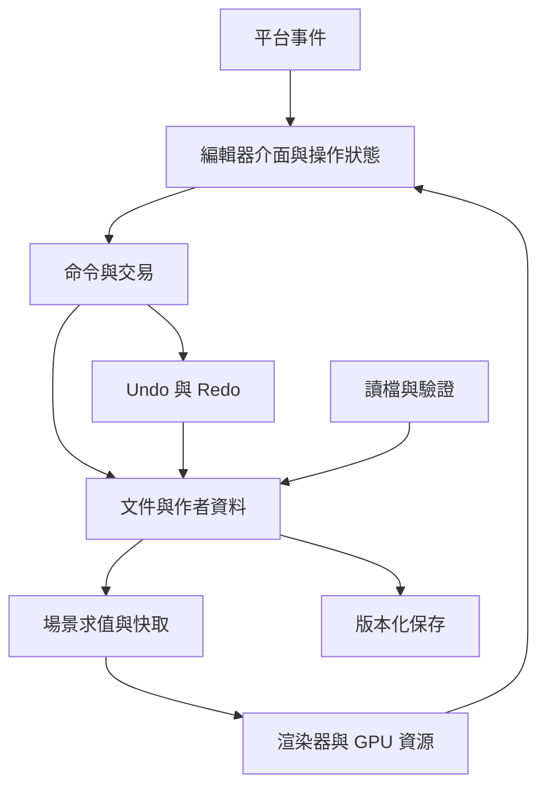

[回到主報告](../README.zh-TW.md) | [實作路線](04-cpp-learning-roadmap.zh-TW.md) | [C++ 核心範例](../examples/mini-editor-core/README.zh-TW.md)

# 從零建立大型 3D 桌面軟體的工程架構

更新日期：2026 年 10 月 11 日。對象是已有程式基礎、想用 C++ 開發桌面軟體的學習者。

**第一個目標是做出一個完整的小型編輯器：建立物件、選取、移動、復原、保存、重新開啟。**這條流程會迫使你處理大型軟體最重要的共同問題：資料由誰擁有、操作如何修改資料、哪些結果要更新、失敗後如何恢復，以及版本改變後能否繼續使用舊內容。

下面提出的是適合自己實作的學習架構，並用 Blender 文件作對照。它不是 Blender 現行程式碼的逐行還原，也不是其歷史開發順序。附帶的 C++ 範例實作場景、命令、Undo、版本化讀寫和簡單求值；桌面介面及 GPU 視窗留給後續練習。

## 先定義第一件能完成的工作

第一個使用情境可以是：使用者建立兩個共用立方體網格的物件，移動其中一個，把錯誤的移動復原，再保存並重新開啟場景。

從這個情境倒推，首版需要視窗、攝影機、網格顯示、選取、物件變換、場景檔案與 Undo。毛髮、流體、雕刻、完整材質節點、路徑追蹤和分散式製作可以在需要它們的階段加入。先把一項工作做完整，才有可檢查的系統邊界。

「從零」在這條路線中，是自己設計產品與核心邏輯，同時使用編譯器、視窗與數學等既有元件。Blender 自己也整合其他開源元件；自行開發大型軟體並不等於從頭實作所有依賴。[Blender 元件授權說明](https://www.blender.org/about/license/)

## 用六個邊界組織第一版

| 邊界 | 責任 | 主要輸入與輸出 |
| --- | --- | --- |
| 平台層 | 視窗、鍵鼠、檔案對話框與作業系統差異 | 平台事件轉成程式可用的事件。 |
| 編輯器介面 | 視窗布局、工具列、屬性面板與操作狀態 | 讀取文件；送出操作意圖。 |
| 操作與歷史 | 命令驗證、交易、取消、Undo／Redo | 修改作者資料；發布變更。 |
| 文件核心 | 物件、網格、材質、資產識別與不變條件 | 不依賴視窗也能建立和檢查場景。 |
| 場景求值 | 變換、修改器、動畫與依賴更新 | 作者資料轉成當下可使用的結果。 |
| 渲染層 | GPU 資源、繪製、選取緩衝與畫面輸出 | 讀取求值結果，產生畫面。 |

這是建議的分界，不需要首日就拆成六個動態函式庫。一個執行檔加幾個 CMake target 已足夠；真正要避免的是核心資料直接依賴 GUI 型別、GPU handle 或目前聚焦的視窗。



Blender 的 Operators 文件將操作定位為介面與應用資料之間的控制者，也連接復原與重新執行。可以借鏡這個責任分界，而不必先複製完整操作框架。[Blender Operators](https://developer.blender.org/docs/features//interface/operators/)

## 場景首先是一個有身份的資料庫

最容易出錯的初版設計，是每個畫面上的東西都擁有自己的完整資料，或者用物件名稱當作身份。名稱能改、也可能重複；身份應該在重命名後保持穩定。

把 Object 與 Mesh 分開。Mesh 保存局部座標的頂點、面、UV 等；Object 指向一份 Mesh，另外保存自己的位置、旋轉、縮放與父物件關係。兩個 Object 因而可以共用同一個 Mesh，卻出現在不同位置。glTF 也區分節點與被參照的網格，但自己的作者資料還會需要編輯歷史等額外內容。[glTF 場景與網格規格](https://registry.khronos.org/glTF/specs/2.0/glTF-2.0.html)

建議逐步形成以下型別。這段是設計示意，不是可直接編譯的完整程式：

```cpp
struct ObjectId { std::uint64_t value; };
struct MeshId   { std::uint64_t value; };

struct Object {
    ObjectId id;
    MeshId mesh;
    Transform local;
    std::optional<ObjectId> parent;
};

struct Mesh {
    MeshId id;
    std::vector<Vec3> positions;
    std::vector<Triangle> triangles;
    std::vector<CornerData> corners;
};
```

`ObjectId` 和 `MeshId` 用不同型別，可防止把網格 ID 誤當作物件 ID。小型範例先用同一個整數別名降低閱讀負擔；擴充時可以改為上述強型別。

資料庫要寫下可以執行檢查的不變條件：ID 不重複、參照能解析、面索引不超出頂點數量、數值沒有 NaN／Infinity，父子關係不能形成循環。命令、匯入器和讀檔器都應遵守這些條件。

## 記憶體所有權先清楚再追求效能

初版可讓 Document 擁有 Scene，Scene 擁有物件和網格。跨物件關係使用 ID；需要操作時向資料庫查找。短期內部函式可以借用參照，但不要讓面板、背景工作或 Undo 長期保存可能失效的裸指標。

例如，你把 `std::vector<Object>` 中某個元素的位址交給屬性面板，之後新增物件觸發容器重新配置，面板的指標就可能失效。即使用穩定地址容器，刪除、載入與 Undo 也可能重建資料。因此，穩定身份與當下位址必須分開。

需要回收槽位時，可採用帶 generation 的 handle：`{index, generation}`。刪除後提高槽位的 generation，舊 handle 就無法指向後來建立的新物件。持久化 ID 與這種執行期 handle 是不同責任，可以建立對照表。

GPU buffer、檔案與工作執行緒等資源應由 RAII 封裝，建立和釋放配對。GPU 資源的釋放還必須符合所用 API 的 context／執行緒要求；C++ 解構函式不會自動解決 GPU 已在使用資源的同步問題。

## 一次拖曳必須有完整的生命週期

把滑鼠拖曳理解為操作狀態機：

```text
Idle
  → 開始操作與記錄原狀
  → 更新預覽
  → 確認並提交
  → Idle

更新預覽
  → Esc 或操作失敗
  → 恢復原狀
  → Idle
```

開始時取得目標 ID、原始變換、拖曳基準與軸向限制。移動時用「原始值加目前滑鼠位移」計算預覽，避免每次事件累加誤差。確認時提交一筆歷史；取消時恢復原狀，不留下 Undo 紀錄。

相同移動邏輯也應能接受數字輸入、屬性面板與腳本。因此，滑鼠事件處理負責換算輸入，真正的場景操作接受明確資料，例如 `Translate(objectId, delta)`。核心操作不必知道滑鼠在哪個像素。

Blender 的 modal operator 用於持續處理事件，與一次執行的操作有所不同。其文件也記錄 modal 執行期間的 Undo 與自動保存安排；自己的編輯器仍需明確設計取消與提交邊界。[Operator 生命週期](https://developer.blender.org/docs/features//interface/operators/)

## Undo 是狀態恢復與歷史分支問題

可以依規模選擇三種策略：

| 策略 | 例子 | 主要取捨 |
| --- | --- | --- |
| 完整快照 | 操作前保存整個 Scene | 容易驗證；記憶體和複製成本高。 |
| 差異或補丁 | 保存變動物件的舊值、新值及建立／刪除資料 | 比較省空間；要處理參照與順序。 |
| 命令重播 | 從檢查點重新執行操作 | 需要固定輸入、確定性與外部資產版本。 |

學習初版先做完整快照。附帶範例的 `Document::execute()` 先複製候選場景、執行命令、驗證，再提交。命令失敗時，現有場景、版本與 Redo 都保持原狀。

歷史有分支：先移動、Undo，再做另一個移動，原本的 Redo 分支就必須捨棄。Undo 後也要讓求值快取失效；否則資料回到舊值，畫面卻仍顯示新值。

身份分配也要考慮歷史：新增物件後 Undo，再新增另一個物件，不能讓先前留下的 ID 參照誤認成新物件。範例在 Undo／Redo 時保留 ID 分配器的最高進度；未來加入多文件與背景工作時，還要配合文件身份區分不同文件中的 ID。

後來若改為差異式 Undo，刪除物件時除了 ID，還要保存恢復所需的內容和參照。遇到拓樸編輯或雕刻，適合的差異形式可能又不同。Blender 的 Undo 文件列出上層編輯器、核心歷史管理與特定步驟型別的分工，不是一套簡單的逆命令就涵蓋所有情境。[Blender Undo](https://developer.blender.org/docs/features/core/undo/)

## 保存的資料與當下畫面需要的資料要分開

作者資料描述使用者的意圖：原始網格、物件變換、修改器設定、動畫曲線。求值資料描述當下的結果：這一幀的世界矩陣、變形後網格、法線、包圍盒與可繪製項目。

假設網格有一個 Mirror 修改器，作者可能只編輯一側，畫面顯示兩側。如果渲染結果反過來覆蓋作者資料，下一次求值可能再次鏡像已鏡像的網格；也會失去原本可調整的修改器流程。

初版可以用一個 document revision：操作、Undo、Redo 或載入成功後遞增；快取的 revision 不一致就重算。附帶範例使用這個機制。它會重算整個場景，容易理解，但不適合大型場景的互動效能。

成熟後再細分 geometry、transform、material、topology 的變更版本。只修改位置，不應重新計算未變動的網格拓樸。增加快取前，先寫下它依賴哪些輸入，以及什麼事件讓它失效。

Blender 的相依圖文件說明場景關係與受影響資料的更新，並討論原始和求值資料的分離。其中包含 2.8 時期的設計背景；理解原則後，仍需對照選定版本的原始碼。[相依圖設計](https://developer.blender.org/docs/features/core/depsgraph/)

## 相依圖從父子關係開始就夠

第一個例子是父物件移動，子物件的世界矩陣跟著改變：

```text
父物件局部變換
  → 父物件世界矩陣
  → 子物件世界矩陣
  → 子物件世界包圍盒
  → 畫面與選取結果
```

建立有向關係，修改輸入時標記受影響節點 dirty，再依拓樸順序計算。父子與初期節點系統可以先要求無循環；新增會形成循環的關係時，直接拒絕並說明原因。更複雜的限制解算另行設計。

不要把「重新繪製」與「重新求值」混為一件事。移動滑鼠可能只需要更新工具提示；攝影機轉動會改變視圖，但不一定要重建角色的局部網格。把更新原因分類，才能降低每幀的工作量。

## 渲染器讀取結果並管理自己的資源

開始用三角形陣列與索引 buffer 即可。渲染器把局部座標網格上傳 GPU，再用每個物件的世界矩陣繪製；共用 Mesh 的物件可以共用 buffer。作者資料保存 ID 和網格，GPU handle 留在渲染器的資源表。

首版必須固定座標約定：左右手系統、上方向、角度單位、矩陣乘法方向及深度範圍。假設用列向量，常見世界與投影關係可寫成：

```text
local = T × R × S
world(child) = world(parent) × local(child)
clipPosition = projection × view × world × localPosition
```

這裡的「列向量」是 column vector；矩陣在記憶體中的 row-major／column-major 配置是另一個問題。要在數學型別和 shader 輸入之間保持一致。實作旋轉與變換時可以借用 GLM，並自行測試所選的約定。[GLM 文件](https://github.com/g-truc/glm/blob/master/manual.md)

法線在非等比縮放下通常需要使用變換線性部分的逆轉置；零縮放會造成不可逆矩陣，必須決定拒絕、限制或降級處理。用幾個已知點與向量的結果建立測試，比只看畫面更容易定位錯誤。

色彩也要定義清楚。照明運算使用線性值，顯示時再做適當轉換；貼圖的色彩資料與法線等數值資料需要不同解讀方式。進入 PBR 階段時，依選定格式與渲染模型一致處理。[glTF 材質規格](https://registry.khronos.org/glTF/specs/2.0/glTF-2.0.html)

## 選取要從座標轉換與身份解析做起

有兩個實用起點。CPU 方法把滑鼠像素轉成世界射線，先檢查包圍盒，再與三角形求交。GPU 方法另外畫一張身份緩衝，從點選像素取得物件或面 ID。

CPU 射線有利於理解座標與求交；GPU 身份緩衝能貼近畫面，但讀回可能等待 GPU，而且需要明確設定深度、透明物件、MSAA 與選取優先順序。最初只做物件選取，面／邊／頂點選取在網格編輯階段加入。

射線變換到物件局部座標時，若各物件的縮放不同，不可直接比較任意重新正規化後的局部距離。應保持一致的射線參數，或把命中點轉回世界座標後比較。這是「能點到三角形」進一步成為「總是選到正確前景物件」的差距。

桌面顯示縮放還會讓邏輯像素與 framebuffer 像素不同。選取位置必須依當下 viewport 區域和實際 buffer 尺寸換算，不能直接使用整個主視窗的滑鼠座標。

## 網格編輯需要適合局部改動的拓樸

顯示三角形只需要陣列，擠出一個面卻要查它的邊、鄰面、邊界與角落屬性。因此可以區分三種表示：作者與保存資料、局部編輯資料，以及 GPU 需要的三角形資料。

學習順序是先建立頂點與三角形陣列，再加鄰接查詢，最後視需求改成 half-edge 或 radial-edge 類型的結構。half-edge 的常見簡化適合流形表面；若要支援一條邊連接多個面、孤立邊等內容，資料結構與操作都需要相應設計。

Blender 的 BMesh 是可處理非流形的邊界表示，包含頂點、邊、面與 Loop，並以相鄰關係支援局部操作。Loop 的重要意義，是同一個幾何頂點在不同面角落可以有不同 UV 或其他屬性。[BMesh 設計](https://developer.blender.org/docs/features/objects/mesh/bmesh/)

做擠出工具時，先支援單一面：複製邊界頂點、建立側面、連結新面，再讓新的頂點依拖曳移動。取消必須恢復原拓樸。之後才處理多面區域、孔洞、非流形輸入和屬性插值。

幾何運算還需要處理退化面、極短邊、零面積、共面與浮點誤差。epsilon 的大小要考慮資料尺度；重要拓樸判定可能需要穩健幾何方法，不能只把容許誤差任意調大。

## 檔案格式是一份需要長期履行的資料契約

初版可使用有版本號、ID 與明確欄位的文字格式。載入先建立候選文件，完成語法、索引與參照檢查，再替換目前文件；壞檔不能讓已開啟的內容消失。

格式遷移可以是 `v1 → v2 → v3` 的連續函式。例如 v1 只有平移，v2 新增旋轉，就補上單位四元數；新增欄位不應只改記憶體結構而忘記舊檔。保留各版本的測試檔與預期結果。

保存檔案不要直接把 C++ 物件記憶體傾印到磁碟。指標、容器內部布局、padding、位元組順序和編譯器差異都不構成穩定格式。Blender 的 DNA 有結構描述及相容轉換機制；它的複雜性正好說明，二進位格式需要配套。[DNA](https://developer.blender.org/docs/features/core/dna/)、[檔案相容性處理](https://developer.blender.org/docs/handbook/guidelines/compatibility_handling_for_blend_files/)

正式的保存流程還要先寫同一檔案系統的暫存檔、確認寫入結果，再依平台能力替換原檔，並管理備份與復原。原子替換不等於斷電後一定耐久；flush、檔案系統與平台行為要另行驗證。附帶範例的檔案輸出只是格式練習，尚未提供這套保存保護。

## 背景工作使用快照與結果驗證

先讓主執行緒擁有可修改文件。工作執行緒讀取不可變快照，計算縮圖、匯入資料或重建網格；完成後把結果送回主執行緒，由它驗證並提交。

每個工作至少附帶文件身份、輸入版本與工作身份。例如使用者在匯入期間重新開啟另一個文件，舊工作的結果就必須被丟棄。只比較物件名稱，或只在每份文件重設版本為零，都可能讓舊結果污染新文件。

取消也是協議：工作定期檢查停止要求，釋放中間結果；主執行緒在文件關閉後不再接受它的回呼。UI 顯示進度不代表主執行緒可以同步等待數秒。

不要將自己的執行緒設計直接套到 Blender Python API。官方文件警告其 Python 整合不能任意從背景執行緒存取，並提供替代方式。[Blender Python 執行緒限制](https://docs.blender.org/api/5.0/info_gotchas_threading.html)

## 擴充系統先開放穩定的操作邊界

初期可以在同一個程式裡建立命令註冊表，由名稱找到操作，參數用明確結構表示。這已能服務選單、快捷鍵與測試；之後才提供腳本綁定。

屬性描述可以逐步增加型別、預設值、範圍、單位、顯示名稱與變更通知，讓面板、動畫和腳本使用一致資訊。Blender 的 RNA 展示這類中繼資料如何連結多個系統。[RNA](https://developer.blender.org/docs/features/core/rna/)

跨動態函式庫的外掛還要處理 ABI。`extern "C"` 只處理部分連結約定，不能自動保證版本、結構布局、呼叫慣例與記憶體管理相容。可用帶大小與版本的 C 結構、opaque handle 及函式表，明定由哪一方配置和釋放資料，並在邊界攔截例外。

## 效能優化要回答是哪一段變慢

把一幀拆成事件處理、命令提交、CPU 求值、GPU 上傳、GPU 繪製及等待。CPU 計時和 GPU 計時分開，並記錄不同場景規模的結果。

例如一個物件有 100 萬頂點、每個 position 以三個 32 位元浮點數保存，位置陣列約 12 MB；若每次完整 Undo 都複製整個位置陣列，100 筆歷史單是這份資料就約 1.2 GB，還沒算其他屬性與容器。這個簡單估算會指引你改成共享不變資料或差異式歷史，而不是先換更快的繪圖 API。

再例如 10 萬個物件共用一個網格，不應把它們都展開成完整的頂點複本。渲染器保留實例與變換，在需要真正修改幾何時才具體化。附帶範例為了可讀性展開世界頂點，這一點必須在走向大型場景前重構。

## 測試以跨系統結果為中心

第一批測試應包含移動後 Undo、刪除後恢復參照、保存再載入、壞檔載入失敗保持原文件，以及 Undo 後做新操作清除 Redo。這些會檢查模組協作，不能只測某個 setter 是否寫入欄位。

加入網格編輯後檢查拓樸與屬性；加入多執行緒後檢查過期結果與關閉；加入 GPU 後再做畫面與選取整合測試。渲染圖像比較要考慮 GPU／driver 差異和合理容許值，不宜要求所有環境逐位元一致。

Blender 同時使用核心測試與 UI 事件模擬測試，後者可覆蓋 Undo 整合與 modal 操作。[C/C++ 測試](https://developer.blender.org/docs/handbook/testing/gtest/)、[UI 測試](https://developer.blender.org/docs/handbook/testing/ui/)

## 團隊變大時管理介面與責任

隨著功能擴大，為核心、網格、渲染、平台、檔案與擴充指定主要負責人。跨模組功能先寫清楚資料流、所有權、失敗方式與測試，再各自實作；有共識的模組邊界比單純增加人數更重要。

每項變更都問：會改作者資料嗎、會讓舊檔失效嗎、會影響 Undo 嗎、需要使哪些快取失效、能否取消、其他平台能否使用。把這些問題放進設計和審查慣例，才有機會讓新功能持續累積。

Blender 的模組制度提供責任分工範例；但個人專案可以用簡單的模組說明與決策紀錄開始，隨協作需求增加制度。[Blender Modules](https://developer.blender.org/docs/handbook/organization/modules/)

接下來按[實作路線](04-cpp-learning-roadmap.zh-TW.md)完成第一個小型流程，再用[原始碼導讀](05-reading-blender-source.zh-TW.md)檢查 Blender 如何處理相同問題。
