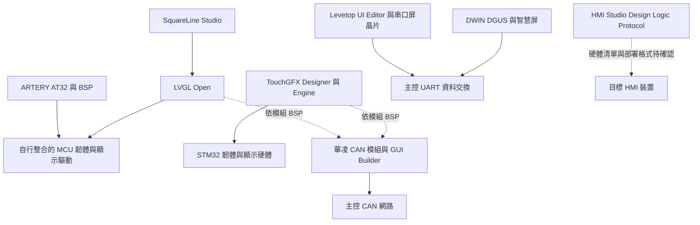

[English overview](README.md) | **繁體中文**

# MCU Embedded HMI 生態與產品比較

研究日期：2026 年 10 月 12 日，Asia/Taipei。範圍涵蓋 SquareLine Studio、TouchGFX、DWIN DGUS、LVGL Open、華凌 CAN 智慧顯示器、Levetop 串口屏控制晶片、ARTERY AT32 與 HMI Studio。

MCU 型嵌入式人機介面（HMI）的選型，首先取決於誰負責畫面運算、控制邏輯與通訊。這八項並非同一層的替代產品：有的是設計工具，有的是圖形框架，有的是晶片或整合模組。應先選擇系統架構，再比較同層產品的開發效率、移植成本與供應條件。

## 生態定位

| 產品或系列 | 主要層次 | 比較時應回答的問題 |
| --- | --- | --- |
| [SquareLine Studio](https://squareline.io/) | 產生 LVGL UI 程式的視覺設計工具 | 是否縮短設計與維護時間，匯出版本是否符合目標韌體 |
| [TouchGFX](https://support.touchgfx.com/docs/introduction/what-is-touchgfx) | STM32 的設計工具、產生器與 C++ 執行框架 | 已採 STM32 時，整套工具鏈是否滿足畫面及硬體需求 |
| [DWIN DGUS](https://www.dwin.com.cn/DGUS.html) | 配合 DWIN 智慧屏的 GUI 設計平台 | 由智慧屏處理 UI、主控交換資料是否適合產品 |
| [LVGL Open](https://lvgl.io/docs/open/introduction) | 可移植的開源 C 圖形框架 | 是否需要掌握 UI 原始碼與跨 MCU 移植能力 |
| [華凌 CAN 智慧顯示器](https://www.winstar.com.tw/zh-tw/products/smart-display/can-display.html) | TFT、STM32、CAN 與工具的整合模組 | 是否要以 CANopen 或自訂 CAN 訊號直接驅動畫面 |
| [Levetop](https://www.levetop.cn/tw/Product/list.aspx?lcid=131) | TFT 串口屏控制晶片與配套工具 | 是否要自己做顯示硬體，但把圖形處理交給專用晶片 |
| [ARTERY](https://www.arterychip.com/tw/index.jsp) | 通用 AT32 MCU、開發工具與圖形範例 | 晶片資源、顯示介面與 BSP 是否適合自建 HMI |
| [HMI Studio](https://www.hmistudio.io/) | 整合 Design、Logic、Protocol 與 AI 的 HMI 工具 | 公開 Alpha 的流程能否通過目標硬體與長期維護驗證 |

### 可替代與可組合的關係

以下是依官方產品定位整理的架構關係；虛線代表必須取得相容性資料後才能確認的組合。

SquareLine 與 LVGL 可構成同一軟體堆疊；ARTERY 是其中可能的 MCU 平台。華凌官方頁面表示其 STM32 平台支援 TouchGFX 與 LVGL，但模組 BSP、可用韌體與支援版本仍須逐型號核對。HMI Studio 公開頁尚不足以確認可部署的 MCU 全清單或與上述框架的完整關係。[SquareLine 工作流程](https://docs.squareline.io/docs/introduction/typical_dev/)、[ARTERY LVGL 範例](https://arterychip.com/download/Example%20Code/SC0118_LVGL_FreeRTOS_Demo_on_AT32_EN_V2.0.0.pdf)、[華凌產品頁](https://www.winstar.com.tw/zh-tw/products/smart-display/can-display.html)、[HMI Studio](https://www.hmistudio.io/)。

## 初步選型方向

以下是依架構與公開能力做出的工程判斷，並非實機排名。

| 需求 | 優先評估路線 | 主要取捨 |
| --- | --- | --- |
| 多 MCU 平台、掌握 UI 程式、需要客製元件 | LVGL；需要視覺工具時搭配 SquareLine | 顯示驅動、通訊與整機效能由團隊整合 |
| 已有 STM32 與 C++ 開發能力 | TouchGFX，並與同硬體的 LVGL 比較 | STM32 工具鏈整合較直接；跨晶片品牌須重新評估 |
| 保留既有主控，快速加上操作畫面 | DWIN DGUS 智慧屏；自行設計顯示板時評估 Levetop | UI 與主控分離；專用格式、協定及晶片增加遷移工作 |
| 工業 CAN 網路，希望採整合顯示模組 | 華凌 CANopen 或 Custom CAN ID 系列 | 模組成本與功能以 SKU 為準；CAN 2.0A/B 不代表 CAN FD |
| 想自行掌握硬體 BOM 與韌體 | AT32 或其他 MCU 加 LVGL | 要計入顯示板、觸控、記憶體與 BSP 開發成本 |
| 評估 AI 建畫面、圖形化邏輯與通訊綁定 | HMI Studio 的受控概念驗證 | 目前公開為 Alpha，正式授權與量產支援待確認 |

## 文件導覽

| 文件 | 內容 |
| --- | --- |
| [八項產品詳細比較](research/01-product-comparison.zh-TW.md) | 平台、元件、開發流程、通訊、授權成本與限制 |
| [架構與實機評測方法](research/02-architecture-and-evaluation.zh-TW.md) | 記憶體、頻寬、成本模型、共同工作負載與驗收方法 |
| [來源與待確認事項](research/03-sources-and-open-questions.zh-TW.md) | 官方連結、版本邊界、擷取狀態與採購前問題 |

## 研究原則

以整體 MCU HMI 生態與使用者需求為中心。EDT 與其他公司採相同的證據和比較標準，不因品牌或既有專案而預設推薦。官方頁面與文件支持的是產品記載或廠商主張；FPS、穩定性、開發工時、量產品質與總成本需另做共同條件下的驗證。

本版為公開資料比較，尚未完成八項方案的安裝、同機效能測試或採購報價。未公開或未成功讀取的資料不等於功能不存在。版本、價格與路線圖以研究日所見為準。
