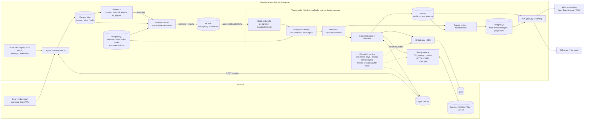
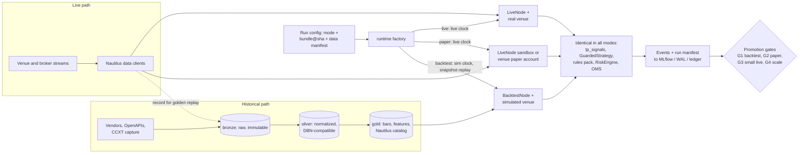

**English** | [繁體中文](README.zh-TW.md)

# Multi-Asset Analysis, Backtesting & Trading Platform: Research Conclusion and Recommended Architecture

*Main report · Status as of 2026-10-05 · Scope: stocks, crypto, bonds and options across US/global markets, crypto venues and Taiwan (TWSE/TPEx, TAIFEX). This report fuses 11 research reports, 3 architecture proposals and 3 independent judge reviews into one recommendation. Versions, prices and legal points are point-in-time snapshots from the fact-checked research, so re-verify them before you buy, sign or deploy anything. This is engineering research, not legal, tax or investment advice.*

## Bottom line up front

- **Adopt Proposal A as the backbone: extend NautilusTrader v2 on one Linux host, write Python, and own only the Taiwan adapter.** It is the only proposal a 2–3 person team can take to live trading in under a year (a solo builder needs about 14–16 months). It averaged 6.8/10 across the three judges, against 5.9 for B (own Rust core) and 5.4 for C (multi-tenant cloud platform). B and C each failed the feasibility lens outright. See [the evaluation record](architecture/evaluation.md).
- **Close the correctness gaps all three proposals shared before trusting a backtest.** Seven grafts do this:
  - a write-ahead order-intent journal (fsync before send);
  - per-venue client-ID encoding and fill de-duplication on `(venue, exec_id)`. In our Taiwan adapter and in the ledger projection, an order whose submit times out becomes `UNKNOWN` and is resolved by query, never by blind resubmission. For upstream adapters (IBKR, crypto) we rely on NautilusTrader's in-flight-order reconciliation plus a per-venue recovery procedure, and a Phase 0 spike verifies both for each adapter;
  - determinism rules enforced in CI;
  - one indicator library shared by the vectorized and event-driven tiers;
  - a corporate-action event pipeline, including Taiwan ex-rights/ex-dividend (除權息);
  - a dividend-driven early-assignment model for short American options;
  - explicit rounding and minimum-fee rules in the rules pack.
- **Build the cheap seams for growth now, so that most growth is additive and the rest is a bounded port.** These are a `StrategyRuntime` port with engine-agnostic signal code, an order-gateway contract that runs in-process for now, tenant and account IDs in every schema, a `license_tag` registry, a Taiwan sidecar built to a platform-defined TW gateway contract (the future edge-connector contract, [ADR-0006](docs/adr/ADR-0006-broker-connectivity-and-gateway-contract.md)), adapter capability flags, and a rule that no distributable artifact may contain LGPL, GPL, AGPL or Commons Clause code. The seams do not make every move free: a forced engine move to LEAN is an estimated 2–4 PM port ([ADR-0002](docs/adr/ADR-0002-extend-nautilustrader-as-backtest-engine.md)), and moving to NATS rewrites the egress and control plumbing ([ADR-0005](docs/adr/ADR-0005-messaging-and-deployment-topology.md)).
- **De-scope the first release.** Go live on **one venue family first** (crypto perpetuals or IBKR, whichever you trade most; perpetuals only on a venue that Phase 0 confirms a Taiwan resident may legally use, with IBKR as the default otherwise), then Taiwan, then options and bonds. Ship a web workstation plus Telegram/ntfy alerts before any desktop or mobile shell. Use an effective-dated security master that records `known_at` from day one but builds full bitemporal queries only later.
- **Gate real money.** Live capital requires NautilusTrader 2.0.0 GA, or a pinned release candidate that passes a 30-day paper soak with zero unexplained reconciliation breaks, a signed risk-acceptance ADR and a 10% capital cap.
- **Effort and cost (scenario 1).** About 12 person-months (PM) of bottom-up effort to the first live market, or 14–16 PM with a 20–30% contingency. Because the G2 paper window cannot be compressed, first live money comes at about **month 8–9 for two people** and **14–16 months solo**. All four asset classes (bonds analytics-first) take about 18 PM base (22–23 PM with contingency), reached around month 12–13 for two people. Running cost once live is about US$10–200/month on a home server (plus about US$700–1,200 of one-off hardware), about US$200–400 on one cloud VM, and about US$115–320 for a home-plus-Tokyo split. TEJ and FinMind quotes are still pending; see the [cost table](#cost-order-of-magnitude).
- **Scenario 2 (5–20 people, or offering a service) is a triggered evolution, not a day-one architecture.** Grow toward C's platform (out-of-process order gateway, NATS, OpenBao, tenancy) only when an external-user trigger fires *and* counsel signs off, or when the team reaches about 4–5 engineers. Grow toward B's own Rust core only if NautilusTrader blocks you, if you must distribute an LGPL-free engine, or if you need sub-10 ms reactions and have senior Rust engineers.

### Recommended stack at a glance

| Layer | Recommended (scenario 1: 1–3 people, self-use) | Alternative | One-line rationale | At team scale (scenario 2) |
|---|---|---|---|---|
| Core engine | **NautilusTrader v2** (Rust core, LGPL-3.0-only). Pin `2.0.0rc5` exactly, then move to GA. We write no Rust | QuantConnect **LEAN** (C#, Apache-2.0) for a C#-first or US-options-first team | Same strategy code in backtest, sandbox and live, plus maintained IB and crypto adapters with reconciliation, so we extend rather than build ([10](research/10-open-source-platforms-build-vs-buy.md)) | The same engine behind the `StrategyRuntime` port. An own Rust core only on trigger |
| Strategy language / API | **Python 3.14** (GIL build). Signal and sizing logic lives in engine-agnostic `tp_signals`; a thin `GuardedStrategy` is the Nautilus glue | Rust strategies for hot paths (later) | One language for research and live; leaving Nautilus becomes a bounded port (about 2–4 PM), not a rewrite of strategies | Unchanged; optional Rust strategies |
| Backtesting | **Two tiers, one indicator library:** a vectorized screen (Polars/NumPy, vectorbt internal-only), then Nautilus `BacktestNode` on bars + L1 with pessimistic intra-bar fills. Our own simulation extensions cover TW rules, corporate actions, funding replay, early assignment and borrow/financing costs | LEAN CLI for US equities and options | Only event-driven results are promoted, and tier agreement is meaningful because both tiers share the indicators ([02](research/02-backtesting-engine.md)) | Ray for sweeps; L2/L3 queue models calibrated by TCA |
| Market data storage | **Parquet lake** (bronze/silver/gold, zstd, content-hashed, DBN-compatible schema) + **DuckDB** (move to 2.0 after 2026-10-21) + **Polars** | QuestDB 10 for live tick capture | Zero ops on any OS; the same files feed research and backtests ([03](research/03-market-data-storage.md)) | DuckLake or Iceberg snapshots; ClickHouse 26.8 LTS for many concurrent users |
| Reference data | **PostgreSQL 18** security master: effective-dated `instrument` and `instrument_xref` rows that record `known_at`; a corporate-action table; effective-dated **rules packs**; one `CalendarPort` | Vendor IDs as keys (rejected) | Our own IDs survive vendor restatements; one rules pack feeds backtest, risk and live | Full bitemporal queries; licensed CUSIP and corporate-action feeds |
| Trade records | **Node-local intent WAL** (fsync before send), then a **PostgreSQL append-only, hash-chained ledger** with projections, then a nightly S3 Object Lock export | Dedicated event store (only with existing expertise) | Closes Nautilus's asynchronous-persistence window; tamper-evident audit at near-zero cost ([07](research/07-system-architecture-messaging.md), [08](research/08-risk-security-ops-compliance.md)) | Outbox to NATS; synchronous replica for RPO ≈ 0 |
| Messaging | Nautilus in-process MessageBus; **Valkey 9.1** streams for egress to journal and API (spike in Phase 0), carrying the engine's own JSON/MessagePack; Protobuf contracts only at the journal and API boundary | **NATS JetStream 2.15** (fallback) | No custom bridge if Valkey works; Valkey is BSD where Redis 8 is AGPL/RSAL/SSPL | NATS JetStream with accounts and leaf nodes |
| Broker connectivity | **IBKR** via the Nautilus IB adapter (IB Gateway + IBC); **crypto** via Nautilus native adapters on 1–2 venues legally open to you; **Taiwan** via our adapter to a **Shioaji 1.7.7 sidecar** that implements our TW gateway contract (HTTP + SSE). Capability flags on every adapter | Fubon Neo as the second TW broker; CCXT for the long tail | The only verified single-account route to US/global markets for a Taiwan resident, plus a Linux-native Taiwan broker ([04](research/04-broker-exchange-connectivity.md), [11](research/11-taiwan-market-localization.md)) | One gateway process per venue account; Windows gateway VM only for Capital SKCOM; FIX later |
| OMS / risk | Nautilus ExecutionEngine + RiskEngine, plus our fail-closed rules-pack checks (including short-sale and venue-exposure checks) and loss breakers in `GuardedStrategy`, plus venue-native controls. Manual tickets and approved proposals take the same path. Three-path kill switch | — | Three layers, identical in every mode ([08](research/08-risk-security-ops-compliance.md)) | Out-of-process order/risk gateway, single writer per account with lease and fencing |
| Pricing | **QuantLib 1.43** (QD+ American, bonds, curves); NumPy Black-76 on an implied forward (TXO, index, crypto options); SVI per expiry; our own crypto-derivatives module | fast-vollib; ORE for XVA/SIMM | QuantLib is the only maintained, permissive library covering options, bonds and curves ([05](research/05-instrument-model-pricing-analytics.md)) | A stateless pricing service with a surface service |
| Research / ML | marimo + JupyterLab; DuckDB/Polars (pandas 3 at boundaries only); skfolio CPCV + cvxpy; LightGBM + Optuna; **MLflow 3.16 as the trial registry**; in-house PSR/DSR/PBO; pinned QuantStats | Qlib; Chronos-2 / TimesFM 2.5 as baselines only | Reproducible research with honest trial counts ([09](research/09-research-ml-analytics.md)) | JupyterHub with sandboxed kernels; shared GPU pool on demand |
| Front end | **React + TypeScript (Vite) web workstation** with an order ticket and a proposal-approval queue, plus Telegram/ntfy alerts (LINE Messaging API optional). Add a Tauri 2.12 desktop shell and PWA web push in Phase 3 if needed | Electron 44 | One codebase; clients never hold venue keys ([06](research/06-cross-platform-client-ui.md)) | BFF with OIDC; React Native companion for push |
| Localization (i18n) | **react-i18next** (or FormatJS) with a per-user locale setting, **zh-TW and en** UI strings and alert texts; `Intl.NumberFormat` including 萬/億 compact notation; CJK fonts (Noto Sans TC) in charts and PDF reports; `name_en`/`name_zh_tw` in the security master; Big5/CP950 and ROC (民國) dates handled in statement imports | — | The owner reads Traditional Chinese, and Taiwan statements and data use local encodings and dates ([06](research/06-cross-platform-client-ui.md), [11](research/11-taiwan-market-localization.md)) | Per-user locale and entitlements; translation workflow |
| Charts / grids | Lightweight Charts 5.2 (attribution shown), uPlot, ECharts 6.1, AG Grid Community 36; KLineChart if drawing tools are needed | SciChart.js or Highcharts (paid) | All permissive. TradingView Advanced Charts is not licensable to individuals | AG Grid Enterprise; custom WebGL ladder and TAIFEX T-quote |
| API / UI transport | FastAPI gateway: REST for commands and one WebSocket with server-side conflation and a lossless order channel; Protobuf schemas (JSON mapping first); Arrow IPC for backtest artifacts | Connect RPC | Contract-first without heavy codegen on day one | Binary Protobuf; per-user entitlements |
| Deployment | **Docker Compose on one Linux host** with a static egress IP: a home mini-PC, or a VM in Taipei or Tokyo chosen by measured RTT. UI over Tailscale/WireGuard. Disaster recovery: continuous PostgreSQL archiving and off-box WAL shipping to S3, plus a pre-allow-listed cold standby (ledger RPO ≤ 5 min, RTO ≤ 1 h) | A second small VM in Tokyo for 24/7 crypto | One box; static IP for broker and venue allow-lists | Kubernetes 1.35+ for stateless services, pinned VMs for trader nodes |
| Observability | Grafana Cloud free tier, or Prometheus 3 + Grafana + Loki; trading SLIs; chrony | — | Zero ops; covers staleness, rejects, drift, reconnects and clock offset | OpenTelemetry end to end; per-hop HDR latency histograms |
| Security | SOPS + age; trade-only, withdrawal-disabled, IP-bound keys, one per strategy or sub-account, rotated every 90 days; FIDO2 everywhere; Shioaji `.pfx` mounted into exactly two containers (the sidecar and the kill switch); AI tools get scoped tokens with no order, control or limit rights ([ADR-0017](docs/adr/ADR-0017-ai-trust-boundary.md)); hash-pinned lockfiles; SPDX licence scan in CI | Cloud secret manager | Credentials are the crown jewels | OpenBao 2.7 on a cloud KMS; SLSA provenance; SBOMs |

## Requirements and assumptions

**Functional scope (from the brief).** Market and historical data management; research and analytics; strategy backtesting; paper trading; live automated and semi-automated trading; risk management; performance analytics; cross-platform UI (desktop, web and mobile). Asset classes: stocks, crypto, bonds and options, plus TAIFEX futures as a Taiwan essential.

**Assumptions.** Each assumption below is an open decision that changes the recommendation (see the open-decisions section near the end).

| Topic | Working assumption | Source |
|---|---|---|
| User | Based in Taiwan and communicates in Traditional Chinese. Wants US/global markets and crypto as well as Taiwan; the design is not Taiwan-only | Brief |
| Team | Undecided. Scenario 1 is 1–3 people; scenario 2 is 5–20 people | Brief |
| Use | Self-use on own accounts first. Offering a service is undecided and legally gated | Brief, [08](research/08-risk-security-ops-compliance.md) |
| Latency | Decision to order in tens to hundreds of milliseconds; holding periods from minutes to weeks; bars and L1 data. No market making, L3 queue modelling or co-location in scenario 1 | [01](research/01-core-language-runtime.md) |
| Downtime tolerance | Hours of downtime are tolerable if venue dead-man timers and auto-flatten rules exist. Stricter needs trigger HA | [08](research/08-risk-security-ops-compliance.md) |
| Date | 2026-10-05. NautilusTrader 2.0 is a release candidate, DuckDB 2.0 ships 2026-10-21, and Python 3.15 ships 2026-10-09 (adopt in 2027) | Research verification logs |

**Out of scope for scenario 1:** market making, sub-10 ms strategies, custody of anyone else's assets, selling signals, copy trading, and managing other people's money.

## Key design principles

1. **One engine, one strategy bundle, three modes.** Backtest, paper and live differ only in the adapters and clock that a runtime factory binds. Strategy, rules pack, risk checks and OMS semantics are identical.
2. **Event-driven, single-threaded, deterministic kernel.** Parallelize *across* runs (sweeps, folds), never *within* one. Same-timestamp events have a stable tie-break, RNGs are seeded, and nothing iterates unordered hash maps.
3. **Exact fixed-point money.** Prices, quantities and money are exact fixed-point values: per-instrument scaled integers in the engine and lake (Nautilus v2 uses 128-bit, 16 decimals), and scale-quantized `NUMERIC`/`Decimal` in the ledger and at accounting edges. float64 is used only inside models (greeks, IV). Every conversion is explicit, tested and rounded by a declared rule ([ADR-0003](docs/adr/ADR-0003-fixed-point-numerics-and-nanosecond-timestamps.md)).
4. **One event-time type.** UTC int64 nanoseconds for every event time (`ts_event`, `ts_init`); administrative bookkeeping columns (`valid_from`, `known_at`, `ts_recorded`) may be `TIMESTAMPTZ` but never order or replay events. `trading_date` and `session_id` come only from the `CalendarPort`, because TAIFEX night sessions cross midnight and crypto needs an artificial daily cut. Strategy code never reads the wall clock (lint-banned).
5. **Point-in-time data.** Store raw prices with corporate-action events, universes that include delisted names, fundamentals keyed by publication time, macro vintages (ALFRED), and immutable content-hashed partitions whose manifest hash is pinned in every run.
6. **Ports and adapters.** `StrategyRuntime`, `MarketDataPort`, `ExecutionPort`, `AccountPort`, `ReferenceDataPort` and `CalendarPort` are the seams. Adapters declare capability flags (`amend_mode`, `native_oco`, `multi_leg`, `reduce_only`, `post_only`, `max_client_id_len`, `id_format`, dead-man support). Engine types never leak past `runtime/` and `adapters/`.
7. **The venue is the source of truth.** Intents are written ahead of sending. Reconciliation runs at startup (strategies stay stopped until it passes), intraday (every 1–5 minutes) and at end of day against statements. Any unexplained break halts the account. Orders the owner places outside the platform are either kept off automated accounts (a dedicated account or sub-account per automated book) or adopted by reconciliation under an explicit per-account policy, so they do not count as unexplained.
8. **A fail-closed risk gate identical in every mode,** plus venue-native controls and a three-path kill switch. Keys are trade-only and never reach web or mobile clients.
9. **Rules are data.** Ticks, lots, price limits, sessions, fees, taxes, rounding and minimum fees are effective-dated configuration (for example, the Taiwan bond and bond-ETF tax holiday ends 2026-12-31 and the 0.15% day-trade tax runs to 2027-12-31).
10. **Promotion requires evidence.** Every trial is logged in a registry. No strategy is promoted on a vectorized result. Gates use DSR, PBO, CPCV and cost stress, and the live node refuses unregistered bundles.
11. **Licence hygiene.** Every dataset carries a `license_tag`. Engines stay server-side. Nothing distributable contains LGPL, GPL, AGPL or Commons Clause code.
12. **Size operations to the stage.** A new deployable must have its own scaling, failure or security boundary; otherwise it is a module in an existing one.

## Recommended architecture overview

### Components (scenario 1)

What each part does (full specifications in [recommended-architecture.md](architecture/recommended-architecture.md)):

- **Data plane.** Ingest writes raw vendor payloads to bronze, normalizes them into a DBN-compatible silver schema (UTC-ns timestamps, internal `instrument_id`, scaled-integer prices, `source`, `license_tag`), and builds gold bars, features and the Nautilus catalog. Partitions that fail quality checks are quarantined.
- **Strategy plane.** One Nautilus `LiveNode` per broker account (isolation level L1). A strategy bundle is `tp_signals` code plus config plus a rules-pack version, identified by `git SHA + config hash` and carrying an MLflow promotion tag.
- **Order path.** Strategy intent → `GuardedStrategy` checks (rules pack, limits, loss breaker, capability flags) → Nautilus RiskEngine → **intent WAL (fsync)** → ExecutionEngine → adapter → venue. Fills are de-duplicated on `(venue, exec_id)`.
- **Semi-automated trading.** A manual order ticket (`POST /v1/orders`) and strategy- or AI-generated proposals that a human approves (`POST /v1/proposals/{id}/approve`) enter the same order path with `source=MANUAL` or `source=PROPOSAL`. Risk is re-checked at approval time, proposals expire, and Telegram can approve but never raise a limit ([§3.13](architecture/recommended-architecture.md#313-semi-automated-trading-manual-tickets-and-proposal-approval)).
- **Records.** Valkey streams and the WAL feed the journal writer, which appends to a hash-chained PostgreSQL ledger and runs reconciliation. The API reads projections and pushes events to clients.
- **Control.** UI and Telegram commands (halt, resume, flatten, limit change) go through the API to a per-node control stream. The kill-switch service holds its own trade-only crypto keys and its own Shioaji session, so it can cancel on crypto venues and at SinoPac even when a node is wedged. **IBKR caveat:** for IBKR, path 2 is not independent of IB Gateway until Phase 0 verifies a second username; the node and the kill switch share the gateway and the IBKR login, so a wedged gateway leaves the IBKR mobile app or web client as the manual last resort. Venue dead-man timers are the third path where the venue and product support one.

### Data flow: backtest, paper and live

| Mode | Node | Clock and data | Execution | Gate to the next stage |
|---|---|---|---|---|
| Backtest | `BacktestNode` | Simulated clock; replay of a manifest-pinned lake snapshot | Simulated venue built from the same venue and rules config as live: explicit fee model (mandatory from rc6), funding replayed from venue history, corporate-action and assignment modules, TW rules extensions | **G1:** walk-forward or CPCV; DSR ≥ 0.95; PBO ≤ 0.2; profitable with costs doubled; vectorized and event-driven tiers agree (return within 10%, no sign flip); corporate-action coverage for equities, assignment coverage for short options |
| Paper | Sandbox `LiveNode` (live data, simulated fills), plus IBKR paper, crypto testnets, Shioaji `simulation=True` | Live | Simulated or venue paper | **G2:** at least 3 months, or a per-class trade-count route (for example ≥ 200 round trips and ≥ 6 weeks for intraday strategies; [§8.2](architecture/recommended-architecture.md#82-promotion-pipeline-research--backtest--paper--live)), never shorter than the 30-day soak on an RC engine; slippage and tracking error within bands; reconciliation clean; no manual overrides |
| Live | `LiveNode` | Live | Real | **G3:** real-money gate met; 10% capital. **G4:** ramp to 25% then 100% while live P&L stays inside the backtest's Monte Carlo 95% band; automatic `REDUCING`/`HALTED` outside it |

## Scenario-based recommendation

### Scenario 1: solo or 1–3 people, mainly self-use (recommended starting point)

Use everything above as written. The team writes Python and TypeScript only, but **at least one person must be able to read Rust**, because NautilusTrader v2 failures surface in Rust.

- **Engine and versions.** Extend NautilusTrader v2 with an exact pin. Every Nautilus config is built in `platform/runtime/` factories, which absorb RC renames in one place (for example rc4's `LiveExecClientConfig` → `ExecutionClientConfig`). LEAN is the documented fallback.
- **Release-candidate stance.** Do not build on 1.231.x: its security backports end around November 2026, before any realistic go-live. Real money requires the gate in the bottom line above.
- **Topology.** One Linux host running Docker Compose (about 10 containers; see the [deployable list](architecture/recommended-architecture.md)). Choose home or cloud after confirming that your Taiwan broker accepts cloud IPs, and measure RTT to your venues.
- **Python images.** One main image (Python 3.14, pandas 3) through Phase 2. Call FinMind's REST API directly instead of its `pandas<3` client. A `legacy-quant` image (Python 3.13, pandas 2.3) appears only when Phase 3 options work needs vollib or alphalens.
- **Operations.** Plan for these duties, which no tool removes:
  - human approval of IBKR's periodic 2FA re-authentication (IBC automates restarts, not the 2FA approval);
  - Shioaji's 14-day release cycle;
  - Nautilus RC upgrades;
  - the DuckDB 2.0 move;
  - 24/7 crypto paging;
  - a quarterly full-rebuild drill on the cold standby (§7.1 of the recommended architecture).

  Hold one maintenance window a month and wait 3–7 days before adopting new dependency versions.
- **Solo four-eyes.** Where a second approver would sign off a promotion or a limit change, use a written checklist, an ADR and a 24-hour cooling-off period instead.

### Scenario 2: 5–20 people, or preparing to offer a service

Keep the scenario-1 kernel and data model, and add platform components **only as their triggers fire**:

- an out-of-process **order/risk gateway** that is the single writer per account (lease plus fencing token, `PendingNew` persisted before send, query-by-client-ID after timeouts);
- **NATS JetStream** as the inter-process bus, with accounts per tenant and leaf nodes for edge sites;
- one **gateway process per venue account**;
- **OpenBao** on a cloud KMS;
- **OIDC + WebAuthn**, roles (owner, trader, researcher, risk officer, auditor) and four-eyes approval;
- an **entitlement service** enforcing `license_tag`;
- **DuckLake or Iceberg** snapshots, plus **ClickHouse** or **QuestDB**;
- **Ray** for sweeps;
- a firm-wide risk service (VaR/ES, stress, greek grids);
- **Kubernetes** for stateless services, with trader nodes on pinned VMs;
- a **React Native** companion for push and biometric approvals.

For an external offering, the customer-hosted **edge connector** (C's design) keeps personal Taiwan broker certificates with their owner. Whether it actually satisfies broker terms is a legal hypothesis that needs counsel and broker confirmation.

### Evolution path from scenario 1 to scenario 2

The scenario-1 seams make most steps an addition. The exceptions have stated costs: a forced engine move is a 2–4 PM port, and the move to NATS rewrites the egress and control plumbing.

| Seam built in scenario 1 | What it enables later |
|---|---|
| `StrategyRuntime` port and engine-agnostic `tp_signals` | LEAN or an own core behind the same port |
| Order-gateway contract in-process | Move the gateway out of process |
| `tenant_id` and `account_id` in schemas | Tenancy without a migration |
| `license_tag` registry | An entitlement service |
| Shioaji sidecar behind the platform-defined TW gateway contract | An edge connector or a Windows gateway implementing the same contract |
| Capability flags | More venues without branching on venue names |

| # | Trigger (observable) | Evolve toward | Notes |
|---|---|---|---|
| T1 | A second user, a paid signal, copy trading or any external tenant | **Legal review first.** Then the platform increment: out-of-process order gateway, tenancy, OIDC, entitlements, licensed data distribution | Taiwan: SITCA Act Art. 107, Futures Trading Act Art. 112, broker terms forbid third-party authorization, certificates are personal |
| T2 | 4–5+ engineers, or more than about 5 trader nodes or accounts | NATS JetStream, per-venue gateways, out-of-process risk gateway, OpenBao, Kubernetes for stateless services | Isolation L1 → L2 with shared gateways (broker session limits, e.g. Shioaji allows 5 sessions per person ID) |
| T3 | A Windows-only broker is needed (Capital SKCOM for overseas futures or sub-brokerage 複委託) | Windows Server gateway VM behind the same TW gateway contract (HTTP + SSE in scenario 1, a NATS leaf node in scenario 2; no gRPC in scenario 1, [ADR-0006](docs/adr/ADR-0006-broker-connectivity-and-gateway-contract.md)) | Watchdog; restarts before 08:30 and 15:00; matching bitness |
| T4 | Live tick capture, several concurrent dashboards, or several writers to the lake | QuestDB (capture), DuckLake/Iceberg (snapshots), ClickHouse (many users) | lakeFS is BSL since v1.87.0; avoid it if a service is ever planned |
| T5 | Reaction under about 10 ms, or a need for L2/L3 queue modelling | Rust-native strategies, Nautilus L3 or hftbacktest, Tokyo hosting, Fubon DMA/IDC for TAIFEX | Requires Rust staff |
| T6 | Nautilus 2.0 GA slips past the Phase 2 exit; upstream rejects a change we need (TW matching, bonds); key-maintainer loss; licence or open-core change | LEAN behind `StrategyRuntime`, or B's own Rust core if 2+ senior Rust engineers exist | The thin SDK keeps strategies, rules packs, ledger, gateway contract and UI; the LEAN brokerage for the TW contract, the simulation extensions and the runtime glue are rewritten. Estimated 2–4 PM ([port-cost table in ADR-0002](docs/adr/ADR-0002-extend-nautilustrader-as-backtest-engine.md#cost-of-a-forced-move-to-lean)); rehearsed in Phase 3c |
| T7 | The Phase 0 spike shows TW call auctions or limit-lock refusal cannot be expressed as Nautilus fill/matching extensions | A Taiwan-only simulator in the style of B's `SimVenue` for TW backtests | B's kill rule applies: stop if it slips more than 3 months |
| T8 | Bonds beyond ETFs and manual booking | First-class `Bond` instrument workflow, IBKR `BOND` orders; FIX (QuickFIX/J) RFQ for institutional venues | The `Bond` domain type already exists in `tp_domain` |
| T9 | Capital that cannot tolerate hours of downtime | Active-passive per account with lease and fencing, second region, WORM retention aligned to SEC 17a-4 | Never active-active against one account |
| T10 | A desktop or self-hosted product must ship the engine | LGPL-free core: LEAN (Apache-2.0) or B's own core; licence review | Nautilus may never be bundled into a distributed artifact without legal review |
| T11 | AI-generated strategies or automated factor mining | Platform-wide trial counting, sandboxed code execution, read-only MCP tools, human approval before any order; the AI trust boundary ([ADR-0017](docs/adr/ADR-0017-ai-trust-boundary.md)) applies from the first AI tool, not only at T11 | Uncounted trials make DSR meaningless |
| R1 (reverse) | No external users within about 12 months of building the platform increment, the team shrinks below 5, or legal review is negative | Collapse back to the lean Compose design and keep the shared packages | C's own lean trigger |

### When Taiwan is the main focus vs. US equities and crypto

| Aspect | Taiwan-first | US equities / crypto first |
|---|---|---|
| First live market | Taiwan stocks or TAIFEX through the Shioaji sidecar. The custom adapter and TW rules pack sit on the critical path: about **+2–2.5 PM** before first live (≈14 PM base, first live around month 10 for two people) | Crypto perpetuals (Nautilus Binance/OKX/Bybit adapters) **only if Phase 0 confirms the venue is legally usable by a Taiwan resident**, otherwise IBKR US equities (the default), with zero custom adapter code. Taiwan follows in Phase 3 |
| Hosting | Home server or Taipei region (AWS `ap-east-2`, opt-in, or GCP `asia-east1`). Check that the broker accepts cloud IPs; a static IP is needed for the API-key allow-list | AWS Tokyo for crypto; US-East is unnecessary at this latency tier |
| Market rules to model first | ±10% limits (no fills when locked), opening and closing call auctions, 3.5% volatility interruption, odd lots as a separate book with 5-second auctions, disposition stocks and sell-first suspensions, day-trade eligibility, T+2, night-session trading date, typhoon overrides, 2027 holidays (QuantLib's Taiwan calendar stops at 2026) | US sessions with DST, T+1, SEC Section 31 and FINRA TAF fees, PDT vs FINRA intraday margin (both configurable until 2027-10-20); crypto funding, liquidation, 24/7 calendar with a 00:00 UTC cut |
| Data | TWSE/TPEx/TAIFEX OpenAPIs (free, end-of-day and reference); broker feed (real time); FinMind sponsor tier for tick history (**data terms are educational/non-commercial; confirm before relying on it**); **TEJ** for point-in-time fundamentals and delistings (strongly advised for cross-sectional TW equity research; quote in Phase 0); TWSE/TPEx OpenAPIs for ex-rights/ex-dividend schedules (`TWT48U_ALL`, `tpex_exright_prepost`), delisted companies, 融資融券 balances and lendable shares; TWSE Data E-Shop for an authoritative 5-level book (NT$5,000 per data-month) | IBKR bundles ($10/month snapshot bundle, waived at $30 of commissions, plus a streaming add-on of about $4.50 for API algorithms), Massive (point-in-time ticker lists with delisted names, splits and dividends) or Norgate Platinum for a survivorship-free US universe, ThetaData for options, CCXT capture (Tardis only if tick history justifies $700+/month) |
| Derivatives emphasis | TAIFEX TX/MTX/TMF futures and TXO (European, cash-settled on a 30-minute average, Wednesday/Friday weeklies); TAIFEX SPAN parameter loader; Black-76 on an implied forward | US single-stock options (American QD+, dividend-driven early assignment is critical), OCC OSI keys, Reg T margin; Deribit for crypto options |
| Crypto | MAX and BitoPro for TWD spot (on a configured allow-list tied to the FSC register). They offer no perpetuals and have no Nautilus adapters, so they are not a first-live route; VASP Act licensing from about Q1 2028 | Binance/OKX/Bybit/Deribit/Hyperliquid, **only after a Phase 0 check of each venue against the FSC AML-registration list and the venue's own geo terms**; per-venue exposure caps and venue-health alerts for counterparty risk. If no perp venue is eligible, go IBKR-first |
| UI | Red-up/green-down colour setting (with a colour-blind palette), five-level book, T-quote for TXO | Green-up colours, depth chart, funding panel, option chain |
| Operations | TWSE/TPEx: orders accepted from 08:30, continuous trading 09:00–13:25, closing auction to 13:30 (after-hours fixed-price 14:00–14:30). TAIFEX index futures/options: day session 08:45–13:45, plus the night session 15:00–05:00 if traded; Shioaji traffic caps return empty values (treat as an alarm); rate-limit breaches suspend service | 24/7 paging for crypto; IBKR 2FA duty; venue maintenance windows |
| Path to scenario 2 | A Taiwan SaaS is structurally hard (personal certificates, advisory licensing, TWSE redistribution at NT$60,000/month plus NT$100,000/month). The realistic paths are a licensed partner or self-hosted software, and self-hosted software brings LGPL back into play (T10) | A US/global service needs RIA/CTA analysis and exchange distributor agreements; IBKR third-party OAuth 1.0a after a compliance review |

## How the four asset classes are handled

| Dimension | Stocks and ETFs (US, TWSE/TPEx) | Crypto (spot, perps, dated, options) | Options (US, TXO, Deribit) | Bonds |
|---|---|---|---|---|
| Instrument model | Nautilus `Equity`, plus our effective-dated `tick_scheme_id` per instrument class (TW stocks and ETFs differ), typed quantity unit (TW board lot of 1,000 vs odd lot; odd lots trade as a separate `instrument_id` with its own book), disposition and day-trade flags refreshed daily | `CurrencyPair`, `CryptoPerpetual`, `CryptoFuture`, `CryptoOption`, plus `settlement_currency` and `is_inverse`; i128 fixed point; U256 only at on-chain adapters | `OptionContract`, `OptionSpread`, plus our `option_terms` (exercise style, settlement method, effective-dated multiplier and deliverable) | Our own `Bond` domain type in `tp_domain`: coupon schedule, day count, settlement lag, calls, price as % of par with a 32nds codec, face-value quantity. Not a Nautilus instrument |
| Identifiers | Internal `instrument_id`; FIGI (OpenFIGI), ISIN, ticker + MIC, IB conId; CUSIP only under licence | Venue symbol + base/quote/settlement currency | OCC OSI (21 characters); TAIFEX root + month or weekly code | ISIN; CUSIP only under licence; IBKR conId |
| Data (scenario 1) | IBKR live; Massive for US history, point-in-time ticker lists (delisted names), splits and dividends (Norgate Platinum as the daily alternative); TW OpenAPIs (ex-rights/ex-dividend, delistings, 融資融券, lendable shares), broker feed, FinMind or TEJ; IBKR shortable-share ticks and fee-rate files for US borrow | CCXT capture into bronze; per-venue funding history; Tardis optional | ThetaData (US); Shioaji + TAIFEX daily ticks (TXO); Deribit public API | FRED/ALFRED, Treasury Fiscal Data, IBKR quotes; TPEx bond reference data |
| Execution route | IBKR (US/global); Shioaji (TW), Fubon Neo second | Nautilus native adapters on 1–2 eligible venues; MAX/BitoPro for TWD | IBKR (US); Shioaji (TXO); Deribit directly (Coinbase's gateway is perps-only since 2026-10-01) | Bond ETFs as equities; direct bonds booked by hand or as low-frequency IBKR orders |
| Pricing and analytics | Marks; corporate-action-adjusted series for signals only | Inverse/linear PnL, premium-adjusted delta, funding accrual, annualized basis (our module) | QuantLib QD+ American (US single stocks); Black-76 on an implied forward (TXO, index, crypto); SVI per expiry; IV via Let's Be Rational | QuantLib: accrued interest, yield, duration, DV01, curves (NSS). Results rounded to settlement convention before booking |
| Backtest fidelity | Bars + L1, pessimistic intra-bar; fill at **raw** prices; **corporate actions as engine events** (split position adjustment, dividend cash, TW stock dividends creating odd lots); TW limit-lock refusal and auctions (spike); short fills refused when not shortable, with borrow fees, margin interest and payment in lieu accrued | Funding settlements replayed from venue-published history; liquidation simulated per venue; maker/taker tiers | L1 chains, fill at bid/ask, never mid; expiry and cash settlement; **dividend-driven early-assignment model** for short American calls; assignment reconciled from the broker live | **No event-driven backtests on indicative OTC quotes.** Daily valuation and carry analysis only |
| Lifecycle events | Splits, cash and stock dividends, symbol changes, delistings, capital reductions | Funding, delistings, redenominations | Exercise, assignment, expiry, deliverable adjustments | Coupons, calls, maturity (ledger events) |
| Fees and taxes (rules pack) | US: commission, SEC Section 31 (rate reset each fiscal year), FINRA TAF, borrow fees and margin interest, payment in lieu on shorted dividends, 30% dividend withholding for non-US persons (W-8BEN). TW: commission ≤0.1425%, tax 0.3% on sells, 0.15% day trades to 2027-12-31, 0.1% ETFs; 融資 interest, 融券 and 借券 fees; rounding and broker minimums; NHI supplementary premium on dividends | Maker/taker tiers, funding, withdrawal and gas fees | IBKR US tiered per contract (US$0.65/0.50/0.25, US$1 minimum per order); TAIFEX tax 0.1% of premium on both sides, futures rate on cash settlement | Dealer spread; TW corporate bonds and bond ETFs tax-free only until 2026-12-31 |
| Margin and risk | Reg T and FINRA intraday margin (both configurable); TW cash with T+2 settled vs available. **Short selling and financing:** shortable/locate check, Reg SHO Rule 201 (SSR), hard-to-borrow recall and buy-in; TW credit-account (信用交易) eligibility, 融資融券 quotas and maintenance ratio, the below-previous-close short restriction, forced 融券 cover before shareholder meetings and ex-rights; a `BorrowModel` in backtests ([ADR-0012](docs/adr/ADR-0012-security-master-rules-packs-and-calendars.md)) | Venue margin; liquidation-price checks; per-venue exposure caps; stablecoins as instruments with de-peg alerts | Greeks limits; Reg T option tables; TAIFEX SPAN loader | DV01 and duration limits |
| Phase delivered | Phase 1–2 (US or TW first, per focus) | Phase 1–2 | Phase 3 (analytics first, then single-leg and defined-risk strategies) | Phase 3 (bond ETFs + manual bond book, daily valuation) |

## Comparison of the three proposals

Three judges scored each proposal from 0 to 10 through a different lens. The full record, including every graft decision and every factual concern, is in [architecture/evaluation.md](architecture/evaluation.md).

| Proposal | Feasibility & delivery (1–3 people, 3–9 months) | Correctness & performance | Long-term evolution & multi-asset completeness | Average | Fatal flaw |
|---|---|---|---|---|---|
| [A: Lean MVP on open-source shoulders](architecture/proposal-A-lean-mvp.md) | **7.8** | 6.5 | 6.0 | **6.77** | None |
| [B: Performance & correctness first (own Rust core)](architecture/proposal-B-performance-core.md) | 3.0 | **7.8** | 6.8 | 5.87 | Cannot go live in 3–9 months with a small team (first live trade ≈ month 10 with six engineers) |
| [C: Platform & scale (multi-user, cloud-native)](architecture/proposal-C-platform-scale.md) | 2.5 | 6.0 | **7.6** | 5.37 | Same (internal live at months 10–14 after ≈120 PM; Kubernetes, OpenBao and multi-tenant operations are unaffordable for 1–3 people) |

**Why the fusion looks the way it does:**

- **A is the backbone** because it is the only proposal that delivers live trading at small-team cost.
- **B contributes correctness:** the determinism contract, write-ahead journal, execution semantics, bond model, Taiwan simulator semantics and the kill-criterion discipline.
- **C contributes the seams for growth:** the `StrategyRuntime` port, the order-gateway contract, tenant IDs, the licence registry, the edge-connector contract, the deployable-count rule, TWD crypto venues and the regulatory-posture ADR.
- **All three missed the same gaps,** which are added here: corporate-action events, an early-assignment model, rounding rules, and a dependency-risk register (Nautilus key-person and open-core risk; the single-maintainer `ibapi` crate).

## Phased roadmap

Durations assume **two people** working in parallel (a quant/strategy developer and a platform/full-stack engineer). Person-month (PM) figures are **bottom-up estimates per component** (table below) plus an explicit contingency. They replace an earlier top-down headline ("10 PM, 6–7 months") that could not fit the G2 paper window and was not reconciled with [evaluation §3.1](architecture/evaluation.md), where the feasibility judge expected Proposal A's smaller scope (10.5 PM) to slip to 8–9 months.

**Why elapsed time is not PM divided by people.** The G2 paper window (at least 3 months, or the per-class trade-count route) can start only when the paper stack of Phase 2a works, and extra effort cannot shorten it. Phase 2 is therefore split into 2a (build the paper stack), 2b (the G2 paper window, which contains the 30-day soak if NautilusTrader is not yet GA) and 2c (10% live). The engineering time freed during 2b goes to Phase 3a.

| Phase | Weeks (two people) | Goal | Key deliverables | Exit criteria | PM (base) |
|---|---|---|---|---|---|
| **0. Foundations and spikes** | 0–4 | Remove the unknowns before building | Monorepo, `uv` lockfiles, CI (wall-clock and I/O lint for strategies, SPDX licence scan, import-boundary lint), first ADRs, dependency-risk register. **Spikes:** v2 out-of-tree adapter API; Nautilus fill/matching extensions for TW call auctions and limit-lock refusal; a simulation module for corporate-action cash and position adjustments; Valkey as the Nautilus Redis backend (fallback: PostgreSQL cache + NATS bridge); IB Gateway + IBC + 2FA routine; kill-switch cancel semantics per venue (IBKR `reqGlobalCancel` or master client ID; dead-man support per venue and product); **in-flight-order reconciliation of every upstream adapter we will use, checked against the per-venue recovery table (§3.4 of the [recommended architecture](architecture/recommended-architecture.md#34-oms--ems))**; Shioaji sidecar; Python 3.14 wheels for every pin; DuckDB 2.0. **Checks:** each perpetual and options venue's eligibility for a Taiwan resident (FSC AML-registration list and the venue's geo terms); TEJ and FinMind quotes; IBKR streaming bundles, OPRA and market-data lines | Spike and check verdicts recorded as ADRs; a backtest runs in CI | 1.4 |
| **1. Data, research and event-driven backtests** | 3–18 | Trustworthy backtests for the first market (plus the second in the vectorized tier) | Ingest (CCXT, IBKR/Massive history and reference data, TW OpenAPIs including ex-rights/ex-dividend schedules and delistings, FinMind REST, FRED, FX rates); bronze/silver/gold with quality checks and quarantine; security master (with `name_en`/`name_zh_tw`) and a corporate-action table fed from the named point-in-time sources in [§3.1](architecture/recommended-architecture.md#31-data-gateway-historical-ingest-and-live-market-data); `CalendarPort`; rules packs for the first market (with `short_sale` and `financing` sections if the strategy shorts or borrows); `tp_signals` shared by both tiers; MLflow trial registry; PSR/DSR/PBO metrics; BacktestNode with fee models, funding replay, corporate-action events and the `BorrowModel`; run manifests; golden-master CI; automated G1 | A point-in-time universe including delisted names for the first market, from a named source; two reference strategies pass or fail G1 reproducibly; tiers agree | 4.3 |
| **2a. Paper stack** | 10–26 | Everything paper trading needs | `runtime/` factories; `GuardedStrategy` and `tp_risk`; intent WAL (pre-send and post-send records); journal writer with hash chain; projections (cash per currency, tax lots, FX conversions); reconciliation (startup, intraday, EOD statement import) with the external-order policy; three-path kill switch; manual order ticket and proposal-approval queue; Compose deployment with SOPS, observability, PITR backups, off-box WAL shipping and an infrastructure-as-code rebuild; web workstation v1 (positions, orders, order ticket, approvals, charts, backtest reports, limits, kill switch; zh-TW/en) + Telegram/ntfy | The paper node runs end to end; startup reconciliation verified after a forced crash; restore drill done | 5.55 |
| **2b. G2 paper window** | 24–39 | Evidence for real money | Sandbox and venue-paper trading for at least 3 months, or the per-class trade-count route of [§8.2](architecture/recommended-architecture.md#82-promotion-pipeline-research--backtest--paper--live); the 30-day soak inside the same window if NautilusTrader is not GA; TCA; chaos and kill-switch drills; go-live checklist. Phase 3a starts in parallel | G2 passed; real-money gate met; 5+ consecutive clean reconciliation sessions; kill-switch drill on every path | 0.5 |
| **2c. First live market** | 37–44 | Real money on **one** venue family | Live at 10% capital (G3) | 4 weeks of clean live reconciliation | 0.2 |
| **3. Taiwan, derivatives and bonds** | 26–56 | Complete the multi-asset scope | **3a (2.7 PM):** Shioaji adapter to the TW gateway contract (capability flags, client-ID mapping, `UNKNOWN` resolution); TW/TAIFEX rules pack, including 融資融券, 借券 and the below-previous-close short rule; TW simulation extensions; odd lots tested with tiny real orders; a TW strategy through its own G2 window; TW live at 10%. **3b (2.5 PM):** option chains (ThetaData, IBKR, Shioaji TXO); pricing worker (legacy-quant image if vollib is used); Reg T and SPAN loaders; early-assignment model; Deribit analytics; bond ETFs + manual bond book with daily QuantLib valuation; Tauri shell and PWA push only if needed. **3c (0.8 PM):** the Taiwan-resident tax-reporting plug-in ([ADR-0016](docs/adr/ADR-0016-multi-currency-books-tax-lots-and-tax-plugins.md)); the LEAN fallback rehearsed on one reference strategy ([ADR-0002](docs/adr/ADR-0002-extend-nautilustrader-as-backtest-engine.md)) | TW strategy through G3; options strategies through G1/G2; bond book valued daily; annual TWD tax summary produced from the ledger; LEAN rehearsal report | 6.0 |

**Bottom-up effort to the first live market (Phases 0–2).** "Graft" marks items added by the evaluation; "review" marks items added by the completeness review.

| # | Component | Phase | PM |
|---|---|---|---|
| 1 | Monorepo, lockfiles, CI lints, SPDX scan, first ADRs, dependency-risk register | 0 | 0.35 |
| 2 | Phase 0 spikes and checks (listed above) | 0 | 1.05 |
| 3 | Ingest, bronze/silver/gold, quality checks, quarantine, manifests, licence registry | 1 | 1.0 |
| 4 | Security master, `instrument_xref`, corporate-action table and feeds, `CalendarPort` | 1 | 0.6 |
| 5 | First-market rules pack: rounding and minimum fees (graft); short-sale and financing sections (review) | 1 | 0.4 |
| 6 | `tp_signals` batch and incremental versions with equivalence tests (graft) | 1 | 0.4 |
| 7 | MLflow trial registry, `tp_metrics` (PSR/DSR/PBO), CPCV | 1 | 0.5 |
| 8 | BacktestNode integration: fee models, funding replay, corporate-action module (graft), `BorrowModel` (review) | 1 | 0.8 |
| 9 | Run manifests, golden-master CI, tier agreement, automated G1 (graft) | 1 | 0.4 |
| 10 | FX-rate dataset and multi-currency P&L (review) | 1 | 0.2 |
| 11 | Runtime factories, `StrategyRuntime`, `GuardedStrategy`, `tp_risk` with capability flags (graft) and short-sale and venue-exposure checks (review) | 2a | 0.9 |
| 12 | Intent WAL with pre-send and post-send records, journal writer, hash chain (grafts); projections with tax lots and FX conversions (review) | 2a | 1.0 |
| 13 | Reconciliation (startup, intraday, EOD statement import with Big5 and ROC dates), per-venue recovery, external-order policy | 2a | 0.8 |
| 14 | Three-path kill switch and drills | 2a | 0.4 |
| 15 | Manual order ticket and proposal-approval queue (review) | 2a | 0.4 |
| 16 | Deployment and DR: Compose, SOPS, observability, PITR backups, off-box WAL shipping, IaC rebuild, standby drill (review) | 2a | 0.8 |
| 17 | Web workstation v1 with zh-TW/en i18n (review), Telegram/ntfy | 2a | 1.1 |
| 18 | AI trust boundary (review); only if AI tools touch the platform before Phase 3 | 2a | 0.15 |
| 19 | Paper and first-live operation: TCA, chaos and kill-switch drills, go-live checklist, fixes | 2b–2c | 0.7 |
| | **Base total** | | **≈ 12.0** |
| | **Contingency (20–30%)** | | **+2.4–3.6** |

**Totals.**

| Milestone | Base PM | With contingency | Two people (elapsed) | Solo (elapsed) |
|---|---|---|---|---|
| First live market (Phases 0–2) | ≈ 12.0 | ≈ 14.4–15.6 | **Month 8–9.** About month 7–8 for an intraday strategy on the trade-count route; month 10–11 if the contingency is fully used | **14–16 months**; up to about 18 with the full contingency |
| All four asset classes (plus Phase 3) | ≈ 18.0 | ≈ 21.6–23.4 | Month 12–13 | About 22–26 months |
| Taiwan-first variant (Shioaji adapter and TW rules moved into Phases 1–2) | ≈ 14 to first live | ≈ 17–18 | About month 10 | About 17–19 months |

**Reconciliation with the evaluation.** Proposal A's own estimate was 10.5 PM and about 6.5 months, and the feasibility judge expected a slip to 8–9 months. Our base is higher (≈ 12 PM) because it adds the correctness grafts (WAL and hash chain, corporate-action module, dual indicator implementations, capability flags) and the items added in review (semi-automated trading, DR, i18n, borrow and financing, FX and tax lots). It also removes scope: three UI shells become one, and the bitemporal security master becomes effective-dated rows. The 20–30% contingency covers the slip the judge expected. The resulting first-live date (month 8–9 for two people) matches the judge's forecast.

**Kill criteria (from B).** If any build item (the Taiwan adapter, TW simulation extensions, the WAL journal) slips more than 3 months past its phase exit, stop and take the documented fallback. For Taiwan, the fallbacks are Fubon Neo, or XQ for manual and XS strategies. For TW simulation, use conservative bar-level rules and evaluate T7. For the journal, rely on Nautilus persistence plus reconciliation and record the residual risk in an ADR.

**Beyond Phase 3 (scenario 2, triggered only).** These figures are author estimates derived from Proposal C's phase sizing minus the components reused from scenario 1:

- **Phase 4, team platform** (T1/T2): about 40–60 PM, 5–8 engineers, 6–9 months.
- **Phase 5, external offering** (only after legal sign-off): about 60–70 PM more. This covers tenancy hardening, entitlements, licensed distribution, the edge connector, billing, sandboxes, a penetration test and SOC 2 readiness.

## Cost (order of magnitude)

**Scenario 1 line items (USD per month unless stated, excluding commissions).** Confidence levels: **High** means taken from a vendor price list or official page on the date shown. **Medium** means vendor information that could not be fetched directly, or a small extrapolation. **Low** means an author estimate. **Unknown** means the item is only available by quote.

| # | Item | Needed for | USD | Source (date) | Confidence |
|---|---|---|---|---|---|
| 1 | IBKR US Securities Snapshot and Futures Value Bundle (US equity quotes as **snapshots**, not streaming) | Live, US | 10; waived at $30 of monthly commissions | IBKR market-data pricing, via research 03 (2026-10-05) | High |
| 2 | IBKR US Equity and Options Add-On Streaming Bundle (streaming US equity and OPRA quotes for API algorithms; requires item 1) | Live, US algorithms | ≈ 4.50 | IBKR pages refused automated fetches on 2026-10-05. QuantConnect's IBKR guide (2026-10-05) names items 1 and 2 as the usual pair; the price is from author knowledge | Medium: confirm in Phase 0 |
| 3 | IBKR Quote Booster: +100 concurrent market-data lines. The default is 100 lines, which limits option chains | Phase 3 options | ≈ 30 per pack | Default of 100 lines: TWS API documentation (2026-10-05); pack price from author knowledge | Medium |
| 4 | Massive Stocks Starter: 5 years, 15-minute delayed; point-in-time ticker lists including delisted names; splits back to 1978 | Phases 0–1; US point-in-time universe | 29 | massive.com pricing and API docs (2026-10-05) | High (delisted coverage of the corporate-action endpoints: verify in Phase 0) |
| 5 | Massive Advanced (real time, 20+ years) or Alpaca Algo Trader Plus | Only if broker-independent real-time data is needed | 199 or 99 | massive.com (2026-10-05); research 03 | High |
| 6 | Norgate US Platinum (daily from 1990, delisted names, historical index constituents; Windows-only) | Alternative US point-in-time source | Calculator price not captured; 12-month terms are 10% cheaper than 6-month terms | norgatedata.com (2026-10-05) | Low |
| 7 | ThetaData Value, then Standard | Options research, then Phase 3 | 40, then 80 | Research 03 | High |
| 8 | FinMind sponsor tier | TW history | ≈ 50–100 | Author estimate; the pricing page is a JavaScript app that could not be read (2026-10-05) | Low: quote and terms in Phase 0 |
| 9 | TEJ | TW point-in-time fundamentals and delistings | By quote | Research 03 | Unknown: quote in Phase 0 |
| 10 | Fugle Developer | Optional TW data | ≈ 47 (NT$1,499) | Research 11 | High |
| 11 | TWSE Data E-Shop 5-level book | One-off | ≈ 156 per data-month (NT$5,000) | Research 11 | High |
| 12 | CCXT capture, FRED/ALFRED, Treasury, TWSE/TPEx/TAIFEX OpenAPIs, MAX/BitoPro public data | All | 0 | Research 03 and 11 | High |
| 13 | Home server power (always-on mini-PC) | Home or split | ≈ 5, plus ≈ 700–1,200 one-off for the mini-PC and UPS; a static IP from the ISP is extra and varies | Author estimate | Low |
| 14 | AWS EC2 m7i.xlarge (4 vCPU, 16 GiB), on demand | Cloud, full stack | ≈ 190 in Tokyo ($0.2604/h); ≈ 171 in Taipei ($0.23436/h) | AWS price list, published 2026-09-25 | High |
| 15 | AWS EC2 m7i.large (2 vCPU, 8 GiB), on demand | Split: crypto node and its kill switch in Tokyo | ≈ 95 ($0.1302/h) | AWS price list, 2026-09-25 | High |
| 16 | EBS gp3 storage | Cloud | $0.096/GB-month in Tokyo, $0.0864 in Taipei (≈ 14 or 13 for 150 GB) | AWS EBS price list, 2026-09-25 | High |
| 17 | Public IPv4 address (Elastic IP) for broker allow-lists | Cloud | ≈ 3.65 ($0.005/h) | AWS VPC price list, 2026-09-25 | High |
| 18 | S3: PITR archive, WAL shipping, Object Lock export, lake backups | Live | ≈ 5–20 | Author estimate | Medium |
| 19 | Grafana Cloud free tier, Tailscale personal, Telegram, ntfy | All | 0 | Research 06 and 07 | Medium |
| 20 | LINE Official Account (optional notifier) | Optional | 0 for a low-volume personal alert bot on the free plan; plans change on 2026-11-01 | LINE Biz Taiwan (2026-10-05) | Medium |
| 21 | vectorbt PRO (optional, personal non-commercial) | Optional | 20 ($240/yr) | Research 09 | High |

Compute is priced on demand. A one-year commitment cuts it by roughly a third: in us-east-1 an m7i.xlarge 1-year reservation is about 34% below on demand (instances.vantage.sh, 2026-10-05). This was not checked for Tokyo or Taipei.

**Scenario 1 totals (USD per month, excluding commissions and one-off hardware):**

| Stage or topology | Minimum | Typical | What is in it |
|---|---|---|---|
| Phases 0–1 (research, paper) on an existing workstation | ≈ 5 | ≈ 75 | S3; Massive Starter and ThetaData Value when needed |
| Live, home server (topology B) | ≈ 10–25 | ≈ 100–200 | Minimum: power and backups for a crypto-first start, plus about $15 of IBKR data if IBKR-first and not waived. Typical: IBKR items 1–2, Massive Starter, FinMind, S3 and power |
| Live, one cloud VM (topology C, Tokyo or Taipei) | ≈ 200–220 | ≈ 300–400 | VM ≈ 171–190, 150 GB gp3 ≈ 13–14 and IPv4 ≈ 4, plus the data items |
| Live, split: home TW host plus a Tokyo m7i.large for crypto and its kill switch | ≈ 115–130 | ≈ 220–320 | Tokyo VM ≈ 95, 50 GB gp3 ≈ 5, IPv4 ≈ 4 and egress, plus home power and data. If the core (ledger, Valkey, API) also moves to Tokyo, as in the §7 diagram of the [recommended architecture](architecture/recommended-architecture.md), use the m7i.xlarge figure instead |
| Phase 3 additions | + 80–110 | + 110–160 | ThetaData Standard; a Quote Booster if chains exceed 100 lines; Fugle optional |
| Taiwan-focus additions | TEJ quote | + 50–150 | FinMind tier and Fugle (optional), plus a TEJ quote; TWSE Data E-Shop one-off |

The "$150–600/month" in the [evaluation record](architecture/evaluation.md) is the feasibility judge's estimate for Proposal A; this table supersedes it.

**Scenario 2 (USD per month, excluding payroll, which dominates).** These are order-of-magnitude author estimates (low confidence), not priced with the AWS calculator. Price concrete instances when T1 or T2 fires; one m7i.xlarge in Tokyo (≈ $190/month on demand) is a useful unit.

| Bucket | Internal team, own capital | External beta (after legal sign-off) |
|---|---|---|
| Market data | ~$1k–5k: Databento Standard ($199 per plan), ORATS ($299), Tardis Professional ($1,000–2,200), Fugle NT$2,999, TEJ | ~$10k–20k+: distribution tiers (e.g. Databento Plus/Unlimited, Tardis Business $3,000–6,000), TWSE licence NT$60,000 plus internet fee NT$100,000 (≈US$5k at an assumed 32 TWD/USD) |
| Infrastructure | ~$1k–10k (VMs in Tokyo/Taipei/US, PostgreSQL HA, NATS, QuestDB/ClickHouse, S3 WORM, on-demand GPUs) | ~$10k–30k |
| Licences | ~$0.2k–1k (AG Grid Enterprise $999/developer perpetual; optional SciChart, roughly $1.3k–1.7k/developer/yr, unverified) | ~$1k–3k plus audit fees |
| **Total** | **≈ $2k–16k** | **≈ $21k–53k** |

One-off purchases (deep TAIFEX history on DVD, Cboe DataShop, TWSE Data E-Shop) come on top. Excluded on licence grounds: Rateslib (£251/user/yr for any commercial use), TimesFM 3.0 and Moirai 2.0 weights (non-commercial), lakeFS v1.87+ (BSL) if a service is planned, Redis 8 (AGPL/RSAL/SSPL), and GPL/AGPL engines in anything distributed.

## Main risks and mitigations

| Risk | Impact | Mitigation |
|---|---|---|
| **NautilusTrader v2 churn**: RCs rename configs; rc6 makes an explicit fee model mandatory and drops BitMEX; no GA date | Breakage on upgrade; real money on an RC | Exact pins; `runtime/` factories; golden-master replays; planned upgrade windows; real-money gate; LEAN fallback ADR |
| **NautilusTrader key-person and open-core risk**: on 2026-10-05 the GitHub contributors API showed about 19,182 commits for the lead maintainer against 339 for the next contributor; a commercial "Nautilus Pro" tier (risk engine, execution algorithms) is announced | The project stalls, or features move behind a paywall | Thin `tp_signals` SDK and `StrategyRuntime` port; at least one person who reads Rust; LEAN fallback rehearsed once on a reference strategy in Phase 3c (a forced port is estimated at 2–4 PM); T6 trigger |
| **Single-maintainer IB path**: Nautilus v2's IB adapter uses the MIT Rust `ibapi` crate, pinned at `=3.3.0` while crates.io has 5.0.0 (2026-10-04) | IB protocol changes wait on two upstreams | ib_async (BSD-2) is independent and already used by the kill switch; fork or vendor the MIT crate if needed |
| **Backtest optimism**: no corporate actions in Nautilus backtests, no early-assignment model, TW limit-lock and auction rules unverified in the simulator, no short-sale or borrow constraints | Fake P&L; shorts that could never have been borrowed | Corporate-action events and the assignment model gate promotion; Phase 0 TW matching spike (T7); a `BorrowModel` that refuses unborrowable shorts and accrues borrow fees and margin interest; costs-doubled stress including borrow; fill at bid/ask |
| **Persistence gap**: Nautilus does not gate dispatch on a durable commit; Valkey `appendfsync everysec` can lose about 1 s | Holes in the audit trail; duplicate orders after a crash | Intent WAL with fsync before send; reconciliation at startup as a release blocker; fill dedup on `(venue, exec_id)` |
| **Kill-switch gaps**: Binance `countdownCancelAll` covers USDⓈ-M futures only, not spot; an IBKR client can normally cancel only its own orders; the kill switch shares IB Gateway | Orders survive a wedged node | IBKR `reqGlobalCancel` (also cancels manual orders, which is acceptable in an emergency) or master client ID, verified in Phase 0. **For IBKR, path 2 is not independent of IB Gateway until Phase 0 verifies a second username; the broker mobile app or web client is the last resort.** Per-venue dead-man confirmation; minimal spot balances |
| **Crypto venue counterparty risk**: exchange insolvency, withdrawal suspensions, stablecoin de-pegs; perp venues may not be legally usable from Taiwan | Loss of the balance held on a venue; forced exit | Per-venue exposure caps in `tp_risk` and `limits.yaml`; venue-health and de-peg alerts; a venue-failure runbook; only working capital on venues; Phase 0 eligibility check against the FSC register, with IBKR-first as the default ([§3.5](architecture/recommended-architecture.md#35-risk-engine-and-kill-switch)) |
| **Manual trades on an automated account** (common for a solo Taiwan trader using the broker app) | A reconciliation break would halt the node | A dedicated account or sub-account per automated book where possible; otherwise the `adopt` external-order policy books them through reconciliation ([§5.7](architecture/recommended-architecture.md#57-crash-recovery-and-reconciliation)) |
| **Taiwan adapter**: Shioaji releases every 14 days (1.7.6 was yanked), returns empty values over its traffic cap, and suspends service on rate breaches | Silent data starvation; bans | Sidecar boundary, contract tests, empty response = alarm, client-side throttling, exact pins, Fubon Neo fallback |
| **Single host, one operator, 24/7 crypto**: WAL, Valkey, ledger and lake share one disk | Unattended incidents; host loss with positions open | Venue dead-man timers, auto-flatten rules, paging, UPS; ledger RPO ≤ 5 min (continuous archiving to S3), intent WAL shipped off-box every few seconds, RTO ≤ 1 h on a pre-allow-listed cold standby; a host-loss runbook and a quarterly full-rebuild drill ([§7.1](architecture/recommended-architecture.md#71-backup-and-disaster-recovery-scenario-1)); reconciliation before every restart |
| **Data licences**: Massive and ThetaData plans are individual-use; FinMind data is educational/non-commercial; broker feeds may not be redistributed | Licence breach, especially if a company entity trades or a service launches | `license_tag` on every dataset plus a licence registry, including an `llm_export_allowed` flag checked before licensed data reaches a third-party LLM API ([ADR-0017](docs/adr/ADR-0017-ai-trust-boundary.md)); confirm FinMind sponsor terms; TEJ or TWSE E-Shop as licensed alternatives |
| **Dependency churn**: DuckDB 2.0 (2026-10-21; 1.5 EOL 2026-11-01), pandas 3 split, Polars 2.0, Python 3.15, Tauri v3 alpha, QuantLib's Taiwan calendar ending in 2026 | Breakage and end-of-life exposure | Pin everything; one main image; monthly upgrade window; load the 2027 TWSE/TAIFEX holidays before year-end |
| **Supply chain** (npm "Shai-Hulud" worms in 2025) | Credential theft | Hash-pinned lockfiles, a 3–7 day adoption delay, FIDO2 on registries, build machines separate from key-holding machines |

### Regulatory reminders (not legal advice)

- **Self-use is mostly governed by broker rules.**
  - US: FINRA intraday margin replaced the PDT rule on 2026-06-04, but brokers may phase it in until 2027-10-20, so support both regimes.
  - Taiwan: API orders are electronic trading under signed risk disclosures, with a CA certificate. Brokers keep your raw orders and IP, and you may not authorize third parties.
- **Serving others needs licences.**
  - Taiwan: paid securities advice without a licence is punishable under SITCA Act Art. 107 (up to 5 years and NT$1M–50M); unlicensed futures advice falls under Futures Trading Act Art. 112 (up to 7 years). Discretionary management needs separate approval.
  - US: RIA, CTA or broker-dealer registration, depending on the activity.
  - EU: MiCA CASP authorization (the transition ended 2026-07-01).
  - A free signals channel that becomes paid crosses this line.
- **Crypto in Taiwan.** Local AML registration is required today, and unregistered offshore venues may not solicit Taiwan users. The **Virtual Asset Service Act** passed on 2026-06-30, takes effect in Q1 2027 at the earliest, and first licences are expected around Q1 2028. The domestic Travel Rule applies from October 2026. Keep the venue allow-list in configuration, and confirm each perpetual or options venue against the FSC register in Phase 0 before it becomes a first-live candidate.
- **Funding offshore brokers.** A Taiwan individual may settle (結匯) up to the equivalent of US$5 million per calendar year directly at a bank; single settlements of US$500,000 or more need supporting documents, and transactions of NT$500,000 or more need a declaration form (外匯收支或交易申報辦法 Art. 2, 4 and 5). Plan IBKR funding and repatriation within these limits.
- **Market data.** Showing data to anyone else is redistribution. TWSE charges NT$60,000/month plus internet fees, TAIFEX needs written consent, and IBKR forbids redistributing TWS API data without approval.
- **Tax rules expire, and tax reporting is per jurisdiction.** The TW bond and bond-ETF transaction-tax holiday ends 2026-12-31, and the 0.15% day-trade rate runs to 2027-12-31. US wash-sale rules matter only to US taxpayers. For a Taiwan resident, the ledger produces annual TWD summaries for the Income Basic Tax Act (overseas income, counted once a household's total reaches NT$1 million), dividends (US 30% withholding with a W-8BEN; Taiwan's dividend-tax options; the NHI supplementary premium) and crypto. Tax lots, withholding events and the jurisdiction plug-ins are defined in [ADR-0016](docs/adr/ADR-0016-multi-currency-books-tax-lots-and-tax-plugins.md); none of this is tax advice.
- **Before any external user:** write a "self-directed software" regulatory-posture ADR and get a mandatory legal sign-off gate (T1).

## Open decisions for the user

| Decision | Options | How the answer changes the recommendation |
|---|---|---|
| Team size and language skills | Solo · 2–3 · 4+ · includes senior Rust engineers · C#-first | Solo: the same plan over 14–16 months to first live, and keep Phase 3 optional. 4–5+: start the T2 items (NATS, per-venue gateways) in Phase 2. Two or more senior Rust engineers and 12+ months of runway make B's own core viable. C#-first: swap Nautilus for LEAN behind the same port (strategies pinned to Python 3.11, end of life 2027-10) |
| Primary markets | Taiwan · US equities/options · crypto · a mix | Decides the first live market and the Phase 1–2 rules pack (see the Taiwan vs US/crypto table). US-options-first raises LEAN's appeal |
| Self-use or service (and when) | Self-use only · maybe in 1–2 years · soon | Self-use: scenario 1 as written. Maybe later: keep every seam strictly (tenant IDs, licence tags, no LGPL in distributables). Soon: legal review now, budget Phase 4–5, and avoid individual-use data plans in shared paths |
| Latency and holding period | Daily/weekly · intraday minutes · sub-second · sub-10 ms | Daily/weekly: the vectorized tier plus bar backtests are enough, and real-time data spend can shrink. Sub-10 ms: T5 (Rust strategies, Tokyo/IDC, Fubon DMA), and retail Taiwan APIs cannot reach sub-100 µs anyway |
| Monthly budget | < $100 · $100–400 · $1k–5k · more | Under $100: research and paper only with delayed data, or live on a home server with minimal data. $1k–5k: Databento, ORATS, TEJ and Tardis become affordable, improving history depth and point-in-time quality |
| Hosting | Home server · Taipei VM · Tokyo VM · split | Depends on whether your Taiwan broker accepts cloud IPs, home power and ISP reliability, and whether you trade 24/7 crypto (Tokyo VM recommended) |
| Tax residency / US-person status | Taiwan resident · US person · other | Changes broker eligibility (IBKR TPEx excludes Taiwan residents; Alpaca live eligibility is unverified for Taiwan residents), PDT vs intraday margin, crypto venue eligibility, and which tax plug-in runs (Taiwan resident: overseas-income and dividend summaries in TWD; US person: wash-sale tracking) |
| Capital at risk and downtime tolerance | Hours OK · minutes · near zero | Minutes or less triggers T9 (active-passive with fencing, a second region) earlier, which raises cost and operations |
| Depth in options and bonds | Analytics only · defined-risk options · US single-stock options with early exercise · direct bonds | Single-stock options make the early-assignment model and dividend data mandatory before G1. Direct bond trading triggers T8 |
| AI-generated strategies | No · assistive coding · automated mining | Any AI use follows the AI trust boundary ([ADR-0017](docs/adr/ADR-0017-ai-trust-boundary.md)): proposals only, human approval, scoped tokens. Automated mining also needs platform-wide trial counting, sandboxes and read-only MCP tools before Phase 2 (T11) |
| Manual trading next to automation | Never · occasionally in the broker app · regularly | Occasionally or regularly: put automated books in their own account or sub-account where the venue allows it, or set the account's external-order policy to `adopt`; use the platform's order ticket where possible so manual trades pass the same risk checks |
| Windows-only brokers | Not needed · Capital SKCOM for overseas futures or 複委託 | Needed: add the Windows gateway VM (T3) |
| Distributing a desktop or self-hosted app | No · maybe | Maybe: keep Nautilus strictly server-side. If the engine itself must ship, plan T10 (LEAN or an own core) and a licence review |

## Document index

**Main deliverables**

- [Recommended architecture (detailed)](architecture/recommended-architecture.md): component specifications, data model, events and clocks, repository layout, deployment topologies, testing and promotion.
- [Evaluation record](architecture/evaluation.md): scores, judge verdicts, graft decisions, factual concerns and how each was handled.
- [Architecture decision records (index)](docs/adr/README.md)

**Architecture proposals**

- [Proposal A: Lean MVP on open-source shoulders](architecture/proposal-A-lean-mvp.md)
- [Proposal B: Performance & correctness first (own Rust core)](architecture/proposal-B-performance-core.md)
- [Proposal C: Platform & scale (multi-user, cloud-native)](architecture/proposal-C-platform-scale.md)

**Research reports (each ends with a verification log)**

1. [Core programming languages & runtime](research/01-core-language-runtime.md)
2. [Backtesting engine design & methodology](research/02-backtesting-engine.md)
3. [Market data pipeline, vendors & storage](research/03-market-data-storage.md)
4. [Broker & exchange connectivity](research/04-broker-exchange-connectivity.md)
5. [Instrument modeling & pricing analytics](research/05-instrument-model-pricing-analytics.md)
6. [Cross-platform client, charting & real-time visualization](research/06-cross-platform-client-ui.md)
7. [System architecture, messaging & component design](research/07-system-architecture-messaging.md)
8. [Risk management, security, operations & compliance](research/08-risk-security-ops-compliance.md)
9. [Research environment, quant analytics, AI/ML & performance analytics](research/09-research-ml-analytics.md)
10. [Existing platforms (open-source and commercial) and build vs. buy](research/10-open-source-platforms-build-vs-buy.md)
11. [Taiwan market connectivity & localization](research/11-taiwan-market-localization.md)
