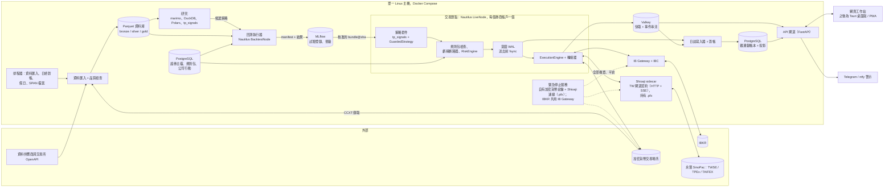
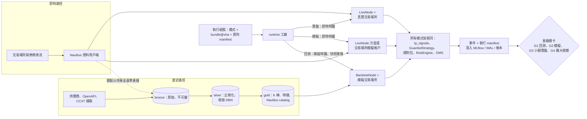

[English](README.md) | **繁體中文**

# 多資產分析、回測與交易平台：研究結論與建議架構

*主報告 · 狀態截至 2026-10-05 · 範圍：美國／全球市場、加密貨幣交易場所與台灣（證交所 TWSE／櫃買中心 TPEx、期交所 TAIFEX）的股票、加密貨幣、債券與選擇權。本報告將 11 份研究報告、3 份架構提案與 3 份獨立評審意見整合為單一建議。版本、價格與法律要點皆為經事實查核之研究在特定時點的快照，因此在購買、簽約或部署任何東西之前，請重新驗證。本文為工程研究，並非法律、稅務或投資建議。*

## 結論摘要

- **採用提案 A 作為骨幹：在單一 Linux 主機上擴充 NautilusTrader v2，以 Python 撰寫，只自行負責台灣轉接器（adapter）**。這是唯一一個 2–3 人團隊能在一年內推進到實盤交易的提案（單人開發者約需 14–16 個月）。三位評審給它的平均分數為 6.8/10，相較之下 B（自建 Rust 核心）為 5.9，C（多租戶雲端平台）為 5.4。B 與 C 都在可行性面向上直接不及格。請參閱[評估紀錄](architecture/evaluation.zh-TW.md)。
- **在信任任何回測之前，先補上三個提案共有的正確性缺口**。以下七項嫁接（graft）可達成此目的：
  - 預寫式下單意圖日誌（write-ahead order-intent journal；送出前先 fsync）；
  - 依交易場所編碼的 client ID，以及以 `(venue, exec_id)` 進行成交去重。在我們的台灣轉接器與帳本投影（projection）中，送單逾時的委託會變成 `UNKNOWN`，並透過查詢來解決，絕不盲目重送。對於上游轉接器（IBKR、加密貨幣），我們依賴 NautilusTrader 的在途委託（in-flight order）對帳，加上各交易場所的復原程序，並由第 0 階段（Phase 0）的技術探勘（spike）針對每個轉接器驗證這兩者；
  - 在 CI 中強制執行的確定性（determinism）規則；
  - 由向量化與事件驅動（event-driven）兩層共用的單一指標函式庫；
  - 公司行動（corporate action）事件管線，包括台灣除權息；
  - 針對賣出美式選擇權部位、由股利驅動的提前指派（early assignment）模型；
  - 規則包（rules pack）中明確的捨入與最低手續費規則。
- **現在就建立低成本的成長接縫（seam），讓大部分的成長都是加法式的，其餘則是範圍有限的移植**。這些接縫包括：搭配引擎無關（engine-agnostic）訊號程式碼的 `StrategyRuntime` 埠（port）、目前在行程內執行的下單閘道契約、每個 schema 中的租戶與帳戶 ID、`license_tag` 登錄表、依平台定義的 TW 閘道契約所建構的台灣 sidecar（即未來的邊緣連接器契約，[ADR-0006](docs/adr/ADR-0006-broker-connectivity-and-gateway-contract.zh-TW.md)）、轉接器能力旗標（capability flags），以及一條規則：任何可散布的產物都不得包含 LGPL、GPL、AGPL 或 Commons Clause 程式碼。這些接縫並不會讓每一次遷移都零成本：被迫將引擎遷移至 LEAN 估計需要 2–4 PM（人月）的移植工作（[ADR-0002](docs/adr/ADR-0002-extend-nautilustrader-as-backtest-engine.zh-TW.md)），而改用 NATS 則需重寫對外輸出（egress）與控制管線（[ADR-0005](docs/adr/ADR-0005-messaging-and-deployment-topology.zh-TW.md)）。
- **縮減首個版本的範圍**。先在**單一交易場所類別**上線實盤（加密貨幣永續合約或 IBKR，以你最常交易者為準；永續合約僅限於第 0 階段確認台灣居民可合法使用的交易場所，否則預設採用 IBKR），接著是台灣，然後是選擇權與債券。在任何桌面或行動版外殼之前，先交付網頁工作站加上 Telegram/ntfy 警示。從第一天起就使用記錄 `known_at` 的依生效日期（effective-dated）證券主檔（security master），但完整的雙時態（bitemporal）查詢留待之後再建構。
- **為真實資金設下關卡**。投入實盤資金需要 NautilusTrader 2.0.0 GA；或者是一個固定版本的候選版本（release candidate, RC），且須通過 30 天模擬浸泡測試（paper soak）並做到零無法解釋的對帳差異、一份已簽署的風險承擔 ADR，以及 10% 的資金上限。
- **工作量與成本（情境 1）**。由下而上估算，到首個實盤市場約需 12 人月（PM），加上 20–30% 的應變緩衝則為 14–16 PM。由於 G2 模擬交易期間無法壓縮，首筆實盤資金約在**兩人團隊的第 8–9 個月**、**單人的第 14–16 個月**投入。四種資產類別全部完成（債券以分析優先）約需 18 PM 基準（含應變緩衝 22–23 PM），兩人團隊約在第 12–13 個月達成。上線後的營運成本：家用伺服器約每月 US$10–200（另加約 US$700–1,200 的一次性硬體），單一雲端 VM 約 US$200–400，家用加東京的分離部署約 US$115–320。TEJ 與 FinMind 的報價仍待確認；請參閱[成本表](#成本數量級)。
- **情境 2（5–20 人，或對外提供服務）是由觸發條件驅動的演進，而非第一天就採用的架構**。只有在外部使用者觸發條件成立*且*法律顧問簽核，或團隊成長到約 4–5 名工程師時，才朝 C 的平台（行程外下單閘道、NATS、OpenBao、多租戶）發展。只有在 NautilusTrader 阻礙你、你必須散布不含 LGPL 的引擎，或你需要低於 10 ms 的反應時間且擁有資深 Rust 工程師時，才朝 B 的自建 Rust 核心發展。

### 建議技術堆疊一覽

| 層級 | 建議（情境 1：1–3 人，自用） | 替代方案 | 一句話理由 | 團隊規模時（情境 2） |
|---|---|---|---|---|
| 核心引擎 | **NautilusTrader v2**（Rust 核心，LGPL-3.0-only）。精確固定 `2.0.0rc5`，之後再改用 GA。我們不撰寫 Rust | QuantConnect **LEAN**（C#，Apache-2.0），適合以 C# 為主或以美國選擇權為優先的團隊 | 回測、沙盒與實盤使用相同的策略程式碼，加上有人維護且具對帳功能的 IB 與加密貨幣轉接器，因此我們是擴充而非從頭建構（[10](research/10-open-source-platforms-build-vs-buy.zh-TW.md)） | 同一引擎置於 `StrategyRuntime` 埠之後。只有在觸發條件成立時才自建 Rust 核心 |
| 策略語言／API | **Python 3.14**（GIL 版本）。訊號與部位規模邏輯放在引擎無關的 `tp_signals` 中；輕薄的 `GuardedStrategy` 作為 Nautilus 的黏合層 | 熱路徑使用 Rust 策略（之後） | 研究與實盤使用同一種語言；離開 Nautilus 成為範圍有限的移植（約 2–4 PM），而非重寫策略 | 不變；可選用 Rust 策略 |
| 回測 | **兩層架構、單一指標函式庫**：先以向量化篩選（Polars/NumPy，vectorbt 僅限內部使用），再以 Nautilus `BacktestNode` 在 K 棒 + L1 資料上以悲觀的 K 棒內成交假設執行。我們自己的模擬擴充涵蓋 TW 規則、公司行動、資金費率重播、提前指派，以及借券／融資成本 | LEAN CLI，用於美股與選擇權 | 只有事件驅動的結果會晉級；由於兩層共用指標，兩層結果一致才具意義（[02](research/02-backtesting-engine.zh-TW.md)） | 以 Ray 執行參數掃描；以 TCA 校準的 L2/L3 佇列模型 |
| 市場資料儲存 | **Parquet 資料湖**（bronze/silver/gold、zstd、內容雜湊、相容 DBN 的 schema）+ **DuckDB**（2026-10-21 之後改用 2.0）+ **Polars** | QuestDB 10，用於即時 tick 擷取 | 在任何作業系統上都零維運；同一批檔案同時供研究與回測使用（[03](research/03-market-data-storage.zh-TW.md)） | DuckLake 或 Iceberg 快照；多使用者並行時使用 ClickHouse 26.8 LTS |
| 參考資料 | **PostgreSQL 18** 證券主檔：依生效日期、記錄 `known_at` 的 `instrument` 與 `instrument_xref` 資料列；公司行動資料表；依生效日期的**規則包**；單一 `CalendarPort` | 以供應商 ID 作為鍵值（已否決） | 我們自己的 ID 能承受供應商的資料重述；同一份規則包供回測、風控與實盤使用 | 完整的雙時態查詢；有授權的 CUSIP 與公司行動資料源 |
| 交易紀錄 | **節點本地的意圖 WAL**（送出前 fsync），接著是 **PostgreSQL 僅附加（append-only）、雜湊鏈結的帳本**及其投影，再每晚匯出至 S3 Object Lock | 專用事件儲存（僅在已具備相關專業時） | 補上 Nautilus 非同步持久化的空窗；以接近零的成本取得防竄改的稽核軌跡（[07](research/07-system-architecture-messaging.zh-TW.md)、[08](research/08-risk-security-ops-compliance.zh-TW.md)） | 以 Outbox 送往 NATS；同步副本以達成 RPO ≈ 0 |
| 訊息傳遞 | Nautilus 行程內 MessageBus；以 **Valkey 9.1** streams 對外輸出至日誌與 API（第 0 階段探勘），承載引擎原生的 JSON/MessagePack；僅在日誌與 API 邊界使用 Protobuf 契約 | **NATS JetStream 2.15**（備案） | 若 Valkey 可行就不需要自製橋接；Valkey 採 BSD 授權，而 Redis 8 為 AGPL/RSAL/SSPL | 搭配 accounts 與 leaf nodes 的 NATS JetStream |
| 券商連線 | **IBKR** 透過 Nautilus IB 轉接器（IB Gateway + IBC）；**加密貨幣**透過 Nautilus 原生轉接器，連接 1–2 個你可合法使用的交易場所；**台灣**透過我們的轉接器連接 **Shioaji 1.7.7 sidecar**，該 sidecar 實作我們的 TW 閘道契約（HTTP + SSE）。每個轉接器都有能力旗標 | Fubon Neo（富邦）作為第二家台灣券商；長尾交易場所使用 CCXT | 對台灣居民而言，這是唯一經驗證、以單一帳戶接觸美國／全球市場的途徑，再加上原生支援 Linux 的台灣券商（[04](research/04-broker-exchange-connectivity.zh-TW.md)、[11](research/11-taiwan-market-localization.zh-TW.md)） | 每個交易場所帳戶一個閘道行程；僅群益 Capital SKCOM 需要 Windows 閘道 VM；之後再導入 FIX |
| OMS／風控 | Nautilus ExecutionEngine + RiskEngine，加上我們在 `GuardedStrategy` 中的失效即關閉（fail-closed）規則包檢查（包括放空與交易場所曝險檢查）與虧損斷路器，再加上交易場所原生的控管。手動委託單與經核准的提案走同一條路徑。三路徑緊急停止開關（kill switch） | — | 三道防線，在每種模式下都完全相同（[08](research/08-risk-security-ops-compliance.zh-TW.md)） | 行程外的下單／風控閘道，每個帳戶單一寫入者，搭配租約（lease）與隔離（fencing） |
| 定價 | **QuantLib 1.43**（QD+ 美式、債券、殖利率曲線）；以 NumPy 在隱含遠期價格上實作 Black-76（TXO、指數、加密貨幣選擇權）；每個到期日一組 SVI；我們自己的加密貨幣衍生性商品模組 | fast-vollib；ORE 用於 XVA/SIMM | QuantLib 是唯一有人維護、採寬鬆授權，且涵蓋選擇權、債券與曲線的函式庫（[05](research/05-instrument-model-pricing-analytics.zh-TW.md)） | 無狀態定價服務，搭配波動率曲面服務 |
| 研究／ML | marimo + JupyterLab；DuckDB/Polars（pandas 3 僅用於邊界）；skfolio CPCV + cvxpy；LightGBM + Optuna；**以 MLflow 3.16 作為試驗登錄表**；自行實作 PSR/DSR/PBO；固定版本的 QuantStats | Qlib；Chronos-2／TimesFM 2.5 僅作為基準 | 可重現的研究，並誠實計算試驗次數（[09](research/09-research-ml-analytics.zh-TW.md)） | 搭配沙盒化 kernel 的 JupyterHub；按需共用的 GPU 池 |
| 前端 | **React + TypeScript（Vite）網頁工作站**，含下單介面與提案核准佇列，加上 Telegram/ntfy 警示（LINE Messaging API 可選）。必要時於第 3 階段加入 Tauri 2.12 桌面外殼與 PWA 網頁推播 | Electron 44 | 單一程式碼庫；用戶端從不持有交易場所金鑰（[06](research/06-cross-platform-client-ui.zh-TW.md)） | 搭配 OIDC 的 BFF；React Native 推播輔助 App |
| 在地化（i18n） | **react-i18next**（或 FormatJS），提供每位使用者的語系設定、**zh-TW 與 en** 的介面字串與警示文字；`Intl.NumberFormat`，包括萬/億簡寫；圖表與 PDF 報表使用 CJK 字型（Noto Sans TC）；證券主檔中的 `name_en`/`name_zh_tw`；匯入對帳單時處理 Big5/CP950 編碼與民國（ROC）日期 | — | 擁有者閱讀繁體中文，且台灣的對帳單與資料使用在地的編碼與日期格式（[06](research/06-cross-platform-client-ui.zh-TW.md)、[11](research/11-taiwan-market-localization.zh-TW.md)） | 每位使用者的語系與權限；翻譯工作流程 |
| 圖表／表格 | Lightweight Charts 5.2（顯示出處標示）、uPlot、ECharts 6.1、AG Grid Community 36；需要繪圖工具時使用 KLineChart | SciChart.js 或 Highcharts（付費） | 全部採寬鬆授權。TradingView Advanced Charts 不授權給個人 | AG Grid Enterprise；自製 WebGL 價格階梯與 TAIFEX T 字報價 |
| API／UI 傳輸 | FastAPI 閘道：指令使用 REST，另有一條具伺服器端合併（conflation）與無損委託通道的 WebSocket；Protobuf schema（先用 JSON 對應）；回測產物使用 Arrow IPC | Connect RPC | 契約優先，但第一天不需要繁重的程式碼產生 | 二進位 Protobuf；每位使用者的權限 |
| 部署 | **在單一 Linux 主機上以 Docker Compose 部署**，搭配固定的對外 IP：家用迷你電腦，或依實測 RTT 選擇台北或東京的 VM。透過 Tailscale/WireGuard 存取 UI。災難復原：持續的 PostgreSQL 歸檔與異機 WAL 傳送至 S3，加上預先列入允許清單的冷備援（帳本 RPO ≤ 5 分鐘，RTO ≤ 1 小時） | 東京第二台小型 VM，用於 24/7 加密貨幣交易 | 單一主機；固定 IP 以符合券商與交易場所的允許清單 | 無狀態服務使用 Kubernetes 1.35+，交易節點使用固定的 VM |
| 可觀測性 | Grafana Cloud 免費方案，或 Prometheus 3 + Grafana + Loki；交易 SLI；chrony | — | 零維運；涵蓋資料陳舊、拒單、偏移、重新連線與時鐘偏差 | 端到端 OpenTelemetry；逐跳 HDR 延遲直方圖 |
| 安全性 | SOPS + age；僅限交易、停用提領、綁定 IP 的金鑰，每個策略或子帳戶一把，每 90 天輪替；全面使用 FIDO2；Shioaji `.pfx` 只掛載到恰好兩個容器（sidecar 與緊急停止開關）；AI 工具取得範圍受限的權杖，不具下單、控制或調整限額的權限（[ADR-0017](docs/adr/ADR-0017-ai-trust-boundary.zh-TW.md)）；以雜湊固定的 lockfile；CI 中的 SPDX 授權掃描 | 雲端機密管理服務 | 憑證是最重要的資產 | 以雲端 KMS 為基礎的 OpenBao 2.7；SLSA 來源證明；SBOM |

## 需求與假設

**功能範圍（來自需求說明）**。市場與歷史資料管理；研究與分析；策略回測；模擬交易（paper trading）；實盤自動與半自動交易；風險管理；績效分析；跨平台 UI（桌面、網頁與行動裝置）。資產類別：股票、加密貨幣、債券與選擇權，另加上作為台灣必備項目的 TAIFEX 期貨。

**假設**。下列每項假設都是一個會改變建議的未決事項（請參閱接近文末的「待使用者決定的事項」章節）。

| 主題 | 工作假設 | 來源 |
|---|---|---|
| 使用者 | 身在台灣，以繁體中文溝通。除了台灣之外，也想交易美國／全球市場與加密貨幣；此設計並非僅限台灣 | 需求說明 |
| 團隊 | 未定。情境 1 為 1–3 人；情境 2 為 5–20 人 | 需求說明 |
| 用途 | 先以自有帳戶自用。是否對外提供服務未定，且受法律關卡限制 | 需求說明、[08](research/08-risk-security-ops-compliance.zh-TW.md) |
| 延遲 | 從決策到下單為數十至數百毫秒；持有期間從數分鐘到數週；K 棒與 L1 資料。情境 1 不做造市、L3 佇列建模或主機共置（co-location） | [01](research/01-core-language-runtime.zh-TW.md) |
| 停機容忍度 | 若有交易場所的 dead-man 計時器與自動平倉規則，可容忍數小時的停機。更嚴格的需求會觸發高可用（HA） | [08](research/08-risk-security-ops-compliance.zh-TW.md) |
| 日期 | 2026-10-05。NautilusTrader 2.0 為候選版本，DuckDB 2.0 於 2026-10-21 發布，Python 3.15 於 2026-10-09 發布（2027 年採用） | 研究驗證紀錄 |

**情境 1 範圍之外**：造市、低於 10 ms 的策略、保管他人資產、販售訊號、跟單交易，以及代客操作他人資金。

## 關鍵設計原則

1. **一個引擎、一套策略套件、三種模式**。回測、模擬與實盤只差在 runtime 工廠所綁定的轉接器與時鐘。策略、規則包、風控檢查與 OMS 語意完全相同。
2. **事件驅動、單執行緒、確定性的核心**。在多次執行*之間*平行化（參數掃描、交叉驗證折），絕不在單次執行*之內*平行化。相同時間戳記的事件有穩定的排序決勝規則、亂數產生器皆設定種子，且不會迭代無序的雜湊表。
3. **精確的定點數金額**。價格、數量與金額都是精確的定點數值：在引擎與資料湖中為依商品縮放的整數（Nautilus v2 使用 128 位元、16 位小數），在帳本與會計邊界則為依精度量化的 `NUMERIC`/`Decimal`。float64 只用於模型內部（希臘字母、隱含波動率）。每次轉換都是明確的、經過測試的，並依宣告的規則捨入（[ADR-0003](docs/adr/ADR-0003-fixed-point-numerics-and-nanosecond-timestamps.zh-TW.md)）。
4. **單一事件時間型別**。每個事件時間（`ts_event`、`ts_init`）都使用 UTC int64 奈秒；管理用的簿記欄位（`valid_from`、`known_at`、`ts_recorded`）可以是 `TIMESTAMPTZ`，但絕不用來排序或重播事件。`trading_date` 與 `session_id` 只能來自 `CalendarPort`，因為 TAIFEX 夜盤會跨越午夜，而加密貨幣需要人為的每日切分點。策略程式碼絕不讀取系統時鐘（以 lint 禁止）。
5. **時點正確（point-in-time）的資料**。儲存原始價格與公司行動事件、包含已下市標的的股票池、以公布時間為鍵的基本面資料、總經資料的歷史版本（ALFRED），以及不可變、經內容雜湊的分區，其清單（manifest）雜湊會固定記錄在每次執行中。
6. **埠與轉接器（ports and adapters）**。`StrategyRuntime`、`MarketDataPort`、`ExecutionPort`、`AccountPort`、`ReferenceDataPort` 與 `CalendarPort` 就是接縫。轉接器宣告能力旗標（`amend_mode`、`native_oco`、`multi_leg`、`reduce_only`、`post_only`、`max_client_id_len`、`id_format`、dead-man 支援）。引擎型別絕不洩漏到 `runtime/` 與 `adapters/` 之外。
7. **交易場所是唯一事實來源**。意圖會在送出前先寫入。對帳在啟動時執行（對帳通過前策略保持停止）、盤中執行（每 1–5 分鐘），以及在日終依對帳單執行。任何無法解釋的差異都會使該帳戶停止交易。擁有者在平台外下的委託，若不是排除在自動化帳戶之外（每個自動化帳簿使用專屬帳戶或子帳戶），就是依明確的逐帳戶政策由對帳程序納入，因此不會被視為無法解釋。
8. **在每種模式下都完全相同的失效即關閉（fail-closed）風控關卡**，加上交易場所原生控管與三路徑緊急停止開關。金鑰僅限交易，且絕不會傳到網頁或行動用戶端。
9. **規則即資料**。跳動單位（tick）、交易單位、漲跌幅限制、交易時段、費用、稅、捨入與最低手續費都是依生效日期的組態（例如，台灣債券與債券 ETF 的證券交易稅停徵期於 2026-12-31 結束，0.15% 的當沖稅率則延續至 2027-12-31）。
10. **晉級需要證據**。每次試驗都記錄在登錄表中。沒有任何策略會憑向量化結果晉級。關卡使用 DSR、PBO、CPCV 與成本壓力測試，且實盤節點會拒絕未登錄的策略套件。
11. **授權衛生**。每個資料集都帶有 `license_tag`。引擎留在伺服器端。任何可散布的產物都不包含 LGPL、GPL、AGPL 或 Commons Clause 程式碼。
12. **依階段調整維運規模**。新的可部署單元必須擁有自己的擴展、故障或安全邊界；否則它就是現有單元中的一個模組。

## 建議架構總覽

### 元件（情境 1）

各部分的功能（完整規格請見 [recommended-architecture.zh-TW.md](architecture/recommended-architecture.zh-TW.md)）：

- **資料平面**。資料匯入將原始的供應商酬載寫入 bronze 層，正規化為相容 DBN 的 silver schema（UTC 奈秒時間戳記、內部 `instrument_id`、縮放整數價格、`source`、`license_tag`），並建構 gold 層的 K 棒、特徵與 Nautilus catalog。未通過品質檢查的分區會被隔離。
- **策略平面**。每個券商帳戶一個 Nautilus `LiveNode`（隔離等級 L1）。策略套件由 `tp_signals` 程式碼、組態與規則包版本組成，以 `git SHA + config hash` 識別，並帶有 MLflow 晉級標籤。
- **下單路徑**。策略意圖 → `GuardedStrategy` 檢查（規則包、限額、虧損斷路器、能力旗標）→ Nautilus RiskEngine → **意圖 WAL（fsync）** → ExecutionEngine → 轉接器 → 交易場所。成交以 `(venue, exec_id)` 去重。
- **半自動交易**。手動下單介面（`POST /v1/orders`）以及由策略或 AI 產生、經人工核准的提案（`POST /v1/proposals/{id}/approve`）都以 `source=MANUAL` 或 `source=PROPOSAL` 進入相同的下單路徑。核准時會重新檢查風控，提案會過期，且 Telegram 可以核准但絕不能調高限額（[§3.13](architecture/recommended-architecture.zh-TW.md#313-半自動交易手動委託單與提案核准)）。
- **紀錄**。Valkey streams 與 WAL 供給日誌寫入器，後者附加寫入雜湊鏈結的 PostgreSQL 帳本並執行對帳。API 讀取投影，並將事件推送給用戶端。
- **控制**。UI 與 Telegram 指令（停止、恢復、平倉、調整限額）經由 API 送到每個節點的控制串流。緊急停止服務持有自己的僅限交易加密貨幣金鑰以及自己的 Shioaji 連線，因此即使節點卡死，也能在加密貨幣交易場所與永豐（SinoPac）撤單。**IBKR 注意事項**：對 IBKR 而言，在第 0 階段驗證第二個使用者名稱之前，路徑 2 並不獨立於 IB Gateway；節點與緊急停止開關共用閘道與 IBKR 登入，因此若閘道卡死，IBKR 行動 App 或網頁用戶端就是最後的手動手段。在交易場所與商品支援的情況下，交易場所的 dead-man 計時器是第三條路徑。

### 資料流：回測、模擬與實盤

| 模式 | 節點 | 時鐘與資料 | 執行 | 進入下一階段的關卡 |
|---|---|---|---|---|
| 回測 | `BacktestNode` | 模擬時鐘；重播由 manifest 固定的資料湖快照 | 以與實盤相同的交易場所與規則組態建構的模擬交易場所：明確的手續費模型（自 rc6 起為必要）、依交易場所歷史重播的資金費率、公司行動與指派模組、TW 規則擴充 | **G1**：walk-forward 或 CPCV；DSR ≥ 0.95；PBO ≤ 0.2；成本加倍後仍獲利；向量化與事件驅動兩層結果一致（報酬差距在 10% 以內，正負號未反轉）；股票須涵蓋公司行動，賣出選擇權須涵蓋指派 |
| 模擬（Paper） | 沙盒 `LiveNode`（即時資料、模擬成交），加上 IBKR 模擬帳戶、加密貨幣測試網、Shioaji `simulation=True` | 即時 | 模擬或交易場所模擬帳戶 | **G2**：至少 3 個月，或依資產類別的交易次數路線（例如當沖策略需 ≥ 200 次來回交易且 ≥ 6 週；[§8.2](architecture/recommended-architecture.zh-TW.md#82-晉級管線研究--回測--模擬交易--實盤)），且絕不短於 RC 引擎所需的 30 天浸泡測試；滑價與追蹤誤差在容許範圍內；對帳乾淨；無手動覆寫 |
| 實盤 | `LiveNode` | 即時 | 真實 | **G3**：達成實盤資金關卡；10% 資金。**G4**：在實盤損益維持在回測蒙地卡羅 95% 區間內的前提下，逐步提高至 25%，再到 100%；超出區間時自動進入 `REDUCING`/`HALTED` |

## 依情境的建議

### 情境 1：單人或 1–3 人，主要自用（建議的起點）

完全照上述內容使用。團隊只撰寫 Python 與 TypeScript，但**至少要有一人能讀懂 Rust**，因為 NautilusTrader v2 的故障會在 Rust 層浮現。

- **引擎與版本**。以精確固定版本擴充 NautilusTrader v2。所有 Nautilus 組態都在 `platform/runtime/` 工廠中建構，將 RC 的重新命名集中在一處吸收（例如 rc4 的 `LiveExecClientConfig` → `ExecutionClientConfig`）。LEAN 是已記錄的備案。
- **候選版本立場**。不要建構在 1.231.x 上：它的安全性修補回溯約於 2026 年 11 月結束，早於任何實際可行的上線時間。投入真實資金需要通過上文結論摘要中的關卡。
- **拓撲**。一台執行 Docker Compose 的 Linux 主機（約 10 個容器；請參閱[可部署單元清單](architecture/recommended-architecture.zh-TW.md)）。在確認你的台灣券商接受雲端 IP 之後，再選擇家用或雲端，並量測到各交易場所的 RTT。
- **Python 映像檔**。第 2 階段結束前只使用一個主要映像檔（Python 3.14、pandas 3）。直接呼叫 FinMind 的 REST API，而非使用其 `pandas<3` 用戶端。只有當第 3 階段的選擇權工作需要 vollib 或 alphalens 時，才會出現 `legacy-quant` 映像檔（Python 3.13、pandas 2.3）。
- **維運**。請為以下職責做好規劃，沒有任何工具能免除它們：
  - 人工核准 IBKR 定期的 2FA 重新驗證（IBC 自動化的是重新啟動，而非 2FA 核准）；
  - Shioaji 的 14 天發布週期；
  - Nautilus RC 升級；
  - 遷移至 DuckDB 2.0；
  - 24/7 加密貨幣值班告警；
  - 每季在冷備援上進行一次完整重建演練（建議架構的 §7.1）。

  每月安排一次維護時段，並在採用新的相依套件版本前等待 3–7 天。
- **單人的四眼原則**。在原本需要第二位核准者簽核晉級或限額變更的地方，改用書面檢查清單、一份 ADR 以及 24 小時冷靜期。

### 情境 2：5–20 人，或準備對外提供服務

保留情境 1 的核心與資料模型，並**僅在對應的觸發條件成立時**加入平台元件：

- 行程外的**下單／風控閘道**，作為每個帳戶的單一寫入者（租約加上 fencing token、送出前持久化 `PendingNew`、逾時後依 client ID 查詢）；
- **NATS JetStream** 作為行程間匯流排，每個租戶一個 account，邊緣站點使用 leaf node；
- **每個交易場所帳戶一個閘道行程**；
- 以雲端 KMS 為基礎的 **OpenBao**；
- **OIDC + WebAuthn**、角色（擁有者、交易員、研究員、風控人員、稽核員）與四眼核准；
- 強制執行 `license_tag` 的**權限服務**；
- **DuckLake 或 Iceberg** 快照，加上 **ClickHouse** 或 **QuestDB**；
- 以 **Ray** 執行參數掃描；
- 全公司層級的風控服務（VaR/ES、壓力測試、希臘字母網格）；
- 無狀態服務使用 **Kubernetes**，交易節點則置於固定的 VM；
- 用於推播與生物辨識核准的 **React Native** 輔助 App。

若要對外提供服務，由客戶自行託管的**邊緣連接器**（C 的設計）可讓個人的台灣券商憑證留在其擁有者手中。它是否真正符合券商條款，仍是一個需要法律顧問與券商確認的法律假設。

### 從情境 1 演進到情境 2 的路徑

情境 1 的接縫讓大多數步驟都只是新增。例外情況的成本已明列：被迫的引擎遷移是 2–4 PM 的移植工作，而遷移到 NATS 則需重寫對外輸出與控制管線。

| 情境 1 中建立的接縫 | 之後能實現什麼 |
|---|---|
| `StrategyRuntime` 埠與引擎無關的 `tp_signals` | 在同一個埠之後換成 LEAN 或自建核心 |
| 行程內的下單閘道契約 | 將閘道移出行程 |
| schema 中的 `tenant_id` 與 `account_id` | 無需資料遷移即可支援多租戶 |
| `license_tag` 登錄表 | 權限服務 |
| 位於平台定義的 TW 閘道契約之後的 Shioaji sidecar | 實作同一契約的邊緣連接器或 Windows 閘道 |
| 能力旗標 | 新增更多交易場所，而無需依交易場所名稱分支 |

| # | 觸發條件（可觀察） | 演進方向 | 備註 |
|---|---|---|---|
| T1 | 第二位使用者、付費訊號、跟單交易或任何外部租戶 | **先進行法律審查**。接著是平台增量：行程外下單閘道、多租戶、OIDC、權限控管、有授權的資料散布 | 台灣：證券投資信託及顧問法（SITCA Act）第 107 條、期貨交易法第 112 條，券商條款禁止授權第三方，且憑證屬於個人 |
| T2 | 4–5 名以上工程師，或超過約 5 個交易節點或帳戶 | NATS JetStream、各交易場所閘道、行程外風控閘道、OpenBao、無狀態服務使用 Kubernetes | 隔離等級 L1 → L2，搭配共用閘道（券商連線數限制，例如 Shioaji 每個身分證字號允許 5 個連線） |
| T3 | 需要僅支援 Windows 的券商（群益 Capital SKCOM，用於海外期貨或複委託） | 位於同一 TW 閘道契約之後的 Windows Server 閘道 VM（情境 1 為 HTTP + SSE，情境 2 為 NATS leaf node；情境 1 不使用 gRPC，[ADR-0006](docs/adr/ADR-0006-broker-connectivity-and-gateway-contract.zh-TW.md)） | 監控程式（watchdog）；於 08:30 與 15:00 前重新啟動；位元數須相符 |
| T4 | 即時 tick 擷取、多個並行儀表板，或資料湖有多個寫入者 | QuestDB（擷取）、DuckLake/Iceberg（快照）、ClickHouse（多使用者） | lakeFS 自 v1.87.0 起改為 BSL；若有計畫提供服務則應避免 |
| T5 | 反應時間低於約 10 ms，或需要 L2/L3 佇列建模 | Rust 原生策略、Nautilus L3 或 hftbacktest、東京主機代管、TAIFEX 使用富邦（Fubon）DMA/IDC | 需要 Rust 人才 |
| T6 | Nautilus 2.0 GA 延誤超過第 2 階段結束；上游拒絕我們需要的變更（TW 撮合、債券）；關鍵維護者流失；授權或 open-core 模式變更 | 在 `StrategyRuntime` 之後改用 LEAN，或在有 2 名以上資深 Rust 工程師時採用 B 的自建 Rust 核心 | 輕薄的 SDK 保留了策略、規則包、帳本、閘道契約與 UI；需要重寫的是用於 TW 契約的 LEAN brokerage、模擬擴充與 runtime 黏合層。估計 2–4 PM（[ADR-0002 中的移植成本表](docs/adr/ADR-0002-extend-nautilustrader-as-backtest-engine.zh-TW.md#被迫遷移至-lean-的成本)）；於第 3c 階段演練 |
| T7 | 第 0 階段探勘顯示，TW 集合競價或漲跌停鎖死時的拒絕成交無法以 Nautilus 成交／撮合擴充來表達 | 仿照 B 的 `SimVenue` 風格，建立僅供台灣回測使用的模擬器 | 適用 B 的終止規則：延誤超過 3 個月即停止 |
| T8 | 債券需求超出 ETF 與手動記帳 | 一級（first-class）`Bond` 商品工作流程、IBKR `BOND` 委託；針對機構交易場所使用 FIX（QuickFIX/J）RFQ | `Bond` 領域型別已存在於 `tp_domain` 中 |
| T9 | 資金無法容忍數小時的停機 | 每個帳戶採主動－被動（active-passive）架構並搭配租約與 fencing、第二區域、依 SEC 17a-4 的 WORM 保存 | 絕不對同一帳戶採用主動－主動（active-active） |
| T10 | 桌面版或自行託管的產品必須內含引擎 | 不含 LGPL 的核心：LEAN（Apache-2.0）或 B 的自建核心；授權審查 | 未經法律審查，絕不可將 Nautilus 綁入任何散布的產物中 |
| T11 | AI 產生的策略或自動化因子挖掘 | 全平台的試驗計數、沙盒化程式碼執行、唯讀 MCP 工具、任何下單前皆需人工核准；AI 信任邊界（[ADR-0017](docs/adr/ADR-0017-ai-trust-boundary.zh-TW.md)）自第一個 AI 工具起即適用，而非僅在 T11 時 | 未計入的試驗會讓 DSR 失去意義 |
| R1（反向） | 建構平台增量後約 12 個月內沒有外部使用者、團隊縮減至 5 人以下，或法律審查結果為否定 | 收斂回精簡的 Compose 設計，並保留共用套件 | C 自己的精簡觸發條件 |

### 以台灣為主要焦點 vs. 以美股與加密貨幣為主

| 面向 | 台灣優先 | 美股／加密貨幣優先 |
|---|---|---|
| 首個實盤市場 | 透過 Shioaji sidecar 交易台股或 TAIFEX。自製轉接器與 TW 規則包位於關鍵路徑上：首次實盤前約 **+2–2.5 PM**（基準 ≈14 PM，兩人團隊約在第 10 個月首次實盤） | 加密貨幣永續合約（Nautilus Binance/OKX/Bybit 轉接器），**僅限第 0 階段確認台灣居民可合法使用該交易場所時**，否則採 IBKR 美股（預設），完全不需自製轉接器程式碼。台灣於第 3 階段跟進 |
| 主機代管 | 家用伺服器或台北區域（AWS `ap-east-2`，需選擇啟用，或 GCP `asia-east1`）。確認券商接受雲端 IP；API 金鑰允許清單需要固定 IP | 加密貨幣使用 AWS 東京；在此延遲等級下不需要 US-East |
| 優先建模的市場規則 | ±10% 漲跌幅限制（鎖死時無法成交）、開盤與收盤集合競價、3.5% 瞬間價格穩定措施、零股作為獨立的委託簿並採 5 秒集合競價、處置股與暫停先賣後買、當沖資格、T+2、夜盤交易日、颱風停市調整、2027 年假日（QuantLib 的台灣行事曆只到 2026 年） | 含夏令時間的美國交易時段、T+1、SEC Section 31 與 FINRA TAF 費用、PDT vs FINRA 盤中保證金（兩者在 2027-10-20 前皆可設定）；加密貨幣資金費率、強制平倉、以 00:00 UTC 切分的 24/7 行事曆 |
| 資料 | TWSE/TPEx/TAIFEX OpenAPI（免費、日終與參考資料）；券商行情（即時）；FinMind 贊助方案取得 tick 歷史資料（**資料條款為教育／非商業用途；依賴前請先確認**）；**TEJ** 提供時點正確的基本面與下市資料（強烈建議用於台股橫斷面研究；於第 0 階段取得報價）；TWSE/TPEx OpenAPI 提供除權息排程（`TWT48U_ALL`、`tpex_exright_prepost`）、下市公司、融資融券餘額與可借券股數；TWSE Data E-Shop 提供權威的五檔委託簿（每資料月 NT$5,000） | IBKR 行情套組（快照套組每月 $10，當月手續費達 $30 即免收，另加供 API 演算法使用、約 $4.50 的串流附加方案）、Massive（含下市標的、分割與股利的時點正確代號清單）或 Norgate Platinum 以取得無存活者偏差的美股股票池、選擇權使用 ThetaData、CCXT 擷取（只有在 tick 歷史資料值得每月 $700 以上時才用 Tardis） |
| 衍生性商品重點 | TAIFEX TX/MTX/TMF 期貨與 TXO（歐式、以 30 分鐘平均價現金結算、週三／週五週選擇權）；TAIFEX SPAN 參數載入器；在隱含遠期價格上使用 Black-76 | 美國個股選擇權（美式 QD+，股利驅動的提前指派至關重要）、OCC OSI 代碼、Reg T 保證金；加密貨幣選擇權使用 Deribit |
| 加密貨幣 | MAX 與 BitoPro 用於 TWD 現貨（列於與金管會登記名冊連動的已設定允許清單中）。它們不提供永續合約，也沒有 Nautilus 轉接器，因此不是首次實盤的途徑；虛擬資產服務法（VASP Act）的執照約自 2028 年第 1 季起核發 | Binance/OKX/Bybit/Deribit/Hyperliquid，**僅在第 0 階段依金管會（FSC）AML 登記名單與該交易場所自身的地區條款逐一檢查之後**；以各交易場所曝險上限與交易場所健康度警示因應交易對手風險。若沒有任何永續合約交易場所符合資格，則改採 IBKR 優先 |
| UI | 紅漲綠跌的顏色設定（附色盲友善調色盤）、五檔委託簿、TXO 的 T 字報價 | 綠漲的顏色設定、深度圖、資金費率面板、選擇權鏈 |
| 維運 | 證交所／櫃買：08:30 起接受委託，09:00–13:25 逐筆交易，13:25–13:30 收盤集合競價（盤後定價 14:00–14:30）。期交所指數期貨／選擇權：日盤 08:45–13:45，若交易另加夜盤 15:00–05:00；Shioaji 超過流量上限時會回傳空值（應視為警報）；違反速率限制會導致服務被暫停 | 加密貨幣需 24/7 值班告警；IBKR 2FA 職責；交易場所維護時段 |
| 通往情境 2 的路徑 | 台灣 SaaS 在結構上就很困難（個人憑證、投顧執照、TWSE 資訊再散布費用每月 NT$60,000 加上每月 NT$100,000）。實際可行的途徑是與持照業者合作，或提供自行託管的軟體，而自行託管軟體會讓 LGPL 問題重新浮現（T10） | 美國／全球服務需要 RIA/CTA 分析與交易所行情散布商協議；經合規審查後使用 IBKR 第三方 OAuth 1.0a |

## 四種資產類別的處理方式

| 維度 | 股票與 ETF（美國、TWSE/TPEx） | 加密貨幣（現貨、永續、定期、選擇權） | 選擇權（美國、TXO、Deribit） | 債券 |
|---|---|---|---|---|
| 商品模型 | Nautilus `Equity`，加上我們依商品類別、依生效日期的 `tick_scheme_id`（台股與 ETF 不同）、具型別的數量單位（台股整股 1,000 股 vs 零股；零股以獨立的 `instrument_id` 交易，擁有自己的委託簿），以及每日更新的處置與當沖旗標 | `CurrencyPair`、`CryptoPerpetual`、`CryptoFuture`、`CryptoOption`，加上 `settlement_currency` 與 `is_inverse`；i128 定點數；只在鏈上轉接器使用 U256 | `OptionContract`、`OptionSpread`，加上我們的 `option_terms`（履約方式、結算方式、依生效日期的乘數與交割標的） | 我們自己在 `tp_domain` 中的 `Bond` 領域型別：票息排程、計息基礎、交割延遲、贖回條款、以面額百分比表示的價格並附 1/32 報價編解碼器、以面額計的數量。並非 Nautilus 商品 |
| 識別碼 | 內部 `instrument_id`；FIGI（OpenFIGI）、ISIN、代號 + MIC、IB conId；CUSIP 僅在取得授權時使用 | 交易場所代號 + 基礎／計價／結算幣別 | OCC OSI（21 個字元）；TAIFEX 商品代碼 + 月份或週別代碼 | ISIN；CUSIP 僅在取得授權時使用；IBKR conId |
| 資料（情境 1） | IBKR 即時；Massive 提供美國歷史資料、時點正確的代號清單（含下市標的）、分割與股利（Norgate Platinum 為每日資料的替代方案）；TW OpenAPI（除權息、下市、融資融券、可借券股數）、券商行情、FinMind 或 TEJ；IBKR 可放空股數 tick 與費率檔案用於美股借券 | CCXT 擷取至 bronze；各交易場所的資金費率歷史；Tardis 可選 | ThetaData（美國）；Shioaji + TAIFEX 每日 tick（TXO）；Deribit 公開 API | FRED/ALFRED、Treasury Fiscal Data、IBKR 報價；TPEx 債券參考資料 |
| 執行途徑 | IBKR（美國／全球）；Shioaji（台灣），Fubon Neo 為第二選擇 | 在 1–2 個符合資格的交易場所使用 Nautilus 原生轉接器；TWD 使用 MAX/BitoPro | IBKR（美國）；Shioaji（TXO）；直接連 Deribit（Coinbase 的閘道自 2026-10-01 起僅支援永續合約） | 債券 ETF 以股票方式處理；直接持有的債券以手動記帳，或以低頻的 IBKR 委託下單 |
| 定價與分析 | 市價標記（marks）；經公司行動調整的序列僅用於訊號 | 反向／線性損益、權利金調整後 delta、資金費率應計、年化基差（我們的模組） | QuantLib QD+ 美式（美國個股）；在隱含遠期價格上使用 Black-76（TXO、指數、加密貨幣）；每個到期日一組 SVI；以 Let's Be Rational 計算隱含波動率 | QuantLib：應計利息、殖利率、存續期間、DV01、殖利率曲線（NSS）。結果在記帳前依交割慣例捨入 |
| 回測擬真度 | K 棒 + L1、悲觀的 K 棒內成交；以**原始**價格成交；**公司行動作為引擎事件**（分割時調整部位、現金股利、台股股票股利產生零股）；TW 漲跌停鎖死時拒絕成交與集合競價（探勘）；無法放空時拒絕放空成交，並應計借券費、融資利息與替代股利（payment in lieu） | 依交易場所公布的歷史重播資金費率結算；依各交易場所模擬強制平倉；maker/taker 費率級距 | L1 選擇權鏈，以買價／賣價成交，絕不用中價；到期與現金結算；針對賣出美式買權的**股利驅動提前指派模型**；指派結果依券商的即時資料對帳 | **不對指示性的 OTC 報價進行事件驅動回測**。僅做每日評價與持有收益（carry）分析 |
| 生命週期事件 | 分割、現金與股票股利、代號變更、下市、減資 | 資金費率、下架、幣值重新計價（redenomination） | 履約、指派、到期、交割標的調整 | 票息、贖回、到期（帳本事件） |
| 費用與稅（規則包） | 美國：手續費、SEC Section 31（每會計年度重設費率）、FINRA TAF、借券費與融資利息、放空期間股利的替代支付（payment in lieu）、非美國人士 30% 股利預扣稅（W-8BEN）。台灣：手續費 ≤0.1425%、賣出證交稅 0.3%、當沖 0.15%（至 2027-12-31）、ETF 0.1%；融資利息、融券與借券費用；捨入與券商最低手續費；股利的二代健保補充保費 | Maker/taker 費率級距、資金費率、提領與 gas 費 | IBKR 美國分級制、按口計費（US$0.65/0.50/0.25，每筆委託最低 US$1）；TAIFEX 期交稅為權利金的 0.1%、買賣雙方皆課，現金結算時適用期貨稅率 | 交易商價差；台灣公司債與債券 ETF 僅在 2026-12-31 前免稅 |
| 保證金與風控 | Reg T 與 FINRA 盤中保證金（兩者皆可設定）；台灣現股以 T+2 區分已交割與可用。**放空與融資**：可放空／借券確認（locate）檢查、Reg SHO Rule 201（SSR）、難借券的召回與強制回補；台灣信用交易資格、融資融券額度與維持率、平盤以下不得放空的限制、股東會與除權前的融券強制回補；回測中的 `BorrowModel`（[ADR-0012](docs/adr/ADR-0012-security-master-rules-packs-and-calendars.zh-TW.md)） | 交易場所保證金；強平價格檢查；各交易場所曝險上限；穩定幣作為商品並附脫鉤警示 | 希臘字母限額；Reg T 選擇權表格；TAIFEX SPAN 載入器 | DV01 與存續期間限額 |
| 交付階段 | 第 1–2 階段（依焦點先做美國或台灣） | 第 1–2 階段 | 第 3 階段（先做分析，再做單腳與風險有限的策略） | 第 3 階段（債券 ETF + 手動債券帳簿、每日評價） |

## 三個提案的比較

三位評審各自從不同的面向，以 0 到 10 分為每個提案評分。完整紀錄（包括每項嫁接決策與每個事實疑慮）請見 [architecture/evaluation.zh-TW.md](architecture/evaluation.zh-TW.md)。

| 提案 | 可行性與交付（1–3 人，3–9 個月） | 正確性與效能 | 長期演進與多資產完整度 | 平均 | 致命缺陷 |
|---|---|---|---|---|---|
| [A：站在開源肩膀上的精簡 MVP](architecture/proposal-A-lean-mvp.zh-TW.md) | **7.8** | 6.5 | 6.0 | **6.77** | 無 |
| [B：效能與正確性優先（自建 Rust 核心）](architecture/proposal-B-performance-core.zh-TW.md) | 3.0 | **7.8** | 6.8 | 5.87 | 小團隊無法在 3–9 個月內上線實盤（即使有六名工程師，首筆實盤交易也約在第 10 個月） |
| [C：平台與規模（多使用者、雲端原生）](architecture/proposal-C-platform-scale.zh-TW.md) | 2.5 | 6.0 | **7.6** | 5.37 | 同上（約 120 PM 之後於第 10–14 個月內部上線實盤；Kubernetes、OpenBao 與多租戶維運對 1–3 人而言負擔不起） |

**為何融合後的方案長這樣**：

- **A 是骨幹**，因為它是唯一能以小團隊成本交付實盤交易的提案。
- **B 貢獻正確性**：確定性契約、預寫日誌、執行語意、債券模型、台灣模擬器語意，以及終止條件的紀律。
- **C 貢獻成長接縫**：`StrategyRuntime` 埠、下單閘道契約、租戶 ID、授權登錄表、邊緣連接器契約、可部署單元數量規則、TWD 加密貨幣交易場所，以及監理立場 ADR。
- **三者都遺漏了相同的缺口**，這些缺口在此補上：公司行動事件、提前指派模型、捨入規則，以及相依性風險登錄表（Nautilus 的關鍵人物與 open-core 風險；單一維護者的 `ibapi` crate）。

## 分階段路線圖

工期假設**兩人**平行工作（一位量化／策略開發者與一位平台／全端工程師）。人月（PM）數字是**依元件由下而上的估算**（見下表）再加上明確的應變緩衝。它們取代了先前由上而下的標題數字（「10 PM，6–7 個月」），該數字無法容納 G2 模擬交易期間，也未與[評估 §3.1](architecture/evaluation.zh-TW.md) 調和；在該節中，可行性評審預期提案 A 較小的範圍（10.5 PM）會延誤至 8–9 個月。

**為何經過時間不等於 PM 除以人數**。G2 模擬交易期間（至少 3 個月，或依資產類別的交易次數路線）只能在第 2a 階段的模擬交易堆疊可運作後才開始，而額外投入的人力無法縮短它。因此第 2 階段拆分為 2a（建構模擬交易堆疊）、2b（G2 模擬交易期間；若 NautilusTrader 尚未 GA，則包含 30 天浸泡測試）與 2c（10% 實盤）。2b 期間釋出的工程時間將投入第 3a 階段。

| 階段 | 週數（兩人） | 目標 | 關鍵交付項目 | 結束條件 | PM（基準） |
|---|---|---|---|---|---|
| **0. 基礎建設與技術探勘** | 0–4 | 在開始建構前消除未知數 | Monorepo、`uv` lockfile、CI（策略的系統時鐘與 I/O lint、SPDX 授權掃描、匯入邊界 lint）、首批 ADR、相依性風險登錄表。**技術探勘**：v2 樹外（out-of-tree）轉接器 API；用於 TW 集合競價與漲跌停鎖死拒絕成交的 Nautilus 成交／撮合擴充；處理公司行動現金與部位調整的模擬模組；以 Valkey 作為 Nautilus 的 Redis 後端（備案：PostgreSQL 快取 + NATS 橋接）；IB Gateway + IBC + 2FA 例行程序；各交易場所的緊急停止撤單語意（IBKR `reqGlobalCancel` 或 master client ID；各交易場所與商品的 dead-man 支援）；**我們將使用的每個上游轉接器的在途委託對帳，並對照各交易場所復原表檢查（[建議架構](architecture/recommended-architecture.zh-TW.md#34-oms--ems)的 §3.4）**；Shioaji sidecar；每個固定版本的 Python 3.14 wheel；DuckDB 2.0。**檢查**：每個永續合約與選擇權交易場所對台灣居民的資格（金管會 AML 登記名單與該交易場所的地區條款）；TEJ 與 FinMind 報價；IBKR 串流套組、OPRA 與行情線路數 | 技術探勘與檢查的結論記錄為 ADR；CI 中可執行回測 | 1.4 |
| **1. 資料、研究與事件驅動回測** | 3–18 | 為首個市場建立可信的回測（另加向量化層中的第二個市場） | 資料匯入（CCXT、IBKR/Massive 歷史與參考資料、TW OpenAPI 包括除權息排程與下市資料、FinMind REST、FRED、匯率）；含品質檢查與隔離的 bronze/silver/gold；證券主檔（含 `name_en`/`name_zh_tw`）以及由 [§3.1](architecture/recommended-architecture.zh-TW.md#31-資料閘道歷史資料擷取與即時市場資料) 所列時點正確來源供給的公司行動資料表；`CalendarPort`；首個市場的規則包（若策略會放空或借券，則含 `short_sale` 與 `financing` 區段）；兩層共用的 `tp_signals`；MLflow 試驗登錄表；PSR/DSR/PBO 指標；具備手續費模型、資金費率重播、公司行動事件與 `BorrowModel` 的 BacktestNode；執行 manifest；黃金基準（golden-master）CI；自動化 G1 | 首個市場具有來自指定來源、包含下市標的的時點正確股票池；兩個參考策略能可重現地通過或未通過 G1；兩層結果一致 | 4.3 |
| **2a. 模擬交易堆疊** | 10–26 | 模擬交易所需的一切 | `runtime/` 工廠；`GuardedStrategy` 與 `tp_risk`；意圖 WAL（送出前與送出後紀錄）；具雜湊鏈的日誌寫入器；投影（各幣別現金、稅務批次（tax lots）、匯兌轉換）；對帳（啟動、盤中、日終對帳單匯入）與外部委託政策；三路徑緊急停止開關；手動下單介面與提案核准佇列；以 SOPS、可觀測性、PITR 備份、異機 WAL 傳送與基礎架構即程式碼（IaC）重建的 Compose 部署；網頁工作站 v1（部位、委託、下單介面、核准、圖表、回測報告、限額、緊急停止開關；zh-TW/en）+ Telegram/ntfy | 模擬節點端到端運作；強制當機後驗證啟動對帳；完成還原演練 | 5.55 |
| **2b. G2 模擬交易期間** | 24–39 | 為投入真實資金取得證據 | 進行至少 3 個月的沙盒與交易場所模擬交易，或採用 [§8.2](architecture/recommended-architecture.zh-TW.md#82-晉級管線研究--回測--模擬交易--實盤) 的依資產類別交易次數路線；若 NautilusTrader 尚未 GA，在同一期間內進行 30 天浸泡測試；TCA；混沌與緊急停止演練；上線檢查清單。第 3a 階段同步開始 | 通過 G2；達成實盤資金關卡；連續 5 個以上乾淨的對帳交易時段；每條路徑都完成緊急停止演練 | 0.5 |
| **2c. 首個實盤市場** | 37–44 | 在**單一**交易場所類別投入真實資金 | 以 10% 資金實盤（G3） | 連續 4 週乾淨的實盤對帳 | 0.2 |
| **3. 台灣、衍生性商品與債券** | 26–56 | 完成多資產範圍 | **3a（2.7 PM）**：依 TW 閘道契約實作的 Shioaji 轉接器（能力旗標、client ID 對應、`UNKNOWN` 解決）；TW/TAIFEX 規則包，包括融資融券、借券與平盤以下放空規則；TW 模擬擴充；以極小額真實委託測試零股；一個 TW 策略通過其自身的 G2 期間；TW 以 10% 實盤。**3b（2.5 PM）**：選擇權鏈（ThetaData、IBKR、Shioaji TXO）；定價 worker（若使用 vollib 則用 legacy-quant 映像檔）；Reg T 與 SPAN 載入器；提前指派模型；Deribit 分析；債券 ETF + 手動債券帳簿並以 QuantLib 每日評價；僅在需要時才做 Tauri 外殼與 PWA 推播。**3c（0.8 PM）**：台灣居民稅務申報外掛（[ADR-0016](docs/adr/ADR-0016-multi-currency-books-tax-lots-and-tax-plugins.zh-TW.md)）；以一個參考策略演練 LEAN 備案（[ADR-0002](docs/adr/ADR-0002-extend-nautilustrader-as-backtest-engine.zh-TW.md)） | TW 策略通過 G3；選擇權策略通過 G1/G2；債券帳簿每日評價；從帳本產出年度 TWD 稅務摘要；LEAN 演練報告 | 6.0 |

**由下而上估算至首個實盤市場的工作量（第 0–2 階段）**。「嫁接」標示評估時新增的項目；「審查」標示完整性審查時新增的項目。

| # | 元件 | 階段 | PM |
|---|---|---|---|
| 1 | Monorepo、lockfile、CI lint、SPDX 掃描、首批 ADR、相依性風險登錄表 | 0 | 0.35 |
| 2 | 第 0 階段技術探勘與檢查（如上所列） | 0 | 1.05 |
| 3 | 資料匯入、bronze/silver/gold、品質檢查、隔離、manifest、授權登錄表 | 1 | 1.0 |
| 4 | 證券主檔、`instrument_xref`、公司行動資料表與資料源、`CalendarPort` | 1 | 0.6 |
| 5 | 首個市場規則包：捨入與最低手續費（嫁接）；放空與融資區段（審查） | 1 | 0.4 |
| 6 | `tp_signals` 批次與增量版本，附等價性測試（嫁接） | 1 | 0.4 |
| 7 | MLflow 試驗登錄表、`tp_metrics`（PSR/DSR/PBO）、CPCV | 1 | 0.5 |
| 8 | BacktestNode 整合：手續費模型、資金費率重播、公司行動模組（嫁接）、`BorrowModel`（審查） | 1 | 0.8 |
| 9 | 執行 manifest、黃金基準 CI、兩層一致性、自動化 G1（嫁接） | 1 | 0.4 |
| 10 | 匯率資料集與多幣別損益（審查） | 1 | 0.2 |
| 11 | Runtime 工廠、`StrategyRuntime`、`GuardedStrategy`、具能力旗標的 `tp_risk`（嫁接），以及放空與交易場所曝險檢查（審查） | 2a | 0.9 |
| 12 | 具送出前與送出後紀錄的意圖 WAL、日誌寫入器、雜湊鏈（嫁接）；含稅務批次與匯兌轉換的投影（審查） | 2a | 1.0 |
| 13 | 對帳（啟動、盤中、含 Big5 與民國日期的日終對帳單匯入）、各交易場所復原、外部委託政策 | 2a | 0.8 |
| 14 | 三路徑緊急停止開關與演練 | 2a | 0.4 |
| 15 | 手動下單介面與提案核准佇列（審查） | 2a | 0.4 |
| 16 | 部署與災難復原：Compose、SOPS、可觀測性、PITR 備份、異機 WAL 傳送、IaC 重建、備援演練（審查） | 2a | 0.8 |
| 17 | 具 zh-TW/en i18n 的網頁工作站 v1（審查）、Telegram/ntfy | 2a | 1.1 |
| 18 | AI 信任邊界（審查）；僅在第 3 階段之前 AI 工具就已觸及平台時才需要 | 2a | 0.15 |
| 19 | 模擬與首次實盤營運：TCA、混沌與緊急停止演練、上線檢查清單、修正 | 2b–2c | 0.7 |
| | **基準總計** | | **≈ 12.0** |
| | **應變緩衝（20–30%）** | | **+2.4–3.6** |

**總計**。

| 里程碑 | 基準 PM | 含應變緩衝 | 兩人（經過時間） | 單人（經過時間） |
|---|---|---|---|---|
| 首個實盤市場（第 0–2 階段） | ≈ 12.0 | ≈ 14.4–15.6 | **第 8–9 個月**。採交易次數路線的當沖策略約為第 7–8 個月；若完全用盡應變緩衝則為第 10–11 個月 | **14–16 個月**；若完全用盡應變緩衝，最多約 18 個月 |
| 四種資產類別全部（加上第 3 階段） | ≈ 18.0 | ≈ 21.6–23.4 | 第 12–13 個月 | 約 22–26 個月 |
| 台灣優先變體（Shioaji 轉接器與 TW 規則移至第 1–2 階段） | 至首次實盤 ≈ 14 | ≈ 17–18 | 約第 10 個月 | 約 17–19 個月 |

**與評估結果的調和**。提案 A 自己的估算是 10.5 PM、約 6.5 個月，而可行性評審預期會延誤至 8–9 個月。我們的基準較高（≈ 12 PM），因為它加入了正確性嫁接項目（WAL 與雜湊鏈、公司行動模組、雙重指標實作、能力旗標）以及審查時新增的項目（半自動交易、災難復原、i18n、借券與融資、匯兌與稅務批次）。它同時也移除了部分範圍：三個 UI 外殼縮減為一個，雙時態證券主檔改為依生效日期的資料列。20–30% 的應變緩衝涵蓋了評審預期的延誤。最終的首次實盤日期（兩人團隊第 8–9 個月）與評審的預測一致。

**終止條件（來自 B）**。若任何建構項目（台灣轉接器、TW 模擬擴充、WAL 日誌）延誤超過其階段結束時間 3 個月以上，就停止並採用已記錄的備案。台灣的備案是 Fubon Neo，或以 XQ 進行手動交易與 XS 策略。TW 模擬的備案是使用保守的 K 棒層級規則並評估 T7。日誌的備案是依賴 Nautilus 的持久化加上對帳，並將剩餘風險記錄在 ADR 中。

**第 3 階段之後（情境 2，僅在觸發時）**。這些數字是作者依提案 C 的階段規模，扣除從情境 1 重用的元件後推估而得：

- **第 4 階段，團隊平台**（T1/T2）：約 40–60 PM，5–8 名工程師，6–9 個月。
- **第 5 階段，對外服務**（僅在法律簽核後）：再增加約 60–70 PM。這涵蓋多租戶強化、權限控管、有授權的資料散布、邊緣連接器、計費、沙盒、滲透測試與 SOC 2 準備。

## 成本（數量級）

**情境 1 明細項目（除另有說明外為每月美元，不含交易手續費）**。信心等級：**高**表示取自所示日期的供應商價目表或官方頁面。**中**表示無法直接擷取的供應商資訊，或小幅外推。**低**表示作者估算。**未知**表示該項目僅能透過詢價取得。

| # | 項目 | 用途 | USD | 來源（日期） | 信心等級 |
|---|---|---|---|---|---|
| 1 | IBKR US Securities Snapshot and Futures Value Bundle（美股報價為**快照**，而非串流） | 實盤，美國 | 10；當月手續費達 $30 即免收 | IBKR 行情定價，經由研究 03（2026-10-05） | 高 |
| 2 | IBKR US Equity and Options Add-On Streaming Bundle（供 API 演算法使用的美股與 OPRA 串流報價；需要項目 1） | 實盤，美國演算法 | ≈ 4.50 | IBKR 頁面於 2026-10-05 拒絕自動化擷取。QuantConnect 的 IBKR 指南（2026-10-05）將項目 1 與 2 列為常見組合；價格來自作者既有知識 | 中：於第 0 階段確認 |
| 3 | IBKR Quote Booster：+100 條並行行情線路。預設為 100 條，會限制選擇權鏈 | 第 3 階段選擇權 | 每組 ≈ 30 | 預設 100 條：TWS API 文件（2026-10-05）；每組價格來自作者既有知識 | 中 |
| 4 | Massive Stocks Starter：5 年、延遲 15 分鐘；含下市標的的時點正確代號清單；分割資料回溯至 1978 年 | 第 0–1 階段；美國時點正確股票池 | 29 | massive.com 定價與 API 文件（2026-10-05） | 高（公司行動端點對下市標的的涵蓋範圍：於第 0 階段驗證） |
| 5 | Massive Advanced（即時、20 年以上）或 Alpaca Algo Trader Plus | 僅在需要不依賴券商的即時資料時 | 199 或 99 | massive.com（2026-10-05）；研究 03 | 高 |
| 6 | Norgate US Platinum（自 1990 年起的日資料、下市標的、歷史指數成分股；僅限 Windows） | 美國時點正確資料的替代來源 | 未取得計算器價格；12 個月方案比 6 個月方案便宜 10% | norgatedata.com（2026-10-05） | 低 |
| 7 | ThetaData Value，之後 Standard | 選擇權研究，之後第 3 階段 | 40，之後 80 | 研究 03 | 高 |
| 8 | FinMind 贊助方案 | TW 歷史資料 | ≈ 50–100 | 作者估算；定價頁面為無法讀取的 JavaScript 應用程式（2026-10-05） | 低：於第 0 階段取得報價與條款 |
| 9 | TEJ | TW 時點正確基本面與下市資料 | 需詢價 | 研究 03 | 未知：於第 0 階段取得報價 |
| 10 | Fugle Developer | 選用的 TW 資料 | ≈ 47（NT$1,499） | 研究 11 | 高 |
| 11 | TWSE Data E-Shop 五檔委託簿 | 一次性 | 每資料月 ≈ 156（NT$5,000） | 研究 11 | 高 |
| 12 | CCXT 擷取、FRED/ALFRED、Treasury、TWSE/TPEx/TAIFEX OpenAPI、MAX/BitoPro 公開資料 | 全部 | 0 | 研究 03 與 11 | 高 |
| 13 | 家用伺服器電費（全天候運作的迷你電腦） | 家用或分離部署 | ≈ 5，另加迷你電腦與 UPS 一次性約 700–1,200；ISP 提供的固定 IP 另計且費用不一 | 作者估算 | 低 |
| 14 | AWS EC2 m7i.xlarge（4 vCPU、16 GiB），隨需 | 雲端，完整堆疊 | 東京 ≈ 190（$0.2604/h）；台北 ≈ 171（$0.23436/h） | AWS 價目表，2026-09-25 發布 | 高 |
| 15 | AWS EC2 m7i.large（2 vCPU、8 GiB），隨需 | 分離部署：東京的加密貨幣節點及其緊急停止開關 | ≈ 95（$0.1302/h） | AWS 價目表，2026-09-25 | 高 |
| 16 | EBS gp3 儲存 | 雲端 | 東京 $0.096/GB-月，台北 $0.0864（150 GB 約 14 或 13） | AWS EBS 價目表，2026-09-25 | 高 |
| 17 | 用於券商允許清單的公用 IPv4 位址（Elastic IP） | 雲端 | ≈ 3.65（$0.005/h） | AWS VPC 價目表，2026-09-25 | 高 |
| 18 | S3：PITR 歸檔、WAL 傳送、Object Lock 匯出、資料湖備份 | 實盤 | ≈ 5–20 | 作者估算 | 中 |
| 19 | Grafana Cloud 免費方案、Tailscale 個人版、Telegram、ntfy | 全部 | 0 | 研究 06 與 07 | 中 |
| 20 | LINE 官方帳號（選用的通知管道） | 選用 | 在免費方案下用於低流量個人警示機器人為 0；方案將於 2026-11-01 變更 | LINE Biz 台灣（2026-10-05） | 中 |
| 21 | vectorbt PRO（選用，個人非商業用途） | 選用 | 20（$240/年） | 研究 09 | 高 |

運算資源以隨需價格計價。一年期承諾可降低約三分之一：在 us-east-1，m7i.xlarge 一年期預留執行個體比隨需價格低約 34%（instances.vantage.sh，2026-10-05）。東京或台北未經查核。

**情境 1 總計（每月美元，不含交易手續費與一次性硬體）**：

| 階段或拓撲 | 最低 | 一般 | 內容 |
|---|---|---|---|
| 第 0–1 階段（研究、模擬交易），使用既有工作站 | ≈ 5 | ≈ 75 | S3；需要時加上 Massive Starter 與 ThetaData Value |
| 實盤，家用伺服器（拓撲 B） | ≈ 10–25 | ≈ 100–200 | 最低：以加密貨幣優先起步時的電費與備份，若採 IBKR 優先且未獲免收，另加約 $15 的 IBKR 資料費。一般：IBKR 項目 1–2、Massive Starter、FinMind、S3 與電費 |
| 實盤，單一雲端 VM（拓撲 C，東京或台北） | ≈ 200–220 | ≈ 300–400 | VM ≈ 171–190、150 GB gp3 ≈ 13–14、IPv4 ≈ 4，加上資料項目 |
| 實盤，分離部署：家用 TW 主機加上東京 m7i.large 執行加密貨幣與其緊急停止開關 | ≈ 115–130 | ≈ 220–320 | 東京 VM ≈ 95、50 GB gp3 ≈ 5、IPv4 ≈ 4 與對外流量，加上家用電費與資料。若核心（帳本、Valkey、API）也移至東京，如[建議架構](architecture/recommended-architecture.zh-TW.md) §7 的圖所示，則改用 m7i.xlarge 的數字 |
| 第 3 階段新增 | + 80–110 | + 110–160 | ThetaData Standard；若選擇權鏈超過 100 條線路則加 Quote Booster；Fugle 選用 |
| 台灣焦點新增 | TEJ 報價 | + 50–150 | FinMind 方案與 Fugle（選用），加上 TEJ 報價；TWSE Data E-Shop 一次性費用 |

[評估紀錄](architecture/evaluation.zh-TW.md)中的「每月 $150–600」是可行性評審對提案 A 的估算；本表取代該數字。

**情境 2（每月美元，不含占比最大的人事成本）**。這些是作者的數量級估算（低信心），並未以 AWS 計算器計價。當 T1 或 T2 觸發時，再為具體的執行個體計價；東京的一台 m7i.xlarge（隨需約每月 $190）是一個實用的計量單位。

| 類別 | 內部團隊，自有資金 | 對外 Beta（法律簽核後） |
|---|---|---|
| 市場資料 | ~$1k–5k：Databento Standard（每個方案 $199）、ORATS（$299）、Tardis Professional（$1,000–2,200）、Fugle NT$2,999、TEJ | ~$10k–20k+：散布等級方案（例如 Databento Plus/Unlimited、Tardis Business $3,000–6,000）、TWSE 授權費 NT$60,000 加上網際網路費 NT$100,000（以假設的 32 TWD/USD 計約 US$5k） |
| 基礎架構 | ~$1k–10k（東京／台北／美國的 VM、PostgreSQL HA、NATS、QuestDB/ClickHouse、S3 WORM、隨需 GPU） | ~$10k–30k |
| 授權 | ~$0.2k–1k（AG Grid Enterprise 每位開發者 $999 永久授權；選用的 SciChart，約每位開發者每年 $1.3k–1.7k，未經驗證） | ~$1k–3k 加上稽核費用 |
| **總計** | **≈ $2k–16k** | **≈ $21k–53k** |

一次性採購（TAIFEX 深度歷史資料 DVD、Cboe DataShop、TWSE Data E-Shop）另計。基於授權理由排除：Rateslib（任何商業用途每位使用者每年 £251）、TimesFM 3.0 與 Moirai 2.0 權重（非商業）、若計畫提供服務則排除 lakeFS v1.87+（BSL）、Redis 8（AGPL/RSAL/SSPL），以及任何散布產物中的 GPL/AGPL 引擎。

## 主要風險與緩解措施

| 風險 | 影響 | 緩解措施 |
|---|---|---|
| **NautilusTrader v2 變動頻繁**：RC 會重新命名組態；rc6 將明確的手續費模型設為必要並移除 BitMEX；沒有 GA 日期 | 升級時發生故障；以 RC 版本投入真實資金 | 精確固定版本；`runtime/` 工廠；黃金基準重播；規劃的升級時段；實盤資金關卡；LEAN 備案 ADR |
| **NautilusTrader 關鍵人物與 open-core 風險**：2026-10-05 時，GitHub contributors API 顯示主要維護者約有 19,182 次提交，而次一位貢獻者為 339 次；已宣布商業版「Nautilus Pro」方案（風控引擎、執行演算法） | 專案停滯，或功能被移到付費牆之後 | 輕薄的 `tp_signals` SDK 與 `StrategyRuntime` 埠；至少一人能讀 Rust；於第 3c 階段以一個參考策略演練一次 LEAN 備案（被迫移植估計需 2–4 PM）；T6 觸發條件 |
| **單一維護者的 IB 路徑**：Nautilus v2 的 IB 轉接器使用 MIT 授權的 Rust `ibapi` crate，固定在 `=3.3.0`，而 crates.io 上已有 5.0.0（2026-10-04） | IB 協定變更須等待兩個上游 | ib_async（BSD-2）是獨立的，且已被緊急停止開關使用；必要時 fork 或 vendor 該 MIT crate |
| **回測過度樂觀**：Nautilus 回測中沒有公司行動、沒有提前指派模型、TW 漲跌停鎖死與集合競價規則未在模擬器中驗證、沒有放空或借券限制 | 虛假的損益；根本不可能借到券的空單 | 公司行動事件與指派模型作為晉級關卡；第 0 階段 TW 撮合探勘（T7）；拒絕無法借券之空單並應計借券費與融資利息的 `BorrowModel`；包含借券在內的成本加倍壓力測試；以買價／賣價成交 |
| **持久化缺口**：Nautilus 不會以持久化提交作為派送的前提；Valkey `appendfsync everysec` 可能遺失約 1 秒的資料 | 稽核軌跡出現漏洞；當機後重複下單 | 送出前 fsync 的意圖 WAL；將啟動時對帳列為發布阻斷條件；以 `(venue, exec_id)` 進行成交去重 |
| **緊急停止開關缺口**：Binance `countdownCancelAll` 只涵蓋 USDⓈ-M 期貨，不含現貨；IBKR 用戶端通常只能取消自己的委託；緊急停止開關共用 IB Gateway | 節點卡死時委託仍然存活 | IBKR `reqGlobalCancel`（也會取消手動委託，在緊急情況下可接受）或 master client ID，於第 0 階段驗證。**對 IBKR 而言，在第 0 階段驗證第二個使用者名稱之前，路徑 2 並不獨立於 IB Gateway；券商行動 App 或網頁用戶端是最後手段。** 逐一確認各交易場所的 dead-man 機制；維持最低的現貨餘額 |
| **加密貨幣交易場所的交易對手風險**：交易所破產、暫停提領、穩定幣脫鉤；永續合約交易場所可能無法從台灣合法使用 | 損失存放於交易場所的餘額；被迫退出 | `tp_risk` 與 `limits.yaml` 中的各交易場所曝險上限；交易場所健康度與脫鉤警示；交易場所故障應變手冊（runbook）；交易場所上只放營運資金；第 0 階段依金管會名冊檢查資格，預設採 IBKR 優先（[§3.5](architecture/recommended-architecture.zh-TW.md#35-風控引擎與緊急停止開關)） |
| **自動化帳戶上的手動交易**（使用券商 App 的台灣單人交易者常見此情況） | 對帳差異會使節點停止 | 盡可能為每個自動化帳簿使用專屬帳戶或子帳戶；否則以 `adopt` 外部委託政策透過對帳將其入帳（[§5.7](architecture/recommended-architecture.zh-TW.md#57-當機復原與對帳)） |
| **台灣轉接器**：Shioaji 每 14 天發布一次（1.7.6 已被撤回），超過流量上限時回傳空值，並在違反速率限制時暫停服務 | 無聲的資料斷流；遭到封鎖 | sidecar 邊界、契約測試、空回應 = 警報、用戶端節流、精確固定版本、Fubon Neo 備案 |
| **單一主機、單一操作者、24/7 加密貨幣**：WAL、Valkey、帳本與資料湖共用同一顆磁碟 | 無人處理的事故；持有部位時主機遺失 | 交易場所 dead-man 計時器、自動平倉規則、值班告警、UPS；帳本 RPO ≤ 5 分鐘（持續歸檔至 S3）、意圖 WAL 每數秒傳送至異機、在預先列入允許清單的冷備援上 RTO ≤ 1 小時；主機遺失應變手冊與每季完整重建演練（[§7.1](architecture/recommended-architecture.zh-TW.md#71-備份與災難復原情境-1)）；每次重新啟動前先對帳 |
| **資料授權**：Massive 與 ThetaData 方案為個人使用；FinMind 資料為教育／非商業用途；券商行情不得再散布 | 違反授權，尤其是在以公司實體交易或推出服務時 | 每個資料集都有 `license_tag`，再加上授權登錄表，包括在授權資料送往第三方 LLM API 前檢查的 `llm_export_allowed` 旗標（[ADR-0017](docs/adr/ADR-0017-ai-trust-boundary.zh-TW.md)）；確認 FinMind 贊助方案條款；以 TEJ 或 TWSE E-Shop 作為有授權的替代方案 |
| **相依套件變動**：DuckDB 2.0（2026-10-21；1.5 於 2026-11-01 終止支援）、pandas 3 分裂、Polars 2.0、Python 3.15、Tauri v3 alpha、QuantLib 的台灣行事曆在 2026 年結束 | 故障與終止支援的風險 | 固定所有版本；單一主要映像檔；每月升級時段；在年底前載入 2027 年 TWSE/TAIFEX 假日 |
| **供應鏈**（2025 年 npm「Shai-Hulud」蠕蟲） | 憑證遭竊 | 以雜湊固定的 lockfile、3–7 天的採用延遲、在套件登錄庫使用 FIDO2、建置機器與持有金鑰的機器分離 |

### 監理提醒（非法律建議）

- **自用主要受券商規則規範**。
  - 美國：FINRA 盤中保證金已於 2026-06-04 取代 PDT 規則，但券商可分階段導入至 2027-10-20，因此兩種制度都要支援。
  - 台灣：API 下單屬於在已簽署風險預告書下的電子交易，並需 CA 憑證。券商會保存你的原始委託與 IP，且你不得授權第三方。
- **服務他人需要執照**。
  - 台灣：未經許可提供有償證券投資顧問，依證券投資信託及顧問法（SITCA Act）第 107 條可處罰（最高 5 年有期徒刑及新台幣 100 萬至 5,000 萬元罰金）；未經許可的期貨顧問依期貨交易法第 112 條處罰（最高 7 年）。全權委託管理需另行核准。
  - 美國：依活動內容，需辦理 RIA、CTA 或 broker-dealer 登記。
  - 歐盟：MiCA CASP 授權（過渡期已於 2026-07-01 結束）。
  - 免費訊號頻道一旦轉為付費，就跨越了這條界線。
- **台灣的加密貨幣**。目前需要在地的 AML 登記，未登記的境外交易場所不得招攬台灣使用者。**虛擬資產服務法**已於 2026-06-30 通過，最快於 2027 年第 1 季施行，首批執照預計約在 2028 年第 1 季核發。國內旅行規則（Travel Rule）自 2026 年 10 月起適用。將交易場所允許清單保存在組態中，並在任何永續合約或選擇權交易場所成為首次實盤候選之前，於第 0 階段依金管會名冊確認。
- **為境外券商注資**。台灣個人每一曆年可直接在銀行結匯最高等值 500 萬美元；單筆結匯達 50 萬美元以上需檢附證明文件，新台幣 50 萬元以上的交易需填寫申報書（外匯收支或交易申報辦法第 2、4、5 條）。請在這些限額內規劃 IBKR 的入金與資金匯回。
- **市場資料**。向任何其他人展示資料就屬於再散布。TWSE 收取每月 NT$60,000 加上網際網路費用，TAIFEX 需要書面同意，而 IBKR 禁止未經核准再散布 TWS API 資料。
- **稅務規則會到期，且稅務申報依各司法管轄區而定**。台灣債券與債券 ETF 的證券交易稅停徵期於 2026-12-31 結束，0.15% 的當沖稅率則延續至 2027-12-31。美國洗售（wash-sale）規則只對美國納稅人有影響。對台灣居民而言，帳本會產出年度 TWD 摘要，供所得基本稅額條例（海外所得，在一戶合計達 NT$100 萬時才計入）、股利（以 W-8BEN 適用的美國 30% 預扣稅；台灣的股利課稅方式選擇；二代健保補充保費）與加密貨幣使用。稅務批次、預扣事件與各司法管轄區外掛定義於 [ADR-0016](docs/adr/ADR-0016-multi-currency-books-tax-lots-and-tax-plugins.zh-TW.md)；以上皆非稅務建議。
- **在任何外部使用者加入之前**：撰寫一份「自主操作軟體（self-directed software）」監理立場 ADR，並設立強制性的法律簽核關卡（T1）。

## 待使用者決定的事項

| 決策 | 選項 | 答案如何改變建議 |
|---|---|---|
| 團隊規模與語言技能 | 單人 · 2–3 人 · 4 人以上 · 包含資深 Rust 工程師 · 以 C# 為主 | 單人：同一計畫，約 14–16 個月達到首次實盤，第 3 階段保持選用。4–5 人以上：在第 2 階段啟動 T2 項目（NATS、各交易場所閘道）。兩名以上資深 Rust 工程師加上 12 個月以上的資金跑道，B 的自建核心才可行。以 C# 為主：在同一個埠之後以 LEAN 取代 Nautilus（策略固定在 Python 3.11，2027-10 終止支援） |
| 主要市場 | 台灣 · 美股／選擇權 · 加密貨幣 · 混合 | 決定首個實盤市場與第 1–2 階段的規則包（見台灣 vs 美國／加密貨幣表格）。若以美國選擇權為優先，LEAN 的吸引力會提高 |
| 自用或提供服務（以及時間點） | 僅自用 · 也許 1–2 年後 · 近期 | 自用：照寫情境 1。也許之後：嚴格保留每個接縫（租戶 ID、授權標籤、可散布產物不含 LGPL）。近期：現在就進行法律審查、編列第 4–5 階段預算，並避免在共用路徑中使用個人使用的資料方案 |
| 延遲與持有期間 | 每日／每週 · 盤中數分鐘 · 次秒級 · 低於 10 ms | 每日／每週：向量化層加上 K 棒回測就足夠，即時資料支出可以縮減。低於 10 ms：T5（Rust 策略、東京／IDC、富邦 DMA），而且台灣散戶 API 無論如何都達不到低於 100 µs |
| 每月預算 | < $100 · $100–400 · $1k–5k · 更多 | 低於 $100：只用延遲資料做研究與模擬交易，或以最少資料在家用伺服器上實盤。$1k–5k：Databento、ORATS、TEJ 與 Tardis 變得負擔得起，可提升歷史深度與時點正確品質 |
| 主機代管 | 家用伺服器 · 台北 VM · 東京 VM · 分離部署 | 取決於你的台灣券商是否接受雲端 IP、家中電力與 ISP 的可靠度，以及你是否交易 24/7 加密貨幣（建議東京 VM） |
| 稅務居住地／美國人身分 | 台灣居民 · 美國人 · 其他 | 影響券商資格（IBKR TPEx 排除台灣居民；Alpaca 實盤資格對台灣居民未經驗證）、PDT vs 盤中保證金、加密貨幣交易場所資格，以及執行哪個稅務外掛（台灣居民：以 TWD 計的海外所得與股利摘要；美國人：洗售追蹤） |
| 風險資本與停機容忍度 | 數小時可接受 · 數分鐘 · 趨近於零 | 數分鐘或更短會提早觸發 T9（具 fencing 的主動－被動架構、第二區域），提高成本與維運負擔 |
| 選擇權與債券的深度 | 僅分析 · 風險有限的選擇權 · 具提前履約的美國個股選擇權 · 直接持有債券 | 個股選擇權使提前指派模型與股利資料在 G1 之前成為必要。直接交易債券會觸發 T8 |
| AI 產生的策略 | 否 · 輔助寫程式 · 自動化挖掘 | 任何 AI 使用都遵循 AI 信任邊界（[ADR-0017](docs/adr/ADR-0017-ai-trust-boundary.zh-TW.md)）：只提出提案、人工核准、範圍受限的權杖。自動化挖掘還需要在第 2 階段之前具備全平台試驗計數、沙盒與唯讀 MCP 工具（T11） |
| 自動化之外的手動交易 | 從不 · 偶爾在券商 App 中 · 經常 | 偶爾或經常：在交易場所允許時，將自動化帳簿放在專屬帳戶或子帳戶中，或將該帳戶的外部委託政策設為 `adopt`；盡可能使用平台的下單介面，讓手動交易也通過相同的風控檢查 |
| 僅支援 Windows 的券商 | 不需要 · 群益 Capital SKCOM 用於海外期貨或複委託 | 需要：新增 Windows 閘道 VM（T3） |
| 散布桌面版或自行託管的應用程式 | 否 · 也許 | 也許：嚴格將 Nautilus 留在伺服器端。若必須隨附引擎本身，則規劃 T10（LEAN 或自建核心）與授權審查 |

## 文件索引

**主要交付文件**

- [建議架構（詳細版）](architecture/recommended-architecture.zh-TW.md)：元件規格、資料模型、事件與時鐘、儲存庫結構、部署拓撲、測試與晉級。
- [評估紀錄](architecture/evaluation.zh-TW.md)：評分、評審結論、嫁接決策、事實疑慮及其各自的處理方式。
- [架構決策紀錄（索引）](docs/adr/README.zh-TW.md)

**架構提案**

- [提案 A：站在開源肩膀上的精簡 MVP](architecture/proposal-A-lean-mvp.zh-TW.md)
- [提案 B：效能與正確性優先（自建 Rust 核心）](architecture/proposal-B-performance-core.zh-TW.md)
- [提案 C：平台與規模（多使用者、雲端原生）](architecture/proposal-C-platform-scale.zh-TW.md)

**研究報告（每份皆以驗證紀錄作結）**

1. [核心程式語言與執行環境](research/01-core-language-runtime.zh-TW.md)
2. [回測引擎設計與方法論](research/02-backtesting-engine.zh-TW.md)
3. [市場資料管線、供應商與儲存](research/03-market-data-storage.zh-TW.md)
4. [券商與交易所連線](research/04-broker-exchange-connectivity.zh-TW.md)
5. [商品建模與定價分析](research/05-instrument-model-pricing-analytics.zh-TW.md)
6. [跨平台用戶端、圖表與即時視覺化](research/06-cross-platform-client-ui.zh-TW.md)
7. [系統架構、訊息傳遞與元件設計](research/07-system-architecture-messaging.zh-TW.md)
8. [風險管理、安全性、維運與法規遵循](research/08-risk-security-ops-compliance.zh-TW.md)
9. [研究環境、量化分析、AI/ML 與績效分析](research/09-research-ml-analytics.zh-TW.md)
10. [既有平台（開源與商業）及自建 vs. 採購](research/10-open-source-platforms-build-vs-buy.zh-TW.md)
11. [台灣市場連線與在地化](research/11-taiwan-market-localization.zh-TW.md)
