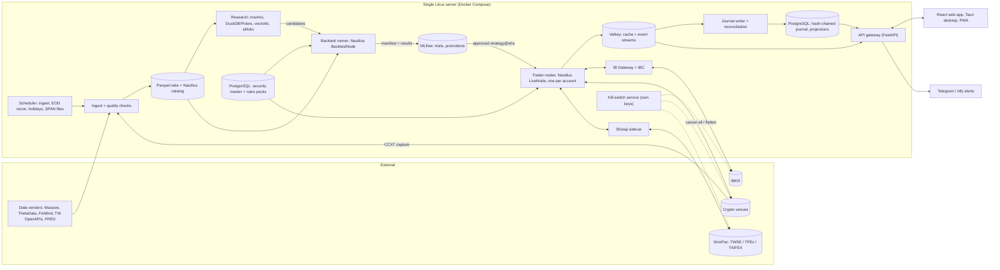
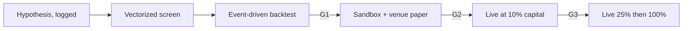

**English** | [繁體中文](proposal-A-lean-mvp.zh-TW.md)

# Proposal A: Lean MVP on Open-Source Shoulders

*Architecture proposal · Status as of 2026-10-05 · Derived from research [01](../research/01-core-language-runtime.md) to [11](../research/11-taiwan-market-localization.md). Versions and prices are snapshots, so re-verify them before committing.*

## 1. Positioning and target audience

**In one sentence:** a Python-first platform built on NautilusTrader v2 and run on one Linux server, which one to three people can take from research to small-size live trading in crypto, US equities and Taiwan equities in about six months, with options and bonds added analytics-first.

| Dimension | Assumption |
|---|---|
| Team | 1–3 people. The sweet spot is 2: a quant/strategy developer and a platform/full-stack engineer |
| Markets | Crypto (1–2 venues legally open to the user); US/global stocks and options via IBKR; TWSE/TPEx stocks and TAIFEX futures/options via SinoPac Shioaji; bonds via bond ETFs plus manually booked positions |
| Latency | Decision-to-order in tens to hundreds of milliseconds, holding periods from minutes to weeks, bar and L1 data. No market making, no L2/L3 queue modelling, no co-location ([01](../research/01-core-language-runtime.md)) |
| Use | **Self-use only** (own accounts). Accounts, owners and limits are still modelled explicitly, so a later service offering becomes a licensing project rather than a rewrite ([08](../research/08-risk-security-ops-compliance.md)) |

**Engine decision: extend, don't build ([10](../research/10-open-source-platforms-build-vs-buy.md)).** NautilusTrader fits this scope best. It has a Rust core with Python strategies, the same strategy code in backtest, sandbox and live, L1–L3 matching, perpetual-funding settlement in backtests, and maintained adapters for IB, Binance, OKX, Bybit, Coinbase, Deribit and Hyperliquid. **LEAN** (Apache-2.0) is the fallback for a C#-first team or a US-options-first product, but it pins strategies to Python 3.11, which reaches end of life in 2027-10. Neither engine ships a Taiwan adapter or a tradable bond type, so those gaps are ours either way. Freqtrade, Hummingbot and Jesse are crypto-only, and vectorbt is research-only.

**Release-candidate stance.** 2.0.0rc5 (2026-09-15) is the newest installable v2 build. rc6 appears in the release notes but is not yet on PyPI. 1.231.0 is the last 1.x and receives security backports only until about November 2026. We build on v2 from day one with an exact pin, and gate real money on 2.0.0 GA or a documented soak test (§6).

## 2. Layered stack

| Layer | Choice | Rationale | Alternative |
|---|---|---|---|
| Core engine language | Rust, but only inside NautilusTrader. We write no Rust in the MVP | Deterministic single-threaded kernel, fixed-point i128 prices and UTC-nanosecond time come for free | C#/.NET 10 via LEAN |
| Strategy language / API | Python 3.14 (standard GIL build). Strategies subclass our `GuardedStrategy` (a Nautilus `Strategy` with mandatory risk checks). Our `runtime` factories build every node and venue config | One language for research and strategies. Factories absorb v2 renames (e.g. rc4's `LiveExecClientConfig` → `ExecutionClientConfig`) in one place | Engine-agnostic strategy SDK (deferred, see §7) |
| Backtest engine | Two tiers: vectorbt 1.x screening (internal use) → Nautilus `BacktestNode` validation on bars + L1 with pessimistic intra-bar fills | Only event-driven results are promoted, and the two tiers must agree within tolerance ([02](../research/02-backtesting-engine.md)) | vectorbt PRO ($240/yr); LEAN CLI |
| Tick and bar data | Parquet lake (Hive-partitioned, zstd; bronze/silver/gold) on local NVMe, mirrored to S3-compatible storage. Nautilus `ParquetDataCatalog` for engine-ready data. DuckDB 1.5.6 (move to 2.0 after its 2026-10-21 release; 1.5 reaches end of life on 2026-11-01) plus Polars | Zero ops on any OS; the same files feed research and backtests ([03](../research/03-market-data-storage.md)) | Single-node QuestDB once live tick capture or dashboards arrive |
| Reference data | PostgreSQL 18 security master: bitemporal `instrument` and `instrument_xref` (FIGI via OpenFIGI, ISIN, OCC OSI, TAIFEX codes, venue symbols). Effective-dated rules packs: ticks, limits, fees, taxes, calendars | Our own IDs survive vendor restatements (Databento reassigns some Nasdaq IDs on 2026-10-31) | Vendor IDs (rejected) |
| Trade and accounting records | Nautilus cache backed by Valkey. Append-only, hash-chained order/fill/limit-change journal plus position and cash projections in PostgreSQL. Nightly export to S3 Object Lock | The venue is the truth and the journal is the audit trail. Reconciliation closes Nautilus's asynchronous-persistence window ([07](../research/07-system-architecture-messaging.md)) | Full event-sourced ledger with outbox (team scale) |
| Vendors: US equities | IBKR market data for live trading. Massive Starter $29 (15-min delayed) for research history. Massive Advanced $199 or Alpaca Algo Trader Plus $99 only if broker-independent real-time data is needed | Cheapest path; individual-use licences fit self-use | Databento Standard $199 for ticks/L2 |
| Vendors: options | ThetaData Standard $80 (tick level) or Value $40; IBKR chains for live | Affordable US options history | ORATS from $199; Cboe DataShop one-offs |
| Vendors: crypto | CCXT 4.5.85 WebSocket capture into bronze Parquet, plus per-venue funding history | Free and MIT-licensed | Tardis.dev (Solo from $700/mo, over budget) |
| Vendors: bonds and rates | FRED/ALFRED and Treasury Fiscal Data (free); IBKR quotes | Free and vintaged | FINRA TRACE academic ($500/yr, 36-month delay) |
| Vendors: Taiwan | Shioaji live feed. TWSE/TPEx/TAIFEX OpenAPIs for reference data, holidays, disposition lists and daily TAIFEX ticks. FinMind sponsor tier for historical ticks over REST (its Python client pins pandas<3) | Free or cheap; futures/options ticks from 2011, stock ticks from 2018 ([11](../research/11-taiwan-market-localization.md)) | Fugle Developer NT$1,499/mo; TEJ for point-in-time fundamentals |
| Connectivity: US/global stocks, options, bonds | IBKR through the Nautilus IB adapter, which in v2 uses the MIT Rust `ibapi` crate rather than the GPL TWS API client. IB Gateway runs headless, with IBC handling daily restarts and 2FA | The only verified single-account route for a Taiwan resident ([04](../research/04-broker-exchange-connectivity.md)) | Alpaca (US persons); tastytrade |
| Connectivity: crypto | Nautilus native adapters for 1–2 eligible venues (e.g. Binance, OKX or Bybit); Deribit later, for options | Built-in reconciliation; trade-only keys | CCXT behind our own port |
| Connectivity: Taiwan | Our Nautilus data and execution adapter, talking to a **Shioaji 1.7.7 sidecar** (`shioaji server start`, local HTTP/SSE) in its own container | Crash isolation; the broker binary and `.pfx` certificate stay out of the engine; Linux-native, so no Windows gateway | Fubon Neo (documented second broker); Capital SKCOM only via a Windows VM later |
| Messaging | Nautilus in-process MessageBus inside each node; Valkey 9.1 (BSD) streams for egress from nodes to the journal and API | Nautilus already speaks Redis-protocol streams, so no custom bridge is needed. Valkey avoids Redis 8's AGPL/RSAL/SSPL terms | NATS JetStream (see §7) |
| OMS / risk | Nautilus ExecutionEngine (order state machine, reconciliation) + RiskEngine (precision, notional, rate limits, `ACTIVE`/`REDUCING`/`HALTED`) + our fail-closed `risk` pack + venue-native controls | Three layers, with the same code in backtest, paper and live | Out-of-process risk gateway (team scale) |
| Pricing: options | QuantLib-Python 1.43 (`QdFpAmericanEngine` for US single stocks). NumPy Black-76 on an implied forward for TXO, index and crypto options. vollib 1.0.11 for chain IV and greeks in a Python 3.13 worker, because vollib does not support 3.14. SVI per expiry. In-house crypto-derivatives module | QuantLib is the only maintained, permissive library covering options, bonds and curves ([05](../research/05-instrument-model-pricing-analytics.md)) | fast-vollib 0.2.3 (young, single maintainer) |
| Pricing: bonds | QuantLib for accrued interest, yield, duration, DV01 and curves; a 32nds parse/display codec | Same library, BSD-3 | Rateslib (any commercial use needs a paid licence; excluded) |
| Research / ML | marimo + JupyterLab; DuckDB/Polars with pandas 3 only at boundaries; skfolio CPCV + cvxpy; LightGBM + Optuna; MLflow 3.16 as the trial registry; in-house metrics (PSR/DSR/PBO) plus pinned QuantStats tear sheets | Reproducible and permissive, with known trial counts ([09](../research/09-research-ml-analytics.md)) | Qlib for cross-sectional ML; Chronos-2/TimesFM 2.5 as baselines only |
| Front end (web / desktop / mobile) | One React + TypeScript (Vite) workstation; Tauri 2.12 desktop shell (pinned to 2.x); PWA companion for alerts, approvals and the kill switch | One codebase, and clients hold no venue keys ([06](../research/06-cross-platform-client-ui.md)) | Electron 44 (pinned Chromium); React Native later |
| Charting and grids | Lightweight Charts 5.2 (attribution shown), uPlot, ECharts 6.1 for reports, AG Grid Community; KLineChart if drawing tools are needed | All permissive. TradingView Advanced Charts is not licensable to individuals | SciChart.js or Highcharts Stock (paid) |
| UI transport | FastAPI gateway: REST for commands, one WebSocket with server-side conflation. Protobuf schemas, sent in their JSON mapping first and binary once profiling justifies it. Arrow IPC for backtest artifacts | Contract-first without heavy codegen on day one | Connect RPC; NATS over WebSocket |
| Deployment | Docker Compose on one Linux server with a static egress IP: either a home mini-PC or one cloud VM in a Taiwan or Tokyo region, chosen by measured RTT (first confirm the Taiwan broker accepts cloud IPs). UI over WireGuard/Tailscale | One box, and a static IP for broker and venue allow-lists | Separate crypto VM in Tokyo plus a home Taiwan box (§7) |
| Observability | Grafana Cloud free tier, or self-hosted Prometheus 3 + Grafana + Loki. Trading SLIs, alerts to Telegram/ntfy, chrony | Zero ops; covers staleness, rejects, drift, reconnects and clock offset | Self-hosted stack once retention matters |
| Security / keys | SOPS + age for server secrets; OS keychain for the desktop API token. Venue keys are trade-only, withdrawal-disabled and IP-bound, one per strategy or sub-account, rotated every 90 days. FIDO2 on every account. The Shioaji `.pfx` is mounted only into its sidecar | Credentials are the crown jewels | OpenBao 2.7 (team scale) |

## 3. Component architecture and data flow



- **Market data.** Live data enters each node through its adapter. Historical and captured data lands raw in bronze, is normalized in silver into a DBN-compatible schema (`ts_event`/`ts_recv` as UTC int64 nanoseconds, internal `instrument_id`, scaled-integer price and size, `source`, `license_tag`), and is aggregated into gold bars and features. Partitions that fail quality checks are quarantined.
- **Orders.** Strategy → `GuardedStrategy` checks (rules pack, limits, loss breaker) → Nautilus RiskEngine → ExecutionEngine → adapter → venue. Node events flow to Valkey, where the journal writer appends them to the hash chain and the API pushes them to clients.
- **Reconciliation.** At startup, strategies stay stopped until open orders, fills, positions and balances match. Intraday checks run every 1–5 minutes, and an end-of-day check runs against broker statements. Any unexplained mismatch sets `HALTED`.
- **Control.** UI commands (halt, resume, flatten, limit changes) go through the API to a per-node control stream. The kill-switch service holds its own trade-only keys and can cancel at each venue even when a node is wedged. Venue dead-man timers, such as Binance's per-symbol `countdownCancelAll`, are the third path.

### Same strategy code from backtest to paper to live



| Stage | Nautilus mode | Clock and data | Execution | Gate to the next stage |
|---|---|---|---|---|
| Backtest | `BacktestNode` | Simulated clock; catalog replay | Simulated venue built from the same venue and rules config as live, with an explicit fee model (mandatory from rc6) and funding events | **G1:** walk-forward or CPCV; DSR ≥ 0.95; PBO ≤ 0.2; still profitable with costs doubled; vectorized and event-driven tiers agree |
| Paper | Sandbox node (live data, simulated fills), plus IBKR paper, testnets and Shioaji `simulation=True` | Live | Simulated or venue paper | **G2:** ≥3 months or a minimum trade count; slippage and tracking error within bands; reconciliation clean |
| Live | `LiveNode` | Live | Real | **G3:** capital ramp 10% → 25% → 100%; live P&L inside the backtest's Monte Carlo 95% band |

Only the node configuration differs between modes. The live node loads a strategy only as `git SHA + config hash` carrying an MLflow promotion tag. Every run writes a manifest (lockfile, engine pin, data snapshot hash, seeds, rules-pack version). CI lint-bans wall-clock and I/O calls in strategy code. Golden-master replays of recorded sessions guard backtest-live parity.

## 4. Handling per asset class

| Asset class | Instrument model | Pricing / analytics | Sessions, expiry, settlement | Fee and tax model (effective-dated) | MVP scope |
|---|---|---|---|---|---|
| US equities | Nautilus `Equity`; raw prices plus corporate-action factors applied on read, because Nautilus backtests have no built-in corporate actions | Marks only | `exchange_calendars` US; T+1 | IBKR $0.005/share (min $1); SEC Section 31 (rate reset each fiscal year), FINRA TAF, borrow fees | Daily/minute strategies, live |
| Taiwan equities | `Equity` plus TW attributes: tick ladder (0.01 to 5 at breaks of 10/50/100/500/1,000), board lot 1,000 vs odd lot as a typed quantity, disposition flag, day-trade eligibility | Marks only | XTAI; call auctions 08:30–09:00 and 13:25–13:30; ±10% limits; 3.5% volatility interruption; 5-second odd-lot auctions; T+2 | Commission ≤0.1425%; securities transaction tax 0.3% on sells, 0.15% on day trades until 2027-12-31, 0.1% on ETFs | Board-lot strategies live. Odd lots tested with tiny real orders, because Shioaji's simulator rejects them |
| Crypto (spot, perpetuals) | `CurrencyPair`, `CryptoPerpetual`, `CryptoFuture`; `settlement_currency` and `is_inverse` extensions | Inverse/linear PnL, funding accrual and basis in our crypto module | 24/7, with a 00:00 UTC daily cut; liquidation simulated | Maker/taker tiers; funding as `FundingSettlement` events from per-venue history (Binance 8 h by default, switchable to 1 h; Hyperliquid hourly) | First live market |
| Options (US, TXO, Deribit) | `OptionContract`, `OptionSpread`; OCC OSI keys; TAIFEX weekly codes | US single stocks: American QD+. TXO, index and Deribit: Black-76 on an implied forward, with premium-adjusted delta for BTC-settled contracts. SVI per expiry | TXO is European and cash-settled on a 30-minute average, with Wednesday/Friday weeklies; Deribit expires 08:00 UTC. Exercise and assignment are reconciled from the broker, since Nautilus has no early-assignment model | IBKR tiered per-contract fees; TAIFEX tax 0.1% of premium, both sides. Margin: Reg T table plus TAIFEX SPAN-file loader for backtests; broker figures live | Analytics, then low-frequency single-leg and defined-risk strategies (M6) |
| TAIFEX futures | `FuturesContract` (TX NT$200/pt, MTX NT$50, TMF NT$10) | Basis versus index | Day 08:45–13:45, night 15:00–05:00; monthly expiry on the third Wednesday; daily mark-to-market | Futures tax 0.002% of value, both sides; margins and position limits from the TAIFEX OpenAPI | Live alongside TW equities |
| Bonds | Nautilus has no tradable bond type. Bond ETFs are `Equity`. Direct bonds live in a `bond_terms` table (coupon schedule, day count, settlement lag, calls) and are booked into the journal by hand or from low-frequency IBKR orders | QuantLib: accrued interest, yield, duration, DV01, curves | SIFMA calendars (`pandas_market_calendars`); US Treasuries T+1 | Dealer markup. TW corporate bonds and bond ETFs are exempt from transaction tax only until 2026-12-31 | Daily valuation only. No backtests on indicative OTC quotes |

**Cross-cutting contracts.**
- Prices and quantities stay fixed-point in the engine (Nautilus v2 wheels default to 128-bit, 16 decimals). Decimal is used in accounting reports and float64 only in analytics, with explicit conversions between them.
- A `CalendarPort` derives `trading_date` and `session_id` from UTC nanoseconds. It combines `exchange_calendars` (XTAI, US), `pandas_market_calendars` (CME, SIFMA), custom TAIFEX day/night and crypto calendars, and versioned override files for typhoon closures.
- Two items need care in M1. QuantLib's Taiwan calendar stops at 2026, so load the 2027 TWSE/TAIFEX holidays. Also, confirm the rule that night-session fills belong to the next trading date against TAIFEX's own rules before implementing it.

## 5. Suggested repository layout

```text
trading-platform/
├─ pyproject.toml, uv.lock     # Python 3.14; nautilus_trader==2.0.0rc5 (exact pin)
├─ envs/legacy-quant/          # Python 3.13 + pandas 2.3: vollib, alphalens, FinMind client
├─ proto/                      # Protobuf contracts for API/UI (buf breaking checks)
├─ platform/                   # our code; engine internals do not leak past runtime/
│  ├─ runtime/                 # Nautilus node/venue config factories, version shims
│  ├─ domain/                  # instrument extensions, bond terms, money/time helpers
│  ├─ refdata/                 # security master, FIGI/OSI/TAIFEX/crypto symbology
│  ├─ calendars/               # CalendarPort implementations + override files
│  ├─ rules/{us,tw,taifex,crypto}/  # effective-dated ticks, limits, fees, taxes
│  ├─ risk/                    # GuardedStrategy, pre-trade checks, loss breakers
│  ├─ pricing/                 # QuantLib wrappers, Black-76, SVI, crypto_derivs
│  ├─ ledger/                  # journal writer, hash chain, reconciliation jobs
│  ├─ data/                    # ingest (bronze/silver/gold), quality checks
│  └─ research/                # metrics (PSR/DSR/PBO), CPCV glue, screens
├─ adapters/shioaji/           # Nautilus data+exec adapter -> Shioaji sidecar
├─ strategies/                 # strategies (subclass GuardedStrategy) + configs
├─ apps/{node,backtest,api,scheduler,notifier,killswitch}/
├─ notebooks/                  # marimo .py notebooks
├─ ui/                         # React/TS (Vite), src-tauri/, PWA manifest
├─ config/                     # venues.yaml, limits.yaml, SOPS-encrypted secrets
├─ deploy/compose/             # docker-compose.yml, IBC config, systemd units
├─ tests/{unit,property,golden,contract,recon}/
└─ docs/adr/
```

IBKR and crypto connectivity use the upstream Nautilus adapters, configured through `runtime/`, so the repository only owns the Taiwan adapter.

## 6. Roadmap and cost

Durations assume two people working in parallel.

| Phase | Weeks | Scope | Exit criteria | Person-months |
|---|---|---|---|---|
| M0 Foundations | 0–4 | Monorepo, lockfiles, CI (wall-clock lint, SPDX licence scan), first ADRs. Spikes: v2 custom-adapter API, Valkey as the Nautilus Redis backend, Shioaji sidecar, IB Gateway + IBC, Python 3.14 wheels for every pin | Spike verdicts recorded; a backtest runs in CI | 1.0 |
| M1 Data and research | 3–10 | Ingest for CCXT, Massive/IBKR history, TW OpenAPIs, FinMind and FRED; lake layers; quality checks; security master; `CalendarPort`; marimo, MLflow and the metrics module | Point-in-time universe including delisted names for one market; trial registry live | 2.0 |
| M2 Event-driven backtests | 8–16 | Crypto perpetuals with funding, US and TW equities; TW rules pack; fee and tax tables; crypto module; manifests; golden-master CI; automated G1 | Two reference strategies pass or fail G1 reproducibly | 2.5 |
| M3 Paper and operations | 14–22 | Nodes on IBKR paper, testnet and Shioaji simulation; risk pack; three-path kill switch; journal and reconciliation; Compose deployment, backups, observability, secrets | 5+ consecutive clean reconciliation sessions; kill-switch drill passed | 2.0 |
| M4 UI (parallel) | 12–24 | Web workstation (positions, orders, charts, backtest reports, limits, kill switch), Tauri build, PWA with web push, Telegram bot | Day-to-day operation from desktop and phone | 2.0 |
| M5 Small live | 22–28 | Go-live checklist; first market at 10% capital, then ramp | G3 met on one market; 4 weeks of clean reconciliation | 1.0 |
| M6 Options and bonds | 26–38 | Chains (ThetaData, IBKR, Shioaji TXO), pricing worker, Reg T and SPAN loaders, Deribit analytics, bond ETFs, manual bond book with QuantLib valuation | Options strategies through G1/G2; bond book valued daily | 2.5–3.0 |

**About 10.5 person-months to the first live market (about 5–6.5 months elapsed for two people) and about 13 person-months including options and bonds.** A solo builder should expect 11–13 months to go live.

**Real-money gate.** Live trading requires either (a) a pinned Nautilus 2.0.0 GA, or (b) a pinned RC that passed a 30-day paper soak with zero unexplained reconciliation breaks, a signed risk-acceptance ADR, and capital capped at 10%. Falling back to 1.231.x is only a stopgap, because its backport window closes around November 2026.

**Monthly cost (order of magnitude, USD, excluding commissions):**

| Item | Research and paper (M0–M4) | Live MVP (M5+) |
|---|---|---|
| US equities data | $0–29 (Massive Starter) | $10–200 (IBKR bundle, $10 and waived at $30 of commissions; add Massive Advanced or Alpaca only if needed) |
| Options data | $0–40 (ThetaData Value) | $80 (ThetaData Standard) |
| Crypto, bonds and rates data | $0 | $0 |
| Taiwan data | $0 (OpenAPIs, Shioaji) | ~$50–100 (FinMind sponsor tier, price to confirm; Fugle Developer ≈ US$47 optional) |
| Compute | Existing workstation; a home mini-PC is a one-off purchase | $0 (home server) or ~$80–200 for a cloud VM (author's estimate, not from the research) |
| Storage, backup, WORM | ~$5 | ~$5–20 |
| Observability and licences | $0 (Grafana Cloud free; all OSS) | $0–20 (optional vectorbt PRO at $240/yr) |
| **Total** | **≈ $5–100** | **≈ $150–600** |

## 7. Risks and evolution triggers

**Technical risks**
- **Nautilus v2 churn.** The RCs break configs and enums: rc4 renamed configs, and rc6 makes an explicit fee model mandatory and drops BitMEX. No GA date has been published. *Mitigation:* exact pins, `runtime/` factories, golden-master tests, planned upgrade windows, and a LEAN fallback ADR. Strategy code is knowingly coupled to Nautilus's `Strategy` API; that is the price of being lean.
- **Taiwan adapter.** The maturity of the v2 custom-adapter API is unverified. Shioaji returns *empty values* once its traffic cap is exceeded, suspends service on rate-limit breaches, ships every 14 days, and yanked 1.7.6. *Mitigation:* the sidecar boundary, contract tests, treating empty responses as alarms, and client-side throttling.
- **Single server.** It is a single point of failure, and crypto trades 24/7 with one operator. *Mitigation:* venue dead-man timers, auto-flatten rules, a UPS, restore drills, and reconciliation before every restart.
- **Persistence gap.** Nautilus does not gate dispatch on a durable commit. Startup reconciliation is therefore a release blocker.
- **Dependency churn.** DuckDB 2.0; the pandas 3 split (hence the legacy environment); Python 3.15 (stay on 3.14); Tauri v3 alpha; the Valkey/Nautilus v2 compatibility that M0 must confirm, with NATS as the fallback.
- **Backtest realism.** Taiwan limit-locked days, missing early-assignment modelling and indicative bond quotes all inflate results. The rules pack and broker reconciliation address them.

**Licence risks**
- Nautilus is LGPL-3.0-only. It stays server-side and is never bundled into Tauri or PWA builds. Distributing any binary that contains it needs legal review of Rust static-linking obligations.
- TWS API 10.49+ is GPL. We avoid linking it: Nautilus v2 uses the MIT `ibapi` crate, and the kill switch uses ib_async (BSD-2).
- vectorbt carries a Commons Clause, and vectorbt PRO memberships are personal and non-commercial. Use both for internal research only, and confirm the terms if a company entity trades.
- Data licences: Massive and ThetaData plans are individual-use; broker feeds may not be redistributed; TWSE redistribution costs NT$60,000/month plus fees; TAIFEX data needs written consent; Lightweight Charts requires attribution. Every dataset carries a `license_tag`.
- Excluded: Rateslib, FinancePy (test oracle only), TimesFM 3.0 and Moirai 2.0 weights, lakeFS (BSL), Redis 8, and GPL/AGPL engines in anything distributed.

**Regulatory risks**
- The platform stays self-use. In Taiwan, paid securities advice needs an SICE (投顧) licence, and unlicensed futures advice carries up to 7 years under Futures Trading Act Art. 112. Broker API terms forbid authorizing third parties, and certificates are personal.
- Crypto venues come from a configured allow-list: local AML registration applies, and the VASP Act (passed 2026-06-30) takes effect in Q1 2027 at the earliest, with licences expected around Q1 2028.
- FINRA intraday margin replaced the PDT rule on 2026-06-04, but brokers may phase it in until 2027-10-20, so both regimes must be configurable.
- Dated tax rules expire: the Taiwan bond and bond-ETF holiday ends 2026-12-31, and the 0.15% day-trade rate runs to 2027-12-31.

**Triggers for moving toward another proposal**

| Trigger | Evolve toward |
|---|---|
| A second user, a paid signal, copy trading or any tenant | Team-scale build: our own OMS, ledger, entitlements and audit, with the engine behind a `StrategyRuntime` port. Licensing comes first |
| 4+ engineers, or more than about 5 trader nodes or accounts | Per-venue gateways, NATS JetStream as the bus, an out-of-process risk gateway, OpenBao |
| Bonds beyond ETFs and manual booking | Own bond instrument and RFQ workflow; FIX (QuickFIX/J) to Tradeweb, MarketAxess or Bloomberg |
| Reaction under ~10 ms, or a need for L2/L3 queue modelling | Rust-native strategies, L3 backtests (Nautilus or hftbacktest), Tokyo hosting, Fubon DMA/IDC for TAIFEX |
| A Windows-only broker (Capital SKCOM for overseas futures or 複委託) | Hybrid topology: a Windows gateway VM plus a NATS leaf node |
| Live tick capture, or several concurrent dashboards | QuestDB; Iceberg or DuckLake once there are multiple writers |
| Nautilus 2.0 GA slips past M5, or upstream rejects a core change we need | Switch to LEAN, or fork with 2+ engineers dedicated to rebasing |
| Capital that cannot tolerate hours of downtime | Active-passive per account with fencing, a second region, WORM retention aligned to SEC 17a-4 |
