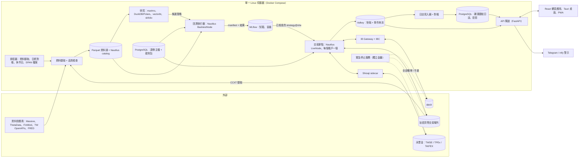
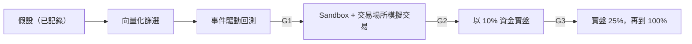

[English](proposal-A-lean-mvp.md) | **繁體中文**

# 提案 A：站在開源肩膀上的精實 MVP

*架構提案 · 狀態截至 2026-10-05 · 衍生自研究 [01](../research/01-core-language-runtime.zh-TW.md) 至 [11](../research/11-taiwan-market-localization.zh-TW.md)。版本與價格皆為當時的快照，正式採用前請重新查證。*

## 1. 定位與目標使用者

**一句話總結：** 一個以 Python 為主、建構於 NautilusTrader v2 之上並執行於單一 Linux 伺服器的平台，讓一至三人在約六個月內，從研究走到加密貨幣、美股與台股的小額實盤交易；選擇權與債券則以分析優先的方式納入。

| 面向 | 假設 |
|---|---|
| 團隊 | 1–3 人。最佳規模為 2 人：一位量化／策略開發者，以及一位平台／全端工程師 |
| 市場 | 加密貨幣（1–2 個使用者可合法使用的交易場所（venue））；透過 IBKR 交易美國／全球股票與選擇權；透過永豐金（SinoPac）Shioaji 交易 TWSE／TPEx 股票及 TAIFEX 期貨／選擇權；債券則透過債券 ETF 加上手動登錄的部位 |
| 延遲 | 從決策到下單為數十至數百毫秒，持有期間從數分鐘到數週，使用 K 線（bar）與 L1 資料。不做造市、不做 L2/L3 佇列建模、不做主機共置（co-location）（[01](../research/01-core-language-runtime.zh-TW.md)） |
| 用途 | **僅供自用**（自有帳戶）。帳戶、擁有者與限額仍會明確建模，因此日後若要對外提供服務，將是一項取得執照的專案，而非重寫（[08](../research/08-risk-security-ops-compliance.zh-TW.md)） |

**引擎決策：擴充，而非自建（[10](../research/10-open-source-platforms-build-vs-buy.zh-TW.md)）。** NautilusTrader 最符合此範圍。它擁有 Rust 核心搭配 Python 策略，在回測、沙盒（sandbox）與實盤中使用同一套策略程式碼，支援 L1–L3 撮合、回測中的永續合約資金費率結算，並維護 IB、Binance、OKX、Bybit、Coinbase、Deribit 與 Hyperliquid 的轉接器（adapter）。**LEAN**（Apache-2.0）是以 C# 為主的團隊或以美股選擇權為主的產品的備案，但它將策略綁定在 Python 3.11，而該版本將於 2027-10 終止支援（end of life）。兩個引擎都沒有提供台灣轉接器或可交易的債券型別，所以無論選哪一個，這些缺口都得由我們自己補上。Freqtrade、Hummingbot 與 Jesse 僅支援加密貨幣，vectorbt 則僅適用於研究。

**候選版本（release candidate）立場。** 2.0.0rc5（2026-09-15）是目前最新、可安裝的 v2 版本。rc6 雖已出現在發行說明中，但尚未上架 PyPI。1.231.0 是最後一個 1.x 版本，僅會收到安全性向後移植（backport）修補，直到約 2026 年 11 月為止。我們從第一天起就以精確版本鎖定（exact pin）建構於 v2 之上，並以 2.0.0 正式版（GA）或一次有文件紀錄的浸泡測試（soak test）作為投入真實資金的關卡（§6）。

## 2. 分層技術堆疊

| 層級 | 選擇 | 理由 | 替代方案 |
|---|---|---|---|
| 核心引擎語言 | Rust，但僅限於 NautilusTrader 內部。MVP 中我們不撰寫任何 Rust | 直接免費獲得確定性的單執行緒核心、定點數 i128 價格與 UTC 奈秒時間 | 透過 LEAN 使用 C#/.NET 10 |
| 策略語言／API | Python 3.14（標準 GIL 版本）。策略繼承我們的 `GuardedStrategy`（一個內建強制風控檢查的 Nautilus `Strategy`）。由我們的 `runtime` 工廠建構每個節點與交易場所的設定 | 研究與策略使用同一種語言。工廠將 v2 的更名（例如 rc4 的 `LiveExecClientConfig` → `ExecutionClientConfig`）集中在單一處吸收 | 與引擎無關的策略 SDK（延後，見 §7） |
| 回測引擎 | 兩層：vectorbt 1.x 篩選（內部使用）→ Nautilus `BacktestNode` 在 K 線 + L1 上驗證，並採用悲觀的 K 線內成交假設 | 只有事件驅動（event-driven）的結果才會晉級，且兩層結果必須在容許誤差內一致（[02](../research/02-backtesting-engine.zh-TW.md)） | vectorbt PRO（$240/年）；LEAN CLI |
| Tick 與 K 線資料 | 位於本機 NVMe 的 Parquet 資料湖（Hive 分割、zstd；bronze/silver/gold），並鏡像至 S3 相容儲存。以 Nautilus `ParquetDataCatalog` 存放引擎可直接使用的資料。DuckDB 1.5.6（2.0 於 2026-10-21 發布後即改用；1.5 於 2026-11-01 終止支援）加上 Polars | 在任何作業系統上皆零維運；同一批檔案同時供研究與回測使用（[03](../research/03-market-data-storage.zh-TW.md)） | 待即時 tick 擷取或儀表板上線後，改用單節點 QuestDB |
| 參考資料 | PostgreSQL 18 證券主檔（security master）：雙時態（bitemporal）的 `instrument` 與 `instrument_xref`（透過 OpenFIGI 取得的 FIGI、ISIN、OCC OSI、TAIFEX 代碼、交易場所代號）。依生效日期管理的規則包：跳動單位（tick）、限制、手續費、稅、交易日曆 | 我們自有的 ID 不受供應商重新編定影響（Databento 將於 2026-10-31 重新指派部分 Nasdaq ID） | 供應商 ID（已否決） |
| 交易與會計紀錄 | 以 Valkey 為後端的 Nautilus 快取。PostgreSQL 中有僅可附加（append-only）、雜湊鏈結的委託／成交／限額變更日誌，以及部位與現金投影（projection）。每晚匯出至 S3 Object Lock | 交易場所是事實來源，日誌則是稽核軌跡。對帳可補上 Nautilus 非同步持久化的空窗期（[07](../research/07-system-architecture-messaging.zh-TW.md)） | 搭配 outbox 的完整事件溯源（event-sourced）帳本（團隊規模） |
| 供應商：美股 | 實盤使用 IBKR 市場資料。研究用歷史資料使用 Massive Starter $29（延遲 15 分鐘）。只有在需要不依賴券商的即時資料時，才採用 Massive Advanced $199 或 Alpaca Algo Trader Plus $99 | 最便宜的路徑；個人使用授權符合自用情境 | Databento Standard $199，用於 tick／L2 |
| 供應商：選擇權 | ThetaData Standard $80（tick 等級）或 Value $40；實盤使用 IBKR 的選擇權鏈 | 價格實惠的美股選擇權歷史資料 | ORATS 起價 $199；Cboe DataShop 單次購買 |
| 供應商：加密貨幣 | 以 CCXT 4.5.85 WebSocket 擷取並寫入 bronze Parquet，加上各交易場所的資金費率歷史 | 免費且採 MIT 授權 | Tardis.dev（Solo 方案每月 $700 起，超出預算） |
| 供應商：債券與利率 | FRED/ALFRED 與 Treasury Fiscal Data（免費）；IBKR 報價 | 免費且保留歷史版本（vintage） | FINRA TRACE 學術版（$500/年，延遲 36 個月） |
| 供應商：台灣 | Shioaji 即時行情。TWSE/TPEx/TAIFEX OpenAPI 提供參考資料、休市日、處置股清單與 TAIFEX 每日 tick。FinMind 贊助方案透過 REST 提供歷史 tick（其 Python 用戶端鎖定 pandas<3） | 免費或便宜；期貨／選擇權 tick 自 2011 年起，股票 tick 自 2018 年起（[11](../research/11-taiwan-market-localization.zh-TW.md)） | Fugle Developer 每月 NT$1,499；TEJ 提供時點（point-in-time）基本面資料 |
| 連線：美國／全球股票、選擇權、債券 | 透過 Nautilus IB 轉接器連接 IBKR；該轉接器在 v2 中使用 MIT 授權的 Rust `ibapi` crate，而非 GPL 授權的 TWS API 用戶端。IB Gateway 以無頭（headless）模式執行，並由 IBC 處理每日重啟與 2FA | 台灣居民唯一經驗證、可用單一帳戶完成的途徑（[04](../research/04-broker-exchange-connectivity.zh-TW.md)） | Alpaca（限美國人士）；tastytrade |
| 連線：加密貨幣 | 針對 1–2 個合格交易場所（例如 Binance、OKX 或 Bybit）使用 Nautilus 原生轉接器；Deribit 日後再加入，用於選擇權 | 內建對帳；僅具交易權限的金鑰 | 包在我們自有 port 之後的 CCXT |
| 連線：台灣 | 我們自建的 Nautilus 資料與執行轉接器，與在獨立容器中執行的 **Shioaji 1.7.7 sidecar**（`shioaji server start`，本機 HTTP/SSE）溝通 | 故障隔離；券商二進位檔與 `.pfx` 憑證不進入引擎；Linux 原生，因此不需要 Windows 閘道 | 富邦 Neo（有文件記錄的第二家券商）；群益 SKCOM 僅能日後透過 Windows VM 使用 |
| 訊息傳遞 | 每個節點內部使用 Nautilus 行程內 MessageBus；以 Valkey 9.1（BSD）streams 將事件從節點送往日誌與 API | Nautilus 本身已支援 Redis 協定的 streams，因此不需要自訂橋接。Valkey 可避開 Redis 8 的 AGPL/RSAL/SSPL 授權條款 | NATS JetStream（見 §7） |
| OMS／風控 | Nautilus ExecutionEngine（委託狀態機、對帳）+ RiskEngine（精度、名目金額、速率限制、`ACTIVE`/`REDUCING`/`HALTED`）+ 我們的失效即關閉（fail-closed）`risk` 套件 + 交易場所原生控制 | 三層防護，在回測、模擬交易與實盤中使用相同程式碼 | 獨立行程的風控閘道（團隊規模） |
| 定價：選擇權 | QuantLib-Python 1.43（美國個股使用 `QdFpAmericanEngine`）。TXO、指數與加密貨幣選擇權使用以 NumPy 實作、基於隱含遠期價格的 Black-76。在 Python 3.13 worker 中使用 vollib 1.0.11 計算選擇權鏈的隱含波動率（IV）與希臘字母，因為 vollib 不支援 3.14。每個到期日各自擬合 SVI。自建加密貨幣衍生性商品模組 | QuantLib 是唯一持續維護、採寬鬆授權，且涵蓋選擇權、債券與曲線的函式庫（[05](../research/05-instrument-model-pricing-analytics.zh-TW.md)） | fast-vollib 0.2.3（尚新、僅單一維護者） |
| 定價：債券 | 使用 QuantLib 計算應計利息、殖利率、存續期間、DV01 與曲線；另有 32 分之一報價（32nds）的解析／顯示編解碼器 | 同一個函式庫，BSD-3 授權 | Rateslib（任何商業用途皆需付費授權；已排除） |
| 研究／ML | marimo + JupyterLab；DuckDB/Polars，pandas 3 僅用於邊界；skfolio CPCV + cvxpy；LightGBM + Optuna；以 MLflow 3.16 作為試驗登錄庫；自建指標（PSR/DSR/PBO）加上鎖定版本的 QuantStats 績效報告（tear sheet） | 可重現、採寬鬆授權，且試驗次數可知（[09](../research/09-research-ml-analytics.zh-TW.md)） | Qlib 用於橫斷面 ML；Chronos-2/TimesFM 2.5 僅作為基準 |
| 前端（網頁／桌面／行動） | 單一 React + TypeScript（Vite）交易工作站；Tauri 2.12 桌面外殼（鎖定 2.x）；PWA 輔助應用，用於警示、審批與緊急停止開關（kill switch） | 單一程式碼庫，且用戶端不持有任何交易場所金鑰（[06](../research/06-cross-platform-client-ui.zh-TW.md)） | Electron 44（鎖定 Chromium 版本）；日後採用 React Native |
| 圖表與表格 | Lightweight Charts 5.2（顯示出處標示）、uPlot、用於報告的 ECharts 6.1、AG Grid Community；若需要繪圖工具則使用 KLineChart | 全部採寬鬆授權。TradingView Advanced Charts 不授權給個人 | SciChart.js 或 Highcharts Stock（付費） |
| UI 傳輸 | FastAPI 閘道：命令使用 REST，另有一條具伺服器端合併（conflation）的 WebSocket。Protobuf schema 先以其 JSON 對應格式傳送，待效能分析證明有必要時再改為二進位。回測產出物使用 Arrow IPC | 契約優先（contract-first），且第一天不需要繁重的程式碼產生 | Connect RPC；NATS over WebSocket |
| 部署 | 在一台具固定對外 IP 的 Linux 伺服器上使用 Docker Compose：可以是家用迷你電腦，或位於台灣或東京區域的一台雲端 VM，依實測 RTT 選擇（須先確認台灣券商接受雲端 IP）。UI 透過 WireGuard/Tailscale 存取 | 單一主機，並以固定 IP 因應券商與交易場所的允許清單 | 東京的獨立加密貨幣 VM 加上家中的台灣主機（§7） |
| 可觀測性 | Grafana Cloud 免費方案，或自架 Prometheus 3 + Grafana + Loki。交易 SLI、警示發送至 Telegram/ntfy、chrony | 零維運；涵蓋資料過期、拒單、漂移、重新連線與時鐘偏差 | 當資料保存期限變得重要時，改用自架堆疊 |
| 資安／金鑰 | 伺服器機密使用 SOPS + age；桌面 API 權杖存於作業系統金鑰鏈。交易場所金鑰僅具交易權限、停用提領且綁定 IP，每個策略或子帳戶各一把，每 90 天輪替。每個帳戶皆啟用 FIDO2。Shioaji `.pfx` 僅掛載至其 sidecar | 憑證是最核心的資產 | OpenBao 2.7（團隊規模） |

## 3. 元件架構與資料流



- **市場資料。** 即時資料透過各節點的轉接器進入節點。歷史資料與擷取的資料以原始形式落地於 bronze 層，在 silver 層正規化為與 DBN 相容的 schema（`ts_event`/`ts_recv` 為 UTC int64 奈秒、內部 `instrument_id`、以縮放整數表示的價格與數量、`source`、`license_tag`），再於 gold 層彙總為 K 線與特徵。未通過品質檢查的分割區會被隔離。
- **委託。** 策略 → `GuardedStrategy` 檢查（規則包、限額、虧損斷路器）→ Nautilus RiskEngine → ExecutionEngine → 轉接器 → 交易場所。節點事件流入 Valkey，由日誌寫入器將其附加至雜湊鏈，並由 API 推送給用戶端。
- **對帳。** 啟動時，策略會保持停止狀態，直到未成交委託、成交、部位與餘額全部相符為止。盤中每 1–5 分鐘執行一次檢查，日終則與券商對帳單核對。任何無法解釋的不一致都會設為 `HALTED`。
- **控制。** UI 命令（停止交易、恢復、平倉、限額變更）透過 API 送至每個節點專屬的控制串流。緊急停止服務持有自己的僅限交易金鑰，即使節點卡死，也能在各交易場所撤單。交易場所的 dead-man 計時器（例如 Binance 的逐商品 `countdownCancelAll`）則是第三條路徑。

### 從回測、模擬交易到實盤皆使用同一套策略程式碼



| 階段 | Nautilus 模式 | 時鐘與資料 | 執行 | 進入下一階段的關卡 |
|---|---|---|---|---|
| 回測 | `BacktestNode` | 模擬時鐘；catalog 重播 | 以與實盤相同的交易場所與規則設定建構的模擬交易場所，搭配明確的手續費模型（自 rc6 起為強制）與資金費率事件 | **G1：** 前推分析（walk-forward）或 CPCV；DSR ≥ 0.95；PBO ≤ 0.2；成本加倍後仍可獲利；向量化與事件驅動兩層結果一致 |
| 模擬交易 | Sandbox 節點（即時資料、模擬成交），加上 IBKR 模擬帳戶、測試網（testnet）與 Shioaji `simulation=True` | 即時 | 模擬，或交易場所提供的模擬交易 | **G2：** ≥3 個月或達最低交易筆數；滑價與追蹤誤差在容許範圍內；對帳無誤 |
| 實盤 | `LiveNode` | 即時 | 真實 | **G3：** 資金逐步增加 10% → 25% → 100%；實盤損益落在回測蒙地卡羅 95% 區間內 |

各模式之間只有節點設定不同。實盤節點只會載入以 `git SHA + config hash` 形式、並帶有 MLflow 晉級標籤的策略。每次執行都會寫出一份 manifest（lockfile、引擎版本鎖定、資料快照雜湊、亂數種子、規則包版本）。CI 以 lint 禁止策略程式碼呼叫牆上時鐘（wall-clock）與 I/O。錄製交易時段的黃金基準（golden-master）重播，用以確保回測與實盤的一致性。

## 4. 各資產類別的處理方式

| 資產類別 | 商品模型 | 定價／分析 | 交易時段、到期、交割 | 手續費與稅務模型（依生效日期） | MVP 範圍 |
|---|---|---|---|---|---|
| 美股 | Nautilus `Equity`；原始價格加上於讀取時套用的公司行動因子，因為 Nautilus 回測沒有內建公司行動 | 僅計算市值（mark） | `exchange_calendars` 美國；T+1 | IBKR 每股 $0.005（最低 $1）；SEC Section 31 規費（每會計年度重設費率）、FINRA TAF、借券費用 | 日線／分鐘線策略，實盤 |
| 台股 | `Equity` 加上台灣屬性：升降單位級距（0.01 至 5，分界點為 10/50/100/500/1,000）、整股 1,000 股與零股以型別化數量區分、處置股標記、當沖資格 | 僅計算市值（mark） | XTAI；集合競價 08:30–09:00 與 13:25–13:30；±10% 漲跌幅限制；3.5% 瞬間價格穩定措施；零股每 5 秒集合競價；T+2 | 手續費 ≤0.1425%；證券交易稅：賣出 0.3%、當沖 0.15%（至 2027-12-31）、ETF 0.1% | 整股策略實盤。零股以極小額真實委託測試，因為 Shioaji 的模擬環境會拒絕零股委託 |
| 加密貨幣（現貨、永續合約） | `CurrencyPair`、`CryptoPerpetual`、`CryptoFuture`；`settlement_currency` 與 `is_inverse` 擴充 | 在我們的加密貨幣模組中計算反向／線性合約損益、資金費率累計與基差 | 24/7，每日於 00:00 UTC 切日；模擬強制平倉 | Maker/taker 費率級距；資金費率以各交易場所歷史資料產生 `FundingSettlement` 事件（Binance 預設 8 小時，可切換為 1 小時；Hyperliquid 每小時） | 第一個實盤市場 |
| 選擇權（美國、TXO、Deribit） | `OptionContract`、`OptionSpread`；OCC OSI 鍵值；TAIFEX 週選擇權代碼 | 美國個股：American QD+。TXO、指數與 Deribit：基於隱含遠期價格的 Black-76，BTC 結算合約使用權利金調整後的 delta。每個到期日各自擬合 SVI | TXO 為歐式、以 30 分鐘平均價現金結算，並有週三／週五到期的週選擇權；Deribit 於 08:00 UTC 到期。由於 Nautilus 沒有提前指派模型，履約與指派依券商資料對帳 | IBKR 依級距按口計費；TAIFEX 交易稅為權利金的 0.1%，買賣雙方皆課。保證金：回測使用 Reg T 表格加上 TAIFEX SPAN 檔載入器；實盤採用券商數據 | 先做分析，再做低頻單腳與風險有限（defined-risk）的策略（M6） |
| TAIFEX 期貨 | `FuturesContract`（TX 大台每點 NT$200、MTX 小台 NT$50、TMF 微台 NT$10） | 相對於指數的基差 | 日盤 08:45–13:45，夜盤 15:00–05:00；每月第三個週三到期；每日按市值計價 | 期貨交易稅為契約價值的 0.002%，買賣雙方皆課；保證金與部位限制取自 TAIFEX OpenAPI | 與台股一同實盤 |
| 債券 | Nautilus 沒有可交易的債券型別。債券 ETF 視為 `Equity`。直接持有的債券存放於 `bond_terms` 資料表（票息時程、計息基礎、交割延遲、贖回條款），並以人工方式或從低頻 IBKR 委託登錄至日誌 | QuantLib：應計利息、殖利率、存續期間、DV01、曲線 | SIFMA 交易日曆（`pandas_market_calendars`）；美國公債 T+1 | 交易商加價（markup）。台灣公司債與債券 ETF 僅在 2026-12-31 前免徵交易稅 | 僅做每日評價。不以指示性 OTC 報價進行回測 |

**跨領域契約。**
- 價格與數量在引擎中維持定點數表示（Nautilus v2 wheel 預設為 128 位元、16 位小數）。會計報表使用 Decimal，float64 僅用於分析，兩者之間皆以明確方式轉換。
- `CalendarPort` 由 UTC 奈秒推導出 `trading_date` 與 `session_id`。它結合 `exchange_calendars`（XTAI、美國）、`pandas_market_calendars`（CME、SIFMA）、自訂的 TAIFEX 日盤／夜盤與加密貨幣日曆，以及用於颱風停市的版本化覆寫檔案。
- M1 有兩件事需要留意。QuantLib 的台灣日曆僅到 2026 年，因此需載入 2027 年的 TWSE/TAIFEX 休市日。此外，在實作「夜盤成交歸屬於下一交易日」這條規則之前，須先對照 TAIFEX 官方規則加以確認。

## 5. 建議的儲存庫結構

```text
trading-platform/
├─ pyproject.toml, uv.lock     # Python 3.14; nautilus_trader==2.0.0rc5 (精確版本鎖定)
├─ envs/legacy-quant/          # Python 3.13 + pandas 2.3: vollib, alphalens, FinMind 用戶端
├─ proto/                      # API/UI 的 Protobuf 契約 (buf breaking 檢查)
├─ platform/                   # 我們的程式碼; 引擎內部細節不會越過 runtime/ 外洩
│  ├─ runtime/                 # Nautilus 節點/交易場所設定工廠, 版本相容層 (shim)
│  ├─ domain/                  # 商品擴充, 債券條款, 金額/時間輔助函式
│  ├─ refdata/                 # 證券主檔, FIGI/OSI/TAIFEX/加密貨幣代號體系
│  ├─ calendars/               # CalendarPort 實作 + 覆寫檔案
│  ├─ rules/{us,tw,taifex,crypto}/  # 依生效日期管理的跳動單位, 限制, 手續費, 稅
│  ├─ risk/                    # GuardedStrategy, 交易前檢查, 虧損斷路器
│  ├─ pricing/                 # QuantLib 包裝, Black-76, SVI, crypto_derivs
│  ├─ ledger/                  # 日誌寫入器, 雜湊鏈, 對帳作業
│  ├─ data/                    # 資料擷取 (bronze/silver/gold), 品質檢查
│  └─ research/                # 指標 (PSR/DSR/PBO), CPCV 銜接程式, 篩選
├─ adapters/shioaji/           # Nautilus 資料+執行轉接器 -> Shioaji sidecar
├─ strategies/                 # 策略 (繼承 GuardedStrategy) + 設定
├─ apps/{node,backtest,api,scheduler,notifier,killswitch}/
├─ notebooks/                  # marimo .py 筆記本
├─ ui/                         # React/TS (Vite), src-tauri/, PWA manifest
├─ config/                     # venues.yaml, limits.yaml, 以 SOPS 加密的機密
├─ deploy/compose/             # docker-compose.yml, IBC 設定, systemd 單元
├─ tests/{unit,property,golden,contract,recon}/
└─ docs/adr/
```

IBKR 與加密貨幣的連線使用上游的 Nautilus 轉接器，並透過 `runtime/` 進行設定，因此本儲存庫只需負責台灣轉接器。

## 6. 路線圖與成本

工期以兩人並行工作為假設。

| 階段 | 週次 | 範圍 | 完成條件 | 人月 |
|---|---|---|---|---|
| M0 基礎建設 | 0–4 | Monorepo、lockfile、CI（牆上時鐘 lint、SPDX 授權掃描）、首批 ADR。技術驗證（spike）：v2 自訂轉接器 API、以 Valkey 作為 Nautilus 的 Redis 後端、Shioaji sidecar、IB Gateway + IBC、每個鎖定版本套件的 Python 3.14 wheel | 已記錄各 spike 的結論；回測可在 CI 中執行 | 1.0 |
| M1 資料與研究 | 3–10 | CCXT、Massive/IBKR 歷史資料、台灣 OpenAPI、FinMind 與 FRED 的資料擷取；資料湖分層；品質檢查；證券主檔；`CalendarPort`；marimo、MLflow 與指標模組 | 單一市場具備包含已下市標的的時點（point-in-time）投資範圍；試驗登錄庫上線 | 2.0 |
| M2 事件驅動回測 | 8–16 | 含資金費率的加密貨幣永續合約、美股與台股；台灣規則包；手續費與稅率表；加密貨幣模組；manifest；golden-master CI；自動化 G1 | 兩個參考策略能以可重現的方式通過或未通過 G1 | 2.5 |
| M3 模擬交易與維運 | 14–22 | 在 IBKR 模擬帳戶、測試網與 Shioaji 模擬環境上執行節點；風控套件；三路徑緊急停止開關；日誌與對帳；Compose 部署、備份、可觀測性、機密管理 | 連續 5 個以上交易時段對帳無誤；緊急停止演練通過 | 2.0 |
| M4 UI（並行） | 12–24 | 網頁交易工作站（部位、委託、圖表、回測報告、限額、緊急停止開關）、Tauri 建置、支援 Web Push 的 PWA、Telegram 機器人 | 可從桌面與手機進行日常操作 | 2.0 |
| M5 小額實盤 | 22–28 | 上線檢查清單；第一個市場以 10% 資金起步，再逐步加碼 | 在一個市場達成 G3；連續 4 週對帳無誤 | 1.0 |
| M6 選擇權與債券 | 26–38 | 選擇權鏈（ThetaData、IBKR、Shioaji TXO）、定價 worker、Reg T 與 SPAN 載入器、Deribit 分析、債券 ETF、以 QuantLib 評價的手動債券帳冊 | 選擇權策略通過 G1/G2；債券帳冊每日評價 | 2.5–3.0 |

**到第一個實盤市場約需 10.5 人月（兩人約需 5–6.5 個月的日曆時間），若含選擇權與債券則約需 13 人月。** 單人開發者預期需要 11–13 個月才能上線。

**真實資金關卡。** 實盤交易須符合以下任一條件：(a) 鎖定 Nautilus 2.0.0 正式版（GA）；或 (b) 鎖定某個 RC 版本，且該版本已通過 30 天模擬交易浸泡測試、期間沒有任何無法解釋的對帳中斷，並有已簽署的風險承擔 ADR，且資金上限為 10%。退回 1.231.x 只是權宜之計，因為其向後移植的支援期約於 2026 年 11 月結束。

**每月成本（數量級估計，美元，不含佣金）：**

| 項目 | 研究與模擬交易（M0–M4） | 實盤 MVP（M5+） |
|---|---|---|
| 美股資料 | $0–29（Massive Starter） | $10–200（IBKR 資料組合，$10，佣金達 $30 即免收；僅在需要時加購 Massive Advanced 或 Alpaca） |
| 選擇權資料 | $0–40（ThetaData Value） | $80（ThetaData Standard） |
| 加密貨幣、債券與利率資料 | $0 | $0 |
| 台灣資料 | $0（OpenAPI、Shioaji） | ~$50–100（FinMind 贊助方案，價格待確認；Fugle Developer ≈ US$47，選配） |
| 運算 | 既有工作站；家用迷你電腦為一次性購置 | $0（家用伺服器）或雲端 VM 約 $80–200（作者估計，非出自研究） |
| 儲存、備份、WORM | ~$5 | ~$5–20 |
| 可觀測性與授權 | $0（Grafana Cloud 免費方案；全部為開源軟體） | $0–20（選配 vectorbt PRO，$240/年） |
| **合計** | **≈ $5–100** | **≈ $150–600** |

## 7. 風險與演進觸發條件

**技術風險**
- **Nautilus v2 變動頻繁。** RC 版本會破壞設定與列舉：rc4 更名了設定類別，rc6 則將明確的手續費模型改為強制並移除 BitMEX。目前尚未公布正式版（GA）日期。*緩解措施：* 精確版本鎖定、`runtime/` 工廠、golden-master 測試、預先規劃的升級時段，以及 LEAN 備案 ADR。策略程式碼是刻意與 Nautilus 的 `Strategy` API 耦合；這是保持精實的代價。
- **台灣轉接器。** v2 自訂轉接器 API 的成熟度尚未驗證。Shioaji 在超過流量上限後會回傳*空值*、違反速率限制時會暫停服務、每 14 天發布一次新版，且曾撤回（yank）1.7.6。*緩解措施：* sidecar 邊界、契約測試、將空回應視為警報，以及用戶端節流。
- **單一伺服器。** 它是單點故障，而加密貨幣 24/7 交易，卻只有一位操作者。*緩解措施：* 交易場所 dead-man 計時器、自動平倉規則、UPS、還原演練，以及每次重啟前先完成對帳。
- **持久化空窗。** Nautilus 不會等到持久化提交（durable commit）完成才分派事件。因此，啟動時對帳是發布的阻擋項目（release blocker）。
- **相依套件變動。** DuckDB 2.0；pandas 3 的分裂（因此需要舊版環境）；Python 3.15（維持在 3.14）；Tauri v3 alpha；Valkey 與 Nautilus v2 的相容性須在 M0 確認，並以 NATS 作為備案。
- **回測真實性。** 台灣漲跌停鎖死的交易日、缺乏提前指派建模，以及債券的指示性報價，都會使結果虛增。規則包與券商對帳可處理這些問題。

**授權風險**
- Nautilus 採 LGPL-3.0-only 授權。它只留在伺服器端，絕不打包進 Tauri 或 PWA 建置。散布任何包含它的二進位檔，都需要針對 Rust 靜態連結義務進行法律審查。
- TWS API 10.49+ 為 GPL 授權。我們避免與其連結：Nautilus v2 使用 MIT 授權的 `ibapi` crate，緊急停止開關則使用 ib_async（BSD-2）。
- vectorbt 附帶 Commons Clause，而 vectorbt PRO 的會員資格屬個人且限非商業用途。兩者都僅用於內部研究；若改由公司實體進行交易，須先確認條款。
- 資料授權：Massive 與 ThetaData 方案僅限個人使用；券商資料源不得再散布；TWSE 資料再散布費用為每月 NT$60,000 另加其他費用；TAIFEX 資料需取得書面同意；Lightweight Charts 要求標示出處。每個資料集都帶有 `license_tag`。
- 已排除：Rateslib、FinancePy（僅作為測試基準（test oracle））、TimesFM 3.0 與 Moirai 2.0 權重、lakeFS（BSL）、Redis 8，以及任何散布物中的 GPL/AGPL 引擎。

**法規風險**
- 平台維持自用。在台灣，有償提供證券投資建議需具備證券投資顧問事業（SICE，投顧）執照，而未經許可提供期貨建議，依《期貨交易法》第 112 條最高可處 7 年有期徒刑。券商 API 條款禁止授權第三方使用，且憑證屬個人所有。
- 加密貨幣交易場所取自設定好的允許清單：須符合當地反洗錢（AML）登記規定，而《虛擬資產服務法》（VASP Act，2026-06-30 通過）最快於 2027 年第一季生效，執照預計約於 2028 年第一季核發。
- FINRA 盤中保證金制度已於 2026-06-04 取代 PDT 規則，但券商可分階段導入至 2027-10-20，因此兩種制度都必須可設定。
- 有期限的稅務規定會到期：台灣債券與債券 ETF 的免稅期於 2026-12-31 結束，0.15% 的當沖稅率則實施至 2027-12-31。

**轉向其他提案的觸發條件**

| 觸發條件 | 演進方向 |
|---|---|
| 出現第二位使用者、付費訊號、跟單交易或任何租戶 | 團隊規模的建置：自有 OMS、帳本、權限與稽核，引擎置於 `StrategyRuntime` port 之後。須先取得執照 |
| 4 位以上工程師，或超過約 5 個交易節點或帳戶 | 每個交易場所各自的閘道、以 NATS JetStream 作為匯流排、獨立行程的風控閘道、OpenBao |
| 超出 ETF 與手動登錄範圍的債券 | 自有債券商品模型與 RFQ 工作流程；透過 FIX（QuickFIX/J）連接 Tradeweb、MarketAxess 或 Bloomberg |
| 反應時間需低於約 10 ms，或需要 L2/L3 佇列建模 | Rust 原生策略、L3 回測（Nautilus 或 hftbacktest）、東京主機代管、TAIFEX 改用富邦 DMA/IDC |
| 僅支援 Windows 的券商（群益 SKCOM，用於海外期貨或複委託） | 混合拓撲：Windows 閘道 VM 加上 NATS leaf 節點 |
| 即時 tick 擷取，或多個並行的儀表板 | QuestDB；有多個寫入者時改用 Iceberg 或 DuckLake |
| Nautilus 2.0 GA 延遲至 M5 之後，或上游拒絕我們需要的核心變更 | 改用 LEAN，或 fork 並投入 2 位以上工程師專責 rebase |
| 資金規模無法容忍數小時的停機 | 每個帳戶採主動－被動（active-passive）架構並搭配隔離（fencing）機制、第二區域、符合 SEC 17a-4 的 WORM 保存 |
