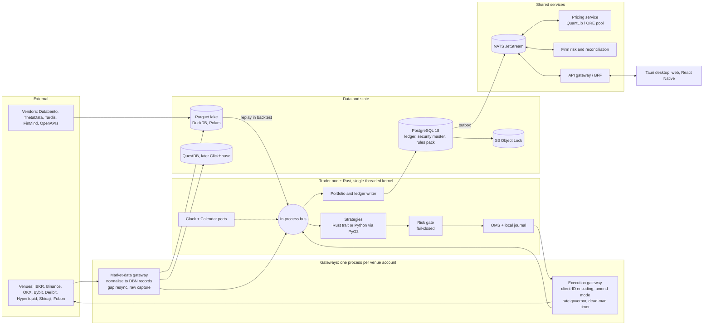

**English** | [繁體中文](proposal-B-performance-core.zh-TW.md)

# Proposal B: Performance & Correctness First (Own Rust Core, One Engine for Backtest and Live)

*Architecture proposal · Status as of 2026-10-05 · Built on research [01](../research/01-core-language-runtime.md) to [11](../research/11-taiwan-market-localization.md). Versions and prices come from those fact-checked reports. Re-verify them before committing.*

## 1. Positioning and target audience

**In one sentence:** build our own Rust-native, deterministic event kernel that runs the *same* strategy binary in backtest, paper and live. Every simulated fill, fee, tax and timestamp is then reproducible down to the nanosecond and the fixed-point unit, and the venue sets the latency ceiling, not our code.

| Dimension | Fit |
|---|---|
| Team | 5–20 engineers with at least two senior Rust engineers and 12+ months of runway (3–4 people only if they already write Rust). **Not a solo MVP:** [10](../research/10-open-source-platforms-build-vs-buy.md) estimates 9–18 months to an MVP for a built core, against 1–3 months for extending an engine. |
| Markets | US/global equities, options, futures and bonds (IBKR); crypto spot, perps and options (Binance, OKX, Bybit, Deribit, Hyperliquid, Coinbase); TWSE/TPEx stocks and TAIFEX futures/options (Shioaji, Fubon Neo). Bonds trade at low frequency. |
| Latency | Built for the intraday 1–100 ms tier (crypto WebSocket, futures, options), with a microsecond budget inside the node so the core never dominates. Sub-100 µs co-location is an extension path (section 7), and Taiwan retail APIs cannot reach it anyway. |
| Self-use vs others | Self-use (own or prop capital) first. We own the core under a licence we choose and ship no LGPL or GPL code, so a desktop distribution or SaaS offering stays possible later, subject to licensing (section 7). |
| Choose another approach if | most holding periods are daily or weekly, live trading is needed within 6 months, or nobody on the team writes Rust. |

## 2. Layered stack

| Layer | Choice | Rationale | Alternative |
|---|---|---|---|
| **Core engine language** | Rust 1.99, pinned in `rust-toolchain.toml`. Single-threaded event kernel; Tokio threads only for network I/O, logging and persistence | No GC on the hot path, memory safety, native `i128`, one toolchain for every desktop and server target. NautilusTrader v2 proves the pattern ([01](../research/01-core-language-runtime.md)) | C#/.NET 10 LTS for .NET-heavy teams; C++ only for vendor SDKs or co-location |
| **Strategy language / API** | One event contract, two front-ends: a Rust `Strategy` trait for latency-sensitive logic, and Python 3.14 (GIL build) via PyO3 0.29 + maturin, with batches crossing as Arrow | Python for research productivity; Rust strategies take FFI off the hot path | Python on an adopted engine (NautilusTrader or LEAN) |
| **Backtest engine** | **Build it on the same kernel:** a `SimVenue` adapter (bars-to-L3 matching, call auctions, queue and latency models) plus a Rust/Polars vectorized screening tier, sharing one `indicators` crate. NautilusTrader 2.x and LEAN serve only as **unlinked differential-test oracles in CI** | No surveyed engine models bonds or Taiwan rules ([02](../research/02-backtesting-engine.md)). Owning the matcher is the point of this proposal, and LGPL stays out of our artifacts | Extend NautilusTrader once 2.0 is GA (PyPI has rc5; upstream advises against RCs with real capital) |
| **Tick & bar storage** | Parquet lake (zstd) as the system of record, with DBN-compatible schemas (`dbn` v0.71, Apache-2.0): int64 ns timestamps, scaled int64 prices, `instrument_id`, `license_tag`. DuckDB and Polars for queries; QuestDB 10 for live capture, ClickHouse 26.8 LTS at team scale; Iceberg or DuckLake snapshots | Fixed-width records replay without copying, and snapshot IDs make runs reproducible ([03](../research/03-market-data-storage.md)) | KDB-X if the team knows q. Plan the DuckDB 2.0 move (1.5 reaches end of life on 2026-11-01) |
| **Reference data** | Bitemporal security master on PostgreSQL 18 with `instrument_xref` (FIGI, ISIN, OCC OSI, TAIFEX codes, venue symbols; CUSIP only under licence). Ticks, lots, limits, fees, taxes, funding and calendars live in an effective-dated, versioned **rules pack** | Our own IDs survive vendor restatements, and one rules pack feeds both backtests and pre-trade risk | Bloomberg or LSEG masters at institutional scale |
| **Trade & accounting records** | A node-local append-only journal (group-commit fsync) records each order **before** it is sent. It projects into an event-sourced PostgreSQL 18 ledger (per-aggregate `seq`, scaled-integer money, outbox to NATS), hash-chained and archived nightly to S3 Object Lock | A crash between send and ack is recoverable; full audit trail and as-of P&L | KurrentDB (KLv1) or immudb (BSL), only with existing expertise |
| **Data vendors** | US equities: Databento Standard (L1–L3 in DBN). Options: ThetaData (individual use only) or Databento OPRA. Crypto: own capture plus Tardis.dev tick history. Bonds and rates: FRED/ALFRED, Treasury Fiscal Data, IBKR quotes. Taiwan: broker feeds, TWSE/TPEx/TAIFEX OpenAPIs, FinMind sponsor ticks, TWSE Data E-Shop 5-level book | Matching fidelity needs ticks and depth, not just bars | Massive or Alpaca for US real-time data. Institutional: Databento Unlimited, OptionMetrics, TEJ, Bloomberg/LSEG |
| **Broker / exchange connectivity** | Native Rust adapters behind ports with capability flags (`amend_mode`, `native_oco`, `multi_leg`, `max_client_id_len`). **Stocks, options, futures, bonds:** IBKR via the MIT-licensed Rust `ibapi` crate (or ib_async in a gateway), never the GPL TWS API client (10.49+). **Crypto:** Binance, OKX, Bybit, Deribit (options), Hyperliquid (EIP-712 agent wallets), Coinbase (ES256 keys; its derivatives gateway is perps-only since 2026-10-01); CCXT in a Python gateway for the long tail. **Taiwan:** a Shioaji 1.7.7 gateway (Python, or its local HTTP/SSE server), Fubon Neo as the second broker, Capital SKCOM only through an optional Windows gateway. FIX (QuickFIX/J) later for prime brokers and bond RFQ | Native adapters expose the rate limits, dead-man timers and reconciliation data that the risk gate needs ([04](../research/04-broker-exchange-connectivity.md), [11](../research/11-taiwan-market-localization.md)) | NautilusTrader adapters (LGPL); LEAN brokerages |
| **Messaging** | Typed in-process bus per node; DBN records from gateway to node; NATS JetStream 2.15 for commands, events, UI fan-out and config KV; Protobuf with `buf breaking` for contracts; Aeron + SBE only for co-location | The cheapest correct transport for each plane ([07](../research/07-system-architecture-messaging.md)) | Kafka 4.3 if an enterprise data platform exists; avoid ZeroMQ |
| **OMS / risk** | In-node OMS with a persisted order state machine (`Unknown` is resolved by reconciliation), ULID client IDs encoded per venue, and fills de-duplicated by `(venue, exec_id)`. A mandatory, fail-closed in-node risk gate (`ACTIVE`/`REDUCING`/`HALTED`) shared by all modes; a firm-wide aggregator on NATS; a three-path kill switch plus venue dead-man timers | Microsecond checks with no network hop, and identical code closes a classic backtest/live gap ([08](../research/08-risk-security-ops-compliance.md)) | An out-of-process risk gateway once several accounts or tenants share capital |
| **Pricing libraries** | Rust `analytics` crate on the hot path: Black-76 on implied forwards, "Let's Be Rational" implied volatility, greeks, SVI, crypto inverse and funding math. A stateless QuantLib 1.43 process pool (QuantLib has a global evaluation date) for American options, bonds and curves; ORE later for XVA and SIMM | Chain-wide IV inside the node without Python. QuantLib is the only maintained, permissive library covering options, bonds and curves ([05](../research/05-instrument-model-pricing-analytics.md)) | fast-vollib (young 0.x). vollib (Python ≤3.13) and FinancePy (GPL) as test oracles only |
| **Research / ML** | Polars, DuckDB and marimo, importing the same `tp` package as live strategies; skfolio (CPCV) and cvxpy; in-house PSR/DSR metrics; LightGBM with Optuna; self-hosted MLflow as the trial registry; Ray for sweeps; separate images for pandas 3, pandas 2.3 and deep learning | One signal codebase, and honest trial counts for DSR and PBO ([09](../research/09-research-ml-analytics.md)) | Qlib (vendored); W&B |
| **Front end & charting** | React/TS workstation in Tauri 2.12 (pinned), whose Rust side reuses core crates and can embed the kernel for offline research. A Web Worker decodes Protobuf with the `model` crate compiled to WASM; the UI renders once per frame on WebGL2. Lightweight Charts 5.2 (attribution shown), uPlot and SciChart.js 6 for dense or 3D views; custom Canvas/WebGL DOM ladder, depth heatmap and TAIFEX T-quote; AG Grid 36; Perspective 5.5. Protobuf over WebSocket with server-side conflation, Connect RPC, Arrow IPC. Mobile: a PWA, then a React Native 0.87 companion | GPU canvases in a webview reach near-native frame rates from one codebase, and shared Rust/WASM code removes precision drift ([06](../research/06-cross-platform-client-ui.md)) | Electron 44, or Tauri v3 with CEF once stable; egui or Qt 6.12 LTS for internal latency monitors |
| **Deployment & ops** | Hybrid: a cloud NATS hub; crypto nodes in AWS Tokyo; Taiwan gateways in Taiwan (AWS `ap-east-2`, GCP `asia-east1` or an on-prem leaf node); IBKR nodes near US East. Trader nodes on pinned VMs or bare metal with isolated cores; stateless services on Kubernetes 1.35+; one writer per account, with fencing | Each workload sits next to its venue, and quiet cores keep latency stable | All-cloud, or one home server for a small team |
| **Observability** | OpenTelemetry traces keyed by client order ID; Prometheus, Grafana and Loki; HDR latency histograms per hop; chrony, plus the AWS PTP clock on supported Linux instances | Latency must be measured per hop, not assumed | Datadog; VictoriaMetrics |
| **Security & keys** | Trade-only, withdrawal-disabled, IP-bound venue keys, one per strategy, rotated every 90 days. SOPS+age, then OpenBao 2.7 (MPL-2.0). Desktop keys sit in the OS keychain and are decrypted only in the Rust core, never in the webview. Taiwan `.pfx` certificates are mounted only into their gateway. FIDO2 everywhere; `cargo-deny`, hash-pinned lockfiles, SBOMs, Sigstore and SLSA v1.2 | Credentials are the crown jewels ([08](../research/08-risk-security-ops-compliance.md)) | Vault Enterprise or a cloud KMS/HSM |

## 3. Component architecture and data flow



Strategies have no I/O and no wall clock: they receive bus events and emit order *intents*. Each intent passes the risk gate and is journaled locally before the execution gateway sends it. Gateways run as separate processes, so a crashing broker SDK or Windows COM component cannot take down the kernel. In backtest mode, lake replay and `SimVenue` replace the gateways in-process.

**Same strategy code from backtest to paper to live.** Only the adapters bound to the ports change. The strategy artifact, risk gate, OMS, portfolio and rules pack are byte-identical.

| Port | Backtest | Paper | Live |
|---|---|---|---|
| Clock | `SimClock` advances to each event's timestamp | `WallClock` (chrony) | `WallClock` |
| Market data | Replay of a lake snapshot, ordered by `ts_init` with a stable sequence tie-break | Live gateway | Live gateway |
| Execution | `SimVenue`: bars-to-L3 matching, call auctions, latency and queue models, rules pack | `SimVenue` on live data, or venue paper (IBKR paper, Shioaji `simulation=True`, crypto testnets) | Venue gateway |
| Strategy, risk gate, OMS, portfolio | Identical | Identical | Identical |
| Ledger | In memory, written out as a run artifact (Parquet plus manifest) | PostgreSQL `paper` schema | PostgreSQL `live` schema plus WORM archive |

**Determinism contract** (enforced in CI):

1. Prices, quantities and money are per-instrument fixed-point integers. Conversion to float64 happens only in explicit, tested functions.
2. Every event carries UTC int64 ns `ts_event` and `ts_init`. `trading_date` and `session_id` come only from the CalendarPort, and wall-clock calls are lint-banned in core and strategy code.
3. One thread dispatches. Same-timestamp events keep a stable sequence order, RNGs are seeded, and nothing iterates randomly ordered hash maps. Decision-path math uses a pure-Rust `libm`, so x86-64 and ARM64 give bit-identical results.
4. Each run writes a manifest (git SHA, lockfiles, container digest, data snapshot IDs, rules-pack version, seeds) and a hash of its output event stream. Golden-master hashes must match on linux-x64 and macOS-arm64.
5. Differential tests run shared scenarios through NautilusTrader and LEAN with documented tolerances. Property tests (proptest, Hypothesis) assert that positions equal the sum of fills, that the gate never passes an over-limit order, and that fill handling is idempotent.
6. Live sessions are recorded and replayed through `SimVenue`. Transaction-cost analysis (TCA) recalibrates the latency and queue models, and a drift alarm halts any strategy whose live P&L leaves the backtest's Monte Carlo 95% band.

**Promotion path.** A strategy version is a content-hashed bundle (wheel or crate, config, rules-pack version) with an MLflow registry entry, and the OMS refuses anything unregistered. The gates follow [09](../research/09-research-ml-analytics.md):

1. Backtest: CPCV with purge and embargo, DSR ≥ 0.95, PBO ≤ 0.2, still profitable with costs doubled, and the vectorized and event-driven tiers in agreement.
2. Paper: at least 3 months or N trades, within tracking-error bands.
3. Live: capital ramps 10% → 25% → 100%, with an independent approver.

## 4. Handling per asset class

Fixed-point layout: i64 for scales up to 9 decimals and i128 for up to 16–18 decimals, always with checked arithmetic (overflow is an error, never a wrap). 1 wei (1e-18) does not fit a 16-decimal type, so on-chain amounts stay U256 until the adapter converts them.

| Asset class | Instrument model | Pricing & analytics | Sessions, expiry, settlement | Fee & tax model (rules pack, effective-dated) |
|---|---|---|---|---|
| **Stocks / ETFs** (US, TWSE/TPEx) | `Equity` with an effective-dated `tick_scheme_id` (TW ticks 0.01 to 5 at breaks of 10/50/100/500/1,000; US $0.01, with the Rule 612 half-penny tick deferred to Nov 2027). Typed quantity unit: TW 1,000-share board lots vs odd lots, in separate books. Price-limit regime, plus day-trade and disposition flags refreshed daily | Marks only. Corporate actions are factors applied at read time; fills use unadjusted prices | US sessions follow DST; T+1. TWSE: call auctions 08:30–09:00 and 13:25–13:30, continuous trading 09:00–13:25, odd-lot auctions every 5 s from 09:10, ±10% limits, 3.5% volatility interruption, T+2. `SimVenue` runs a call-auction matcher and refuses fills at locked limits | US: commission, SEC Section 31 fee (fiscal-year rate), FINRA TAF, borrow fees. TW: commission ≤0.1425%; transaction tax 0.3% on sells, 0.15% on day trades until 2027-12-31, 0.1% on ETFs. Day-trade status is decided at end of day |
| **Crypto** (spot, perps, dated, options) | `CryptoPerpetual`, `CryptoFuture`, `CryptoOption` with base, quote, `settlement_currency` and `is_inverse`; i128 fixed point; raw U256 only in on-chain adapters | Rust module for inverse PnL `Q × (1/F_entry − 1/F_exit)`, premium-adjusted delta for BTC-quoted Deribit options, and annualized basis | 24/7 calendar with a 00:00 UTC accounting cut and venue maintenance windows. Deribit expiries at 08:00 UTC. Liquidation and auto-deleveraging simulated per venue | Maker/taker tiers. **Funding is an engine cash-flow event** per venue rule: Binance `[P̄ + clamp(I − P̄, ±0.05%)] / (8/N)`, where the interval N can change; Hyperliquid hourly, capped at 4%/h |
| **Options & futures** (US, TAIFEX, Deribit) | `OptionContract`, `OptionSpread`, `FuturesContract`. OCC OSI keys; TAIFEX roots plus month or weekly codes. Multiplier and deliverable are effective-dated | Black-76 on implied forwards (index options, TXO, crypto) in Rust; QuantLib's QD+ American engine for US single-stock options; SVI per expiry, SSVI later. Margin: Reg T table plus FINRA intraday margin, and a TAIFEX SPAN parameter loader | Exercise, assignment and expiry are engine events. TXO is European and cash-settled on a 30-minute average, with weeklies expiring Wednesday or Friday. TAIFEX day session 08:45–13:45; night session 15:00–05:00, booked to the next trading date | IBKR US options tiered by premium (US$0.65/0.50/0.25 per contract, US$1 minimum per order). TAIFEX tax on both sides: 0.002% on index futures, 0.1% of option premium, futures rate on cash settlement |
| **Bonds** | Our own `Bond` type: coupon schedule, day count, settlement days, call schedule. Price as % of par in decimal fixed point with a 32nds codec; quantities in face value | QuantLib service: clean and dirty price, accrued interest, yield, duration, DV01; curve bootstrap and Nelson-Siegel-Svensson fits from FRED and Treasury data | SIFMA calendars; US Treasuries settle T+1; coupons and maturities are ledger events. Execution: IBKR `BOND` contracts at low frequency. Taiwan: bond ETFs as equities, foreign bonds booked by hand | Dealer spread modelled with a fill probability, never on indicative quotes. TW: government bonds exempt; corporate bonds and bond ETFs tax-free only until 2026-12-31, then 0.1% unless extended |

## 5. Repository layout

```text
trading-platform/
├─ rust-toolchain.toml, Cargo.toml        # Rust workspace, pinned toolchain
├─ crates/
│  ├─ model/        # fixed-point Price/Qty/Money, UnixNanos, IDs, instruments incl. Bond
│  ├─ calendar/     # CalendarPort: XTAI/US tables, TAIFEX day+night, crypto 24/7, overrides
│  ├─ rules/        # effective-dated ticks, lots, limits, fees, taxes, funding
│  ├─ kernel/       # event loop, bus, timers, SimClock/WallClock
│  ├─ oms/  risk/  portfolio/  journal/  ledger/
│  ├─ sim-venue/    # bars→L3 matching, call auctions, latency and queue models
│  ├─ indicators/   # shared by the vectorized and event-driven tiers
│  ├─ analytics/    # Black-76, LBR implied vol, SVI, inverse/funding math
│  ├─ data/         # DBN-compatible schemas, Parquet catalog, replay
│  ├─ adapters/{ibkr,binance,okx,bybit,deribit,hyperliquid,coinbase}/
│  ├─ transport/{nats,grpc}/
│  └─ py/           # PyO3 bindings → `tp` Python package (maturin)
├─ gateways/{shioaji,fubon,ccxt-longtail,windows-com}/   # out-of-process adapters
├─ services/{pricing,api-gateway,security-master,scheduler,notifier,recon,firm-risk}/
├─ proto/           # Protobuf contracts; `buf breaking` in CI
├─ python/          # strategy SDK, metrics module (PSR/DSR), research helpers
├─ strategies/      # versioned strategies and configs
├─ research/        # marimo notebooks; images: modern, legacy-quant, dl
├─ ui/{web,desktop-tauri,mobile-rn,widgets,wasm-model}/
├─ deploy/{compose,k8s,systemd,windows-gateway}/
└─ tests/{golden,differential,property,contract,chaos}/
```

## 6. Phased roadmap and cost estimate

The roadmap assumes six engineers: three on the Rust core, one quant/Python, one TypeScript, and one SRE/data engineer.

| Phase | Months | Scope | Exit criteria | Person-months |
|---|---|---|---|---|
| **P0 Foundations** | 1–3 | `model`, `calendar`, `kernel` and `rules` crates; Protobuf repo; DBN/Parquet catalog; CI wheel matrix (win-x64, macOS-arm64, linux-x64/arm64; `cp314` plus `cp314t`, because `abi3t` needs CPython 3.15+) | Replaying a recorded day gives the same event-stream hash on two operating systems | 12 |
| **P1 Backtest core** | 3–7 | `SimVenue` (bars, L1, pessimistic intra-bar ordering), US and Taiwan rules packs, funding events, PyO3 strategy API, vectorized tier, run manifests, MLflow trial registry, differential tests | US/TW equities and crypto perps agree with the oracles within tolerance; promotion gates automated | 20 |
| **P2 Paper & first live** | 6–10 | Journal and ledger, OMS, risk gate, reconciliation, three-path kill switch; IBKR, Binance, OKX and Shioaji adapters; NATS; API gateway; Tauri/web UI v1; observability; secrets | Reconciliation green for 5+ consecutive sessions; **first real-money trade at 10% capital, around month 10** | 24 |
| **P3 Fidelity & derivatives** | 10–14 | L2/L3 matching with queue and latency models calibrated by TCA; options lifecycle; Rust analytics and QuantLib service; SPAN and Reg T margin; Deribit, Hyperliquid and Fubon Neo; option-chain and T-quote UI | Option expiries and assignments reconcile with broker statements; slippage within bands | 24 |
| **P4 Bonds, scale, hardening** | 14–18 | Bond model and cash flows, IBKR bond orders; ClickHouse/Iceberg; Ray cluster; firm-wide risk; chaos drills; React Native companion; OpenBao, SLSA; optional FIX and Windows gateway | All four asset classes in one ledger; restore and failover drills pass | 24 |

**Total:** about 104 person-months. First live trade (equities plus crypto perps) around month 10, after about 56 person-months; all four asset classes around month 18. Extending NautilusTrader or LEAN reaches an MVP in 1–3 months with a small team ([10](../research/10-open-source-platforms-build-vs-buy.md)). The difference is the price of owning matching fidelity, determinism and licensing.

**Monthly run cost** (USD, excluding salaries, which dominate):

| Item | Build (P0–P2) | Live, self-use team (P3+) | Institutional |
|---|---|---|---|
| Market data | $300–1,000: Databento Standard $199, ThetaData $80–160, FinMind sponsor tier, Fugle NT$1,499 if needed, Tardis Solo $700 once tick history matters | $1,000–3,000 | $5,000–15,000+: Databento Unlimited ($4,000–4,500), Tardis Business ($3,000–6,000), OptionMetrics/TEJ by quote, Bloomberg about $30k per user per year |
| Infrastructure | $300–800: CI runners including macOS arm64, 2–3 VMs, object storage | $1,000–3,000: Tokyo, Taiwan and US VMs, PostgreSQL HA, NATS, QuestDB, S3 WORM, on-demand GPUs | $5,000–20,000: multi-AZ Kubernetes, ClickHouse cluster, bare-metal nodes |
| Licences | ~$0–200: all open source, Grafana Cloud free tier | $200–800 amortized: AG Grid Enterprise $999/developer perpetual; SciChart.js about $1.3–1.7k/developer/yr (third-party figure; get a quote) | $1,000–5,000+: vendor support (OnixS/Chronicle FIX, Vault Enterprise) |
| **Total** | **≈ $0.6k–2k** | **≈ $2k–7k** | **≈ $10k–40k+** |

One-off history purchases come on top: the TWSE Data E-Shop sells the 5-level book at NT$5,000 per data-month, and TAIFEX sells deep history on DVD. Showing data to anyone outside the team adds redistribution licences; TWSE alone charges NT$60,000/month plus an internet data fee from NT$100,000/month.

## 7. Risks and evolution triggers

**Technical risks**

| Risk | Mitigation |
|---|---|
| Schedule: we rebuild adapters, reconciliation and matching that NautilusTrader already has | Hard phase exit criteria; reuse permissive crates (`dbn`, `ibapi`, `arrow-rs`, Polars); copy designs, never LGPL code |
| Simulator fidelity is unproven: a subtly wrong matcher produces convincing fake P&L | Oracle differential tests, record/replay of live sessions, TCA calibration; promote only from the event-driven tier |
| Rust hiring and bus factor (14.8% of developers use Rust vs 57.9% for Python) | Keep the Rust surface small and documented; most contributors write Python and TypeScript |
| FFI chattiness: per-tick Python callbacks dominate runtime | Batched Arrow events, indicators in Rust, Rust-native strategies for hot paths |
| Durability vs latency of the local journal | Group commit; measure the p99 cost in P2; reconciliation closes any gap |
| Dependency churn: DuckDB 2.0 (2026-10-21), Polars 2.0, pandas 3.1, Python 3.15, Tauri v3, quarterly QuantLib (whose Taiwan calendar stops at 2026) | Pin everything; load the 2027 TWSE/TAIFEX holidays before year-end; upgrade on a schedule |
| Taiwan specifics: Shioaji returns empty quotes when its traffic cap is hit; typhoon closures; broker mergers | Treat empty responses as alarms; manual calendar overrides; independent reconciliation |

**Licence risks**

- NautilusTrader v2 is LGPL-3.0-only, so it runs only as an unlinked CI oracle. The TWS API client is GPL from 10.49, so IBKR goes through the MIT `ibapi` crate or ib_async; IBKR also bars redistributing TWS API market data without approval.
- Keep FinancePy (GPL), vectorbt (Commons Clause) and Backtesting.py (AGPL) out of shipped builds. Check BSL terms for lakeFS, Vault, immudb, Redpanda and ArcticDB.
- Lightweight Charts requires visible TradingView attribution. Massive and ThetaData retail plans are individual-use only, CUSIPs need a licence, and redistributing TAIFEX data needs written consent. `cargo-deny` and SPDX scanning gate every build.

**Regulatory risks**

- Stay self-use until counsel signs off. Selling signals or managing money for others needs licensing: securities investment consulting (投顧) or futures advisory in Taiwan, RIA or CTA registration in the US, MiCA CASP authorisation for crypto in the EU.
- Taiwan's Virtual Asset Service Act passed on 2026-06-30; first licences are expected around Q1 2028, so allowed crypto venues live in configuration. Taiwan broker certificates are personal and can never be pooled.
- US brokers may apply either the old PDT rules or FINRA's new intraday margin regime until 2027-10-20, so the risk gate supports both.

**Triggers for moving to a different approach**

| Trigger | Move toward |
|---|---|
| Fewer than 4 engineers, no senior Rust, or real-money trading needed within 6 months | Extend an existing engine (NautilusTrader 2.x stable or LEAN). Keep this proposal's rules pack, security master, ledger and UI contracts |
| NautilusTrader 2.0 reaches GA with a stable API, and server-side LGPL use is acceptable | Run it as the strategy runtime behind our ports, saving an estimated 30–40 person-months of P1–P3 |
| P1 exit criteria (determinism, agreement with the oracles) slip by more than 3 months | Stop the build and fall back to Extend |
| Holding periods turn out mostly daily or weekly | A Python-centric stack; the Rust core would be over-engineering |
| The platform will serve external users (signals, copy-trading, SaaS) | Platform first: out-of-process risk gateway, per-tenant isolation, entitlements, a licensing programme |
| Strategies need under 100 µs wire-to-wire, co-location or market making | An ultra-low-latency extension: Aeron + SBE, kernel bypass, Rust-only strategies, native binary protocols |
| The team is .NET-heavy, or Windows-only brokers dominate | A C#/.NET 10 core (the LEAN pattern) |

**Candidate ADRs:** Rust kernel with a PyO3 strategy API; build `SimVenue` with oracle testing; DBN-compatible event schema; local journal plus event-sourced PostgreSQL ledger; NATS JetStream with Protobuf contracts; Tauri 2 with shared Rust/WASM model code.
