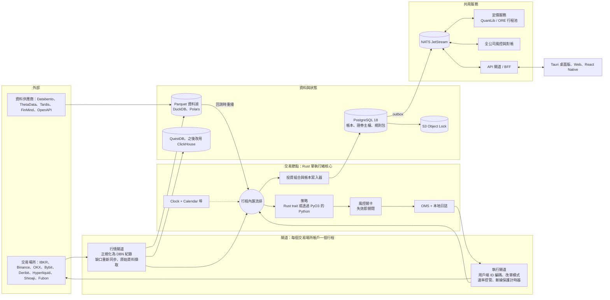

[English](proposal-B-performance-core.md) | **繁體中文**

# 提案 B：效能與正確性優先（自建 Rust 核心，回測與實盤共用同一引擎）

*架構提案 · 狀態截至 2026-10-05 · 以研究報告 [01](../research/01-core-language-runtime.zh-TW.md) 至 [11](../research/11-taiwan-market-localization.zh-TW.md) 為基礎。版本與價格取自這些經過事實查核的報告，正式採用前請再次驗證。*

## 1. 定位與目標使用者

**一句話總結：** 自行打造 Rust 原生、具決定性的事件核心（event kernel），讓*同一個*策略二進位檔在回測、模擬交易（paper trading）與實盤中執行。如此一來，每一筆模擬成交、手續費、稅與時間戳記都能重現到奈秒與定點數單位，而延遲上限由交易場所決定，而非我們的程式碼。

| 面向 | 適用情境 |
|---|---|
| 團隊 | 5–20 名工程師，其中至少兩名資深 Rust 工程師，並有 12 個月以上的資金跑道（runway）（只有在成員本來就會寫 Rust 時，才能縮減為 3–4 人）。**不適合單人 MVP：** [10](../research/10-open-source-platforms-build-vs-buy.zh-TW.md) 估計自建核心需要 9–18 個月才能達到 MVP，而擴充現有引擎只需 1–3 個月。 |
| 市場 | 美國／全球股票、選擇權、期貨與債券（IBKR）；加密貨幣現貨、永續合約與選擇權（Binance、OKX、Bybit、Deribit、Hyperliquid、Coinbase）；TWSE/TPEx 股票與 TAIFEX 期貨／選擇權（Shioaji、Fubon Neo）。債券採低頻交易。 |
| 延遲 | 針對日內 1–100 ms 層級設計（加密貨幣 WebSocket、期貨、選擇權），節點內部採微秒級預算，讓核心永遠不會成為延遲的主要來源。低於 100 µs 的主機共置（co-location）屬於延伸路徑（第 7 節），而且台灣散戶 API 本來就無法達到這個水準。 |
| 自用 vs 對外 | 先以自用（自有資金或自營資金）為主。核心由我們自己擁有、採用自選的授權條款，且不隨產品發布任何 LGPL 或 GPL 程式碼，因此日後仍保有推出桌面版散布或 SaaS 服務的可能，惟須視授權狀況而定（第 7 節）。 |
| 若符合以下情況請改選其他方案 | 大多數持有期間為日或週、需要在 6 個月內上線實盤交易，或團隊中沒有人會寫 Rust。 |

## 2. 分層技術堆疊

| 層級 | 選擇 | 理由 | 替代方案 |
|---|---|---|---|
| **核心引擎語言** | Rust 1.99，於 `rust-toolchain.toml` 中鎖定版本。單執行緒事件核心；Tokio 執行緒僅用於網路 I/O、日誌與持久化 | 熱路徑上沒有 GC、記憶體安全、原生 `i128`，且一套工具鏈即可涵蓋所有桌面與伺服器目標平台。NautilusTrader v2 已驗證此模式（[01](../research/01-core-language-runtime.zh-TW.md)） | 偏重 .NET 的團隊可用 C#/.NET 10 LTS；C++ 僅用於廠商 SDK 或主機共置 |
| **策略語言／API** | 單一事件契約、兩種前端：用於延遲敏感邏輯的 Rust `Strategy` trait，以及透過 PyO3 0.29 + maturin 使用的 Python 3.14（GIL 版本），批次資料以 Arrow 格式跨越語言邊界 | Python 提升研究生產力；Rust 策略讓 FFI 不出現在熱路徑上 | 在採用的現成引擎（NautilusTrader 或 LEAN）上使用 Python |
| **回測引擎** | **建立在同一個核心上：** 一個 `SimVenue` 轉接器（從 K 棒到 L3 的撮合、集合競價、佇列與延遲模型），加上 Rust/Polars 向量化篩選層，兩者共用同一個 `indicators` crate。NautilusTrader 2.x 與 LEAN 僅作為 **CI 中不連結（unlinked）的差異測試基準（oracle）** | 調查過的引擎沒有任何一個能建模債券或台灣規則（[02](../research/02-backtesting-engine.zh-TW.md)）。擁有撮合器正是本提案的重點，同時也讓 LGPL 不會進入我們的建置產物 | 待 NautilusTrader 2.0 正式發布（GA）後擴充它（PyPI 上目前為 rc5；上游建議不要以真實資金使用 RC 版） |
| **Tick 與 K 棒儲存** | 以 Parquet 資料湖（zstd）作為紀錄系統（system of record），採用與 DBN 相容的 schema（`dbn` v0.71，Apache-2.0）：int64 奈秒時間戳記、縮放後的 int64 價格、`instrument_id`、`license_tag`。以 DuckDB 與 Polars 進行查詢；QuestDB 10 用於即時擷取，團隊規模時改用 ClickHouse 26.8 LTS；以 Iceberg 或 DuckLake 建立快照 | 固定寬度紀錄可零複製重播，快照 ID 則讓每次執行皆可重現（[03](../research/03-market-data-storage.zh-TW.md)） | 若團隊熟悉 q 可改用 KDB-X。需規劃遷移至 DuckDB 2.0（1.5 將於 2026-11-01 終止支援） |
| **參考資料** | 在 PostgreSQL 18 上建立雙時態（bitemporal）證券主檔，搭配 `instrument_xref`（FIGI、ISIN、OCC OSI、TAIFEX 代碼、交易場所代號；CUSIP 僅在取得授權後使用）。升降單位、交易單位、各類限制、手續費、稅、資金費率與交易日曆，存放於依生效日期管理、具版本控制的**規則包（rules pack）** | 我們自有的 ID 不受廠商資料重述影響，且同一個規則包同時供應回測與下單前風控 | 機構規模時採用 Bloomberg 或 LSEG 主檔 |
| **交易與會計紀錄** | 節點本地的僅附加（append-only）日誌（群組提交 fsync）會在每筆委託**送出之前**先行記錄。日誌再投射至以事件溯源（event-sourced）方式建構的 PostgreSQL 18 帳本（每個聚合各自的 `seq`、以縮放整數表示金額、透過 outbox 發送至 NATS），以雜湊鏈串接，並每晚封存至 S3 Object Lock | 即使在送出與回報確認（ack）之間發生當機也能復原；具備完整稽核軌跡與任意時點（as-of）損益 | KurrentDB（KLv1）或 immudb（BSL），僅限團隊已具備相關專業時使用 |
| **資料供應商** | 美股：Databento Standard（DBN 格式的 L1–L3）。選擇權：ThetaData（僅限個人使用）或 Databento OPRA。加密貨幣：自行擷取，加上 Tardis.dev 歷史 tick。債券與利率：FRED/ALFRED、Treasury Fiscal Data、IBKR 報價。台灣：券商行情、TWSE/TPEx/TAIFEX OpenAPI、FinMind 贊助方案 tick、證交所資料電子商城（TWSE Data E-Shop）五檔報價 | 撮合擬真度需要 tick 與市場深度資料，而不只是 K 棒 | 美國即時資料可用 Massive 或 Alpaca。機構級：Databento Unlimited、OptionMetrics、TEJ、Bloomberg/LSEG |
| **券商／交易所連線** | 原生 Rust 轉接器置於埠（port）介面之後，並附帶能力旗標（`amend_mode`、`native_oco`、`multi_leg`、`max_client_id_len`）。**股票、選擇權、期貨、債券：** IBKR 透過 MIT 授權的 Rust `ibapi` crate（或在閘道中使用 ib_async），絕不使用 GPL 授權的 TWS API 用戶端（10.49 以上版本）。**加密貨幣：** Binance、OKX、Bybit、Deribit（選擇權）、Hyperliquid（EIP-712 代理錢包）、Coinbase（ES256 金鑰；其衍生性商品閘道自 2026-10-01 起僅支援永續合約）；長尾交易所則在 Python 閘道中使用 CCXT。**台灣：** Shioaji 1.7.7 閘道（Python，或其本地 HTTP/SSE 伺服器），Fubon Neo 作為第二家券商，Capital SKCOM 僅透過選用的 Windows 閘道接入。日後再以 FIX（QuickFIX/J）對接主經紀商（prime broker）與債券 RFQ | 原生轉接器能提供風控關卡所需的速率限制、斷線保護計時器（dead-man timer）與對帳資料（[04](../research/04-broker-exchange-connectivity.zh-TW.md)、[11](../research/11-taiwan-market-localization.zh-TW.md)） | NautilusTrader 轉接器（LGPL）；LEAN 券商整合 |
| **訊息傳遞** | 每個節點內使用具型別的行程內匯流排；閘道到節點之間傳送 DBN 紀錄；NATS JetStream 2.15 用於指令、事件、UI 扇出（fan-out）與設定 KV；契約使用 Protobuf 並以 `buf breaking` 檢查；Aeron + SBE 僅用於主機共置 | 為每個平面選用成本最低且正確的傳輸方式（[07](../research/07-system-architecture-messaging.zh-TW.md)） | 若已有企業資料平台可用 Kafka 4.3；避免使用 ZeroMQ |
| **OMS／風控** | 節點內 OMS，具備持久化的委託狀態機（`Unknown` 狀態由對帳解決）、依交易場所編碼的 ULID 用戶端 ID，以及以 `(venue, exec_id)` 去重的成交回報。所有模式共用一個強制性、失效即關閉（fail-closed）的節點內風控關卡（`ACTIVE`/`REDUCING`/`HALTED`）；NATS 上設有全公司層級的彙總器；三路徑緊急停止開關（kill switch）加上交易場所的斷線保護計時器 | 微秒級檢查且無需網路跳轉，相同的程式碼也弭平了經典的回測／實盤落差（[08](../research/08-risk-security-ops-compliance.zh-TW.md)） | 當多個帳戶或租戶共用資金時，改用行程外風控閘道 |
| **定價函式庫** | 熱路徑上使用 Rust `analytics` crate：基於隱含遠期價格的 Black-76、"Let's Be Rational" 隱含波動率、Greeks、SVI、加密貨幣反向合約與資金費率計算。美式選擇權、債券與殖利率曲線則使用無狀態的 QuantLib 1.43 行程池（QuantLib 有全域評價日）；日後以 ORE 處理 XVA 與 SIMM | 不需 Python 即可在節點內計算整條選擇權鏈的 IV。QuantLib 是唯一仍有維護、採寬鬆授權，且涵蓋選擇權、債券與曲線的函式庫（[05](../research/05-instrument-model-pricing-analytics.zh-TW.md)） | fast-vollib（尚年輕的 0.x 版）。vollib（Python ≤3.13）與 FinancePy（GPL）僅作為測試基準 |
| **研究／ML** | Polars、DuckDB 與 marimo，與實盤策略匯入同一個 `tp` 套件；skfolio（CPCV）與 cvxpy；自建 PSR/DSR 指標；LightGBM 搭配 Optuna；自架 MLflow 作為試驗登錄庫；以 Ray 執行參數掃描；pandas 3、pandas 2.3 與深度學習各使用獨立的映像檔 | 單一訊號程式碼庫，以及供 DSR 與 PBO 使用的誠實試驗次數（[09](../research/09-research-ml-analytics.zh-TW.md)） | Qlib（vendored 內嵌）；W&B |
| **前端與圖表** | 以 Tauri 2.12（鎖定版本）打造 React/TS 交易工作站，其 Rust 端重用核心 crate，並可嵌入核心以進行離線研究。Web Worker 使用編譯為 WASM 的 `model` crate 解碼 Protobuf；UI 以 WebGL2 每影格算繪一次。Lightweight Charts 5.2（顯示出處標示）、uPlot 與 SciChart.js 6 用於高密度或 3D 檢視；自製 Canvas/WebGL DOM 價格階梯（DOM ladder）、深度熱圖與 TAIFEX T 字報價；AG Grid 36；Perspective 5.5。透過 WebSocket 傳送 Protobuf 並於伺服器端合併（conflation）、Connect RPC、Arrow IPC。行動裝置：先做 PWA，再推出 React Native 0.87 輔助 App | Webview 中的 GPU 畫布能以單一程式碼庫達到接近原生的影格率，共用的 Rust/WASM 程式碼則消除精度漂移（[06](../research/06-cross-platform-client-ui.zh-TW.md)） | Electron 44，或待 Tauri v3 搭配 CEF 穩定後採用；內部延遲監控器可用 egui 或 Qt 6.12 LTS |
| **部署與維運** | 混合式：雲端 NATS hub；加密貨幣節點部署於 AWS 東京；台灣閘道部署於台灣（AWS `ap-east-2`、GCP `asia-east1` 或地端 leaf node）；IBKR 節點靠近美東。交易節點使用固定（pinned）VM 或裸機並隔離 CPU 核心；無狀態服務部署於 Kubernetes 1.35+；每個帳戶只有一個寫入者，並搭配 fencing 機制 | 每種工作負載都緊鄰其交易場所，安靜的 CPU 核心讓延遲保持穩定 | 全雲端，或小團隊使用單一台家用伺服器 |
| **可觀測性** | 以用戶端委託 ID 為鍵的 OpenTelemetry 追蹤；Prometheus、Grafana 與 Loki；每個跳點的 HDR 延遲直方圖；chrony，並在支援的 Linux 執行個體上使用 AWS PTP 時鐘 | 延遲必須逐跳實際量測，不能憑假設 | Datadog；VictoriaMetrics |
| **安全與金鑰** | 僅限交易、停用提領、綁定 IP 的交易場所金鑰，每個策略一組，每 90 天輪替。先使用 SOPS+age，之後改用 OpenBao 2.7（MPL-2.0）。桌面端金鑰存放於作業系統金鑰鏈，且僅在 Rust 核心內解密，絕不在 webview 中解密。台灣 `.pfx` 憑證僅掛載至其對應的閘道。全面採用 FIDO2；`cargo-deny`、以雜湊鎖定的 lockfile、SBOM、Sigstore 與 SLSA v1.2 | 憑證是最核心的資產（crown jewels）（[08](../research/08-risk-security-ops-compliance.zh-TW.md)） | Vault Enterprise 或雲端 KMS/HSM |

## 3. 元件架構與資料流



策略沒有 I/O，也不讀取實際時鐘（wall clock）：它們接收匯流排事件並送出委託*意圖（intent）*。每個意圖都會先通過風控關卡並寫入本地日誌，之後才由執行閘道送出。閘道以獨立行程執行，因此即使券商 SDK 或 Windows COM 元件崩潰，也不會拖垮核心。在回測模式下，資料湖重播與 `SimVenue` 會在行程內取代閘道。

**從回測、模擬交易到實盤，使用相同的策略程式碼。** 只有綁定到各個埠的轉接器會改變。策略產物、風控關卡、OMS、投資組合與規則包皆逐位元組完全相同。

| 埠 | 回測 | 模擬交易 | 實盤 |
|---|---|---|---|
| 時鐘 | `SimClock` 推進至每個事件的時間戳記 | `WallClock`（chrony） | `WallClock` |
| 行情資料 | 重播資料湖快照，依 `ts_init` 排序，並以穩定的序號決定同時間事件的先後 | 即時閘道 | 即時閘道 |
| 執行 | `SimVenue`：從 K 棒到 L3 的撮合、集合競價、延遲與佇列模型、規則包 | 在即時資料上執行 `SimVenue`，或使用交易場所的模擬環境（IBKR paper、Shioaji `simulation=True`、加密貨幣測試網） | 交易場所閘道 |
| 策略、風控關卡、OMS、投資組合 | 相同 | 相同 | 相同 |
| 帳本 | 存於記憶體，並輸出為執行產物（Parquet 加上 manifest） | PostgreSQL `paper` schema | PostgreSQL `live` schema 加上 WORM 封存 |

**決定性契約**（於 CI 中強制執行）：

1. 價格、數量與金額皆為依商品設定的定點整數。轉換為 float64 只發生在明確且經過測試的函式中。
2. 每個事件都帶有 UTC int64 奈秒的 `ts_event` 與 `ts_init`。`trading_date` 與 `session_id` 只能來自 CalendarPort，且核心與策略程式碼中以 lint 禁止呼叫實際時鐘。
3. 由單一執行緒分派事件。同一時間戳記的事件維持穩定的序號順序，亂數產生器（RNG）皆設定種子，且不會迭代順序隨機的雜湊表。決策路徑上的數學運算使用純 Rust 的 `libm`，讓 x86-64 與 ARM64 得到逐位元相同的結果。
4. 每次執行都會寫出一份 manifest（git SHA、lockfile、容器 digest、資料快照 ID、規則包版本、種子），以及其輸出事件流的雜湊值。黃金樣本（golden-master）雜湊值必須在 linux-x64 與 macOS-arm64 上一致。
5. 差異測試會將共用情境同時跑過 NautilusTrader 與 LEAN，並採用有文件記載的容許誤差。性質測試（proptest、Hypothesis）斷言部位等於成交總和、風控關卡絕不放行超限委託，且成交處理具冪等性。
6. 實盤交易時段會被錄製，並透過 `SimVenue` 重播。交易成本分析（TCA）會重新校準延遲與佇列模型；若某策略的實盤損益超出回測蒙地卡羅模擬的 95% 區間，漂移警報會使該策略停止。

**晉升路徑。** 策略版本是一個以內容雜湊識別的套件包（wheel 或 crate、設定、規則包版本），並在 MLflow 登錄庫中有對應條目，OMS 會拒絕任何未登錄的版本。各關卡依循 [09](../research/09-research-ml-analytics.zh-TW.md)：

1. 回測：採用具 purge 與 embargo 的 CPCV，DSR ≥ 0.95、PBO ≤ 0.2，成本加倍後仍可獲利，且向量化層與事件驅動（event-driven）層的結果一致。
2. 模擬交易：至少 3 個月或 N 筆交易，且落在追蹤誤差區間內。
3. 實盤：資金依 10% → 25% → 100% 逐步提高，並需由獨立核准人核可。

## 4. 各資產類別的處理方式

定點數配置：小數位數最多 9 位時使用 i64，最多 16–18 位時使用 i128，且一律使用檢查式算術（溢位即為錯誤，絕不迴繞）。1 wei（1e-18）無法放入 16 位小數的型別，因此鏈上金額在轉接器轉換之前都維持 U256。

| 資產類別 | 商品模型 | 定價與分析 | 交易時段、到期與交割 | 手續費與稅務模型（規則包，依生效日期） |
|---|---|---|---|---|
| **股票／ETF**（美國、TWSE/TPEx） | `Equity`，具依生效日期管理的 `tick_scheme_id`（台股升降單位為 0.01 至 5，分界點為 10/50/100/500/1,000；美股為 $0.01，Rule 612 的半分錢跳動單位延後至 2027 年 11 月實施）。具型別的數量單位：台股 1,000 股整股與零股分屬不同的委託簿。漲跌幅限制制度，以及每日更新的當沖與處置股旗標 | 僅需市價評價（mark）。公司行動以讀取時套用的調整因子處理；成交使用未還原價格 | 美股交易時段隨日光節約時間調整；T+1。TWSE：集合競價 08:30–09:00 與 13:25–13:30，連續交易 09:00–13:25，零股自 09:10 起每 5 秒集合競價一次，±10% 漲跌幅限制，3.5% 盤中瞬間價格穩定措施（volatility interruption），T+2。`SimVenue` 執行集合競價撮合器，並在漲跌停鎖住時拒絕成交 | 美股：佣金、SEC Section 31 規費（依會計年度費率）、FINRA TAF、借券費用。台股：手續費 ≤0.1425%；證券交易稅賣出 0.3%、當沖 0.15%（至 2027-12-31）、ETF 0.1%。是否屬於當沖於日終判定 |
| **加密貨幣**（現貨、永續、交割合約、選擇權） | `CryptoPerpetual`、`CryptoFuture`、`CryptoOption`，具 base、quote、`settlement_currency` 與 `is_inverse`；i128 定點數；原始 U256 僅出現在鏈上轉接器中 | Rust 模組處理反向合約損益 `Q × (1/F_entry − 1/F_exit)`、以 BTC 計價之 Deribit 選擇權的權利金調整 delta，以及年化基差 | 24/7 日曆，以 00:00 UTC 作為會計切點，並納入交易場所維護時段。Deribit 於 08:00 UTC 到期。強制平倉與自動減倉（auto-deleveraging）依各交易場所規則模擬 | Maker/taker 費率級距。**資金費率是引擎中的現金流事件**，依各交易場所規則計算：Binance 為 `[P̄ + clamp(I − P̄, ±0.05%)] / (8/N)`，其中間隔 N 可能變動；Hyperliquid 每小時計算，上限為 4%/h |
| **選擇權與期貨**（美國、TAIFEX、Deribit） | `OptionContract`、`OptionSpread`、`FuturesContract`。使用 OCC OSI 鍵值；TAIFEX 商品代碼根（root）加上月份或週別代碼。乘數與交割標的依生效日期管理 | 在 Rust 中以基於隱含遠期價格的 Black-76 定價（指數選擇權、TXO、加密貨幣）；美國個股選擇權使用 QuantLib 的 QD+ 美式引擎；每個到期日各擬合一條 SVI，日後再導入 SSVI。保證金：Reg T 表格加上 FINRA 日內保證金，以及 TAIFEX SPAN 參數載入器 | 履約、指派與到期皆為引擎事件。TXO 為歐式、以 30 分鐘平均價現金結算，週選擇權於週三或週五到期。TAIFEX 一般交易時段 08:45–13:45；盤後交易時段 15:00–05:00，計入下一個交易日 | IBKR 美國選擇權依權利金分級收費（每口 US$0.65/0.50/0.25，每筆委託最低 US$1）。TAIFEX 期交稅買賣雙方皆課：指數期貨 0.002%、選擇權權利金的 0.1%，現金結算時適用期貨稅率 |
| **債券** | 自建 `Bond` 型別：配息排程、計息基礎（day count）、交割天數、贖回排程。價格以面額百分比表示，採十進位定點數並提供 32 分位（32nds）編解碼器；數量以面額計 | QuantLib 服務：除息價格（clean price）與含息價格（dirty price）、應計利息、殖利率、存續期間、DV01；以 FRED 與 Treasury 資料進行曲線拔靴（bootstrap）與 Nelson-Siegel-Svensson 擬合 | SIFMA 日曆；美國公債 T+1 交割；配息與到期皆為帳本事件。執行：以低頻透過 IBKR `BOND` 合約下單。台灣：債券 ETF 視為股票處理，海外債券以人工入帳 | 以成交機率建模交易商價差，絕不依據參考報價（indicative quotes）。台灣：政府公債免稅；公司債與債券 ETF 僅免稅至 2026-12-31，之後除非延長，否則課徵 0.1% |

## 5. 儲存庫結構

```text
trading-platform/
├─ rust-toolchain.toml, Cargo.toml        # Rust workspace，鎖定工具鏈版本
├─ crates/
│  ├─ model/        # 定點數 Price/Qty/Money、UnixNanos、各類 ID、商品（含 Bond）
│  ├─ calendar/     # CalendarPort：XTAI/US 表格、TAIFEX 一般+盤後時段、加密貨幣 24/7、手動覆寫
│  ├─ rules/        # 依生效日期管理的升降單位、交易單位、限制、手續費、稅、資金費率
│  ├─ kernel/       # 事件迴圈、匯流排、計時器、SimClock/WallClock
│  ├─ oms/  risk/  portfolio/  journal/  ledger/
│  ├─ sim-venue/    # K 棒→L3 撮合、集合競價、延遲與佇列模型
│  ├─ indicators/   # 由向量化層與事件驅動層共用
│  ├─ analytics/    # Black-76、LBR 隱含波動率、SVI、反向合約／資金費率計算
│  ├─ data/         # 與 DBN 相容的 schema、Parquet 目錄、重播
│  ├─ adapters/{ibkr,binance,okx,bybit,deribit,hyperliquid,coinbase}/
│  ├─ transport/{nats,grpc}/
│  └─ py/           # PyO3 繫結 → `tp` Python 套件（maturin）
├─ gateways/{shioaji,fubon,ccxt-longtail,windows-com}/   # 行程外轉接器
├─ services/{pricing,api-gateway,security-master,scheduler,notifier,recon,firm-risk}/
├─ proto/           # Protobuf 契約；CI 中執行 `buf breaking`
├─ python/          # 策略 SDK、指標模組（PSR/DSR）、研究輔助工具
├─ strategies/      # 具版本控制的策略與設定
├─ research/        # marimo notebook；映像檔：modern、legacy-quant、dl
├─ ui/{web,desktop-tauri,mobile-rn,widgets,wasm-model}/
├─ deploy/{compose,k8s,systemd,windows-gateway}/
└─ tests/{golden,differential,property,contract,chaos}/
```

## 6. 分階段路線圖與成本估算

本路線圖假設團隊有六名工程師：三名負責 Rust 核心、一名量化／Python、一名 TypeScript，以及一名 SRE／資料工程師。

| 階段 | 月份 | 範圍 | 完成條件 | 人月 |
|---|---|---|---|---|
| **P0 基礎建設** | 1–3 | `model`、`calendar`、`kernel` 與 `rules` crate；Protobuf 儲存庫；DBN/Parquet 目錄；CI wheel 矩陣（win-x64、macOS-arm64、linux-x64/arm64；`cp314` 加上 `cp314t`，因為 `abi3t` 需要 CPython 3.15+） | 重播一個已錄製的交易日，在兩種作業系統上得到相同的事件流雜湊值 | 12 |
| **P1 回測核心** | 3–7 | `SimVenue`（K 棒、L1、悲觀的 K 棒內排序）、美國與台灣規則包、資金費率事件、PyO3 策略 API、向量化層、執行 manifest、MLflow 試驗登錄庫、差異測試 | 美股／台股與加密貨幣永續合約在容許誤差內與基準一致；晉升關卡自動化 | 20 |
| **P2 模擬交易與首次實盤** | 6–10 | 日誌與帳本、OMS、風控關卡、對帳、三路徑緊急停止開關；IBKR、Binance、OKX 與 Shioaji 轉接器；NATS；API 閘道；Tauri/Web UI v1；可觀測性；機密管理 | 連續 5 個以上交易時段對帳全數通過；**約於第 10 個月以 10% 資金進行首筆真實資金交易** | 24 |
| **P3 擬真度與衍生性商品** | 10–14 | 經 TCA 校準佇列與延遲模型的 L2/L3 撮合；選擇權生命週期；Rust 分析模組與 QuantLib 服務；SPAN 與 Reg T 保證金；Deribit、Hyperliquid 與 Fubon Neo；選擇權鏈與 T 字報價 UI | 選擇權到期與指派結果與券商對帳單相符；滑價落在區間內 | 24 |
| **P4 債券、擴展與強化** | 14–18 | 債券模型與現金流、IBKR 債券委託；ClickHouse/Iceberg；Ray 叢集；全公司風控；混沌演練；React Native 輔助 App；OpenBao、SLSA；選用的 FIX 與 Windows 閘道 | 四大資產類別皆納入同一本帳本；還原與容錯移轉演練通過 | 24 |

**合計：** 約 104 人月。首筆實盤交易（股票加上加密貨幣永續合約）約在第 10 個月，此時約已投入 56 人月；四大資產類別全數上線約在第 18 個月。擴充 NautilusTrader 或 LEAN 的小團隊可在 1–3 個月內達到 MVP（[10](../research/10-open-source-platforms-build-vs-buy.zh-TW.md)）。兩者的差距，就是擁有撮合擬真度、決定性與授權自主權所需付出的代價。

**每月營運成本**（美元，不含薪資；薪資才是最大宗）：

| 項目 | 建置期（P0–P2） | 實盤、自用團隊（P3+） | 機構級 |
|---|---|---|---|
| 行情資料 | $300–1,000：Databento Standard $199、ThetaData $80–160、FinMind 贊助方案、必要時加上 Fugle NT$1,499、需要歷史 tick 時加上 Tardis Solo $700 | $1,000–3,000 | $5,000–15,000+：Databento Unlimited（$4,000–4,500）、Tardis Business（$3,000–6,000）、OptionMetrics/TEJ 依報價、Bloomberg 每位使用者每年約 $30k |
| 基礎設施 | $300–800：CI runner（含 macOS arm64）、2–3 台 VM、物件儲存 | $1,000–3,000：東京、台灣與美國的 VM、PostgreSQL HA、NATS、QuestDB、S3 WORM、隨需 GPU | $5,000–20,000：多可用區（multi-AZ）Kubernetes、ClickHouse 叢集、裸機節點 |
| 授權 | ~$0–200：全部開源、Grafana Cloud 免費方案 | 攤提後 $200–800：AG Grid Enterprise 每位開發者 $999 永久授權；SciChart.js 每位開發者每年約 $1.3–1.7k（第三方數據，請索取報價） | $1,000–5,000+：廠商支援（OnixS/Chronicle FIX、Vault Enterprise） |
| **合計** | **≈ $0.6k–2k** | **≈ $2k–7k** | **≈ $10k–40k+** |

一次性的歷史資料採購另計：證交所資料電子商城（TWSE Data E-Shop）的五檔報價每資料月售價 NT$5,000，TAIFEX 則以 DVD 販售深度歷史資料。若要向團隊以外的任何人展示資料，還需加上再散布授權；光是 TWSE 就收取每月 NT$60,000，另加每月 NT$100,000 起的網際網路資訊傳輸費。

## 7. 風險與演進觸發條件

**技術風險**

| 風險 | 緩解措施 |
|---|---|
| 時程：我們要重新打造 NautilusTrader 已具備的轉接器、對帳與撮合功能 | 嚴格的階段完成條件；重用寬鬆授權的 crate（`dbn`、`ibapi`、`arrow-rs`、Polars）；參考其設計，但絕不複製 LGPL 程式碼 |
| 模擬器擬真度尚未經過驗證：細微錯誤的撮合器會產生看似可信的虛假損益 | 基準差異測試、實盤交易時段的錄製／重播、TCA 校準；只從事件驅動層晉升 |
| Rust 人才招募與巴士因子（bus factor）（14.8% 的開發者使用 Rust，相較之下 Python 為 57.9%） | 讓 Rust 涵蓋範圍保持精簡並有完整文件；多數貢獻者撰寫 Python 與 TypeScript |
| FFI 呼叫過於頻繁：逐 tick 的 Python 回呼主導執行時間 | 批次化的 Arrow 事件、以 Rust 實作指標、熱路徑採用 Rust 原生策略 |
| 本地日誌在持久性與延遲之間的取捨 | 群組提交；於 P2 量測 p99 成本；由對帳彌補任何缺口 |
| 相依套件變動頻繁：DuckDB 2.0（2026-10-21）、Polars 2.0、pandas 3.1、Python 3.15、Tauri v3、每季發布的 QuantLib（其台灣日曆只到 2026 年） | 鎖定所有版本；於年底前載入 2027 年 TWSE/TAIFEX 休市日；依排程升級 |
| 台灣特有狀況：Shioaji 在達到流量上限時會回傳空報價；颱風休市；券商合併 | 將空回應視為警報；手動覆寫日曆；獨立對帳 |

**授權風險**

- NautilusTrader v2 採用 LGPL-3.0-only 授權，因此僅作為不連結的 CI 基準執行。TWS API 用戶端自 10.49 版起改為 GPL，因此 IBKR 改透過 MIT 授權的 `ibapi` crate 或 ib_async 連線；IBKR 也禁止未經核准再散布 TWS API 行情資料。
- 出貨的建置版本中不得包含 FinancePy（GPL）、vectorbt（Commons Clause）與 Backtesting.py（AGPL）。需檢查 lakeFS、Vault、immudb、Redpanda 與 ArcticDB 的 BSL 條款。
- Lightweight Charts 要求顯示清楚可見的 TradingView 出處標示。Massive 與 ThetaData 的散戶方案僅限個人使用，CUSIP 需要授權，再散布 TAIFEX 資料需取得書面同意。每次建置都以 `cargo-deny` 與 SPDX 掃描把關。

**法規風險**

- 在法律顧問核可之前維持自用。販售訊號或代他人管理資金都需要取得執照：在台灣需要證券投資顧問（投顧）或期貨顧問執照，在美國需要 RIA 或 CTA 註冊，在歐盟經營加密貨幣業務則需 MiCA CASP 授權。
- 台灣《虛擬資產服務法》已於 2026-06-30 通過；首批執照預計約於 2028 年第一季核發，因此允許使用的加密貨幣交易場所以設定檔管理。台灣券商憑證屬於個人所有，絕不可共用。
- 美國券商在 2027-10-20 之前可選擇適用舊的 PDT 規則或 FINRA 新的日內保證金制度，因此風控關卡兩者皆支援。

**轉向其他方案的觸發條件**

| 觸發條件 | 轉向 |
|---|---|
| 工程師少於 4 人、沒有資深 Rust 工程師，或需要在 6 個月內進行真實資金交易 | 擴充現有引擎（NautilusTrader 2.x 穩定版或 LEAN）。保留本提案的規則包、證券主檔、帳本與 UI 契約 |
| NautilusTrader 2.0 正式發布（GA）且 API 穩定，同時可接受在伺服器端使用 LGPL | 將其作為我們埠介面之後的策略執行環境，預估可節省 P1–P3 約 30–40 人月 |
| P1 完成條件（決定性、與基準一致）延誤超過 3 個月 | 停止自建，退回「擴充」方案 |
| 結果發現持有期間大多為日或週 | 以 Python 為中心的技術堆疊；Rust 核心將屬於過度設計 |
| 平台將服務外部使用者（訊號、跟單交易、SaaS） | 平台優先：行程外風控閘道、每租戶隔離、權限控管、授權計畫 |
| 策略需要低於 100 µs 的端到端（wire-to-wire）延遲、主機共置或造市 | 超低延遲延伸方案：Aeron + SBE、核心旁路（kernel bypass）、純 Rust 策略、原生二進位協定 |
| 團隊偏重 .NET，或以僅支援 Windows 的券商為主 | C#/.NET 10 核心（LEAN 模式） |

**候選 ADR：** Rust 核心搭配 PyO3 策略 API；自建 `SimVenue` 並以基準測試驗證；與 DBN 相容的事件 schema；本地日誌加上事件溯源的 PostgreSQL 帳本；NATS JetStream 搭配 Protobuf 契約；Tauri 2 搭配共用的 Rust/WASM 模型程式碼。
