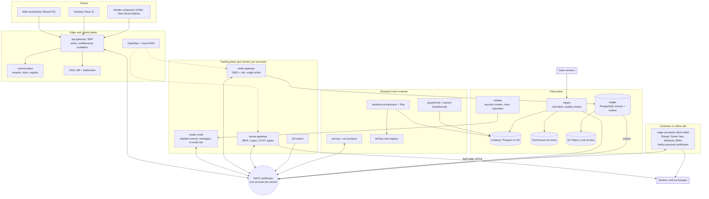

**English** | [繁體中文](proposal-C-platform-scale.zh-TW.md)

# Proposal C: Platform & Scale (Multi-User, Cloud-Native, Web/Mobile/Desktop)

*Architecture proposal · Status as of 2026-10-05 · Builds on research [01](../research/01-core-language-runtime.md)–[11](../research/11-taiwan-market-localization.md). Versions, prices and legal points come from those fact-checked reports. Figures marked "estimate" are this proposal's own sizing.*

## 1. Positioning

**In one sentence:** a multi-tenant, cloud-native platform for analysis, backtesting and trading that a team of 6–12 engineers first runs for its own desks and accounts, and that is built from day one so it can later be offered to outside users as a self-directed research, paper-trading and automation service once data licences and legal review allow.

| Dimension | Assumption |
|---|---|
| Team | 6–12 engineers at peak (can grow to 20), plus part-time compliance counsel |
| Users | First, internal multi-user use on the organization's own accounts. Later, external tenants: research and paper trading first, live trading only after legal sign-off |
| Markets | US/global equities, ETFs, options and Treasuries via IBKR; global crypto plus Taiwan TWD venues; TWSE/TPEx and TAIFEX via local broker APIs; bonds at low frequency |
| Latency | Intraday. Design target: decision-to-wire p99 of 25 ms or less inside one region. Broker round trips (tens to hundreds of ms) dominate. Not suited to sub-millisecond market making |
| Product posture | Software the user directs. No signals for sale, copy trading, discretionary management or custody until licensed (§7) |

## 2. Layered stack

| Layer | Choice | Rationale | Alternative |
|---|---|---|---|
| Core engine language | **Rust** for the trading plane: node extensions, order gateway, venue gateways, edge-connector supervisor. Fixed-point i64/i128 prices; i64 UTC-nanosecond timestamps | No GC on the hot path, memory safety, and the same language as the NautilusTrader v2 core | C#/.NET 10 LTS (supported to 2028-11-14) with LEAN |
| Strategy language / API | **Python 3.14** on the NautilusTrader v2 Strategy API, behind our thin `strategy-sdk`. Rust strategies optional. Packages are signed and content-hashed | The same code runs in backtest, paper and live | LEAN algorithms (C#, or Python 3.11, which reaches end of life 2027-10) |
| Backtest engine | **Integrate** NautilusTrader 2.x (pinned) behind a `StrategyRuntime` port as the event-driven tier. **Build** the vectorized tier (Polars/Numba) and plug-ins for bonds (QuantLib), Taiwan rules, funding, and fees/taxes that change over time. Runs on **Ray 2.59** on Kubernetes with per-tenant quotas | Nautilus has L1–L3 matching and 17 integrations; no engine covers bonds or Taiwan. vectorbt's Commons Clause forbids selling services based on it | LEAN (strongest for US equities and options) |
| Tick & bar storage | **Iceberg 1.12 tables (Parquet) on S3** in bronze, silver and gold layers, queried with DuckDB and Polars. **ClickHouse 26.8 LTS** as the hot store | Iceberg snapshots keep backtests reproducible without lakeFS, whose BSL (since v1.87.0) forbids serving outside users. ClickHouse handles many concurrent users and supports `ASOF JOIN` | QuestDB (HA is Enterprise-only) |
| Reference data | **PostgreSQL 18** bitemporal security master with `instrument_xref` (FIGI, ISIN, OCC OSI, TAIFEX codes, venue symbols), plus market-rules and calendar services | One internal `instrument_id`. Ticks, limits, fees and calendars are stored as dated data that backtest, risk and live all share | Bloomberg/LSEG reference data |
| Trade & accounting records | **PostgreSQL 18** append-only, hash-chained event ledger, with one schema per tenant, an outbox to NATS, and a nightly export to **S3 Object Lock** (compliance mode) | Positions can be rebuilt as of any time, and the ledger is the audit trail. The venue remains the source of truth through reconciliation | immudb (BSL) |
| Messaging | **In-process bus** inside nodes. **NATS JetStream 2.15** between processes, with **one account per tenant** and leaf nodes for edge sites. **Protobuf** contracts (`buf breaking` in CI) and **Arrow** for bulk data | A single binary with multi-tenancy, WebSocket and leaf nodes | Kafka 4.3, only for CDC and analytics |
| OMS / risk | Inside the node: Nautilus `RiskEngine` plus a shared Rust `risk-rules` crate (the same code runs in backtests). Outside it: an **order gateway** with the persisted order state machine and account/tenant limits. It fails closed and is the single writer per account (lease plus fencing). A separate **kill-switch** service | Strategies have no direct path to venues (research 08, option D) | Node-only risk (it shares fate with the strategies) |
| Pricing | **QuantLib 1.43** (QD+ American engine, bonds, curves). **vollib 1.0.11 / fast-vollib 0.2.3** for chain IV and greeks. An in-house crypto-derivatives module and an SVI-to-SSVI surface service. All server-side | QuantLib is the only permissive library covering options, bonds and curves. vollib supports Python ≤ 3.13, so pin that image | ORE 1.8.17 for XVA/SIMM. Rateslib costs £251/user/yr even as a test oracle |
| Research / ML | **JupyterHub** (sandboxed, versioned kernels) and **marimo**; DuckDB and Polars; **MLflow 3.16** (with RBAC) as trial registry; skfolio + cvxpy; LightGBM. Images: modern, legacy-quant (pandas 2.3), deep learning, optional GPU. LLMs get read-only MCP tools only | Trial counts feed the DSR and PBO gates. The pandas 3 split forces separate images | W&B (SaaS) |
| Front end & charting | **React + TypeScript web workstation** first, wrapped by **Tauri 2.12** for desktop. Mobile: a **PWA**, then a **React Native 0.87** companion. Charts: Lightweight Charts 5.2 (with attribution), uPlot, ECharts 6.1, Perspective 5.5. **AG Grid Enterprise** (US$999/developer). Custom Canvas/WebGL DOM ladder and TAIFEX T-quote | Maximum code reuse. Tauri notifications are local only, so push alerts need React Native | Electron 44 for multi-monitor desks; SciChart.js 6 for 3D surfaces. TradingView Advanced Charts is not allowed in a paywalled product |
| UI gateway | BFF: OIDC + PKCE, entitlements, per-subscriber conflation, Protobuf over WebSocket, Connect RPC, Arrow IPC | Exchange display licences apply per user. Orders and fills are never dropped | Direct NATS over WebSocket (rejected: it exposes the bus) |
| Deployment & ops | Managed **Kubernetes 1.35+**. Hub in AWS Tokyo (`ap-northeast-1`). Taiwan workloads in AWS Taipei (`ap-east-2`) or GCP `asia-east1`. GitOps. Trader nodes run as pinned StatefulSets and Ray on spot nodes | Regions are chosen by measured RTT. Order-journal RPO ≈ 0; RTO in minutes | Docker Compose on one VM (see the lean trigger in §7) |
| Observability | **OpenTelemetry** to Prometheus 3 (3.13 LTS), Grafana, Loki 3.7 and Tempo. Trading SLIs: data staleness, tick-to-order latency, reject rate, position drift, clock offset | Standard tooling with no per-series bill. Grafana is AGPL, so tenants are never given a modified copy | Grafana Cloud; Datadog |
| Security & keys | **OpenBao 2.7** (MPL-2.0) on a cloud KMS root, with per-tenant policies and audit devices. Venue keys are trade-only, have withdrawals disabled, are IP-bound and are rotated every 90 days. In SaaS mode, Taiwan `.pfx` certificates stay in the user's edge connector. FIDO2 sign-in. SLSA v1.2 provenance, Sigstore signatures, SBOMs and SPDX scanning | Simple licensing. Personal broker certificates cannot be pooled | Vault Enterprise or an HSM |

### 2.1 Data vendors per asset class

| Asset class | Internal phase | SaaS phase |
|---|---|---|
| US equities | Databento US Equities Standard ($199/mo, includes live data) | Databento Plus (adds external distribution) or Unlimited ($4,000/mo), or the user's own vendor key. Massive and ThetaData retail plans are for individual use only |
| US options | Databento OPRA; ORATS Live ($299/mo) | Business licence or the user's own key. Show greeks from our pricing service |
| Crypto | CCXT 4.5.85 capture (free); Tardis.dev Professional ($1,000–2,200/mo) | Tardis.dev Business ($3,000–6,000/mo); venue ToS |
| Bonds & rates | FRED/ALFRED and Treasury Fiscal Data (free); IBKR; TRACE under agreement | The same; evaluated prices by quote. Never treat them as tradable |
| Taiwan | Broker feeds; TWSE/TPEx/TAIFEX OpenAPIs (143/225/135 endpoints); TEJ; TWSE Data E-Shop (NT$5,000 per data-month). FinMind for prototyping only (its data is non-commercial) | Real-time display needs the TWSE licence (NT$60,000/mo) plus the internet fee (NT$100,000/mo for up to 5,000 accounts). Otherwise delayed data only. TAIFEX needs written consent |

### 2.2 Broker and exchange connectivity

| Asset class | Primary / secondary | Placement & notes |
|---|---|---|
| US/global stocks, options, futures | IBKR via **ib_async** (BSD-2) or the Rust `ibapi` crate (MIT); Alpaca Broker API only for a retail B2B2C product | Never ship IBKR's GPL client (10.49+). In SaaS mode, use IBKR's third-party OAuth 1.0a (after a compliance review) or a gateway on the user's edge connector |
| Crypto | Native Nautilus v2 adapters: Binance, OKX, Bybit, Deribit (options), Coinbase (ES256 keys; perpetuals-only Global Derivatives since 2026-10-01), Hyperliquid (agent wallets). CCXT for the long tail; MAX and BitoPro for TWD | Tokyo. Arm dead-man timers for every traded symbol. Venue allow-list in configuration |
| Taiwan stocks, TAIFEX | **Shioaji 1.7.7** (Linux, local HTTP/SSE server); **Fubon Neo** (Linux, IP-bound API keys); Yuanta SPARK; Capital SKCOM only on a Windows VM | Internal phase: Taipei-region containers. SaaS phase: a **customer-hosted edge connector**, because certificates are personal and broker terms forbid authorizing third parties. IBKR's Taiwan listings exclude Taiwan residents |
| Bonds | IBKR `BOND` contracts at low frequency; bond ETFs as equities; manual booking for OTC bonds | Institutional RFQ via QuickFIX/J only in Phase 5 |

## 3. Component architecture and data flow

### 3.1 Planes and deployables

To avoid sprawl, a new service must have its own scaling, failure or security boundary; anything else becomes a module inside an existing service. That gives **13 owned deployables**:

- **Edge and control:** `api-gateway`, `control-plane` (tenants, roles, entitlements, strategy registry).
- **Trading:** `trader-node` (one per broker account), `order-gateway`, `venue-gateway` (one process per venue account, plus a paper adapter), `kill-switch`, `edge-connector`.
- **Data:** `ingest`, `refdata`, `ledger` (including reconciliation).
- **Compute:** `backtest-orchestrator`, `pricing`, `scheduler-notifier`.

Everything else is off the shelf.



### 3.2 Live order flow

1. A venue gateway, or `ingest` for platform-licensed feeds, publishes normalized events on the tenant's subjects. Each event carries `ts_event`/`ts_init` in UTC nanoseconds and a `license_tag`.
2. In the node, the strategy places an order. In-node checks run first; then a custom `PlatformExecutionClient` sends the order intent onward.
3. The order gateway checks limits, kill-switch state and session state. It writes `PendingNew` and the venue-encoded client order ID to the ledger **before** sending, and fails closed if it cannot.
4. The venue gateway rate-limits by request weight, sends the order, and publishes fills de-duplicated on (venue, exec id). After a timeout it queries by client ID and never blindly resubmits.
5. The ledger projects positions and cash. Reconciliation runs in real time, intraday (every 1–5 min) and at end of day. An unexplained mismatch halts the account.
6. The BFF streams orders, fills and positions without loss, and conflates quotes and greeks.
7. The kill switch has three paths: a UI hotkey, a mobile command, and venue dead-man timers. Runbooks cancel resting orders before revoking keys.

### 3.3 Same strategy code: backtest, then paper, then live

```mermaid
flowchart LR
  A["Strategy package<br/>signed, content-hashed"] --> B["Vectorized screen<br/>Polars kernels"]
  B --> C["Event-driven backtest<br/>Nautilus BacktestEngine on Ray<br/>TW rules, bond, funding plug-ins"]
  C -->|"Gate 1: CPCV, DSR ≥ 0.95,<br/>PBO ≤ 0.2, costs ×2"| D["Platform paper<br/>LiveNode, live data, paper adapter"]
  D -->|"Gate 2: ≥ 3 months or N trades,<br/>tracking error in band"| E["Broker paper<br/>IBKR paper, Shioaji simulation, testnets"]
  E -->|"Gate 3: four-eyes approval,<br/>recon green 5 sessions"| F["Live with capital ramp<br/>10% → 25% → 100%"]
  F -->|"live P&L outside Monte Carlo band"| G["Auto de-risk<br/>REDUCING / HALTED"]
```



Only the adapters change from stage to stage:

| Stage | Kernel | Data | Execution |
|---|---|---|---|
| Backtest | `BacktestEngine` on Ray | A pinned Iceberg snapshot | Simulated venue with fill, fee, tax and funding plug-ins |
| Platform paper | `LiveNode` | Live, via `PlatformDataClient` | Order gateway (paper mode), then the paper adapter (same simulation models) |
| Broker paper | `LiveNode` | Live | Order gateway, then venue gateway, then IBKR paper, Shioaji simulation or a testnet |
| Live | `LiveNode` | Live | Order gateway, then venue gateway, then the venue |

`risk-rules` runs in every stage. Each run writes a manifest: engine version and lockfile, git SHA, image digest, data snapshot ID, parameters, seeds and rules-pack version. The order gateway rejects strategy versions that the registry has not approved. Upstream advises against using Nautilus release candidates with real capital, so RCs go no further than broker paper. Real money waits for 2.0.0 stable or our own soak tests.

### 3.4 Tenancy, authorization and audit

| Boundary | Mechanism |
|---|---|
| Identity | OIDC with WebAuthn MFA. Step-up authentication to enable live trading, raise limits or add keys |
| Authorization | Hierarchy: tenant, workspace, broker account, strategy. Roles: owner, trader, researcher, risk officer (can halt but not trade), viewer, auditor. A relationship-based policy service (evaluate OpenFGA or Cedar). Four-eyes approval for limit changes and promotion to live |
| Data | One ledger schema per tenant; row-level security on shared tables; per-tenant S3 prefixes and KMS keys |
| Compute | One namespace per tenant. User code (strategies, notebooks, AI-written code) runs in gVisor or Kata sandboxes with no credentials; its only egress is the tenant's NATS account |
| Market data | `license_tag` on every dataset; an entitlement service; delayed data on shared screens; access logs; no raw tick export |
| Audit | A hash-chained journal of orders, fills, and limit, role and key changes; off-box daily digests; a WORM archive |
| Internal desks | Run as ordinary tenants, so isolation is tested before external users arrive |

## 4. Handling per asset class

| | Equities & ETFs | Options & futures (US, TAIFEX, Deribit) | Crypto | Bonds |
|---|---|---|---|---|
| Instrument model | Nautilus `Equity` plus a dated `tick_scheme_id`. Board lots and odd lots as typed quantities. TW limit regime, tax class and day-trade and disposition flags refreshed daily | `OptionContract`, `OptionSpread`, `FuturesContract`. Multiplier (US 100; TXO NT$50/pt; TX NT$200/pt), exercise style, adjusted deliverables | Crypto types plus `settlement_currency` and `is_inverse`, at i128 precision. U256 only at on-chain adapters | New in-house `Bond` type: coupons, day count, call schedule, clean vs dirty price, 32nds codec |
| Identifiers | FIGI, ISIN; CUSIP only if licensed | OCC OSI; TAIFEX root plus month or weekly code | Venue symbol plus base, quote and settlement currency | CUSIP/ISIN, IBKR conId |
| Pricing | Marks; corporate-action factors applied at read time | Black-76 on an implied forward (TXO, index, crypto); QuantLib QD+ for US single stocks; SVI, then SSVI | Inverse PnL `Q_usd × (1/F_entry − 1/F_exit)`, premium-adjusted delta, funding accrual, basis | QuantLib accrued interest, yield, DV01, curves |
| Sessions | XTAI/US calendars; TW call auctions, 5-second odd-lot auctions, 3.5% volatility interruption; typhoon overrides | TAIFEX night session 15:00–05:00 counts toward the **next** trading date; weekly TXO expires Wednesday or Friday | 24/7, with a daily cut at 00:00 UTC | SIFMA calendars |
| Settlement | US T+1, TW T+2 (settled vs available cash) | Exercise, assignment and expiry as events. TXO is cash-settled on a 30-minute average | Funding as cash events; Deribit expiries at 08:00 UTC | Coupons, calls and maturity as events |
| Fees & taxes (dated) | US: SEC Section 31, FINRA TAF, borrow. TW: 0.3% tax on sells, 0.15% on day trades until 2027-12-31, 0.1% on ETFs | TAIFEX tax on both sides: 0.002% on index futures, 0.1% of option premium | Maker/taker tiers, funding, gas | TW corporate bonds and bond ETFs are tax-free only until 2026-12-31 |
| Margin | Reg T and FINRA intraday margin, per broker (phase-in to 2027-10-20) | Greek limits; TAIFEX SPAN loader | Venue figures; simulated liquidations | DV01 limits |

## 5. Repo layout

```text
platform/
├─ proto/                      # Protobuf: API, bus events, ledger; buf breaking in CI
├─ crates/                     # Rust
│  ├─ domain/                  # instruments incl. Bond, fixed-point money, UTC-ns time, tenant IDs
│  ├─ risk-rules/              # pre-trade checks shared by trader-node and order-gateway
│  ├─ market-rules/            # dated ticks, limits, fees, taxes; TW/TAIFEX pack
│  ├─ calendar/                # XTAI, US, SIFMA + TAIFEX night session, crypto 24/7, overrides
│  ├─ ledger/                  # event-sourced aggregates, projections, hash chain
│  └─ nautilus-ext/            # PlatformDataClient, PlatformExecutionClient, sim plug-ins
├─ services/
│  ├─ api-gateway/  control-plane/  order-gateway/  kill-switch/
│  ├─ venue-gateway/adapters/{ibkr,binance,okx,bybit,deribit,coinbase,hyperliquid,ccxt,max,bitopro,paper}/
│  ├─ edge-connector/adapters/{shioaji-http,fubon-py,yuanta-dotnet,capital-win}/
│  └─ ingest/  refdata/  ledger/  backtest-orchestrator/  pricing/  scheduler-notifier/
├─ python/{strategy-sdk,signals,metrics,pricing,crypto_derivs,vectorized}/
├─ strategies/                 # templates and internal strategies, versioned with config
├─ research/                   # marimo notebooks
├─ ui/{packages/{proto-ts,design-system,widgets},web,desktop-tauri,mobile-rn}/
├─ images/{modern,legacy-quant,dl,gpu}/
├─ data/{schemas,quality-checks,licence-registry}/
├─ deploy/{helm,terraform,compose-dev}/
└─ tests/{golden-replay,property,contract,venue-cert,chaos,tenant-isolation}/
```

The edge connector is a single signed Rust supervisor. It runs in the Taipei region during the internal phase and on the user's machine in SaaS mode. Each broker SDK runs as a subprocess in its own native language.

## 6. Roadmap and cost

### 6.1 Phased roadmap (estimates)

| Phase | Months | Team | Person-months | Exit criteria |
|---|---|---|---|---|
| 0. Foundations | 0–2 | 6 | 12 | Contracts, domain model, Kubernetes/GitOps, OpenBao, IdP, CI with SBOMs and licence scanning, bronze ingest |
| 1. Research & backtest | 2–6 | 8 | 32 | Lake, security master, TW rules pack, Nautilus on Ray, MLflow trial registry, web v1. Golden-master backtests reproduce exactly |
| 2. Paper & OMS | 6–10 | 9 | 36 | Nodes, order gateway, IBKR/Binance/OKX/Shioaji-simulation gateways, ledger and reconciliation, kill switch. Reconciliation green for 5+ sessions; chaos drill passed |
| 3. Internal live & options | 10–14 | 10 | 40 | Live trading gated on Nautilus 2.0 stable or a soak test; pricing and surface service; TXO and US options; Deribit; Fubon Neo; mobile app. Four weeks of small live trading within slippage bands |
| 4. SaaS readiness | 14–20 | 11 | 66 | Tenant hardening, edge connector, user-supplied keys, entitlements and billing, bonds, penetration test, SOC 2 readiness. Legal sign-off, then an external beta limited to research and paper trading |
| 5. Scale | 20+ | 12–20 | Ongoing | Multi-region DR, FIX and bond RFQ, GPU pool, live trading for licensed external tenants |

That is about **120 person-months to internal live trading** and **about 186 to the external beta**. This matches the 9–18 month "Build" estimate in [research 10](../research/10-open-source-platforms-build-vs-buy.md).

### 6.2 Monthly cost (order of magnitude, excluding payroll)

| Bucket | Internal (Phases 1–3) | External beta (Phase 4+) |
|---|---|---|
| Market data | ~US$2k–5k: Databento Standard ($199 per plan), ORATS $299, Tardis Professional $1,000–2,200, Fugle NT$2,999, plus TEJ by quote | ~US$10k–20k+: Databento distribution tiers, Tardis Business, and the TWSE licence plus fee ≈ NT$160,000 (≈ US$5k at an assumed 32 TWD/USD). User-supplied keys and delayed data reduce this |
| Cloud (estimate, not researched) | ~US$4k–10k | ~US$10k–30k, scaling with tenants and backtest hours |
| Licences | ~US$0.3k–1k (AG Grid amortized; optional SciChart) | ~US$1k–3k, plus audit fees |
| **Total** | **~US$6k–16k/month** | **~US$21k–53k/month** |

## 7. Risks and evolution triggers

**Technical risks**

- **NautilusTrader v2 churn.** RC renames continue, and v1 backports end around November 2026. Mitigation: pin exact versions, keep the engine behind `strategy-sdk`, and run golden-replay CI.
- **Parity loss across network hops.** Mitigation: record and replay, TCA feedback into the fill models, and Monte Carlo drift alarms.
- **Arbitrary tenant code.** Mitigation: sandboxes, no credentials, egress policies, and isolation tests in CI.
- **Operational weight for a small team.** Mitigation: managed services and the 13-deployable cap.
- **Dependency churn.** DuckDB 2.0 is scheduled for 2026-10-21 and 1.5 reaches end of life 2026-11-01. The pandas 3 split continues, and Tauri v3 is in alpha. QuantLib's Taiwan calendar ends in 2026. Databento reassigns some instrument IDs on 2026-10-31, so we keep our own IDs.
- **Taiwan gateways.** Shioaji allows 5 sessions per person ID and silently returns empty quotes once its traffic cap is hit. Windows COM SDKs are fragile. Mitigation: watchdogs, restarts before 08:30 and 15:00, and alerts on empty data.

**Licence risks**

- **Distribution** brings obligations: LGPL-3.0-only Nautilus (keep it out of desktop and edge builds), IBKR's GPL TWS API, and GPL tools.
- **SaaS-specific:** vectorbt's Commons Clause, lakeFS and Redpanda BSL, Redis AGPL/RSAL (use Valkey instead), non-commercial TimesFM 3.0 and Moirai 2.0 weights, and the paid Rateslib licence. SciChart Standard licences are locked to a hostname or app ID and exclude localhost, so Tauri builds need an app-ID key or an Advanced licence.
- **Market data:** retail plans are individual-use only; TWSE and TAIFEX redistribution needs contracts; IBKR forbids redistributing data received over its TWS API without written approval; FinMind data is non-commercial.

**Regulatory risks**

- **Advice and signals:** US RIA/CTA registration. In Taiwan, SITCA Act Art. 107 (up to 5 years plus NT$1M–50M) and Futures Trading Act Art. 112 (up to 7 years).
- **Trading for others:** Taiwan broker terms forbid authorizing third parties, which is why the edge connector exists. IBKR expects automated-trading vendors to hold the relevant registrations.
- **Crypto:** Taiwan's VASP Act (passed 2026-06-30; first licences expected around Q1 2028), the domestic Travel Rule from October 2026, and MiCA in the EU. Mitigation: geo-fence crypto features and never take custody.

| Trigger | Evolve toward |
|---|---|
| No external users within ~12 months, team below 5, or a negative legal review | **Lean self-use design:** modular monolith on Compose with Parquet + DuckDB. Keep the `risk-rules`, `ledger` and `market-rules` crates |
| Strategies need under 1 ms decision-to-wire, L3 queue modelling or market making | **Performance-first design:** order gateway merged into the node, Aeron + SBE, co-location |
| C#-first team, or US options dominate | **LEAN core** behind the same `StrategyRuntime` port |
| Prime brokers, bond RFQ or drop copy | **Institutional extensions:** FIX (QuickFIX/J or OnixS) and Kafka for CDC |
| Taiwan SaaS blocked by licensing | **Self-hosted distribution:** this triggers LGPL/GPL duties, so redo the licence review |
| Nautilus 2.0 slips | Pin the last good RC under soak tests; evaluate LEAN behind the port |

**ADRs to record:**

1. Web-first, multi-tenant platform.
2. Nautilus v2 behind `StrategyRuntime`.
3. Order gateway as the single writer per account.
4. One NATS account per tenant, with leaf-node edge connectors.
5. Storage split: Iceberg, ClickHouse and a PostgreSQL ledger.
6. OpenBao for secrets, with Taiwan certificates held at the edge.
7. Self-directed-software regulatory posture.

## Sources

The verification logs and primary references are in the research reports:

- [01 Core language & runtime](../research/01-core-language-runtime.md)
- [02 Backtesting engine](../research/02-backtesting-engine.md)
- [03 Market data & storage](../research/03-market-data-storage.md)
- [04 Broker & exchange connectivity](../research/04-broker-exchange-connectivity.md)
- [05 Instrument model & pricing](../research/05-instrument-model-pricing-analytics.md)
- [06 Cross-platform client UI](../research/06-cross-platform-client-ui.md)
- [07 System architecture & messaging](../research/07-system-architecture-messaging.md)
- [08 Risk, security, ops & compliance](../research/08-risk-security-ops-compliance.md)
- [09 Research, ML & analytics](../research/09-research-ml-analytics.md)
- [10 Open-source platforms & build vs buy](../research/10-open-source-platforms-build-vs-buy.md)
- [11 Taiwan market localization](../research/11-taiwan-market-localization.md)
