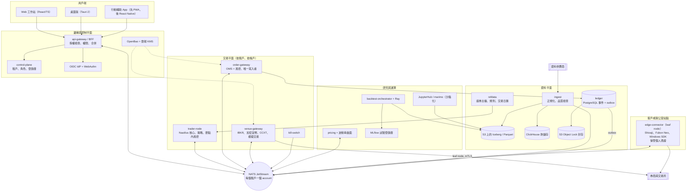
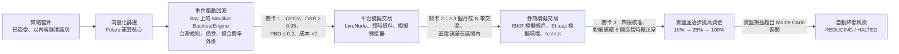

[English](proposal-C-platform-scale.md) | **繁體中文**

# 提案 C：平台與規模（多使用者、雲端原生、Web／行動裝置／桌面）

*架構提案 · 狀態截至 2026-10-05 · 以研究 [01](../research/01-core-language-runtime.zh-TW.md)–[11](../research/11-taiwan-market-localization.zh-TW.md) 為基礎。版本、價格與法律要點皆取自這些經過事實查核的報告。標示「估計」的數字為本提案自行估算的規模。*

## 1. 定位

**一句話總結：** 一個多租戶（multi-tenant）、雲端原生的分析、回測與交易平台，由 6–12 名工程師組成的團隊先供自家交易台與帳戶使用；並從第一天起就以可對外提供的方式建構，待資料授權與法律審查許可後，即可作為由使用者自主操作的研究、模擬交易與自動化服務提供給外部使用者。

| 面向 | 假設 |
|---|---|
| 團隊 | 高峰期 6–12 名工程師（可擴增至 20 名），另加一位兼職合規法律顧問 |
| 使用者 | 首先是在組織自有帳戶上的內部多使用者使用。之後開放外部租戶：先提供研究與模擬交易，實盤交易須待法律核可後才開放 |
| 市場 | 透過 IBKR 交易美國／全球股票、ETF、選擇權與美國公債；全球加密貨幣以及台灣的新台幣交易場所（venue）；透過本地券商 API 交易 TWSE／TPEx 與 TAIFEX；低頻交易債券 |
| 延遲 | 日內。設計目標：在單一區域內，從決策到送出（decision-to-wire）的 p99 不超過 25 ms。券商往返時間（數十至數百 ms）為主要延遲來源。不適合次毫秒級的造市 |
| 產品定位 | 由使用者自行指揮的軟體。在取得執照之前（§7），不販售訊號、不提供跟單交易、不做全權委託管理，也不保管資產 |

## 2. 分層技術堆疊

| 層級 | 選擇 | 理由 | 替代方案 |
|---|---|---|---|
| 核心引擎語言 | 交易平面採用 **Rust**：節點擴充、下單閘道、交易場所閘道、邊緣連接器監督程式（supervisor）。價格採定點數 i64/i128；時間戳記採 i64 UTC 奈秒 | 熱路徑上沒有 GC、記憶體安全，且與 NautilusTrader v2 核心使用相同語言 | C#/.NET 10 LTS（支援至 2028-11-14）搭配 LEAN |
| 策略語言／API | 以 NautilusTrader v2 Strategy API 撰寫的 **Python 3.14**，包在我們精簡的 `strategy-sdk` 之後。Rust 策略為選用。套件皆經簽章並以內容雜湊識別 | 同一份程式碼可在回測、模擬交易與實盤中執行 | LEAN 演算法（C#，或 Python 3.11，其將於 2027-10 終止支援） |
| 回測引擎 | 將 NautilusTrader 2.x（鎖定版本）**整合**於 `StrategyRuntime` port 之後，作為事件驅動（event-driven）層。**自建**向量化層（Polars/Numba），以及債券（QuantLib）、台灣規則、資金費率，與隨時間變動之手續費／稅負的外掛。在 Kubernetes 上的 **Ray 2.59** 執行，並設有各租戶配額 | Nautilus 具備 L1–L3 撮合與 17 種整合；沒有任何引擎涵蓋債券或台灣市場。vectorbt 的 Commons Clause 禁止以其為基礎販售服務 | LEAN（在美國股票與選擇權方面最強） |
| Tick 與 K 線儲存 | **S3 上的 Iceberg 1.12 資料表（Parquet）**，分為 bronze、silver、gold 三層，以 DuckDB 與 Polars 查詢。**ClickHouse 26.8 LTS** 作為熱儲存 | Iceberg 快照可在不使用 lakeFS 的情況下維持回測的可重現性；lakeFS 的 BSL（自 v1.87.0 起）禁止為外部使用者提供服務。ClickHouse 能承受大量並行使用者，並支援 `ASOF JOIN` | QuestDB（HA 僅限 Enterprise 版） |
| 參考資料 | **PostgreSQL 18** 雙時態（bitemporal）證券主檔，搭配 `instrument_xref`（FIGI、ISIN、OCC OSI、TAIFEX 代碼、交易場所代號），外加市場規則與交易日曆服務 | 單一內部 `instrument_id`。跳動單位（tick）、限制、手續費與交易日曆皆以帶日期的資料儲存，由回測、風控與實盤共用 | Bloomberg/LSEG 參考資料 |
| 交易與會計紀錄 | **PostgreSQL 18** 僅可附加（append-only）、雜湊鏈結的事件帳本，每個租戶一個 schema，透過 outbox 傳送至 NATS，並每晚匯出至 **S3 Object Lock**（合規模式） | 可重建任意時間點的部位，帳本即為稽核軌跡。透過對帳，交易場所仍是事實來源（source of truth） | immudb（BSL） |
| 訊息傳遞 | 節點內部使用**行程內匯流排（in-process bus）**。行程之間使用 **NATS JetStream 2.15**，**每個租戶一個 account**，並以 leaf node 連接邊緣站點。以 **Protobuf** 定義契約（CI 中執行 `buf breaking`），大量資料則使用 **Arrow** | 單一執行檔即具備多租戶、WebSocket 與 leaf node | Kafka 4.3，僅用於 CDC 與分析 |
| OMS／風控 | 節點內：Nautilus `RiskEngine` 加上共用的 Rust `risk-rules` crate（回測中執行相同的程式碼）。節點外：**下單閘道（order gateway）**，負責持久化的委託單狀態機與帳戶／租戶限額。它採失敗即封閉（fails closed）設計，並且是每個帳戶的唯一寫入者（租約加 fencing）。另有一個獨立的 **kill-switch** 服務 | 策略沒有直接通往交易場所的路徑（研究 08，選項 D） | 僅在節點內做風控（與策略同生共死） |
| 定價 | **QuantLib 1.43**（QD+ 美式引擎、債券、曲線）。**vollib 1.0.11 / fast-vollib 0.2.3** 用於選擇權鏈的隱含波動率（IV）與 Greeks。自建的加密貨幣衍生性商品模組，以及 SVI 至 SSVI 的波動率曲面服務。全部在伺服器端執行 | QuantLib 是唯一涵蓋選擇權、債券與曲線的寬鬆授權函式庫。vollib 支援 Python ≤ 3.13，因此需鎖定該映像檔 | ORE 1.8.17 用於 XVA/SIMM。Rateslib 即使僅作為測試基準（test oracle）也需每位使用者每年 £251 |
| 研究／ML | **JupyterHub**（沙箱化、版本化的 kernel）與 **marimo**；DuckDB 與 Polars；**MLflow 3.16**（含 RBAC）作為試驗登錄庫；skfolio + cvxpy；LightGBM。映像檔：modern、legacy-quant（pandas 2.3）、深度學習、選用的 GPU。LLM 僅能使用唯讀的 MCP 工具 | 試驗次數會提供給 DSR 與 PBO 關卡使用。pandas 3 的分裂迫使映像檔必須分開 | W&B（SaaS） |
| 前端與圖表 | 先做 **React + TypeScript Web 工作站**，再以 **Tauri 2.12** 包裝為桌面版。行動裝置：先做 **PWA**，再做 **React Native 0.87** 輔助 App。圖表：Lightweight Charts 5.2（需標示出處）、uPlot、ECharts 6.1、Perspective 5.5。**AG Grid Enterprise**（每位開發者 US$999）。自製 Canvas/WebGL 市場深度（DOM）價格階梯與 TAIFEX T 字報價 | 最大化程式碼重用。Tauri 通知僅限本機，因此推播警示需要 React Native | Electron 44 用於多螢幕交易台；SciChart.js 6 用於 3D 曲面。TradingView Advanced Charts 不得用於付費牆後的產品 |
| UI 閘道 | BFF：OIDC + PKCE、權限（entitlements）、依訂閱者合併（conflation）、透過 WebSocket 傳送 Protobuf、Connect RPC、Arrow IPC | 交易所的顯示授權按使用者計算。委託與成交回報絕不丟棄 | 透過 WebSocket 直連 NATS（已否決：會暴露匯流排） |
| 部署與維運 | 代管的 **Kubernetes 1.35+**。中樞位於 AWS 東京（`ap-northeast-1`）。台灣工作負載位於 AWS 台北（`ap-east-2`）或 GCP `asia-east1`。GitOps。交易節點以固定配置（pinned）的 StatefulSet 執行，Ray 則執行於 spot 節點 | 區域依實測 RTT 選擇。委託日誌 RPO ≈ 0；RTO 為分鐘級 | 單一 VM 上的 Docker Compose（見 §7 的精簡觸發條件） |
| 可觀測性 | **OpenTelemetry** 送至 Prometheus 3（3.13 LTS）、Grafana、Loki 3.7 與 Tempo。交易 SLI：資料陳舊度、tick 到下單延遲、拒單率、部位偏移、時鐘偏差 | 標準工具，不按時間序列計費。Grafana 採 AGPL，因此絕不將修改過的版本提供給租戶 | Grafana Cloud；Datadog |
| 安全與金鑰 | 以雲端 KMS 為根的 **OpenBao 2.7**（MPL-2.0），具各租戶政策與稽核裝置。交易場所金鑰僅限交易、停用提領、綁定 IP，且每 90 天輪替。在 SaaS 模式下，台灣的 `.pfx` 憑證保留在使用者的邊緣連接器中。FIDO2 登入。SLSA v1.2 來源證明（provenance）、Sigstore 簽章、SBOM 與 SPDX 掃描 | 授權單純。個人的券商憑證無法集中共用 | Vault Enterprise 或 HSM |

### 2.1 各資產類別的資料供應商

| 資產類別 | 內部階段 | SaaS 階段 |
|---|---|---|
| 美國股票 | Databento US Equities Standard（每月 $199，含即時資料） | Databento Plus（增加對外散布權）或 Unlimited（每月 $4,000），或使用者自有的供應商金鑰。Massive 與 ThetaData 的散戶方案僅限個人使用 |
| 美國選擇權 | Databento OPRA；ORATS Live（每月 $299） | 商業授權或使用者自有金鑰。Greeks 由我們的定價服務計算後顯示 |
| 加密貨幣 | CCXT 4.5.85 擷取（免費）；Tardis.dev Professional（每月 $1,000–2,200） | Tardis.dev Business（每月 $3,000–6,000）；交易場所服務條款（ToS） |
| 債券與利率 | FRED/ALFRED 與 Treasury Fiscal Data（免費）；IBKR；依協議取得的 TRACE | 同上；評價價格需洽詢報價。絕不可將其視為可成交價格 |
| 台灣 | 券商行情；TWSE/TPEx/TAIFEX OpenAPI（143/225/135 個端點）；TEJ；TWSE Data E-Shop（每資料月 NT$5,000）。FinMind 僅用於原型開發（其資料限非商業用途） | 即時顯示需要 TWSE 授權（每月 NT$60,000）加上網際網路傳輸費（最多 5,000 個帳戶，每月 NT$100,000）。否則僅能提供延遲資料。TAIFEX 需取得書面同意 |

### 2.2 券商與交易所連線

| 資產類別 | 主要／次要 | 部署位置與備註 |
|---|---|---|
| 美國／全球股票、選擇權、期貨 | 透過 **ib_async**（BSD-2）或 Rust `ibapi` crate（MIT）連接 IBKR；Alpaca Broker API 僅用於散戶 B2B2C 產品 | 絕不散布 IBKR 的 GPL 用戶端（10.49+）。在 SaaS 模式下，使用 IBKR 的第三方 OAuth 1.0a（須經合規審查）或使用者邊緣連接器上的閘道 |
| 加密貨幣 | Nautilus v2 原生轉接器（adapter）：Binance、OKX、Bybit、Deribit（選擇權）、Coinbase（ES256 金鑰；自 2026-10-01 起 Global Derivatives 僅提供永續合約）、Hyperliquid（代理錢包 agent wallets）。長尾交易場所使用 CCXT；新台幣使用 MAX 與 BitoPro | 東京。為每個交易標的啟用 dead-man 計時器。交易場所允許清單置於設定檔中 |
| 台灣股票、TAIFEX | **Shioaji 1.7.7**（Linux，本機 HTTP/SSE 伺服器）；**富邦 Neo（Fubon Neo）**（Linux，綁定 IP 的 API 金鑰）；元大 SPARK（Yuanta SPARK）；群益 SKCOM（Capital SKCOM）僅在 Windows VM 上執行 | 內部階段：台北區域的容器。SaaS 階段：**由客戶自行託管的邊緣連接器**，因為憑證屬於個人，且券商條款禁止授權第三方。IBKR 的台灣上市商品不開放台灣居民交易 |
| 債券 | 低頻交易 IBKR `BOND` 合約；債券 ETF 視同股票；店頭市場（OTC）債券以人工入帳 | 透過 QuickFIX/J 的機構詢價（RFQ）僅在第 5 階段實作 |

## 3. 元件架構與資料流

### 3.1 平面與可部署單元

為避免服務無序擴張，新服務必須擁有自己的擴展、故障或安全邊界；其餘一律成為既有服務內的模組。因此共有 **13 個自有的可部署單元**：

- **邊緣與控制：** `api-gateway`、`control-plane`（租戶、角色、權限、策略登錄庫）。
- **交易：** `trader-node`（每個券商帳戶一個）、`order-gateway`、`venue-gateway`（每個交易場所帳戶一個行程，外加一個模擬交易轉接器）、`kill-switch`、`edge-connector`。
- **資料：** `ingest`、`refdata`、`ledger`（含對帳）。
- **運算：** `backtest-orchestrator`、`pricing`、`scheduler-notifier`。

其餘一切皆採用現成產品。



### 3.2 實盤委託流程

1. 交易場所閘道（或針對平台授權行情的 `ingest`）在租戶的 subject 上發布正規化事件。每個事件都帶有以 UTC 奈秒表示的 `ts_event`/`ts_init`，以及一個 `license_tag`。
2. 在節點中，策略下單。先執行節點內檢查；接著由自訂的 `PlatformExecutionClient` 將下單意圖往下游傳送。
3. 下單閘道檢查限額、kill-switch 狀態與交易時段狀態。它會在送出**之前**，將 `PendingNew` 以及依交易場所格式編碼的用戶端委託 ID 寫入帳本；若無法寫入，則失敗即封閉（fail closed）。
4. 交易場所閘道依請求權重進行速率限制、送出委託，並在以（venue, exec id）去除重複後發布成交回報。逾時後，它會以用戶端 ID 查詢，絕不盲目重送。
5. 帳本投影出部位與現金。對帳以即時、日內（每 1–5 分鐘）與日終三種頻率執行。無法解釋的差異會使該帳戶暫停交易。
6. BFF 無遺漏地串流委託、成交與部位，並合併報價與 Greeks。
7. Kill switch 有三種觸發途徑：UI 快速鍵、行動裝置指令，以及交易場所的 dead-man 計時器。執行手冊（runbook）會先取消掛單，再撤銷金鑰。

### 3.3 相同的策略程式碼：先回測，再模擬交易，後實盤



各階段之間只有轉接器會改變：

| 階段 | 核心 | 資料 | 執行 |
|---|---|---|---|
| 回測 | Ray 上的 `BacktestEngine` | 鎖定的 Iceberg 快照 | 模擬交易場所，含成交、手續費、稅負與資金費率外掛 |
| 平台模擬交易 | `LiveNode` | 即時，透過 `PlatformDataClient` | 下單閘道（模擬模式），接著是模擬轉接器（相同的模擬模型） |
| 券商模擬交易 | `LiveNode` | 即時 | 下單閘道，接著是交易場所閘道，再到 IBKR 模擬帳戶、Shioaji 模擬環境或 testnet |
| 實盤 | `LiveNode` | 即時 | 下單閘道，接著是交易場所閘道，再到交易場所 |

`risk-rules` 在每個階段都會執行。每次執行都會寫出一份 manifest：引擎版本與 lockfile、git SHA、映像檔摘要（digest）、資料快照 ID、參數、亂數種子以及規則包版本。下單閘道會拒絕登錄庫尚未核准的策略版本。上游專案建議不要以真實資金使用 Nautilus 的候選發行版（release candidate，RC），因此 RC 最多只推進到券商模擬交易。真實資金須等待 2.0.0 穩定版或我們自己的浸泡測試（soak test）。

### 3.4 租戶、授權與稽核

| 邊界 | 機制 |
|---|---|
| 身分 | 採用 OIDC 搭配 WebAuthn MFA。啟用實盤交易、提高限額或新增金鑰時，需進行升級驗證（step-up authentication） |
| 授權 | 階層：租戶、工作區、券商帳戶、策略。角色：擁有者、交易員、研究員、風控人員（可暫停但不可交易）、檢視者、稽核員。採用以關係為基礎的政策服務（評估 OpenFGA 或 Cedar）。限額變更與晉升至實盤需經四眼核准 |
| 資料 | 每個租戶一個帳本 schema；共用資料表採列層級安全性（row-level security）；各租戶獨立的 S3 前綴與 KMS 金鑰 |
| 運算 | 每個租戶一個 namespace。使用者程式碼（策略、筆記本、AI 撰寫的程式碼）在不含任何憑證的 gVisor 或 Kata 沙箱中執行；其唯一的對外流量出口是該租戶的 NATS account |
| 市場資料 | 每個資料集都標記 `license_tag`；權限服務；共用螢幕上只顯示延遲資料；存取日誌；不提供原始 tick 匯出 |
| 稽核 | 以雜湊鏈結記錄委託、成交，以及限額、角色與金鑰變更的日誌；每日摘要另存於主機之外；WORM 封存 |
| 內部交易台 | 以一般租戶的身分運作，讓隔離機制在外部使用者加入之前就已經過測試 |

## 4. 各資產類別的處理方式

| | 股票與 ETF | 選擇權與期貨（美國、TAIFEX、Deribit） | 加密貨幣 | 債券 |
|---|---|---|---|---|
| 商品模型 | Nautilus `Equity` 加上帶日期的 `tick_scheme_id`。整股與零股以型別化的數量表示。台灣漲跌幅制度、稅別，以及當沖與處置股旗標每日更新 | `OptionContract`、`OptionSpread`、`FuturesContract`。契約乘數（美國 100；TXO 每點 NT$50；TX 每點 NT$200）、履約型態、調整後的交割標的 | 加密貨幣型別加上 `settlement_currency` 與 `is_inverse`，採 i128 精度。僅在鏈上轉接器使用 U256 | 新的自建 `Bond` 型別：票息、計息基礎（day count）、贖回時程、除息價（clean）與含息價（dirty）、32 分之一報價（32nds）編解碼器 |
| 識別碼 | FIGI、ISIN；CUSIP 僅在取得授權時使用 | OCC OSI；TAIFEX 商品代碼根加上月份或週別代碼 | 交易場所代號，加上基礎幣、計價幣與結算幣 | CUSIP/ISIN、IBKR conId |
| 定價 | 標記價格（marks）；公司行動調整因子於讀取時套用 | 以隱含遠期價格搭配 Black-76（TXO、指數、加密貨幣）；美國個股採 QuantLib QD+；先 SVI，後 SSVI | 反向合約損益 `Q_usd × (1/F_entry − 1/F_exit)`、權利金調整後的 delta、資金費率累計、基差 | QuantLib 應計利息、殖利率、DV01、曲線 |
| 交易時段 | XTAI／美國交易日曆；台灣集合競價、每 5 秒一次的零股集合競價、3.5% 瞬間價格穩定措施（volatility interruption）；颱風停市覆寫 | TAIFEX 夜盤 15:00–05:00 計入**次一**交易日；TXO 週選擇權於週三或週五到期 | 全年無休 24/7，每日於 00:00 UTC 切帳 | SIFMA 交易日曆 |
| 交割 | 美國 T+1、台灣 T+2（區分已交割現金與可用現金） | 履約、被指派與到期皆視為事件。TXO 以 30 分鐘平均價現金結算 | 資金費率視為現金事件；Deribit 於 08:00 UTC 到期 | 票息、贖回與到期皆視為事件 |
| 手續費與稅負（帶日期） | 美國：SEC Section 31、FINRA TAF、借券費。台灣：賣出課徵 0.3% 稅、當沖 0.15%（至 2027-12-31 止）、ETF 0.1% | TAIFEX 買賣雙方皆課稅：指數期貨 0.002%、選擇權權利金的 0.1% | Maker/taker 費率級距、資金費率、gas 費 | 台灣公司債與債券 ETF 的免稅僅適用至 2026-12-31 |
| 保證金 | Reg T 與 FINRA 日內保證金，依券商而異（分階段實施至 2027-10-20） | Greeks 限額；TAIFEX SPAN 載入器 | 交易場所公布的數值；模擬強制平倉 | DV01 限額 |

## 5. 儲存庫結構

```text
platform/
├─ proto/                      # Protobuf：API、匯流排事件、帳本；CI 中執行 buf breaking
├─ crates/                     # Rust
│  ├─ domain/                  # 商品（含 Bond）、定點數金額、UTC 奈秒時間、租戶 ID
│  ├─ risk-rules/              # trader-node 與 order-gateway 共用的交易前檢查
│  ├─ market-rules/            # 帶日期的跳動單位、限制、手續費、稅負；TW/TAIFEX 規則包
│  ├─ calendar/                # XTAI、US、SIFMA + TAIFEX 夜盤、加密貨幣 24/7、覆寫
│  ├─ ledger/                  # 事件溯源聚合、投影、雜湊鏈
│  └─ nautilus-ext/            # PlatformDataClient、PlatformExecutionClient、模擬外掛
├─ services/
│  ├─ api-gateway/  control-plane/  order-gateway/  kill-switch/
│  ├─ venue-gateway/adapters/{ibkr,binance,okx,bybit,deribit,coinbase,hyperliquid,ccxt,max,bitopro,paper}/
│  ├─ edge-connector/adapters/{shioaji-http,fubon-py,yuanta-dotnet,capital-win}/
│  └─ ingest/  refdata/  ledger/  backtest-orchestrator/  pricing/  scheduler-notifier/
├─ python/{strategy-sdk,signals,metrics,pricing,crypto_derivs,vectorized}/
├─ strategies/                 # 範本與內部策略，與設定一同進行版本控制
├─ research/                   # marimo 筆記本
├─ ui/{packages/{proto-ts,design-system,widgets},web,desktop-tauri,mobile-rn}/
├─ images/{modern,legacy-quant,dl,gpu}/
├─ data/{schemas,quality-checks,licence-registry}/
├─ deploy/{helm,terraform,compose-dev}/
└─ tests/{golden-replay,property,contract,venue-cert,chaos,tenant-isolation}/
```

邊緣連接器是單一、經簽章的 Rust 監督程式。在內部階段，它於台北區域執行；在 SaaS 模式下，則於使用者的機器上執行。每個券商 SDK 都以其原生語言作為子行程執行。

## 6. 路線圖與成本

### 6.1 分階段路線圖（估計）

| 階段 | 月份 | 團隊 | 人月 | 完成條件 |
|---|---|---|---|---|
| 0. 基礎建設 | 0–2 | 6 | 12 | 契約、領域模型、Kubernetes/GitOps、OpenBao、IdP、含 SBOM 與授權掃描的 CI、bronze 層資料匯入 |
| 1. 研究與回測 | 2–6 | 8 | 32 | 資料湖、證券主檔、台灣規則包、Ray 上的 Nautilus、MLflow 試驗登錄庫、Web v1。黃金基準（golden-master）回測可完全重現 |
| 2. 模擬交易與 OMS | 6–10 | 9 | 36 | 節點、下單閘道、IBKR/Binance/OKX/Shioaji 模擬環境閘道、帳本與對帳、kill switch。對帳連續 5 個以上交易時段正常；通過混沌演練 |
| 3. 內部實盤與選擇權 | 10–14 | 10 | 40 | 實盤交易以 Nautilus 2.0 穩定版或浸泡測試為前提；定價與曲面服務；TXO 與美國選擇權；Deribit；富邦 Neo；行動 App。連續四週小額實盤交易，且滑價維持在區間內 |
| 4. SaaS 就緒 | 14–20 | 11 | 66 | 租戶強化、邊緣連接器、使用者自備金鑰、權限與計費、債券、滲透測試、SOC 2 準備。取得法律核可後，推出僅限研究與模擬交易的外部 beta |
| 5. 規模化 | 20+ | 12–20 | 持續進行 | 多區域災難復原（DR）、FIX 與債券 RFQ、GPU 資源池、為持牌外部租戶提供實盤交易 |

這相當於**約 120 人月達到內部實盤交易**，以及**約 186 人月達到外部 beta**。此數字與 [研究 10](../research/10-open-source-platforms-build-vs-buy.zh-TW.md) 中 9–18 個月的「自建（Build）」估計相符。

### 6.2 每月成本（數量級，不含人事成本）

| 項目 | 內部（第 1–3 階段） | 外部 beta（第 4 階段起） |
|---|---|---|
| 市場資料 | 約 US$2k–5k：Databento Standard（每個方案 $199）、ORATS $299、Tardis Professional $1,000–2,200、Fugle NT$2,999，加上需洽詢報價的 TEJ | 約 US$10k–20k 以上：Databento 散布方案級距、Tardis Business，以及 TWSE 授權費加網路傳輸費 ≈ NT$160,000（以假設匯率 32 TWD/USD 計算 ≈ US$5k）。使用者自備金鑰與延遲資料可降低此成本 |
| 雲端（估計，未經研究） | 約 US$4k–10k | 約 US$10k–30k，隨租戶數與回測時數增加 |
| 授權 | 約 US$0.3k–1k（AG Grid 攤提；SciChart 為選用） | 約 US$1k–3k，另加稽核費用 |
| **合計** | **約 US$6k–16k／月** | **約 US$21k–53k／月** |

## 7. 風險與演進觸發條件

**技術風險**

- **NautilusTrader v2 頻繁變動。** RC 版本間的重新命名仍在持續，v1 的向後移植（backport）約於 2026 年 11 月結束。緩解措施：鎖定精確版本、將引擎置於 `strategy-sdk` 之後，並執行 golden-replay CI。
- **跨越網路跳點導致一致性（parity）流失。** 緩解措施：記錄與重播、將 TCA 回饋至成交模型，以及 Monte Carlo 偏移警報。
- **任意的租戶程式碼。** 緩解措施：沙箱、不提供憑證、對外流量政策，以及 CI 中的隔離測試。
- **對小團隊而言維運負擔沉重。** 緩解措施：代管服務以及 13 個可部署單元的上限。
- **相依套件變動。** DuckDB 2.0 預定於 2026-10-21 發布，1.5 則於 2026-11-01 終止支援。pandas 3 的分裂仍在持續，Tauri v3 仍處於 alpha 階段。QuantLib 的台灣交易日曆只到 2026 年。Databento 將於 2026-10-31 重新指派部分商品 ID，因此我們保留自己的 ID。
- **台灣閘道。** Shioaji 每個身分證字號允許 5 個連線階段（session），且在流量達上限後會靜默回傳空報價。Windows COM SDK 相當脆弱。緩解措施：看門狗（watchdog）、在 08:30 與 15:00 之前重新啟動，以及空資料警示。

**授權風險**

- **散布（distribution）**會帶來義務：LGPL-3.0-only 的 Nautilus（不得納入桌面版與邊緣版建置）、IBKR 採 GPL 的 TWS API，以及 GPL 工具。
- **SaaS 特有：** vectorbt 的 Commons Clause、lakeFS 與 Redpanda 的 BSL、Redis 的 AGPL/RSAL（改用 Valkey）、限非商業用途的 TimesFM 3.0 與 Moirai 2.0 權重，以及付費的 Rateslib 授權。SciChart Standard 授權綁定主機名稱或 App ID，且不含 localhost，因此 Tauri 建置需要 App ID 金鑰或 Advanced 授權。
- **市場資料：** 散戶方案僅限個人使用；TWSE 與 TAIFEX 的轉散布需要簽約；IBKR 禁止在未取得書面核准下轉散布透過其 TWS API 取得的資料；FinMind 資料限非商業用途。

**法規風險**

- **投資建議與訊號：** 美國需辦理 RIA/CTA 註冊。在台灣，《證券投資信託及顧問法》（SITCA Act）第 107 條（最高 5 年有期徒刑，並得併科新台幣 100 萬至 5,000 萬元罰金），以及《期貨交易法》第 112 條（最高 7 年有期徒刑）。
- **代他人交易：** 台灣券商條款禁止授權第三方，這正是邊緣連接器存在的原因。IBKR 要求自動化交易供應商持有相關登記。
- **加密貨幣：** 台灣的 VASP Act（虛擬資產服務法，2026-06-30 通過；首批執照預計約於 2028 年第一季核發）、自 2026 年 10 月起實施的國內 Travel Rule，以及歐盟的 MiCA。緩解措施：以地理圍欄（geo-fence）限制加密貨幣功能，且絕不保管資產。

| 觸發條件 | 演進方向 |
|---|---|
| 約 12 個月內沒有外部使用者、團隊少於 5 人，或法律審查結果為否定 | **精簡自用設計：** 以 Compose 部署的模組化單體，搭配 Parquet + DuckDB。保留 `risk-rules`、`ledger` 與 `market-rules` crate |
| 策略需要低於 1 ms 的決策到送出延遲、L3 佇列建模或造市 | **效能優先設計：** 將下單閘道併入節點、Aeron + SBE、主機共置（co-location） |
| 以 C# 為主的團隊，或以美國選擇權為主 | 將 **LEAN 核心**置於相同的 `StrategyRuntime` port 之後 |
| 主要經紀商（prime broker）、債券 RFQ 或 drop copy | **機構級擴充：** FIX（QuickFIX/J 或 OnixS），以及用於 CDC 的 Kafka |
| 台灣 SaaS 因授權問題受阻 | **自行託管的散布版本：** 這會觸發 LGPL/GPL 義務，因此需重新進行授權審查 |
| Nautilus 2.0 延期 | 在浸泡測試下鎖定最後一個良好的 RC；評估將 LEAN 置於該 port 之後 |

**應記錄的 ADR：**

1. Web 優先的多租戶平台。
2. 將 Nautilus v2 置於 `StrategyRuntime` 之後。
3. 下單閘道作為每個帳戶的唯一寫入者。
4. 每個租戶一個 NATS account，並以 leaf node 連接邊緣連接器。
5. 儲存分工：Iceberg、ClickHouse 與 PostgreSQL 帳本。
6. 以 OpenBao 管理機密，台灣憑證保留於邊緣。
7. 自主操作軟體的法規定位。

## 參考來源

驗證紀錄與主要參考資料收錄於各研究報告中：

- [01 核心語言與執行環境](../research/01-core-language-runtime.zh-TW.md)
- [02 回測引擎](../research/02-backtesting-engine.zh-TW.md)
- [03 市場資料與儲存](../research/03-market-data-storage.zh-TW.md)
- [04 券商與交易所連線](../research/04-broker-exchange-connectivity.zh-TW.md)
- [05 商品模型與定價](../research/05-instrument-model-pricing-analytics.zh-TW.md)
- [06 跨平台用戶端 UI](../research/06-cross-platform-client-ui.zh-TW.md)
- [07 系統架構與訊息傳遞](../research/07-system-architecture-messaging.zh-TW.md)
- [08 風控、安全、維運與合規](../research/08-risk-security-ops-compliance.zh-TW.md)
- [09 研究、ML 與分析](../research/09-research-ml-analytics.zh-TW.md)
- [10 開源平台與自建或採購](../research/10-open-source-platforms-build-vs-buy.zh-TW.md)
- [11 台灣市場在地化](../research/11-taiwan-market-localization.zh-TW.md)
