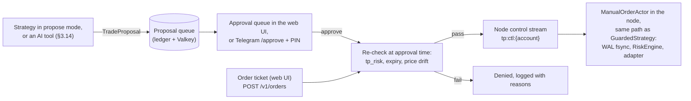
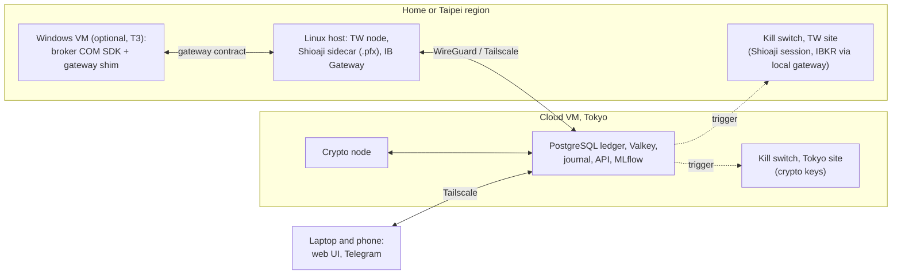
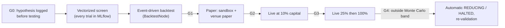
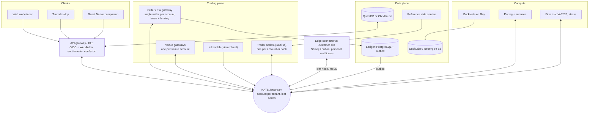

**English** | [繁體中文](recommended-architecture.zh-TW.md)

# Recommended Architecture: Detailed Design

*Status as of 2026-10-05 · Companion to the [main report](../README.md) and the [evaluation record](evaluation.md) · Backbone: [Proposal A](proposal-A-lean-mvp.md), with grafts from [B](proposal-B-performance-core.md) and [C](proposal-C-platform-scale.md). Versions and prices are snapshots from research [01](../research/01-core-language-runtime.md)–[11](../research/11-taiwan-market-localization.md); re-verify before committing. Code blocks are illustrative drafts, not final APIs.*

## 1. Scope and reading guide

This document specifies the **scenario-1 architecture** (1–3 people, self-use) in enough detail to start Phase 0. Every component section ends with a **Scenario 2** line that describes how the component grows when the evolution triggers in the [main report](../README.md) fire. That growth is mostly an addition. Where it is not, the cost is stated: a forced engine move to LEAN is an estimated 2–4 PM port ([ADR-0002](../docs/adr/ADR-0002-extend-nautilustrader-as-backtest-engine.md)), and moving to NATS rewrites the egress and control plumbing ([ADR-0005](../docs/adr/ADR-0005-messaging-and-deployment-topology.md)).

Conventions used here:

- `tp_*` packages are our engine-agnostic Python code. They never import `nautilus_trader`.
- `platform/runtime/` and `adapters/` are the only places allowed to import the engine. An import linter enforces this boundary in CI.
- "Node" means one NautilusTrader `LiveNode` or `BacktestNode` process.
- "Rules pack" means the effective-dated market rules (ticks, lots, limits, sessions, fees, taxes, rounding).

## 2. Architectural style and boundaries

| Decision | Choice | Why |
|---|---|---|
| Style | Modular monolith per trader node (hexagonal core), with processes split only at stable seams: broker sidecars, the API, journaling, the kill switch | Deterministic replay and a single deployable per account. Microservices on day one add failure modes with no benefit ([07](../research/07-system-architecture-messaging.md)) |
| Kernel | NautilusTrader v2: single-threaded dispatch, Tokio I/O threads, i128 fixed-point (16 decimals), UTC-ns time | Proven pattern; the same kernel runs backtest, sandbox and live |
| Isolation | **L1**: one node per broker account, with strategies tagged inside it | Crash and reconciliation scope is one account. Cross-account risk is aggregated asynchronously |
| Engine seam | `StrategyRuntime` port; signal and sizing logic in `tp_signals`; `GuardedStrategy` is thin glue | A forced engine move keeps strategies, rules packs, the ledger, the gateway contract and the UI. The engine-bound parts (a LEAN brokerage for the TW contract, the simulation extensions as LEAN reality models, the runtime glue) are rewritten, an estimated 2–4 PM for LEAN ([ADR-0002](../docs/adr/ADR-0002-extend-nautilustrader-as-backtest-engine.md)). `tp_signals` keeps Python 3.11-compatible syntax because LEAN pins Python 3.11 |
| Order-gateway seam | An `OrderGateway` contract (`OrderIntent` → `RiskDecision` → venue order) implemented **in-process** by `GuardedStrategy` + RiskEngine + intent WAL | Moving it out of process later (scenario 2, single writer per account) is a transport change |
| Tenancy seam | `tenant_id` (default `"self"`) and `account_id` in every schema and event | Multi-user support later needs no data migration |
| Deployable rule | A new deployable must have its own scaling, failure or security boundary; otherwise it is a module | Prevents Compose sprawl (C's rule) |

### Scenario-1 deployables (Docker Compose, one Linux host)

| Container | Role | State | Boundary that justifies it |
|---|---|---|---|
| `node-<account>` | Nautilus `LiveNode` for one broker account: strategies, risk, OMS, adapters, control actor, intent WAL | Local WAL volume; Valkey cache | Failure (one account per process) |
| `ib-gateway` | IB Gateway + IBC (headless) | Vendor session | Failure (vendor process with daily restarts) |
| `shioaji-sidecar` | A thin shim that implements the platform-defined **TW gateway contract** (§3.4) on top of Shioaji (the Python SDK or `shioaji server`, decided by the Phase 0 spike), served as HTTP + SSE on localhost. Holds the `.pfx`; the only other container with the `.pfx` mounted is `killswitch` | Broker session | Security and failure (proprietary binary, personal certificate) |
| `journal` | Journal writer (tails the WAL and Valkey streams into the hash-chained ledger) + reconciliation jobs | Stateless; writes PostgreSQL | Durability (keeps journaling when a node restarts) |
| `api` | FastAPI gateway: REST (including the manual order ticket and proposal approvals, §3.13), one WebSocket, Telegram/ntfy notifier (LINE optional), static UI assets | Stateless | Security (the only surface exposed to clients, over Tailscale) |
| `killswitch` | Minimal process with its own trade-only crypto keys and its own Shioaji session (the `.pfx` is mounted here too). **For IBKR it shares IB Gateway and the IBKR login** until Phase 0 verifies a second username (§3.5); one instance per site in a split deployment | Stateless | Failure (must work when a node is wedged) |
| `scheduler` | Calendar-driven jobs: ingest, reference-data refresh, EOD reconciliation, backups; launches on-demand `backtest` containers from the same image | Stateless | Scaling (batch work kept off the trading path) |
| `postgres` | Security master, rules tables, ledger, MLflow backend | Persistent | Data |
| `valkey` | Nautilus cache and event streams (`appendfsync always` on the trading host) | Persistent | Data |
| `mlflow` | Trial registry and promotion tags | Artifacts on disk/S3 | Data |
| metrics/log shipper | Prometheus + Loki, or the Grafana Cloud agent | — | Operations |

That is about ten long-running containers plus on-demand backtest jobs.

## 3. Component specifications

### 3.1 Data gateway (historical ingest and live market data)

| Aspect | Specification |
|---|---|
| Responsibilities | Pull or capture vendor data; keep raw payloads unchanged (bronze); normalize into the canonical schema (silver); build bars, features and the Nautilus catalog (gold); run quality checks and quarantine failures; tag every row with `source` and `license_tag`; map vendor symbols to `instrument_id` through `instrument_xref`; record live streams for golden replay |
| Inputs | Massive (bars, reference tickers, splits, dividends), ThetaData, IBKR history (pacing-limited), CCXT WebSocket capture, FRED/ALFRED, Treasury Fiscal Data, TWSE/TPEx/TAIFEX OpenAPIs (143/225/135 endpoints), FinMind REST (sponsor tier; called directly, not through its `pandas<3` client), broker live feeds through Nautilus data clients. Also: **FX rates** (`fx_rate`, below) and **borrow data** (`borrow_availability`, `borrow_rate`, `tw_credit_balance`, §4.3) |
| Outputs | Parquet partitions (Hive-style, zstd) under `bronze/`, `silver/`, `gold/`; a **dataset manifest** (list of partition content hashes) whose hash a backtest pins; Nautilus `ParquetDataCatalog` for engine-ready data |
| Quality checks | Gaps against the session calendar (including the TAIFEX night session and 24/7 crypto); duplicate or out-of-order timestamps; crossed or locked quotes; price spikes against a reference; volume vs vendor daily statistics; bars vs ticks; sampled cross-vendor comparisons. Failing partitions go to `quarantine/` with a reason, never silently dropped |
| Point-in-time rules | Raw (unadjusted) prices only; corporate actions as separate events; fundamentals keyed by announcement time; ALFRED vintages; universes include delisted names, from the named sources in the table below (TEJ for Taiwan when cross-sectional research matters) |
| Technology | Python 3.14, Polars 1.44.x, PyArrow, DuckDB 1.5.6 then **2.0 after 2026-10-21** (1.5 reaches end of life on 2026-11-01), CCXT 4.5.85 |
| Failure behaviour | Ingest is idempotent per `(source, partition)`. Live capture gaps raise `DataGap` alerts; the strategy-facing data path never blocks on ingest |
| Scenario 2 | One market-data gateway process per venue fanning out on NATS; QuestDB for live capture; DuckLake or Iceberg tables with snapshot IDs; ClickHouse for many concurrent users; licensed vendors (Databento distribution tiers, Tardis, TEJ, TWSE Data E-Shop) |

**Point-in-time universe and corporate-action sources (scenario 1).** A point-in-time universe including delisted names is a Phase 1 exit criterion and a promotion prerequisite, so each market has a named source. IBKR provides neither historically.

| Market | Universe including delisted names | Corporate actions | Cost (see the [main report](../README.md) cost table) | Verify in Phase 0 |
|---|---|---|---|---|
| US equities | **Massive** reference tickers: a `date` parameter returns the tickers listed on that date, `active=false` returns inactive ones, and each carries `delisted_utc` (Massive API docs, 2026-10-05). Alternative: **Norgate** US Platinum (daily from 1990) or Diamond (from 1950), which include delisted securities and historical index constituents but run only on Windows (export into bronze from a Windows box). Sharadar on Nasdaq Data Link is a further daily alternative (price to confirm) | **Massive** splits (`/stocks/v1/splits`, records back to 1978 on Starter and above) and dividends endpoints; Norgate if chosen | Massive Starter $29/month; Norgate by calculator | Corporate-action coverage of delisted tickers; dividend history depth; spot checks against SEC filings for 20 known events |
| Taiwan (TWSE/TPEx) | TWSE OpenAPI `company/suspendListingCsvAndHtml` (終止上市公司) and the current listings; the OpenAPIs cover recent data, so **TEJ** (by quote) is the source for deep delisted history and point-in-time fundamentals | TWSE `exchangeReport/TWT48U_ALL` (除權除息預告表); TPEx `tpex_exright_prepost` (預告表) and `tpex_exright_daily` (計算結果表); capital reductions and name changes from the MOPS filings | OpenAPIs free; TEJ by quote | How far back the OpenAPI delisting list goes; TEJ quote and licence terms |
| Crypto | CCXT capture keeps delisted pairs only from the day capture starts; Tardis (optional, from $700/month) for older history | Redenominations and delistings from venue announcements, booked by hand | $0 | — |
| FX | `fx_rate` dataset (below) | — | $0 | — |

**FX rates (`fx_rate`).** Base currency is TWD. Sources, each with its own `license_tag`: Bank of Taiwan (臺灣銀行) published board rates (bank buy/sell, for cash conversions); the Central Bank's (中央銀行) daily NTD/USD interbank closing rate (for valuation); FRED H.10 `DEXTAUS` (noon buying rates in New York, a free history cross-check); and the conversion rates on IBKR statements (for reconciliation). As-of rules: P&L at event time uses the latest rate published before `ts_event`; daily valuation and tax reports use the declared daily fixing of the reporting jurisdiction; reconciliation uses the broker's own rate. Every row records `as_of_ns` (the rate's time) and `known_at` (when we received it).

### 3.2 Reference data service (security master, corporate actions, rules packs, calendars)

| Aspect | Specification |
|---|---|
| Responsibilities | Own the internal `instrument_id`; keep effective-dated instrument rows with `known_at` recorded (append-only), including English and Traditional Chinese names (`name_en`, `name_zh_tw`); cross-reference identifiers (FIGI via OpenFIGI, ISIN, OCC OSI, TAIFEX codes, venue symbols, IB conId; CUSIP only under licence); store corporate actions; publish versioned rules packs; implement `CalendarPort` |
| Rules packs | YAML in git (reviewed by pull request) is the source of truth, loaded into PostgreSQL for queries and the UI. Each rule has `valid_from`/`valid_to`, a legal reference and a `verified_at` date. Packs: `us`, `tw`, `taifex`, `crypto`. They cover tick ladders per instrument class (TW stocks vs ETFs differ), lot sizes, price-limit regimes, auction phases, the volatility interruption, fees, taxes, **rounding modes and minimum fees**, settlement lags, funding intervals, and margin tables (Reg T, FINRA intraday, PDT legacy, TAIFEX SPAN parameters). The `us` and `tw` packs also have **`short_sale`** and **`financing`** sections (below) |
| Short sale and financing | **`us.short_sale`:** locate requirement (Reg SHO Rule 203(b)); the Rule 201 short-sale circuit breaker (after a 10% fall from the prior close, short sales only above the national best bid for the rest of that day and the next); hard-to-borrow recall and buy-in handling; payment in lieu of dividends on shorted shares. **`us.financing`:** broker margin-interest tiers and borrow-fee accrual conventions (IBKR). **`tw.short_sale`:** credit-account (信用交易帳戶) eligibility; 融券 and 借券賣出 (SBL) as distinct order types; the below-previous-close (平盤以下) short restriction with its index-constituent and ETF exemptions, modelled as effective-dated rules because the FSC changes them at short notice in market stress; 融券 suspension and forced-cover dates before shareholder meetings and ex-rights (停止融券賣出, 最後回補日); per-stock 融資融券 quotas. **`tw.financing`:** 融資 financing ratio and 融券 margin ratio per market and per stock adjustment (調整成數), the maintenance ratio (維持率) and margin-call rule, 融資 interest and 融券/借券 fees per broker. All values are illustrative until checked against broker contracts and statements (`verified_at`) |
| Daily refresh | TW disposition and notice stocks, day-trade eligibility (TWTB4U), sell-first suspensions (TWTBAU1), 融資融券 balances (TWSE `MI_MARGN`, TPEx `tpex_mainboard_margin_balance`), lendable shares for SBL short sales (TWSE `SBL/TWT96U`), TPEx short-sale suspension notices and margin-ratio adjustments (`tpex_margin_trading_term`, `tpex_margin_trading_adjust`), TAIFEX margins and position limits, holiday schedules, OCC and TAIFEX contract adjustments; for US names, IBKR shortable-share levels |
| Calendars | `exchange_calendars` (XTAI, US) + `pandas_market_calendars` (CME, SIFMA) + custom TAIFEX day/night, TW odd-lot and crypto calendars + versioned override files (typhoon closures). Load the **2027 TWSE/TAIFEX holidays** before year-end, because QuantLib's Taiwan calendar stops at 2026. Confirm the rule that night-session fills belong to the next trading date against TAIFEX's rules before implementing it |
| Interfaces | Python library `tp_refdata` (read-only queries), `CalendarPort`, and a rules-pack loader that returns an immutable, hashed `RulesPack` object |
| Technology | PostgreSQL 18; Python |
| Scenario 2 | A dedicated bitemporal service with "as known at" queries, licensed reference data (CUSIP, vendor corporate actions, OCC adjusted-deliverable notices) and a gRPC/Connect API |

### 3.3 Strategy engine (`StrategyRuntime`, bundles, `GuardedStrategy`, `tp_signals`)

| Aspect | Specification |
|---|---|
| Responsibilities | Host strategies; turn market events into **intents** (`TargetPosition` or `OrderIntent`); never perform I/O or read the wall clock |
| Layering | `tp_signals` holds pure indicator and signal functions (batch versions for the vectorized tier, incremental versions for the event-driven tier, tested against each other) plus sizing. `GuardedStrategy` (a Nautilus `Strategy` subclass in `platform/runtime/nautilus/`) keeps rolling buffers, calls `tp_signals`, runs mandatory pre-trade checks, writes the intent WAL, then calls `submit_order` |
| Strategy bundle | Immutable: `git SHA + config hash + rules-pack hash + engine pin`, registered in MLflow with a promotion stage. The live node refuses any bundle without the required stage |
| `StrategyRuntime` port | `deploy(bundle, account, mode)`, `start()`, `stop()`, `halt(reason)`, `flatten(scope)`, `status()`. The Nautilus implementation is the only one in scenario 1. A LEAN implementation would wrap the same `tp_signals` in `QCAlgorithm` glue |
| Technology | Python 3.14 (GIL build), NautilusTrader `2.0.0rc5` exact pin (move to GA when published) |
| Scenario 2 | Unchanged contract. Optional Rust strategies for hot paths (T5). A LEAN or own-core runtime behind the same port (T6/T10) |

### 3.4 OMS / EMS

| Aspect | Specification |
|---|---|
| Responsibilities | Order state machine, client order IDs, routing to the account's adapter, amend/cancel semantics, fill handling, reconnect reconciliation |
| Engine part | Nautilus `ExecutionEngine` and adapters (IB, Binance/OKX/Bybit/Deribit/Hyperliquid/Coinbase upstream), plus our Shioaji adapter |
| **Intent WAL** (graft from B and C) | Two record kinds. **Pre-send:** before `submit_order`, `GuardedStrategy` appends an `intent` record to a node-local append-only file and **fsyncs it**, using group commit within one kernel cycle. It holds `intent_id`, the **canonical** `client_order_id`, `origin` (STRATEGY, MANUAL or PROPOSAL), account, instrument, side, quantity, price, type, TIF, flags, the risk-decision ID and a record hash. It cannot hold the venue's ID, because upstream adapters assign that later, inside the adapter (IBKR's integer `orderId` comes from `nextValidId` at send time). **Post-send:** when the adapter reports the venue identifiers (`OrderSubmitted`/`OrderAccepted` events, or our Shioaji adapter's ack), the node appends a `venue_id_assigned` record: canonical ID → venue-encoded client ID, venue order ID, and for IBKR `orderId` and `permId`. This record is not fsynced before anything; recovery never depends on it. At our latency tier (tens to hundreds of ms) the fsync cost is acceptable. The journal writer tails both kinds into the ledger |
| Client IDs | A canonical ULID-based `client_order_id`. Venue encoding within `max_client_id_len` and `id_format` (an integer sequence for IBKR, ≤32 alphanumerics for OKX, 128-bit hex for Hyperliquid) happens inside the adapter. Where the venue has a free-text field, the adapter carries the canonical ID in it (IBKR `orderRef`; verify in Phase 0 that the Nautilus IB adapter does this). Where a venue has no client-ID field, our adapter persists `client_order_id → venue order number` on ack and resolves timeouts by matching account, instrument, side, quantity, price and a time window |
| `UNKNOWN` state | **Scope:** our Shioaji adapter and the ledger projection only. There, a submit that times out or loses its connection becomes `UNKNOWN` and is resolved **by query, never by blind resubmission**. For upstream adapters, Nautilus sees the order as `SUBMITTED` until the adapter reports, and its own in-flight-order reconciliation resolves it; the ledger shows `UNKNOWN` until reconciliation closes it. A Phase 0 spike verifies Nautilus's in-flight reconciliation for each upstream adapter we use, against the recovery table below |
| TW gateway contract | Platform-owned Protobuf messages in `proto/gateway/v1/` ([ADR-0006](../docs/adr/ADR-0006-broker-connectivity-and-gateway-contract.md)). Scenario-1 binding: HTTP for commands and queries plus SSE for streams, JSON mapping, on localhost or WireGuard; scenario-2 binding: NATS subjects over a leaf node; no gRPC in scenario 1. It covers session health, instrument discovery, market-data subscriptions with sequence numbers, submit/cancel/amend, queries by client ID or venue order ID, open orders, fills since a watermark, positions, balances, declared capability flags and an explicit `EMPTY_RESPONSE` alarm. The Shioaji sidecar implements it now, a Windows gateway on T3, and a customer-hosted edge connector at T1. This is the "edge-connector contract" of the main report |
| Fill idempotency | Fills are de-duplicated on `(venue, exec_id)`. Positions are derived from fills, never from status messages |
| Capability flags | `adapters/capabilities.yaml` declares per venue and product: `amend_mode` (in_place, cancel_replace, emulate), `native_oco`, `multi_leg`, `reduce_only`, `post_only`, `max_client_id_len`, `id_format`, `dead_man` (kind or none), `cancel_on_disconnect`. `GuardedStrategy` branches on flags, never on venue names (for example, it emulates OCO only where `native_oco` is false and logs the legging risk) |
| Rate governance | Per-venue token buckets below published limits, with reserved headroom for cancels and risk-reducing orders. Examples: Shioaji 250 order operations/10 s and 50 data calls/10 s; Fubon 50 orders/s; Binance spot 6,000 weight/min |
| Scenario 2 | An out-of-process **order gateway** as the single writer per account (lease plus fencing token), with `PendingNew` persisted before send; one venue gateway per venue account; FIX (QuickFIX/J 3.0.x) for prime brokers and bond RFQ |

**Per-venue recovery of in-flight orders.** After a crash or timeout, every WAL intent without a terminal state is resolved like this. Unmatched intents older than the venue's acknowledgement window are recorded as never sent; a venue order with no matching intent is an external order (§5.7).

| Venue | How to find the order | Match key | Notes |
|---|---|---|---|
| IBKR (TWS API via IB Gateway) | `reqAllOpenOrders` (`openOrder` callbacks), `reqExecutions` with a time filter (`execDetails`), `reqCompletedOrders` for orders finished today | `orderRef` (the canonical ID), else `permId` from the post-send record | There is no lookup by `orderRef` ([04](../research/04-broker-exchange-connectivity.md)): recovery scans these callbacks. The `orderId` is unique only per client ID |
| Binance (spot, USDⓈ-M) | Query order by `origClientOrderId`; open orders; user trades | Venue-encoded client ID | Futures and spot are separate endpoints |
| OKX | Order details by `clOrdId` | `clOrdId` (≤32 alphanumerics) | — |
| Bybit | Order history or realtime by `orderLinkId` | `orderLinkId` | — |
| Deribit | Order state by `label` | `label` | — |
| Hyperliquid | Order status by `cloid` | `cloid` (128-bit hex) | — |
| Shioaji (our adapter, through the TW contract) | Contract query by client ID if the shim can attach one; otherwise list the session's orders and match on account, instrument, side, quantity, price and a time window | Canonical ID or the match | The order stays `UNKNOWN` until matched or until the acknowledgement window has passed with no match |

### 3.5 Risk engine and kill switch

**Layers (identical in every mode):**

1. **Rules-pack and limit checks in `GuardedStrategy`** (fail-closed: an exception rejects the order). These cover tick conformity, lot and quantity unit, price-limit band (TW ±10%, US LULD), auction-phase order-type restrictions, disposition-stock restrictions, sell-first suspension, maximum order quantity and notional, position and exposure limits, **per-venue exposure caps** (crypto counterparty risk, below), a margin and buying-power estimate with a 20–30% buffer, duplicate and runaway detection, and a session and instrument-state check. **Short sales** also pass the rules pack's `short_sale` checks: the shortable flag and locate (US), the Rule 201 short-sale restriction, the TW below-previous-close rule, 融券 suspension and forced-cover dates, credit-account eligibility and remaining 融資融券 or SBL quota. The same checks run for strategy intents, manual tickets and approved proposals (§3.13).
2. **Nautilus `RiskEngine`**: precision, maximum notional, reduce-only, submit/modify rate limits, and trading state `ACTIVE`/`REDUCING`/`HALTED`.
3. **Venue-native controls**: price bands, IP-bound keys, and dead-man timers where offered.

**Loss breakers.** A daily loss limit moves the account to `REDUCING`; a hard limit moves it to `HALTED` and cancels all orders. Resetting requires a logged reason and, for a solo operator, a cooling-off period.

**Portfolio risk (asynchronous).** Real-time P&L, drawdown and exposure from fills and marks, in TWD and per currency. Daily historical VaR/ES on 250–500 days of data. Fixed stress shocks: index gap −10%, crypto ±30%, volatility ×2, rates +100 bp, **TWD/USD ±5%**, a **stablecoin de-peg to 0.90**, and the **loss of the largest crypto venue balance**. Portfolio greeks for options and DV01 for bonds. A drift alarm moves a strategy to `REDUCING` when live P&L leaves the backtest's Monte Carlo 95% band.

**Crypto venue counterparty risk.** An exchange can fail, freeze withdrawals or lose a stablecoin peg; none of the other layers covers that.

- **Exposure caps.** `limits.yaml` sets, per venue, a maximum equity (in USD and as a share of total net liquidation value). `tp_risk` rejects orders that would raise margin use above the cap, and an alert fires when balances exceed it, so the operator moves the surplus to cold storage. The system never holds withdrawal keys.
- **Stablecoins are instruments, not USD.** USDT and USDC balances are positions in `CurrencyPair` instruments marked against USD. A de-peg alert fires when a stablecoin trades more than 50 bp from par for 15 minutes (starting point), and the stress set includes a de-peg.
- **Venue-health alerts.** Withdrawal or deposit suspensions on the venue status API or announcements; a fall in published proof-of-reserves ratios; abnormal funding or basis; API error or latency spikes; regulator actions.
- **Venue-failure runbook.** Cancel resting orders (kill-switch path 2); reduce or close positions where the venue still trades; withdraw by hand from the venue's own interface to the allow-listed cold-storage address; record balances and claims; mark the venue `HALTED` in `venues.yaml`.
- **Eligibility.** A perpetual or options venue enters `venues.yaml` only after Phase 0 confirms that a Taiwan resident may use it, against the FSC AML-registration list and the venue's own geo terms. MAX and BitoPro (TWD) offer spot only and have no NautilusTrader adapters. If no perpetual venue is eligible, the first live market is IBKR.

**Kill switch: three paths.**

| Venue / product | Path 1: node | Path 2: `killswitch` service (own crypto keys and Shioaji session; shares IB Gateway for IBKR) | Path 3: venue-native | Verify in Phase 0 |
|---|---|---|---|---|
| IBKR | Strategy cancel-all and flatten | Own TWS API session through IB Gateway using **`reqGlobalCancel`**, which also cancels manually entered orders (acceptable in an emergency), or the master client ID for selective cancels | None known for API orders. Manual last resort: IBKR mobile app or web (runbook) | Cancel semantics; whether a second IBKR username gives a gateway-independent session |
| Binance USDⓈ-M futures | Same | Own trade-only key on the same (sub-)account; cancel all open orders per symbol | `countdownCancelAll` heartbeat, **armed per traded symbol** | — |
| Binance spot | Same | Same | **None in the research.** Keep only working capital on the venue | Confirm |
| OKX, Bybit, Deribit, Hyperliquid | Same | Same | Use dead-man or cancel-on-disconnect features where the venue offers them; not verified in our research | Confirm per product actually traded |
| Shioaji (TWSE/TPEx/TAIFEX) | Same | Own session (Shioaji allows 5 per person ID) to list and cancel open orders | None known | Confirm session behaviour and cancel latency |

**IBKR caveat.** For IBKR, path 2 is not independent of IB Gateway until Phase 0 verifies a second username: the node and the kill switch share the gateway and the IBKR login, so a wedged gateway leaves only the manual last resort, the IBKR mobile app or web client.

**Placement.** The `.pfx` is mounted into exactly two containers, `shioaji-sidecar` and `killswitch`. In a split deployment (§7) the kill switch runs one instance per site, so each instance uses the static IP its brokers allow-list and the IBKR path reaches the local IB Gateway.

Runbooks **cancel resting orders before revoking keys**, because revoking a key does not cancel resting orders.

| Aspect | Specification |
|---|---|
| Interfaces | `tp_risk.check(intent, context) -> RiskDecision` (pure, engine-agnostic); a `TradingStateChanged` command on the node control stream; `killswitch` CLI and API endpoint; Telegram commands `/halt`, `/flatten` and `/approve <proposal>` with a confirmation PIN. Telegram can approve a pending proposal (§3.13) but can never **raise** a limit or enter a free-form order |
| Technology | Python; ib_async 2.1.0 (BSD-2) for the kill switch's IBKR path; venue REST clients for crypto; Shioaji client in the kill-switch container |
| Scenario 2 | An out-of-process risk gateway (option D in [08](../research/08-risk-security-ops-compliance.md)); a hierarchical kill switch (strategy → account → venue → firm) on an independent network path with a four-eyes reset; intraday VaR/ES and greek grids; controls mapped to SEC 15c3-5 and EU RTS 6 as checklists |

### 3.6 Portfolio and accounting

| Aspect | Specification |
|---|---|
| Responsibilities | The book of record for orders, fills, positions, cash, fees, taxes, withholding, funding, borrow fees and margin interest, corporate actions, exercise and assignment, coupons, FX conversions, cash transfers and limit changes. Multi-currency P&L (base currency TWD by default). Settled vs available cash (T+1 US, T+2 TW). Daily mark-to-market for futures. Tax lots and jurisdiction tax plug-ins ([ADR-0016](../docs/adr/ADR-0016-multi-currency-books-tax-lots-and-tax-plugins.md)) |
| Multi-currency | Cash is held **per currency**; nothing is silently converted. `FxConversion` events book both legs (sold amount, bought amount, rate, fees, source) and `CashTransfer` events book deposits, withdrawals and transfers between accounts or sub-accounts, with the remittance reference. The rate used for P&L and reports follows the `fx_rate` as-of rules (§3.1). Projections: cash per currency and account; TWD-equivalent net liquidation value; FX exposure per currency. Stablecoins are positions, not cash (§3.5). **Operations note:** a Taiwan individual may settle up to the equivalent of US$5 million per calendar year directly at a bank; single settlements of US$500,000 or more need supporting documents, and NT$500,000 or more needs a declaration form (外匯收支或交易申報辦法 Art. 2, 4 and 5). The scheduler tracks the year-to-date settled amount from `CashTransfer` events and alerts at 80% |
| Tax lots and withholding | `TaxLot` (§4.5) per open position, with the lot method set per account to match the broker (FIFO by default; average cost or specific identification where the broker uses it). `WithholdingTax` events record tax withheld at source (for example the US 30% dividend withholding for non-US persons). A jurisdiction plug-in turns the ledger into annual reports; the Taiwan-resident plug-in produces TWD summaries of overseas income, dividends and supplementary premiums ([ADR-0016](../docs/adr/ADR-0016-multi-currency-books-tax-lots-and-tax-plugins.md)). US wash-sale tracking runs only for US taxpayers |
| Ledger | PostgreSQL append-only `ledger_event` table, partitioned by month. `UPDATE` and `DELETE` are revoked. Each row stores the SHA-256 of the previous row (hash chain), and a daily digest is stored off-box. A per-aggregate `seq` provides optimistic concurrency. A nightly export goes to **S3 Object Lock** (compliance mode) |
| Projections | Positions per account, strategy and instrument; cash per currency; realized and unrealized P&L; fee and tax totals; funding accruals; open orders |
| Reconciliation | **Startup:** strategies stay stopped until open orders, fills since the watermark, positions and balances match. **Intraday:** every 1–5 minutes. **End of day:** against broker statements (對帳單), including fees, funding, borrow fees, margin interest, withholding, corporate actions, exercise/assignment and coupons. Any unexplained break sets `HALTED` for that account. Breaks are tracked with a reason and a resolution. Orders and fills placed outside the platform follow the account's **external-order policy** (§5.7), so a manual trade in the broker app is not an unexplained break |
| Statement import | Parsers per broker for CSV, Excel and PDF statements. Taiwan files are often **Big5/CP950** rather than UTF-8 (UTF-8 with a BOM also occurs), so the encoding is detected and declared per source. **ROC (民國) dates** such as `115/10/05` are converted by adding 1911 to the year. Full-width digits, thousands separators and parenthesized negatives are normalized. Chinese column headers map to canonical fields through a per-broker mapping file in git. Every import records the source file hash |
| Money rules | NUMERIC in PostgreSQL and Decimal in Python, quantized to the currency or instrument scale. Values computed in float64 (accrued interest from QuantLib, model marks) are **rounded to the settlement convention** by a declared rule before booking |
| Scenario 2 | An outbox to NATS; a synchronous replica (RPO ≈ 0 for the order journal); a book-of-record service with break workflow and approvals; external anchoring of digests |

### 3.7 Scheduler

Jobs are calendar-driven through `CalendarPort` (no hard-coded clock times in code):

- pre-open reference refresh (TW flags, 融資融券 and SBL data, TAIFEX margins and limits, holiday files; IBKR shortable levels and borrow-fee files);
- daily FX fixings into `fx_rate`, and the year-to-date FX settlement total (§3.6);
- TAIFEX SPAN parameter files;
- daily ingest and compaction;
- EOD reconciliation and statement import;
- nightly ledger export to WORM storage; backup checks (archive lag, last base backup, WAL-shipping lag) and a monthly restore drill (§7.1);
- venue-health checks for crypto venues (§3.5);
- certificate and key expiry alerts 30 days ahead (Taiwan `.pfx`, API-key expiry, the 90-day rotation);
- IB Gateway restart windows and the human 2FA re-authentication reminder;
- Shioaji sidecar restarts before 08:30 and 15:00;
- MLflow and artifact housekeeping.

Scheduler failures raise alerts but never touch live order flow.

**Scenario 2:** a dedicated scheduler service with job history and approvals.

### 3.8 Research environment and backtest runner

| Aspect | Specification |
|---|---|
| Environment | marimo notebooks (pure `.py`, diffable) for anything re-run; JupyterLab for scratch work; VS Code. DuckDB SQL over the lake; Polars for features; pandas 3 only at library boundaries (pass `unit="ns"` explicitly, because pandas 3 infers microseconds) |
| Vectorized tier | `tp_signals` batch functions plus a simple vectorized portfolio simulator. vectorbt 1.x is optional and internal-only (Commons Clause). Used for screens, sweeps and CPCV folds |
| Event-driven tier | `tp backtest run --bundle <sha> --data-manifest <hash> --seed <n>` builds a `BacktestNode` through the runtime factory. Bars plus L1 with pessimistic intra-bar ordering; explicit fee models; funding replayed from venue-published history (`FundingRateUpdate` → `FundingSettlement`); our simulation extensions (§5.6) |
| Validation | skfolio `CombinatorialPurgedCV` with purge and embargo; walk-forward; `tp_metrics` (Sharpe, Sortino, drawdown, turnover, PSR, DSR, PBO via CSCV) as the source of truth, unit-tested against reference values; pinned QuantStats only for presentation |
| Trial registry | MLflow 3.16 (SQLite in Phase 0–1, the PostgreSQL backend from Phase 2). **Every variant is a run**, including AI-generated ones, so the trial count *N* behind DSR is honest |
| Compute | multiprocessing or local Ray on the workstation; parallelism only across runs; `PYTHONHASHSEED=0` in backtest workers |
| AI assistance | Read-only MCP tools over the lake (an in-house DuckDB server; edgartools for filings); AI-written code runs in a container with no network and no credentials; broker MCP servers on paper only. Everything AI-related sits behind the **AI trust boundary** (§3.14, [ADR-0017](../docs/adr/ADR-0017-ai-trust-boundary.md)) |
| Scenario 2 | JupyterHub with sandboxed, versioned kernels; Ray on Kubernetes with quotas; a shared GPU pool on demand; MLflow RBAC; a platform-wide trial count |

### 3.9 Pricing and analytics

| Aspect | Specification |
|---|---|
| Responsibilities | Implied volatility and greeks for chains; SVI surface per expiry (butterfly and calendar arbitrage checks); American pricing; bond analytics (clean/dirty price, accrued interest, yield, duration, DV01, curves with Nelson-Siegel-Svensson fits); crypto inverse and funding math; margin estimates (Reg T table, TAIFEX SPAN loader) |
| Libraries | QuantLib-Python 1.43 (`QdFpAmericanEngine` for US single stocks; FD when discrete dividends matter); NumPy Black-76 on an implied forward (TXO, index, crypto) with Let's Be Rational IV (vollib in the legacy image, or fast-vollib if it supports our Python); our `tp_pricing.crypto` module (about 500 lines): inverse PnL `Q × (1/F_entry − 1/F_exit)`, premium-adjusted delta, per-venue funding formula, basis |
| Process model | A worker pool keyed by valuation date (QuantLib's global evaluation date limits threading). Inputs are snapshot IDs (curves, surfaces, funding history); outputs are greeks snapshots (float64) on the event stream and in Parquet. Clients never price |
| Validation | Golden test vectors in CI; dual implementation for production models (QuantLib vs our Black-76/vollib, with FinancePy as an internal-only GPL oracle); flags for no-arbitrage violations and IV non-convergence instead of forced answers |
| Scenario 2 | A stateless pricing service over gRPC or Arrow Flight; an SSVI surface service with parameter history; ORE for XVA and SIMM; GPU batch risk only for scenario grids (float64 validation) |

### 3.10 API gateway

| Aspect | Specification |
|---|---|
| Responsibilities | The only network surface for clients. Authenticates; validates commands; streams state; enforces the paper/live distinction; logs every command to the ledger as an audited event |
| REST (commands and queries) | `GET /v1/accounts`, `/positions`, `/orders`, `/fills`; **`POST /v1/orders`** (manual ticket) and `POST /v1/orders/{client_order_id}/cancel`; **`GET /v1/proposals`**, **`POST /v1/proposals/{id}/approve`** and **`/reject`** (§3.13); `POST /v1/control/{account}/halt`, `/resume`, `/flatten`; `PUT /v1/limits/{account}` (requires re-authentication and a reason); `POST /v1/backtests`, `GET /v1/backtests/{run_id}` (Arrow IPC artifacts); `POST /v1/promotions/{bundle}` (checks gate evidence) |
| WebSocket | One connection with channels. **Lossless and sequenced:** `orders`, `fills`, `positions`, `risk`, `alerts`, using snapshot plus deltas with gap detection and resync. **Conflatable:** `quotes`, `greeks`, `pnl_marks`, at 4–10 Hz for grids and at most the display rate for charts |
| Contracts | Protobuf schemas in `proto/` with `buf breaking` checks in CI. JSON mapping on the wire first, binary once profiling justifies it. Prices and quantities travel as **decimal strings** or scaled integers, never JS `number` |
| Auth (scenario 1) | Reachable only over Tailscale/WireGuard. Device-bound tokens (OS keychain on desktop). Live commands require a second confirmation. Tokens carry **scopes**; AI tools get an AI-scoped token that can read data and create proposals but cannot call order, approval, control, limit or promotion endpoints (§3.14) |
| Technology | FastAPI (Python), reading Valkey streams and PostgreSQL projections |
| Scenario 2 | A BFF with OIDC + PKCE, WebAuthn step-up for live trading and limit changes, per-user entitlements and delayed-data flags, per-subscriber conflation tiers, and Connect RPC |

### 3.11 UI clients

| Aspect | Specification |
|---|---|
| Phase 2 | React + TypeScript (Vite) **web workstation**: positions, orders, fills, charts, backtest reports, limits, kill switch, paper/live banner, reconciliation status, an **order ticket** (pre-trade check results shown before submit) and a **proposal-approval queue** (§3.13). Telegram/ntfy for alerts, `/status`, `/halt`, `/flatten` and `/approve`; an optional **LINE Messaging API** notifier for alerts (LINE Notify ended on 2025-03-31). A PWA manifest costs almost nothing, so it can ship early; web push comes later |
| Phase 3 (optional) | Tauri 2.12 desktop shell (pinned to 2.x; v3 is in alpha) for OS-keychain storage of the API token and multi-window use; PWA web push (iOS Home-Screen apps support Web Push since 16.4) |
| Rendering | A Web Worker decodes and merges data; the UI renders once per `requestAnimationFrame`; charts update the live bar incrementally (`series.update()`) |
| Widgets | Lightweight Charts 5.2 (TradingView attribution kept visible), uPlot for dense series, ECharts 6.1 for reports, AG Grid Community 36 for blotters and chains, KLineChart if drawing tools are needed. Phase 3 adds an option chain and a TAIFEX T-quote (custom Canvas) |
| Localization | **Language:** zh-TW and en, switchable per user, with react-i18next (or FormatJS) and all strings externalized, including alert texts sent to Telegram, ntfy and LINE. **Names:** instruments show `name_zh_tw` or `name_en` from the security master (§4.2) next to the code. **Numbers:** `Intl.NumberFormat` per locale, including compact 萬/億 notation for zh-TW (for example volume and market value); prices and quantities still arrive as decimal strings. **Dates:** ISO dates by default, with ROC (民國) dates optional for zh-TW. **Fonts:** a CJK font such as Noto Sans TC (SIL OFL) bundled for charts, canvas widgets and PDF reports, so Chinese names do not render as boxes. **Colours and time:** configurable up/down colours (TW red-up, US and crypto green-up) plus a colour-blind palette; Asia/Taipei and New York time zones with DST; 24/7 crypto with a defined daily cut |
| Rule | Clients never hold venue keys and never price instruments |
| Scenario 2 | A design system and widget SDK; a React Native 0.87 companion (APNs/FCM push, biometric approvals); Electron if a pinned Chromium or FDC3 interop is needed; AG Grid Enterprise; SciChart for dense or 3D views |

### 3.12 Observability, operations and security

**Trading SLIs with alerts.** Each alert carries a runbook link and routes to Telegram/ntfy.

- market-data staleness and sequence gaps;
- empty broker responses (the Shioaji traffic cap);
- tick-to-order and order-ack latency;
- reject rate;
- risk-gate denials;
- position drift against the venue;
- reconnects;
- missed dead-man heartbeats;
- clock offset (chrony);
- WAL fsync latency;
- journal lag;
- reconciliation breaks;
- backup health: PostgreSQL archive lag, age of the last base backup, off-box WAL-shipping lag (§7.1);
- crypto venue health and stablecoin de-peg (§3.5);
- pending proposals close to expiry (§3.13).

**Secrets.**

- Server secrets: SOPS + age in git.
- Venue keys: trade-only, withdrawal-disabled and IP-bound, one per strategy or sub-account, rotated every 90 days.
- Taiwan `.pfx` certificate and password: mounted into exactly two containers, `shioaji-sidecar` and `killswitch` ([ADR-0008](../docs/adr/ADR-0008-key-and-secret-management.md)).
- AI tools: AI-scoped API tokens only; no secret mounts, no Telegram bot token and no SOPS/age keys in any AI container (§3.14).
- FIDO2 on every broker, exchange, cloud, GitHub and package-registry account.
- Build machines are separate from key-holding machines.

**Supply chain.** Hash-pinned lockfiles, a 3–7 day adoption delay for new versions, an SPDX licence scan, and SBOMs from Phase 2.

**Upgrade calendar.** A monthly maintenance window covers Nautilus RCs, Shioaji (14-day cycle), DuckDB 2.0, Python patch releases and QuantLib (quarterly).

**Scenario 2.** OpenTelemetry traces keyed by client order ID; per-hop HDR latency histograms; OpenBao 2.7 on a cloud KMS; SLSA v1.2 provenance; Sigstore-signed images; on-call rotation.

### 3.13 Semi-automated trading: manual tickets and proposal approval

The brief includes semi-automated trading. Two flows provide it, and both enter the same order path as strategy intents, so the WAL, the risk checks and the ledger see every order.



| Aspect | Specification |
|---|---|
| Manual ticket | `POST /v1/orders` with account, instrument, side, quantity, type, price, TIF and flags. The API runs `tp_risk.check` first and shows the result in the ticket, then sends the intent through the node control stream to a `ManualOrderActor` inside the node. That actor uses the same path as strategies: intent WAL (fsync), Nautilus `RiskEngine`, adapter. The ledger records `origin=MANUAL` and `source=MANUAL`. Manual orders count against every limit and loss breaker, and cannot be placed while the account is `HALTED` (`REDUCING` allows only risk-reducing tickets) |
| Proposals | A strategy bundle can run in **propose mode**: instead of submitting, it emits a `TradeProposal` (§4.4) with its rationale, the signal snapshot and an expiry. AI tools can create proposals only through their scoped token. Proposals are ledger events (`ProposalCreated`, `ProposalApproved`, `ProposalRejected`, `ProposalExpired`) |
| Approval | `POST /v1/proposals/{id}/approve` or `/reject` from the web UI (re-authentication for live accounts), or Telegram `/approve <id>` with the confirmation PIN. At approval time the API **re-runs `tp_risk`** against current positions, limits and prices, and rejects the approval if the proposal has expired or the price has moved beyond the proposal's tolerance. An approved proposal becomes an intent with `origin=PROPOSAL`. Telegram can approve or reject, but never edit a proposal, raise a limit or enter a free-form order |
| Expiry | Every proposal has `expires_at_ns` (minutes for intraday signals, the session close for swing signals). Expired proposals are never executed |
| External orders | Orders placed outside the platform (for example in the broker's mobile app) are handled by the account's external-order policy (§5.7) |
| Scenario 2 | Four-eyes approval (proposer ≠ approver) with role checks; WebAuthn step-up for approvals on live accounts |

### 3.14 AI trust boundary

AI tools (coding agents, research assistants, LLM-based signal generators) are treated as untrusted. They may read data and propose trades; they may never place orders, approve proposals, change limits or see secrets. Full rules and enforcement are in [ADR-0017](../docs/adr/ADR-0017-ai-trust-boundary.md); in summary:

| Rule | Enforcement |
|---|---|
| LLM output becomes **proposals only** | AI-scoped tokens can call `POST /v1/proposals` and read-only endpoints; proposals go through `tp_risk` and the human approval queue (§3.13); there is no auto-approval for `origin=AI` |
| No access to order, approval, control, limit or promotion endpoints | Token scopes checked in the API; a CI test asserts that an AI-scoped token gets 403 on each of them |
| No secrets | AI containers mount no `/run/secrets`, hold no Telegram bot token and no SOPS/age key; coding agents never run on the key-holding trading host |
| Network isolation | A separate Docker network (and host, for coding agents) that reaches only the read-only MCP server, the proposals endpoint and an allow-list of LLM APIs; no route to venues, IB Gateway, the Shioaji sidecar, Valkey control streams or PostgreSQL write roles |
| News, filings and web text are prompt-injection vectors | Retrieval tools are separate from action tools; retrieved text is tagged untrusted in prompts; the only action available is a proposal, which a human approves |
| Audit | Every prompt, tool call, output and resulting proposal is logged (MLflow tracing plus an append-only log), and proposals reference the trace ID |
| Data licences | The licence registry has an `llm_export_allowed` flag per `license_tag`; the MCP server refuses to return licensed data to a third-party LLM API unless it is true |

## 4. Core data model (draft)

### 4.1 Conventions

| Concern | Rule |
|---|---|
| Instrument identity | `instrument_id`: an internal BIGINT surrogate that is never reused. Vendor IDs live only in `instrument_xref` (Databento reassigns some Nasdaq IDs on 2026-10-31) |
| Order identity | `client_order_id`: canonical, ULID-based, encoded per venue. `intent_id`: ULID of the strategy intent. Fill identity: `(venue, exec_id)` |
| Numbers | Engine: Nautilus `Price`, `Quantity` and `Money` (128-bit raw, 16 decimals). Engine-agnostic Python: `Decimal` quantized to the instrument's precision (exact, never float). Market-data storage: int64 scaled by 1e-9 (DBN-compatible); instruments that need more range use a per-instrument scale recorded in the security master. Ledger: PostgreSQL `NUMERIC`. Wire and UI: decimal strings. Models: float64 |
| Time | `*_ns` BIGINT UTC nanoseconds; `trading_date` DATE and `session_id` from `CalendarPort`; time-zone conversion only for display and sessions |
| Tenancy | `tenant_id TEXT NOT NULL DEFAULT 'self'` on accounts, ledger events, bundles and limits |
| Licensing | `license_tag` on every market-data row group and dataset manifest, resolved against a licence registry (`data/licence-registry.yaml`) |

### 4.2 Instrument and security master

```sql
-- Effective-dated, append-only. known_at is recorded so bitemporal ("as known at") queries can be added later.
CREATE TABLE instrument (
  instrument_id        BIGINT      NOT NULL,          -- internal surrogate, never reused
  valid_from           TIMESTAMPTZ NOT NULL,          -- effective (valid) time
  valid_to             TIMESTAMPTZ,                   -- NULL = still valid
  known_at             TIMESTAMPTZ NOT NULL DEFAULT now(),
  security_id          BIGINT,                        -- groups listings of one security (TW board-lot and odd-lot books share it)
  asset_class          TEXT NOT NULL,  -- EQUITY | ETF | FUTURE | OPTION | CRYPTO_SPOT | CRYPTO_PERP | CRYPTO_FUTURE | CRYPTO_OPTION | BOND
  venue_mic            TEXT NOT NULL,  -- XNYS, XNAS, XTAI (TWSE), ROCO (TPEx), XTAF (TAIFEX), venue codes for crypto, OTC for bonds
  segment              TEXT,           -- e.g. BOARD_LOT | ODD_LOT_INTRADAY | ODD_LOT_AFTER_HOURS | DAY | NIGHT
  local_code           TEXT NOT NULL,  -- 2330, 00679B, AAPL, TXO weekly code, BTCUSDT, BTC-PERPETUAL
  name_en              TEXT,           -- e.g. "Taiwan Semiconductor Manufacturing"; effective-dated with the row (renames are new rows)
  name_zh_tw           TEXT,           -- e.g. "台積電"; from TWSE/TPEx listings for TW names, optional elsewhere
  quote_currency       TEXT NOT NULL,
  base_currency        TEXT,           -- crypto pairs
  settlement_currency  TEXT,           -- e.g. BTC for inverse contracts
  is_inverse           BOOLEAN NOT NULL DEFAULT false,
  price_precision      SMALLINT NOT NULL,
  size_precision       SMALLINT NOT NULL,
  tick_scheme_id       TEXT NOT NULL,  -- effective-dated ladder in the rules pack (TW stock vs ETF ladders differ)
  quantity_unit        TEXT NOT NULL,  -- SHARE | BOARD_LOT | CONTRACT | FACE_VALUE | COIN
  lot_size             NUMERIC NOT NULL,
  multiplier           NUMERIC NOT NULL DEFAULT 1, -- US option 100, TXO NT$50/pt, TX NT$200/pt
  calendar_id          TEXT NOT NULL,
  underlying_id        BIGINT,
  expiry_ns            BIGINT,
  status               TEXT NOT NULL,  -- ACTIVE | SUSPENDED | DELISTED | EXPIRED | MATURED
  PRIMARY KEY (instrument_id, valid_from, known_at)
);

CREATE TABLE instrument_xref (
  instrument_id  BIGINT NOT NULL,
  scheme         TEXT   NOT NULL,  -- FIGI | ISIN | OCC_OSI | TAIFEX | VENUE_SYMBOL | IB_CONID | DATABENTO_ID | SHIOAJI_CODE | CCXT_MARKET | CUSIP (licensed only)
  scope          TEXT   NOT NULL DEFAULT '',  -- venue or vendor that the value belongs to
  value          TEXT   NOT NULL,
  valid_from     TIMESTAMPTZ NOT NULL,
  valid_to       TIMESTAMPTZ,
  known_at       TIMESTAMPTZ NOT NULL DEFAULT now(),
  source         TEXT NOT NULL
);

-- Daily-refreshed TW attributes kept out of the instrument row.
CREATE TABLE instrument_daily_flag (
  instrument_id  BIGINT NOT NULL,
  trading_date   DATE   NOT NULL,
  flag           TEXT   NOT NULL,  -- DISPOSITION_LEVEL | DAY_TRADE_ELIGIBLE | SELL_FIRST_SUSPENDED | NOTICE | LIMIT_REGIME
  value          TEXT   NOT NULL,
  source         TEXT   NOT NULL,  -- e.g. TWSE OpenAPI TWTB4U / TWTBAU1
  known_at       TIMESTAMPTZ NOT NULL DEFAULT now(),
  PRIMARY KEY (instrument_id, trading_date, flag, known_at)
);

CREATE TABLE corporate_action (
  ca_id             BIGINT PRIMARY KEY,
  instrument_id     BIGINT NOT NULL,
  ca_type           TEXT NOT NULL,  -- SPLIT | REVERSE_SPLIT | CASH_DIVIDEND | STOCK_DIVIDEND | CAPITAL_REDUCTION
                                    -- | RIGHTS | SYMBOL_CHANGE | MERGER | SPINOFF | DELISTING | DELIVERABLE_ADJUSTMENT
  announce_ns       BIGINT,         -- first public availability (point-in-time key)
  ex_date           DATE,
  record_date       DATE,
  pay_date          DATE,
  ratio_num         NUMERIC,        -- split 2:1 -> 2/1; TW stock dividend per share held
  ratio_den         NUMERIC,
  cash_amount       NUMERIC,        -- gross per share
  currency          TEXT,
  new_instrument_id BIGINT,
  details           JSONB,          -- OCC adjusted deliverable, cash in lieu, odd-lot treatment
  source            TEXT NOT NULL,  -- TWSE/TPEx OpenAPI, vendor, OCC or TAIFEX notice
  known_at          TIMESTAMPTZ NOT NULL DEFAULT now()
);

-- Rules packs: YAML in git is the source of truth; this table mirrors it for queries and the UI.
CREATE TABLE rule (
  rule_pack     TEXT NOT NULL,   -- us | tw | taifex | crypto
  rule_id       TEXT NOT NULL,   -- e.g. tw.tax.stock.day_trade
  version       INT  NOT NULL,
  valid_from    DATE NOT NULL,
  valid_to      DATE,            -- e.g. 2027-12-31 for the 0.15% day-trade rate; 2026-12-31 for the bond-ETF holiday
  scope         JSONB NOT NULL,  -- {asset_class, venue, instrument_class, side, trade_type}
  params        JSONB NOT NULL,  -- {"rate": "0.0015", "rounding": {"mode": "FLOOR", "unit": "1"}, "min_fee": "20"}  (illustrative; confirm against statements)
  legal_ref     TEXT,            -- e.g. Securities Transaction Tax Act Art. 2-2
  verified_at   DATE NOT NULL,   -- last re-verification against the source
  PRIMARY KEY (rule_pack, rule_id, version)
);
```

### 4.3 Market data (Arrow schemas, Parquet at rest)

All tables share these columns: `ts_event` (int64 UTC ns, venue time), `ts_recv` (int64, our receipt time), `instrument_id` (int64), `venue` (string), `source` (string), `license_tag` (string) and `ingest_batch` (string). Prices and sizes are int64 scaled by 1e-9 unless the instrument declares another scale.

| Table | Specific columns | Notes |
|---|---|---|
| `trades` | `price`, `size`, `aggressor_side`, `trade_id`, `flags` (auction, odd lot, block) | TW auction prints are flagged so fills at auctions use the auction price |
| `quotes` (MBP-1) | `bid_px`, `ask_px`, `bid_sz`, `ask_sz`, `bid_ct`, `ask_ct` | L1 is the default fidelity |
| `bars` | `ts_open`, `ts_event` (close), `bar_spec` (e.g. `1-MINUTE-LAST`), `open`, `high`, `low`, `close`, `volume`, `trading_date`, `session_id` | Always **raw** prices. Adjusted series are derived views for signals only |
| `book_mbp10` / `book_mbo` | Levels or order events plus periodic snapshots | Later (L2/L3 trigger T5) |
| `funding` | `rate` (decimal string), `interval_s`, `mark_price`, `index_price`, `next_funding_ns` | Per-venue history, replayed in backtests |
| `option_chain_snap` | `underlying_id`, `bid`, `ask`, `last`, `open_interest`, `vendor_iv`, `vendor_greeks` (struct) | Fixed-cadence snapshots; our own IV is stored separately with model metadata |
| `instrument_status` | `status` (pre-open auction, continuous, closing auction, halted, volatility interruption, limit-up locked, limit-down locked) | Drives TW simulation extensions and pre-trade checks |
| `macro_vintage` | `series_id`, `observation_date`, `value`, `vintage_date` | ALFRED-style point-in-time macro data |
| `fx_rate` | `base_ccy`, `quote_ccy`, `rate` (decimal string), `rate_type` (MID, BID, ASK, FIXING, BROKER), `as_of_ns`, `known_at_ns` | Bank of Taiwan board rates, the Central Bank's NTD/USD closing rate, FRED H.10, IBKR statement rates (§3.1). `ts_event = as_of_ns` |
| `borrow_availability` | `shortable_level` (IBKR tick 46: above 2.5 means at least 1,000 shares available, 1.5 or less means not shortable), `shortable_shares` (tick 89), TW lendable shares for SBL short sales | US from IBKR generic tick 236; TW from TWSE `SBL/TWT96U`. Refreshed pre-open and intraday where available |
| `borrow_rate` | `fee_rate_annual`, `rebate_rate_annual` (decimal strings), `source` | US from IBKR's shortable-stock files (the TWS API has no fee-rate tick); TW 融券 and 借券 fees from the broker schedule in the rules pack |
| `tw_credit_balance` | `margin_purchase_balance`, `short_sale_balance`, `quota_remaining`, `sbl_short_balance`, `short_suspension_from`, `forced_cover_date` | TWSE `MI_MARGN`; TPEx `tpex_mainboard_margin_balance`, `tpex_margin_sbl`, `tpex_margin_trading_term` |

### 4.4 Orders, order events and fills

```python
# tp_domain: engine-agnostic. Decimal values are quantized to instrument precision; floats are never used here.
class OrderStatus(StrEnum):
    PENDING_NEW = "PENDING_NEW"        # intent written to the WAL, not yet sent
    DENIED = "DENIED"                  # rejected by our checks or the Nautilus RiskEngine
    SUBMITTED = "SUBMITTED"
    ACCEPTED = "ACCEPTED"
    PARTIALLY_FILLED = "PARTIALLY_FILLED"
    FILLED = "FILLED"
    PENDING_CANCEL = "PENDING_CANCEL"
    PENDING_REPLACE = "PENDING_REPLACE"
    CANCELED = "CANCELED"
    REJECTED = "REJECTED"              # rejected by the venue
    EXPIRED = "EXPIRED"
    UNKNOWN = "UNKNOWN"                # timeout or disconnect; resolved only by query or reconciliation

@dataclass(frozen=True)
class OrderIntent:
    intent_id: str                     # ULID
    client_order_id: str               # canonical; the adapter encodes it per venue after the WAL write
    tenant_id: str                     # "self" in scenario 1
    account_id: str
    origin: IntentOrigin               # STRATEGY | MANUAL | PROPOSAL (approved TradeProposal)
    strategy_id: str | None            # None for manual tickets
    bundle_sha: str | None
    proposal_id: str | None            # set when origin is PROPOSAL
    instrument_id: int
    side: Side                         # BUY | SELL
    order_type: OrderType              # MARKET | LIMIT | STOP | STOP_LIMIT | AT_AUCTION ...
    quantity: Decimal
    quantity_unit: QuantityUnit        # SHARE | BOARD_LOT | CONTRACT | FACE_VALUE | COIN
    limit_price: Decimal | None
    trigger_price: Decimal | None
    time_in_force: TimeInForce
    flags: frozenset[OrderFlag]        # REDUCE_ONLY, POST_ONLY, ...
    ts_init_ns: int

@dataclass(frozen=True)
class TradeProposal:                   # semi-automated trading (§3.13)
    proposal_id: str                   # ULID
    tenant_id: str
    account_id: str
    proposer: ProposerKind             # STRATEGY | AI
    strategy_id: str | None
    ai_trace_id: str | None            # prompt and tool-call audit trace (§3.14)
    intent_template: OrderIntent       # what would be sent if approved
    rationale: str
    price_tolerance_bps: int           # approval fails if the market moved further
    created_ns: int
    expires_at_ns: int
    status: ProposalStatus             # PENDING | APPROVED | REJECTED | EXPIRED

@dataclass(frozen=True)
class RiskDecision:
    intent_id: str
    approved: bool
    checks: tuple[CheckResult, ...]    # every check with its inputs and outcome
    rules_pack_hash: str
    limits_version: str
    ts_init_ns: int

@dataclass(frozen=True)
class Fill:
    venue: str
    exec_id: str                       # (venue, exec_id) is the idempotency key
    client_order_id: str
    venue_order_id: str
    account_id: str
    instrument_id: int
    side: Side
    quantity: Decimal
    price: Decimal
    liquidity: Liquidity               # MAKER | TAKER | AUCTION
    commission: Money
    taxes: tuple[Money, ...]           # TW securities transaction tax, TAIFEX tax, ...
    fees: tuple[Money, ...]            # SEC Section 31, FINRA TAF, exchange fees
    ts_event_ns: int
    trading_date: date
    settlement_date: date              # T+1 US, T+2 TW, T+0 crypto
    source: EventSource                # VENUE | RECONCILIATION | SIMULATED | EXTERNAL (adopted manual order, §5.7)
```

```sql
CREATE TABLE ledger_event (
  event_id        UUID        NOT NULL,          -- UUIDv7
  tenant_id       TEXT        NOT NULL DEFAULT 'self',
  account_id      TEXT        NOT NULL,
  aggregate_type  TEXT        NOT NULL,          -- ORDER | POSITION | CASH | LIMITS | STRATEGY | INSTRUMENT_LIFECYCLE
  aggregate_id    TEXT        NOT NULL,          -- e.g. client_order_id
  seq             BIGINT      NOT NULL,          -- per aggregate; optimistic concurrency
  event_type      TEXT        NOT NULL,          -- OrderIntentRecorded, VenueIdAssigned, OrderAccepted, OrderFilled, OrderStatusUnknown,
                                                 -- ExternalOrderAdopted, ProposalCreated, ProposalApproved, ProposalRejected, ProposalExpired,
                                                 -- FundingSettled, CorporateActionBooked, OptionAssigned, CouponPaid,
                                                 -- FxConverted, CashTransferred, WithholdingTaxBooked, BorrowFeeAccrued,
                                                 -- MarginInterestAccrued, PaymentInLieuBooked, TaxLotOpened, TaxLotClosed,
                                                 -- LimitChanged, TradingStateChanged, ReconciliationBreak, ...
  ts_event_ns     BIGINT      NOT NULL,
  ts_recorded     TIMESTAMPTZ NOT NULL DEFAULT now(),
  payload         JSONB       NOT NULL,          -- Protobuf JSON mapping of the event
  source          TEXT        NOT NULL,          -- NODE | RECONCILIATION | KILLSWITCH | MANUAL | PROPOSAL | EXTERNAL | SCHEDULER
  prev_hash       BYTEA       NOT NULL,
  hash            BYTEA       NOT NULL,          -- SHA-256(prev_hash || canonical row)
  PRIMARY KEY (event_id, ts_recorded),
  UNIQUE (aggregate_type, aggregate_id, seq, ts_recorded)
) PARTITION BY RANGE (ts_recorded);
-- REVOKE UPDATE, DELETE ON ledger_event FROM PUBLIC; the daily digest of the last hash is stored off-box.
```

### 4.5 Positions

```python
@dataclass
class Position:
    tenant_id: str
    account_id: str
    instrument_id: int
    strategy_id: str | None            # None = account-level view; strategies are tags within an L1 node
    quantity: Decimal                  # signed
    quantity_unit: QuantityUnit
    avg_open_price: Decimal
    realized_pnl: Money
    unrealized_pnl: Money              # at mark_price
    mark_price: Decimal
    mark_ts_ns: int
    accrued_funding: Money             # perpetuals
    accrued_interest: Money            # bonds (rounded to convention)
    open_lots: tuple[TaxLot, ...]      # lot matching by jurisdiction plug-in
    last_event_seq: int                # derived from fills and lifecycle events, never from status messages

@dataclass(frozen=True)
class TaxLot:                          # ADR-0016
    lot_id: str                        # ULID
    tenant_id: str
    account_id: str
    instrument_id: int
    opened_by: str                     # event_id of the fill, corporate action or transfer that opened the lot
    acquired_ts_ns: int
    acquired_trading_date: date
    quantity_open: Decimal             # signed; short lots are negative
    quantity_unit: QuantityUnit
    cost_total: Money                  # in the instrument's currency, including commissions and fees
    currency: str
    fx_rate_to_base: Decimal           # rate at acquisition, from fx_rate under the jurisdiction's as-of rule
    fx_rate_ref: str                   # which fx_rate row was used
    cost_total_base: Money             # TWD by default
    lot_method: LotMethod              # FIFO | AVERAGE_COST | SPECIFIC_ID, set per account to match the broker
    adjustments: tuple[str, ...]       # corporate-action event_ids that changed quantity or cost (splits, stock dividends)
    wash_sale_adjustment: Money | None # only when the US-taxpayer plug-in is active
```

### 4.6 Accounts and margin

```python
@dataclass(frozen=True)
class Account:
    tenant_id: str
    account_id: str
    owner_id: str
    venue: str
    broker_account_ref: str            # stored encrypted
    account_type: AccountType          # CASH | MARGIN | FUTURES | CRYPTO_UNIFIED
    base_currency: str                 # TWD by default for a Taiwan-based user
    margin_model: MarginModel          # REG_T | FINRA_INTRADAY | PDT_LEGACY | TAIFEX_SPAN | VENUE_REPORTED
    limits_version: str                # limits.yaml version in git
    key_refs: tuple[str, ...]          # references into the secret store, never key material
    trading_state: TradingState        # ACTIVE | REDUCING | HALTED

@dataclass(frozen=True)
class Balance:
    account_id: str
    currency: str
    total: Decimal
    free: Decimal
    locked: Decimal
    settled: Decimal                   # TW T+2 / US T+1 settled cash
    unsettled: Decimal
    ts_ns: int

@dataclass(frozen=True)
class MarginSnapshot:
    account_id: str
    ts_ns: int
    source: MarginSource               # BROKER | MODEL
    initial: Decimal
    maintenance: Decimal
    excess: Decimal
    buying_power: Decimal
    liquidation_prices: Mapping[int, Decimal]  # crypto, per instrument
    model_version: str
```

### 4.7 Options and greeks

```python
@dataclass(frozen=True)
class OptionTerms:
    instrument_id: int
    underlying_id: int
    right: Right                       # CALL | PUT
    strike: Decimal
    expiry_ns: int
    exercise_style: ExerciseStyle      # AMERICAN | EUROPEAN
    settlement_type: SettlementType    # PHYSICAL | CASH
    settlement_method: str             # e.g. TAIFEX_30MIN_AVG (TXO), DERIBIT_0800_UTC, OCC_STANDARD
    premium_currency: str              # BTC for Deribit inverse options, USDC for linear ones
    deliverable: Mapping[str, str]     # adjusted deliverables after corporate actions
    osi_symbol: str | None             # 21-character OCC OSI for US options

@dataclass(frozen=True)
class GreeksSnapshot:                  # float64 model world; never used for order or ledger math
    instrument_id: int
    ts_ns: int
    underlying_price: float
    forward: float
    iv: float
    delta: float
    delta_premium_adjusted: bool       # coin-margined options
    gamma: float
    vega: float
    theta: float
    rho: float
    model: PricingModel                # BLACK76 | BSM | QDPLUS_AMERICAN | FD
    surface_id: str
    curve_id: str
    quality: frozenset[QualityFlag]    # IV_NOT_CONVERGED, NO_ARB_VIOLATION, STALE_QUOTE
```

### 4.8 Bonds and cash flows

```python
@dataclass(frozen=True)
class BondTerms:                       # our own type; Nautilus has no tradable bond instrument
    instrument_id: int
    isin: str
    cusip: str | None                  # only if licensed
    issuer: str
    currency: str
    issue_date: date
    maturity_date: date
    coupon_rate: Decimal
    coupon_frequency: int              # per year
    day_count: str                     # ACT/ACT ICMA, 30/360, ...
    business_day_convention: str
    calendar_id: str                   # SIFMA_US, ...
    settlement_days: int               # US Treasuries T+1
    face_increment: Decimal
    min_denomination: Decimal
    price_convention: PriceConvention  # PCT_OF_PAR | US_32NDS | YIELD
    ex_coupon_days: int | None
    call_schedule: tuple[CallDate, ...]

@dataclass(frozen=True)
class CashFlow:
    instrument_id: int
    pay_date: date
    accrual_start: date
    accrual_end: date
    kind: CashFlowKind                 # COUPON | PRINCIPAL | CALL | SINK
    amount_per_100_face: Decimal       # QuantLib result rounded by the declared convention rule
    status: CashFlowStatus             # PROJECTED | PAID | CANCELLED
```

Bond ETFs are ordinary `ETF` instruments. Direct bonds are booked by hand or from low-frequency IBKR orders, valued daily, and **never backtested on indicative quotes**.

### 4.9 Strategy bundles and run manifests

```python
@dataclass(frozen=True)
class StrategyBundle:
    strategy_id: str
    git_sha: str
    config_hash: str
    rules_pack_hash: str
    signals_version: str
    engine_pin: str                    # "nautilus_trader==2.0.0rc5"
    mlflow_run_id: str
    stage: PromotionStage              # RESEARCH | G1_PASSED | G2_PASSED | LIVE_SMALL | LIVE_SCALED | RETIRED
    capital_fraction: Decimal          # 0.10 -> 0.25 -> 1.00

@dataclass(frozen=True)
class RunManifest:
    run_id: str
    mode: Mode                         # BACKTEST | SANDBOX | VENUE_PAPER | LIVE
    bundle: StrategyBundle
    lockfile_hash: str
    image_digest: str
    data_manifest_hash: str            # content hashes of every partition read (or a DuckLake/Iceberg snapshot ID later)
    seeds: Mapping[str, int]
    python_hash_seed: int
    trial_group_id: str                # links all variants tried for DSR/PBO
    output_event_hash: str             # hash of the emitted event stream (golden comparisons)
```

## 5. Events, message flow, clock and mode switching

### 5.1 Event catalogue

| Category | Events | Producer | Durability |
|---|---|---|---|
| Market data | `QuoteTick`, `TradeTick`, `Bar`, `OrderBookDelta`/`Depth10` (later), `FundingRateUpdate`, mark/index price, `InstrumentStatus` (auction phase, halt, volatility interruption, limit lock) | Data clients or catalog replay | Bronze capture (live); lake (historical) |
| Reference and lifecycle (custom data) | `CorporateActionEvent`, `ExpiryEvent`, `ExerciseAssignmentEvent`, `CouponEvent`, `SessionEvent` (open, auction start, close, trading-date roll), `CalendarOverride` | Reference data service; simulation modules in backtest; reconciliation in live | Ledger |
| Order lifecycle | `OrderIntentRecorded` (WAL), Nautilus order events (`OrderInitialized`, `OrderDenied`, `OrderSubmitted`, `OrderAccepted`, `OrderRejected`, `OrderUpdated`, `OrderPendingCancel`, `OrderCanceled`, `OrderExpired`, `OrderFilled`), our `OrderStatusUnknown` and `OrderReconciled` | Node, adapters, reconciliation | WAL → ledger |
| Account | `AccountState`, `MarginSnapshot`, `FundingSettlement`, `CashTransfer`, `FxConversion`, `FeeAdjustment`, `WithholdingTax`, `BorrowFeeAccrual`, `MarginInterestAccrual`, `PaymentInLieu` | Adapters, simulation (`BorrowModel`), reconciliation, statement import | Ledger |
| Semi-automated | `TradeProposal`, `ProposalApproved`/`Rejected`/`Expired`, manual `OrderIntent` | Strategies in propose mode, AI tools (scoped), API | Ledger |
| Risk and control | `RiskDecision`, `TradingStateChanged`, `LimitChanged`, `KillSwitchActivated`, `DriftAlarm`, `ReconciliationBreak` | Risk layers, API, kill switch, journal | Ledger (lossless channel) |
| System | `Heartbeat`, `AdapterConnected`/`Disconnected`, `DataGap`, `EmptyResponseAlarm`, `ClockOffset`, `WalLatency` | All processes | Metrics and logs |

**Transport in scenario 1.** Inside a node, events use the Nautilus MessageBus. Egress to the journal and API uses Nautilus's external streams on Valkey (JSON or MessagePack; Redis-protocol compatibility of Valkey is a Phase 0 spike, with NATS JetStream plus a small bridge actor as the fallback). Control commands go through one Valkey stream per account, `tp:ctl:{account_id}`, which a `ControlActor` in the node consumes and turns into kernel commands. Alerts go through `tp:alerts`. **Scenario 2** moves to NATS subjects such as `tp.{tenant}.{account}.orders.{event}`, `tp.{tenant}.{account}.ctl` and `tp.md.{venue}.{instrument}`, with JetStream for durable streams.

### 5.2 Order flow

```mermaid
sequenceDiagram
  autonumber
  participant SG as tp_signals
  participant GS as GuardedStrategy
  participant WAL as Intent WAL
  participant RE as Nautilus RiskEngine
  participant EX as ExecutionEngine + adapter
  participant V as Venue
  participant J as Journal writer
  SG->>GS: TargetPosition or OrderIntent
  GS->>GS: rules-pack checks, limits, loss breaker, capability flags
  alt any check fails
    GS-->>J: RiskDecision (denied), logged
  else checks pass
    GS->>WAL: append intent with canonical client ID + fsync (group commit)
    GS->>RE: submit_order
    RE->>EX: order passes engine checks
    EX->>V: new order; adapter assigns the venue-encoded ID
    EX-->>WAL: venue_id_assigned (post-send record)
    alt ack before timeout
      V-->>EX: accepted or rejected
    else timeout or disconnect
      EX->>EX: no resubmit; ledger shows UNKNOWN
      EX->>V: recover per the venue table in §3.4
      V-->>EX: found: accepted, or not found: rejected
    end
    V-->>EX: fill with exec_id
    EX->>EX: de-duplicate on (venue, exec_id)
    EX-->>J: events via Valkey stream
    WAL-->>J: intents tailed
    J->>J: hash-chain append, projections, reconciliation watermark
  end
```

### 5.3 Clock and calendar abstraction

- **Clock.** Strategies use only the engine clock (`self.clock`): Nautilus's test clock in backtests (it advances to each event's timestamp and fires due timers in order) and its live clock otherwise. Hosts run chrony; Windows clients keep a per-venue server-time offset. `datetime.now`, `time.time`, unseeded randomness and network or file I/O are **lint-banned** in `tp_signals`, `tp_risk` and `strategies/`.
- **Calendar.** `CalendarPort` is the only source of trading dates and session phases:

```python
class CalendarPort(Protocol):
    def session_at(self, calendar_id: str, ts_ns: int) -> SessionInfo: ...
    def trading_date(self, calendar_id: str, ts_ns: int) -> date: ...
    def sessions(self, calendar_id: str, day: date) -> Sequence[SessionInfo]: ...
    def next_open_ns(self, calendar_id: str, after_ns: int) -> int: ...
    def is_trading_day(self, calendar_id: str, day: date) -> bool: ...

@dataclass(frozen=True)
class SessionInfo:
    calendar_id: str      # XTAI, XTAI_ODD, XTAF (day+night), XNYS, SIFMA_US, CRYPTO_UTC, ...
    trading_date: date    # TAIFEX night-session fills map to the next trading date (confirm the rule with TAIFEX)
    session_id: str       # e.g. "XTAF:2026-10-06:NIGHT"
    phase: SessionPhase   # PRE_OPEN_AUCTION | CONTINUOUS | CLOSING_AUCTION | FIXED_PRICE | NIGHT | HALTED | CLOSED
    opens_ns: int
    closes_ns: int
    override_ref: str | None   # e.g. a typhoon-closure override entry
```

### 5.4 Backtest, paper and live switching

A single **runtime factory** builds every node from the same strategy bundle, rules pack and venue configuration. Only the clock, data source and execution binding change.

```python
def build_node(mode: Mode, bundle: StrategyBundle, accounts: Sequence[AccountRef],
               data: DataManifest | None = None) -> NodeHandle:
    venues = venue_configs(accounts, rules=load_rules(bundle.rules_pack_hash))   # one source for all modes
    strategies = [guarded_strategy_config(bundle, a) for a in accounts]
    match mode:
        case Mode.BACKTEST:
            return backtest_node(strategies, venues.simulated(
                fee_models=True, fill_models="pessimistic_intrabar",
                modules=[funding_replay, corporate_actions, early_assignment, tw_market_rules, borrow_model]), data)
        case Mode.SANDBOX:      # live data, simulated execution
            return live_node(strategies, venues.data_clients(), venues.sandbox_exec_clients())
        case Mode.VENUE_PAPER:  # IBKR paper, testnets, Shioaji simulation=True
            return live_node(strategies, venues.data_clients(), venues.exec_clients(paper=True))
        case Mode.LIVE:
            assert_real_money_gate(bundle, accounts)   # §8.3
            return live_node(strategies, venues.data_clients(), venues.exec_clients(paper=False))
```

| Port | Backtest | Paper | Live |
|---|---|---|---|
| Clock | Simulated (event time) | Live | Live |
| Market data | Replay of a manifest-pinned lake snapshot, merged by `(ts_init, source priority, sequence)` | Live data clients | Live data clients |
| Execution | Simulated venue + our extensions | Sandbox simulation or venue paper | Venue |
| Strategy, `tp_signals`, rules pack, risk checks, OMS semantics | Identical | Identical | Identical |
| Records | Run artifacts (Parquet + manifest) in MLflow | Ledger, `paper` scope | Ledger, `live` scope + WORM archive |

### 5.5 Determinism contract (enforced in CI)

1. **No ambient inputs.** No wall clock, I/O or unseeded randomness in decision code (lint). `PYTHONHASHSEED` is fixed in backtest workers, and decision code may not iterate over sets.
2. **Stable ordering.** Multi-source data is merged by `ts_init` with a stable tie-break. Same-timestamp events keep sequence order.
3. **Fixed-point everywhere decisions touch money.** Floats are used only in models, with explicit conversion and rounding rules.
4. **A manifest for every run** (§4.9), including the output event hash.
5. **Golden masters.** Recorded sessions and reference backtests are replayed in CI. The same platform and image must reproduce the event hash exactly. Across operating systems and CPU architectures we compare with **documented tolerances**, because CPython math, NumPy SIMD dispatch and multithreaded reductions are not bit-reproducible. This deliberately narrows B's bit-identical promise.
6. **Tier agreement.** For the same configuration, the vectorized and event-driven tiers must agree on total return within 10% with no sign flip, or promotion is blocked (the usual causes are look-ahead bugs or cost-model gaps).

### 5.6 Simulation extensions (our code inside the Nautilus backtest)

| Extension | Behaviour | Status |
|---|---|---|
| Funding replay | Load per-venue `FundingRateUpdate` history; Nautilus settles `FundingSettlement` events. Never recompute funding from the formula when history exists | Built into Nautilus; we supply the data |
| Corporate actions | On the ex-date: adjust positions and average cost for splits and reverse splits; book cash dividends (gross, less withholding by account jurisdiction); create odd-lot positions for TW stock dividends; handle capital reductions; delist and close out; map OCC adjusted deliverables. Signals may use adjusted series, but fills always use raw prices | **Phase 0 spike** (a simulation module that adjusts account balances, the mechanism Nautilus's FX-rollover module uses, or an equivalent in v2); a promotion prerequisite for equity strategies that hold across ex-dates |
| Early assignment | For short American calls, assignment on the day before the ex-date when the dividend exceeds the remaining time value; for deep in-the-money short puts, a conservative heuristic; expiry auto-exercise | Phase 3; a promotion prerequisite for short American options |
| TW market rules | Opening and closing call-auction fills at the auction price; **no fills while limit-locked**; volatility-interruption delay and re-auction; odd lots as a separate instrument with 5-second auctions; disposition-stock periodic matching | **Phase 0 spike** as Nautilus fill/matching extensions. If they cannot be expressed, trigger T7 (a TW-only simulator in the style of B's `SimVenue`) |
| Costs | Explicit fee models (mandatory from rc6) from the rules pack, including taxes, rounding and minimum fees; day-trade tax decided at end of day | Phase 1–3 per market |
| Borrow and financing (`BorrowModel`) | **Refuses a short fill** when the instrument was not shortable at that time (`borrow_availability`), or when the rules pack's `short_sale` checks fail (Rule 201 SSR, the TW below-previous-close rule, 融券 suspension windows, quota). Accrues **borrow fees** daily from `borrow_rate` (or a conservative default rate where history is missing, flagged in the run manifest), **margin interest** on debit balances and 融資, and books **payment in lieu** on shorted dividends. Forces cover on TW forced-cover dates and models hard-to-borrow recalls as a configurable buy-in probability | Phase 1 for the first market if the strategy shorts or uses margin; TW in Phase 3a. A promotion prerequisite for long/short and leveraged equity strategies |
| Bonds | No event-driven backtest on indicative OTC quotes. Bond ETFs are simulated as equities | Policy |

### 5.7 Crash recovery and reconciliation

1. Rebuild state from the Nautilus cache (Valkey) and the latest ledger projections.
2. Start adapters in reconciling mode. **Strategies stay stopped and new orders are blocked.**
3. Read the WAL tail. Every intent without a terminal state is resolved with the per-venue recovery procedure in §3.4 (for IBKR, by scanning open, executed and completed orders for the canonical ID in `orderRef` or the `permId`; for crypto venues, by querying the client ID; for Shioaji, by client ID or the ack-data match).
4. Pull open orders, fills since the watermark minus a safety margin, positions and balances. Write missing fills as events tagged `source=RECONCILIATION`. Orders and fills with no matching intent are **external** and follow the account's external-order policy (below).
5. Any difference beyond tolerance that the policy does not explain means staying `HALTED`, paging a human and recording a `ReconciliationBreak`. Otherwise start the strategies.
6. Repeat intraday every 1–5 minutes and at end of day against statements. Exercise, assignment, expiry, funding and corporate actions change positions without orders, so they are reconciled explicitly.

**External-order policy (per account, in `venues.yaml`).** A solo Taiwan trader often places a manual trade in the broker app on the same account the platform trades. Halting the node for that would be wrong, so each account declares one of:

| Policy | When to use | Behaviour |
|---|---|---|
| `dedicated` (preferred) | The automated book has its own account or sub-account (crypto sub-accounts; a separate broker account where the broker allows it) | Any external order is unexpected: `ReconciliationBreak` and `HALTED`, as before |
| `adopt` | The owner trades the same account by hand | External orders and fills are booked through reconciliation as `ExternalOrderAdopted` and fills with `source=EXTERNAL`, into a `manual` book (`strategy_id = None`). They count toward account exposure, margin and loss limits immediately. If an external order touches an instrument that an automated strategy is trading, that strategy moves to `REDUCING` and an alert asks the owner to confirm. Position differences that external fills do not explain still halt the account |

The platform's own order ticket (§3.13) is the preferred way to trade by hand, because those orders pass the risk checks and need no adoption.

## 6. Monorepo layout

```text
trading-platform/
├─ pyproject.toml, uv.lock            # Python 3.14; nautilus_trader==2.0.0rc5 (exact pin)
├─ images/{main,legacy-quant}/        # legacy-quant (3.13, pandas 2.3) only when Phase 3 needs it
├─ proto/                             # Protobuf contracts (API, events, ledger payloads); buf breaking in CI
├─ packages/                          # engine-agnostic: must NOT import nautilus_trader (import-linter)
│  ├─ tp_domain/                      # ids, money/fixed-point helpers, OrderIntent, BondTerms, OptionTerms, corporate actions
│  ├─ tp_signals/                     # indicators + signals, batch and incremental (Python 3.11-compatible syntax)
│  ├─ tp_risk/                        # pure pre-trade checks, loss breakers, RiskDecision
│  ├─ tp_rules/                       # rules-pack loader + schemas; data in config/rules/
│  ├─ tp_calendars/                   # CalendarPort implementations + override files
│  ├─ tp_refdata/                     # security master queries, symbology, OpenFIGI client
│  ├─ tp_data/                        # schemas, ingest, quality checks, manifests, licence registry
│  ├─ tp_pricing/                     # QuantLib wrappers, Black-76, SVI, crypto derivatives
│  ├─ tp_tax/                         # tax lots, jurisdiction plug-ins (TW resident, US taxpayer); ADR-0016
│  └─ tp_metrics/                     # PSR/DSR/PBO, performance metrics (source of truth)
├─ platform/                          # engine-bound code (the only place besides adapters/ that imports nautilus_trader)
│  ├─ runtime/                        # StrategyRuntime port + Nautilus implementation, node factories, version shims
│  │  └─ nautilus/                    # GuardedStrategy, ControlActor, sim extensions (TW rules, corp actions, assignment)
│  ├─ journal/                        # intent WAL, journal writer, hash chain
│  └─ ledger/                         # projections, reconciliation, statement import
├─ adapters/
│  ├─ shioaji/                        # Nautilus data+exec adapter → sidecar (edge-connector contract)
│  └─ capabilities.yaml               # capability flags per venue and product
├─ strategies/                        # strategy bundles (tp_signals + config), versioned
├─ apps/{node,backtest,api,scheduler,ingest,journal,killswitch}/
├─ research/                          # marimo notebooks (.py)
├─ ui/web/                            # React/TS (Vite); later ui/desktop-tauri/, PWA push
├─ config/
│  ├─ rules/{us,tw,taifex,crypto}/    # effective-dated rules (YAML, reviewed by PR)
│  ├─ venues.yaml, limits.yaml        # venue allow-list (incl. TWD crypto venues), external-order policy; limits and venue-exposure caps per account
│  ├─ i18n/{en,zh-TW}/                # UI and alert strings
│  └─ secrets/                        # SOPS-encrypted
├─ data/licence-registry.yaml         # license_tag → terms, permitted uses, redistribution
├─ deploy/{compose,windows-gateway,iac}/  # Compose files, IBC config, systemd units; optional Windows shim; IaC rebuild of the host (§7.1)
├─ tests/{unit,property,golden,contract,recon,pricing,calendar,chaos}/
└─ docs/adr/
```

## 7. Deployment topologies

| Topology | Use | Layout | Watch-outs |
|---|---|---|---|
| **A. Single desktop** | Research, backtesting, sandbox paper | Windows, macOS (Apple Silicon) or Linux; Nautilus wheels support Linux x86_64/ARM64, macOS ARM64 and Windows x86_64 (Linux needs glibc 2.35+); PostgreSQL, Valkey and MLflow in Docker, or MLflow on SQLite | Sleep and OS updates kill uptime; no 24/7 crypto; GPU and most quant tooling assume Linux (WSL2 on Windows) |
| **B. Local engine + remote UI** | Solo live trading of TW and US markets | An always-on Linux mini-PC at home running the full Compose stack, with a UPS and a static IP (needed for broker API-key allow-lists). The UI reaches it from laptop and phone over Tailscale/WireGuard | Home power and ISP risk; 24/7 crypto only with dead-man timers and paging |
| **C. Cloud server** | Crypto, US markets, or when home hosting is unreliable | One VM chosen by measured RTT: AWS Tokyo `ap-northeast-1` for Binance-class venues, AWS Taipei `ap-east-2` (opt-in) or GCP `asia-east1` for Taiwan brokers. Elastic or static IP; backups to S3 Object Lock | Confirm that the Taiwan broker accepts API logins from cloud IPs; secrets live in the cloud |
| **D. Hybrid with a Windows broker gateway** | Only if a Windows-only broker is needed (trigger T3) | The Linux core stays unchanged. A Windows Server VM runs the broker COM SDK (e.g. Capital SKCOM) behind a small shim that implements **the platform-defined TW gateway contract** (§3.4; HTTP + SSE in scenario 1), the same contract the Shioaji sidecar implements, reached over WireGuard | COM dialogs, registry registration and bitness; restarts before 08:30 and 15:00; watchdog |

The common realistic end state for a Taiwan-based user trading crypto as well is a split: crypto in Tokyo, Taiwan at home or in Taipei, and one ledger. The kill switch runs **one instance per site**: the Tokyo instance holds the crypto keys, and the home or Taipei instance holds the Shioaji session (the `.pfx`) and reaches the local IB Gateway, so each uses the static IP its brokers allow-list.



**Scenario 2 topology.** A cloud NATS hub, with leaf nodes at Taiwan sites and customer edge connectors. Trader nodes run on pinned VMs or bare metal near their venues; stateless services run on Kubernetes 1.35+ (1.34 reaches end of life on 2026-10-27). Each account has exactly one writer, active-passive with a lease and fencing token, and a new leader reconciles before trading.

### 7.1 Backup and disaster recovery (scenario 1)

On one host, the intent WAL, Valkey, the PostgreSQL ledger and the Parquet lake share a disk. A disk or host loss must not lose the order record, and recovery must not depend on the lost box.

| Data | RPO target | Mechanism | Restore path |
|---|---|---|---|
| Ledger, security master, rules tables (PostgreSQL) | **≤ 5 min** | Continuous WAL archiving with **pgBackRest** or **WAL-G** to S3 (`archive_timeout` 60 s), a daily base backup, 35-day retention, encrypted; the nightly hash-chained export to S3 Object Lock stays as the tamper-evident copy | Point-in-time recovery to the last archived segment, then verify the hash chain against the off-box daily digest |
| Intent WAL | **≤ 10 s** | A shipper in the `journal` container copies new WAL segments to S3 (or to the standby over WireGuard) every few seconds; the journal also tails intents into PostgreSQL | Replay the shipped segments; any intent after the last shipped segment is found by venue reconciliation (§5.7) |
| Valkey | Not backed up | It is a cache and a stream buffer; state is rebuilt from the ledger and from venue reconciliation | Start empty, reconcile before trading |
| Parquet lake | Bronze ≤ 24 h; silver and gold rebuildable | Nightly sync of bronze to versioned S3; silver and gold are rebuilt from bronze and the manifests | Restore bronze, rebuild |
| MLflow | ≤ 24 h | Backend in PostgreSQL (covered above); artifacts synced to S3 | Restore |
| Secrets | — | SOPS files in git; the offline age recovery key kept off-site | Decrypt on the standby with the recovery key |
| Host configuration | — | Infrastructure as code in `deploy/iac/` (cloud-init or Ansible, plus the Compose files) | Rebuild |

**RTO ≤ 1 h** by rebuilding on a **cold standby**: a stopped cloud VM, or a spare mini-PC, whose static IP is **pre-registered on every broker and venue allow-list** that accepts more than one IP. Where a venue binds a key to a single IP, the runbook includes re-binding the key or issuing a new trade-only key, and the RTO for that venue is longer.

**Host-loss runbook (positions open).**

1. Venue dead-man timers fire where armed (§3.5). Check the kill switch on the other site, if any.
2. From the broker and exchange apps, cancel resting orders and decide whether to flatten. Revoke keys only after cancelling.
3. Start the standby: apply the IaC, decrypt secrets with the recovery key, restore PostgreSQL by point-in-time recovery, and fetch the shipped WAL segments.
4. Start nodes in reconciling mode, with strategies stopped (§5.7). Resolve every open intent, adopt or explain external activity, and check balances against the venues.
5. Resume strategies only after reconciliation is clean, then write a post-incident record.

**Drills.** A monthly restore test of PostgreSQL into a scratch instance, and a **quarterly full-rebuild drill** on the standby (IaC, secrets, PITR, WAL replay, reconciliation in paper mode), timed against the RTO. **Scenario 2:** a synchronous replica (RPO ≈ 0 for the order journal) and active-passive per account (T9).

## 8. Testing strategy and go-live promotion

### 8.1 Test layers

| Layer | What it proves | Tools | Gate |
|---|---|---|---|
| Unit | Rules-pack math (ticks, limits, taxes, rounding, minimum fees), P&L, margin, calendars | pytest | Every commit |
| Property-based | Invariants: position = Σ fills; fill handling is idempotent; the risk gate never passes an over-limit order; tick conformity after rounding; ledger hash chain verifies | Hypothesis | Every commit |
| Calendar | DST shifts; TAIFEX night-session trading date; typhoon overrides; 2027 holidays loaded; crypto daily cut | pytest + fixtures | Every commit |
| Pricing | Golden vectors; QuantLib vs Black-76/vollib agreement; IV convergence in the wings; SVI arbitrage checks | pytest | Every commit |
| Golden-master replay | Recorded sessions and reference backtests reproduce the event hash (same platform) or stay within documented tolerances (cross-platform) | `tests/golden` | Every merge |
| Tier agreement | Vectorized vs event-driven results within 10% and no sign flip | CI job | Before G1 |
| Adapter contract | Recorded venue sessions replayed with fault injection: disconnect mid-fill, duplicate acks, out-of-order events, empty responses, rate-limit errors | `tests/contract` | Every merge for the Shioaji adapter; nightly against paper/testnet |
| Reconciliation | Synthetic breaks are detected; `UNKNOWN` orders are resolved without resubmission; in-flight orders are recovered per venue (§3.4); external orders are halted or adopted according to the account policy | `tests/recon` | Every merge |
| Semi-automated and AI boundary | Manual tickets and approved proposals pass `tp_risk` and the WAL; expired or drifted proposals are refused; Telegram cannot raise limits; an AI-scoped token gets 403 on order, approval, control, limit and promotion endpoints | pytest against the API | Every merge |
| Chaos drills | `kill -9` mid-order, network partition, clock skew, Valkey restart, PostgreSQL failover/restore | Toxiproxy, scripts | Before G3, then quarterly |
| Disaster recovery | Full rebuild on the cold standby from IaC, secrets, PITR and shipped WAL, within the RTO (§7.1) | Runbook, scripts | Before G3, then quarterly |
| Kill-switch drills | All three paths, on every venue traded | Runbook | Before G3, then monthly |
| Licence and supply chain | SPDX scan; no GPL, AGPL, LGPL or Commons Clause in distributable artifacts; lockfile hashes | CI | Every merge |
| Differential (scenario 2) | US equity scenarios run through LEAN as an unlinked oracle with documented tolerances | CI | Optional |

### 8.2 Promotion pipeline: research → backtest → paper → live



| Gate | Entry criteria (starting points; calibrate per strategy class) | Evidence artifact |
|---|---|---|
| **G0 Research** | Hypothesis and data lineage written before testing; every variant logged as an MLflow run with a `trial_group_id` (AI-generated variants included) | MLflow experiment |
| **G1 Backtest** | Walk-forward or CPCV with purge and embargo; **DSR ≥ 0.95**; **PBO ≤ 0.2**; more than 70% of CPCV paths positive; out-of-sample Sharpe at least 50% of in-sample; still profitable with fees, slippage and **borrow and financing costs** doubled (shorts refused when not borrowable); tier agreement; capacity estimate; corporate-action coverage for equities that hold across ex-dates; early-assignment coverage for short American options; funding replayed for perpetuals | Signed backtest report from the event-driven tier, with run manifest |
| **G2 Paper** | At least 3 months, *or* the trade-count route for the strategy's class (table below); never shorter than the 30-day soak while the engine is a release candidate; slippage and tracking error within agreed bands; reconciliation clean; no manual overrides | Paper P&L reconciliation, TCA report |
| **G3 Live (small)** | Real-money gate (§8.3); go-live checklist (§8.4); 10% capital; an independent approver or, for a solo operator, a signed checklist ADR with a 24-hour cooling-off period | Approval record, limits version |
| **G4 Live (scaled)** | 25% then 100% with exit criteria; live P&L inside the backtest's Monte Carlo 95% band; quarterly re-validation; automatic de-risking when metrics break their bands | Monitoring dashboard, re-validation log |

**G2 minimum evidence per strategy class** (starting points; the class is declared in the bundle config):

| Class (typical holding period) | Default window | Trade-count route (both conditions must hold) |
|---|---|---|
| Intraday, high turnover (minutes to hours; ≥ 3 round trips per trading day) | 3 months | ≥ 200 round trips **and** ≥ 6 weeks |
| Swing (1 day to 2 weeks) | 3 months | ≥ 60 round trips **and** ≥ 8 weeks |
| Position, low turnover (weeks or longer) | 3 months | None. Instead, daily target positions must track a same-period backtest replay over at least 60 trading days |
| Options, defined risk | 3 months, including at least one full expiry cycle per tenor traded | ≥ 30 positions opened and closed **and** ≥ 2 expiry cycles |

Mechanics: a promotion writes the MLflow stage tag for the bundle. The live node loads only `git SHA + config hash` bundles carrying the stage that the account's mode requires. Configuration changes create a **new bundle version**; live code is never hot-patched. Rollback means flattening or handing over, then redeploying the previous bundle.

### 8.3 Real-money gate

Live capital requires **either**:

- (a) a pinned NautilusTrader **2.0.0 GA**; **or**
- (b) a pinned release candidate that passed a **30-day paper soak with zero unexplained reconciliation breaks**, a signed risk-acceptance ADR, and **capital capped at 10%** until GA.

Falling back to 1.231.x is only a stopgap, because its backport window closes around November 2026. `assert_real_money_gate` checks the pin, the soak record and the cap at node start.

### 8.4 Go-live checklist

- [ ] Limits configured, version-controlled and reviewed; loss breakers tested.
- [ ] Kill switch tested on all three paths for every venue and product traded; dead-man support confirmed per venue (or recorded as absent, with balances minimized).
- [ ] Keys trade-only, IP-bound and withdrawal-disabled; FIDO2 on every account; `.pfx` mounted only into the sidecar and the kill-switch container; the IBKR kill-switch caveat (shared gateway) understood and the manual last resort tested.
- [ ] Reconciliation green for 5+ consecutive sessions; startup reconciliation verified after a forced crash; in-flight recovery verified for each venue traded; external-order policy set for the account.
- [ ] WAL fsync latency measured; journal lag alert configured.
- [ ] Alert fire drill done; full rebuild on the cold standby within the RTO (§7.1); runbooks for disconnect, stuck order, halted symbol, broker outage, empty-data alarm, IBKR 2FA re-authentication, host loss and crypto venue failure.
- [ ] Per-venue exposure caps set; the venue is on the allow-list after the Taiwan-resident eligibility check.
- [ ] Capital ramp (10% → 25% → 100%) with written exit criteria.
- [ ] Data licences for every dataset the strategy uses are recorded in the licence registry and permit this use.

## 9. Scenario 2 target (evolution view)



What changes and what stays:

- **Stays:** the `tp_*` packages, the rules packs, the security master and corporate-action tables, the ledger schema (tenant IDs already present), the Protobuf contracts, `GuardedStrategy` checks (now also enforced in the order gateway), the promotion gates and the UI codebase.
- **Moves out of process:** the order gateway (C's design: `PendingNew` before send, fail closed, query-by-client-ID after timeouts, lease plus fencing), venue gateways, firm risk, pricing.
- **Added:** identity and tenancy (OIDC, WebAuthn, roles including risk officer and auditor, four-eyes approvals, a relationship-based policy engine such as OpenFGA or Cedar, to be evaluated); entitlements enforcing `license_tag`; sandboxed user code (gVisor or Kata); OpenBao; SOC 2 readiness; a regulatory-posture ADR with a legal gate.
- **Never:** active-active writers on one account, pooled personal broker certificates, or engines bundled into distributed clients without licence review.

## 10. Candidate ADRs

These decisions should be recorded in [docs/adr/](../docs/adr/README.md):

1. Extend NautilusTrader v2 behind a `StrategyRuntime` port, with LEAN as the documented fallback.
2. Real-money gate for release-candidate engines.
3. Python 3.14 main image; a legacy-quant image only on demand.
4. Parquet lake with a DBN-compatible schema, DuckDB/Polars, and content-hashed dataset manifests (DuckLake/Iceberg on trigger T4).
5. Effective-dated security master with `known_at`, and own instrument IDs.
6. Rules packs as effective-dated data, including rounding and minimum fees.
7. Intent WAL plus a hash-chained PostgreSQL ledger; reconciliation as a release blocker.
8. Valkey streams for node egress (Phase 0 spike outcome; NATS fallback).
9. Shioaji sidecar as the first adapter built to the edge-connector contract; no Windows gateway in the MVP.
10. Three-path kill switch and per-venue dead-man semantics.
11. Corporate-action and early-assignment simulation as promotion prerequisites; TW matching extensions (or trigger T7).
12. Two-tier backtesting with a shared indicator library, and the G0–G4 promotion gates.
13. Web-first UI; Tauri and PWA push later; decimal strings on the wire.
14. Licence policy: `license_tag` registry; no LGPL, GPL, AGPL or Commons Clause code in distributables; engines server-side.
15. Single-host Compose deployment and the deployable rule.
16. Dependency-risk register (Nautilus key-person and open-core risk, the `ibapi` crate, Shioaji's cadence).
17. "Self-directed software" regulatory posture and a legal gate before any external user.
18. Multi-currency books, tax lots, withholding and jurisdiction tax plug-ins (Taiwan resident first).
19. AI trust boundary: proposals only, scoped tokens, network isolation, audit log, `llm_export_allowed`.
