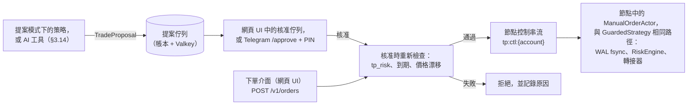
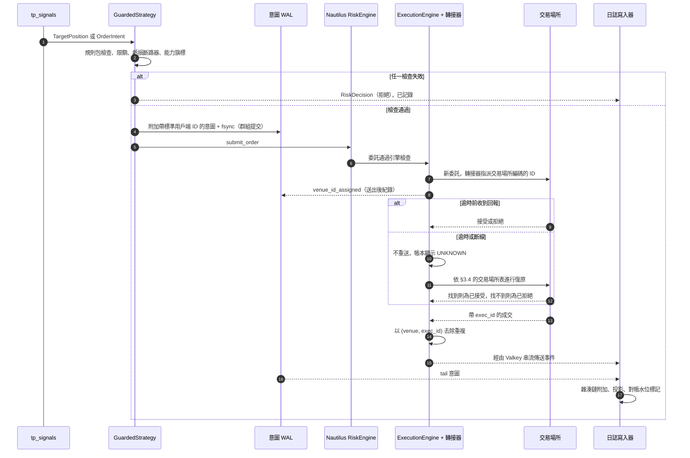
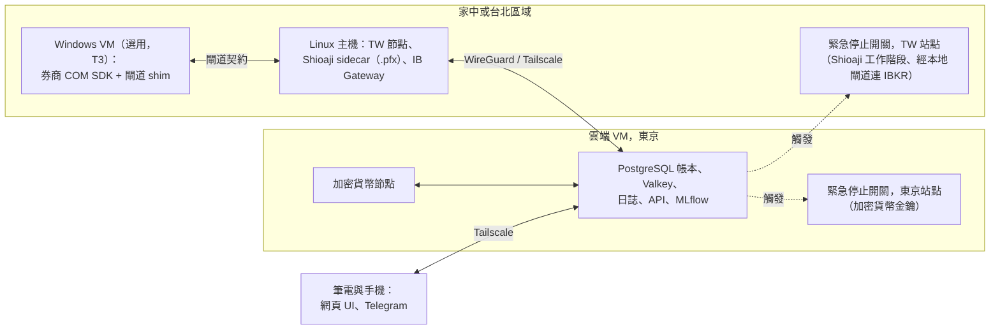
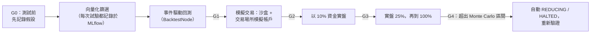
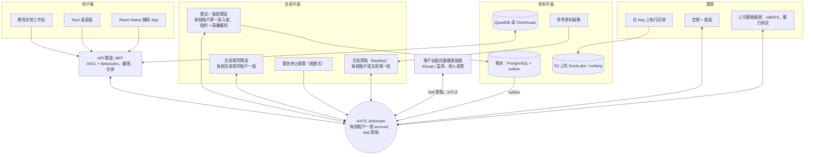

[English](recommended-architecture.md) | **繁體中文**

# 建議架構：詳細設計

*狀態截至 2026-10-05 · 搭配[主報告](../README.zh-TW.md)與[評估紀錄](evaluation.zh-TW.md)閱讀 · 主幹：[提案 A](proposal-A-lean-mvp.zh-TW.md)，並嫁接 [B](proposal-B-performance-core.zh-TW.md) 與 [C](proposal-C-platform-scale.zh-TW.md) 的設計。版本與價格為研究 [01](../research/01-core-language-runtime.zh-TW.md)–[11](../research/11-taiwan-market-localization.zh-TW.md) 當時的快照；正式採用前請重新查證。程式碼區塊僅為示意草稿，並非最終 API。*

## 1. 範圍與閱讀指引

本文件以足以啟動 Phase 0 的細節，規範**情境 1 架構**（1–3 人、自用）。每個元件章節的結尾都有一行 **情境 2**，說明當[主報告](../README.zh-TW.md)中的演進觸發條件成立時，該元件會如何成長。這種成長大多屬於新增。若非單純新增，則會註明代價：被迫將引擎遷移至 LEAN 估計需要 2–4 人月（PM）的移植工作（[ADR-0002](../docs/adr/ADR-0002-extend-nautilustrader-as-backtest-engine.zh-TW.md)），而改用 NATS 則需重寫對外輸出（egress）與控制管線（[ADR-0005](../docs/adr/ADR-0005-messaging-and-deployment-topology.zh-TW.md)）。

本文使用的慣例：

- `tp_*` 套件是我們與引擎無關（engine-agnostic）的 Python 程式碼，絕不 import `nautilus_trader`。
- `platform/runtime/` 與 `adapters/` 是唯一允許 import 引擎的地方。CI 中以 import linter 強制執行此邊界。
- 「節點」（Node）指一個 NautilusTrader `LiveNode` 或 `BacktestNode` 行程。
- 「規則包」（Rules pack）指依生效日期管理的市場規則（跳動單位、交易單位、價格限制、交易時段、手續費、稅、捨入規則）。

## 2. 架構風格與邊界

| 決策 | 選擇 | 理由 |
|---|---|---|
| 風格 | 每個交易節點採模組化單體（modular monolith，核心為六角架構 hexagonal），只在穩定的接縫處拆分為獨立行程：券商 sidecar、API、日誌記錄（journaling）、緊急停止開關（kill switch） | 可確定性重播，且每個帳戶只有一個可部署單元。第一天就採用微服務只會增加故障模式而毫無益處（[07](../research/07-system-architecture-messaging.zh-TW.md)） |
| 核心（kernel） | NautilusTrader v2：單執行緒派送、Tokio I/O 執行緒、i128 定點數（16 位小數）、UTC 奈秒時間 | 經過驗證的模式；同一個核心可執行回測、沙盒（sandbox）與實盤 |
| 隔離 | **L1**：每個券商帳戶一個節點，策略在節點內以標籤區分 | 當機與對帳的影響範圍限於單一帳戶。跨帳戶風險以非同步方式彙總 |
| 引擎接縫（seam） | `StrategyRuntime` port；訊號與部位規模（sizing）邏輯位於 `tp_signals`；`GuardedStrategy` 只是一層薄薄的黏合程式碼 | 若被迫更換引擎，策略、規則包、帳本、閘道契約與 UI 都能保留。與引擎綁定的部分（為 TW 契約實作的 LEAN brokerage 模組、改寫為 LEAN 真實性模型（reality model）的模擬擴充、執行期黏合程式碼）需要重寫，遷移至 LEAN 估計需 2–4 人月（[ADR-0002](../docs/adr/ADR-0002-extend-nautilustrader-as-backtest-engine.zh-TW.md)）。`tp_signals` 維持與 Python 3.11 相容的語法，因為 LEAN 鎖定 Python 3.11 |
| 委託閘道接縫 | 一份 `OrderGateway` 契約（`OrderIntent` → `RiskDecision` → 交易場所委託），在**行程內**由 `GuardedStrategy` + RiskEngine + 意圖 WAL（intent WAL）實作 | 日後將其移出行程（情境 2，每個帳戶單一寫入者）只是傳輸層的變更 |
| 租戶接縫 | 每個 schema 與事件都帶有 `tenant_id`（預設為 `"self"`）與 `account_id` | 日後支援多使用者時不需要資料遷移 |
| 可部署單元規則 | 新的可部署單元必須擁有自己的擴展、故障或安全邊界；否則就只是一個模組 | 防止 Compose 無限蔓延（C 的規則） |

### 情境 1 的可部署單元（Docker Compose，單一 Linux 主機）

| 容器 | 角色 | 狀態 | 證明其存在必要的邊界 |
|---|---|---|---|
| `node-<account>` | 單一券商帳戶的 Nautilus `LiveNode`：策略、風控、OMS、轉接器（adapter）、控制 actor、意圖 WAL | 本機 WAL volume；Valkey 快取 | 故障（每個行程一個帳戶） |
| `ib-gateway` | IB Gateway + IBC（無頭模式） | 供應商工作階段 | 故障（每日重啟的供應商行程） |
| `shioaji-sidecar` | 一個薄薄的轉接層（shim），在 Shioaji（Python SDK 或 `shioaji server`，由 Phase 0 技術驗證（spike）決定）之上實作平台定義的 **TW 閘道契約**（§3.4），以 HTTP + SSE 在 localhost 提供服務。持有 `.pfx`；除此之外唯一掛載 `.pfx` 的容器是 `killswitch` | 券商工作階段 | 安全與故障（專有二進位檔、個人憑證） |
| `journal` | 日誌寫入器（tail WAL 與 Valkey 串流，寫入雜湊鏈結的帳本）+ 對帳作業 | 無狀態；寫入 PostgreSQL | 持久性（節點重啟時仍持續記錄日誌） |
| `api` | FastAPI 閘道：REST（包括手動下單介面與提案核准，§3.13）、一條 WebSocket、Telegram/ntfy 通知器（LINE 為選用）、靜態 UI 資源 | 無狀態 | 安全（唯一對用戶端開放的介面，經由 Tailscale） |
| `killswitch` | 最精簡的行程，擁有自己的僅限交易加密貨幣金鑰與自己的 Shioaji 工作階段（`.pfx` 也掛載於此）。**對 IBKR 而言，它與節點共用 IB Gateway 與 IBKR 登入**，直到 Phase 0 驗證第二個使用者名稱為止（§3.5）；在分散部署中，每個站點各一個實例 | 無狀態 | 故障（節點卡死時仍必須能運作） |
| `scheduler` | 依日曆驅動的作業：資料擷取、參考資料更新、日終（EOD）對帳、備份；從同一映像檔啟動隨需的 `backtest` 容器 | 無狀態 | 擴展（批次工作不進入交易路徑） |
| `postgres` | 證券主檔（security master）、規則表、帳本、MLflow 後端 | 持久化 | 資料 |
| `valkey` | Nautilus 快取與事件串流（交易主機上設定 `appendfsync always`） | 持久化 | 資料 |
| `mlflow` | 試驗登錄與晉級標籤 | 產出物存於磁碟／S3 | 資料 |
| 指標／日誌傳送器 | Prometheus + Loki，或 Grafana Cloud agent | — | 維運 |

合計約十個長時間執行的容器，外加隨需啟動的回測作業。

## 3. 元件規格

### 3.1 資料閘道（歷史資料擷取與即時市場資料）

| 面向 | 規格 |
|---|---|
| 職責 | 拉取或擷取供應商資料；原封不動保留原始酬載（bronze）；正規化為標準 schema（silver）；建立 K 線、特徵與 Nautilus catalog（gold）；執行品質檢查並隔離失敗資料；為每一列標記 `source` 與 `license_tag`；透過 `instrument_xref` 將供應商代號對應到 `instrument_id`；錄製即時串流以供黃金基準（golden）重播 |
| 輸入 | Massive（K 線、參考代號、股票分割、股利）、ThetaData、IBKR 歷史資料（受請求節流限制）、CCXT WebSocket 擷取、FRED/ALFRED、Treasury Fiscal Data、TWSE/TPEx/TAIFEX OpenAPI（分別有 143/225/135 個端點）、FinMind REST（贊助方案；直接呼叫，不透過其 `pandas<3` 用戶端）、經由 Nautilus 資料用戶端取得的券商即時資料。另外還有：**匯率**（`fx_rate`，見下文）與**借券資料**（`borrow_availability`、`borrow_rate`、`tw_credit_balance`，§4.3） |
| 輸出 | 位於 `bronze/`、`silver/`、`gold/` 之下的 Parquet 分割區（Hive 風格、zstd）；一份**資料集 manifest**（分割區內容雜湊清單），回測會鎖定其雜湊；供引擎直接使用的 Nautilus `ParquetDataCatalog` |
| 品質檢查 | 依交易時段日曆檢查缺口（包括 TAIFEX 夜盤與 24/7 加密貨幣）；重複或順序錯亂的時間戳記；交叉或鎖定報價（crossed/locked quotes）；相對於參考價格的價格突波；成交量與供應商每日統計的比對；K 線與 tick 的比對；抽樣的跨供應商比較。失敗的分割區會連同原因移至 `quarantine/`，絕不默默丟棄 |
| 時點（point-in-time）規則 | 只使用原始（未還原）價格；公司行動作為獨立事件；基本面以公告時間為鍵；ALFRED 歷史版本（vintage）；投資範圍（universe）包含已下市標的，來源為下表列出的具名來源（若橫斷面研究很重要，台灣使用 TEJ） |
| 技術 | Python 3.14、Polars 1.44.x、PyArrow、DuckDB 1.5.6，**2026-10-21 之後改用 2.0**（1.5 於 2026-11-01 終止支援）、CCXT 4.5.85 |
| 故障行為 | 擷取作業對每個 `(source, partition)` 具冪等性。即時擷取出現缺口時會發出 `DataGap` 警示；面向策略的資料路徑絕不會因擷取作業而阻塞 |
| 情境 2 | 每個交易場所一個市場資料閘道行程，透過 NATS 扇出；以 QuestDB 進行即時擷取；使用帶快照 ID 的 DuckLake 或 Iceberg 資料表；以 ClickHouse 服務大量並行使用者；授權資料供應商（Databento 散布方案、Tardis、TEJ、TWSE Data E-Shop） |

**時點投資範圍與公司行動資料來源（情境 1）。** 包含已下市標的的時點投資範圍是 Phase 1 的完成條件，也是晉級的先決條件，因此每個市場都有一個具名來源。IBKR 兩者的歷史資料都不提供。

| 市場 | 包含已下市標的的投資範圍 | 公司行動 | 成本（見[主報告](../README.zh-TW.md)的成本表） | Phase 0 待驗證 |
|---|---|---|---|---|
| 美股 | **Massive** 參考代號：`date` 參數會傳回當日掛牌的代號，`active=false` 會傳回已停止交易的代號，且每筆都帶有 `delisted_utc`（Massive API 文件，2026-10-05）。替代方案：**Norgate** US Platinum（每日資料，自 1990 年起）或 Diamond（自 1950 年起），包含已下市證券與歷史指數成分股，但只能在 Windows 上執行（從 Windows 機器匯出至 bronze）。Nasdaq Data Link 上的 Sharadar 是另一個每日資料替代方案（價格待確認） | **Massive** 股票分割（`/stocks/v1/splits`，Starter 以上方案的紀錄可回溯至 1978 年）與股利端點；若選用 Norgate 則使用之 | Massive Starter 每月 $29；Norgate 依其試算器計價 | 已下市代號的公司行動涵蓋率；股利歷史深度；以 SEC 申報文件抽查 20 個已知事件 |
| 台灣（TWSE/TPEx） | TWSE OpenAPI `company/suspendListingCsvAndHtml`（終止上市公司）與現行上市清單；OpenAPI 只涵蓋近期資料，因此深度的下市歷史與時點基本面資料以 **TEJ**（需報價）為來源 | TWSE `exchangeReport/TWT48U_ALL`（除權除息預告表）；TPEx `tpex_exright_prepost`（預告表）與 `tpex_exright_daily`（計算結果表）；減資與更名資訊來自公開資訊觀測站（MOPS）申報 | OpenAPI 免費；TEJ 需報價 | OpenAPI 下市清單可回溯多久；TEJ 報價與授權條款 |
| 加密貨幣 | CCXT 擷取只能從開始擷取當天起保留已下市的交易對；較舊的歷史資料使用 Tardis（選用，每月 $700 起） | 幣種面額調整（redenomination）與下市資訊來自交易場所公告，手動登錄 | $0 | — |
| 外匯 | `fx_rate` 資料集（見下文） | — | $0 | — |

**匯率（`fx_rate`）。** 基準貨幣為 TWD。資料來源各自帶有 `license_tag`：臺灣銀行公告的牌告匯率（銀行買入／賣出，用於現金兌換）；中央銀行每日新台幣兌美元銀行間收盤匯率（用於評價）；FRED H.10 `DEXTAUS`（紐約中午買入匯率，作為免費的歷史交叉核對）；以及 IBKR 對帳單上的換匯匯率（用於對帳）。時點（as-of）規則：事件發生時的損益使用 `ts_event` 之前最新公布的匯率；每日評價與稅務報表使用申報轄區所宣告的每日定盤匯率；對帳使用券商自己的匯率。每一列都記錄 `as_of_ns`（匯率本身的時間）與 `known_at`（我們收到的時間）。

### 3.2 參考資料服務（證券主檔、公司行動、規則包、交易日曆）

| 面向 | 規格 |
|---|---|
| 職責 | 管理內部的 `instrument_id`；保存依生效日期管理、並記錄 `known_at` 的商品列（僅可附加），包括英文與繁體中文名稱（`name_en`、`name_zh_tw`）；交叉對應各種識別碼（透過 OpenFIGI 取得的 FIGI、ISIN、OCC OSI、TAIFEX 代碼、交易場所代號、IB conId；CUSIP 僅在取得授權後使用）；儲存公司行動；發布帶版本的規則包；實作 `CalendarPort` |
| 規則包 | git 中的 YAML（經 pull request 審查）是事實來源，並載入 PostgreSQL 以供查詢與 UI 使用。每條規則都有 `valid_from`/`valid_to`、法源依據與 `verified_at` 日期。規則包包括：`us`、`tw`、`taifex`、`crypto`。內容涵蓋各商品類別的跳動單位級距（台股與 ETF 不同）、交易單位、漲跌幅限制制度、集合競價階段、瞬間價格穩定措施（volatility interruption）、手續費、稅、**捨入模式與最低手續費**、交割延遲、資金費率結算間隔，以及保證金表（Reg T、FINRA 盤中保證金、PDT 舊制、TAIFEX SPAN 參數）。`us` 與 `tw` 規則包另有 **`short_sale`** 與 **`financing`** 區段（見下文） |
| 放空與融資 | **`us.short_sale`：** 借券確認（locate）要求（Reg SHO Rule 203(b)）；Rule 201 放空斷路器（自前一日收盤價下跌 10% 後，當日剩餘時間與次一交易日僅能以高於全國最佳買價的價格放空）；難借券（hard-to-borrow）召回與強制回補（buy-in）處理；放空股票的替代股利支付（payment in lieu of dividends）。**`us.financing`：** 券商保證金利息級距與借券費用的計提慣例（IBKR）。**`tw.short_sale`：** 信用交易帳戶資格；融券與借券賣出（SBL）為不同的委託類型；平盤以下放空限制及其指數成分股與 ETF 的豁免，以依生效日期管理的規則建模，因為金管會（FSC）在市場壓力下會在短時間內調整；股東會與除權息前的融券停止與強制回補日期（停止融券賣出、最後回補日）；個股融資融券額度。**`tw.financing`：** 各市場的融資成數與融券保證金成數及個股調整成數、維持率與追繳規則、各券商的融資利率及融券／借券費用。所有數值在與券商契約及對帳單核對（`verified_at`）之前，均僅供示意 |
| 每日更新 | 台股處置股與注意股、當沖資格（TWTB4U）、暫停先賣後買（TWTBAU1）、融資融券餘額（TWSE `MI_MARGN`、TPEx `tpex_mainboard_margin_balance`）、借券賣出可借股數（TWSE `SBL/TWT96U`）、TPEx 停止融券賣出公告與信用交易成數調整（`tpex_margin_trading_term`、`tpex_margin_trading_adjust`）、TAIFEX 保證金與部位限制、休市日表、OCC 與 TAIFEX 契約調整；美股標的則為 IBKR 可放空股數等級 |
| 交易日曆 | `exchange_calendars`（XTAI、US）+ `pandas_market_calendars`（CME、SIFMA）+ 自訂的 TAIFEX 日盤／夜盤、台股零股與加密貨幣日曆 + 帶版本的覆寫檔（颱風停市）。須在年底前載入 **2027 年 TWSE/TAIFEX 休市日**，因為 QuantLib 的台灣日曆只到 2026 年。在實作「夜盤成交歸屬於次一交易日」這條規則之前，先依 TAIFEX 規章確認 |
| 介面 | Python 函式庫 `tp_refdata`（唯讀查詢）、`CalendarPort`，以及一個傳回不可變、已雜湊之 `RulesPack` 物件的規則包載入器 |
| 技術 | PostgreSQL 18；Python |
| 情境 2 | 專屬的雙時態（bitemporal）服務，支援「截至已知時點（as known at）」查詢、授權參考資料（CUSIP、供應商公司行動、OCC 調整後交割物通知）與 gRPC/Connect API |

### 3.3 策略引擎（`StrategyRuntime`、套件、`GuardedStrategy`、`tp_signals`）

| 面向 | 規格 |
|---|---|
| 職責 | 承載策略；將市場事件轉換為**意圖**（`TargetPosition` 或 `OrderIntent`）；絕不執行 I/O 或讀取牆上時鐘（wall clock） |
| 分層 | `tp_signals` 存放純函式的指標與訊號函式（向量化層使用批次版本，事件驅動（event-driven）層使用增量版本，兩者互相對照測試）以及部位規模計算。`GuardedStrategy`（位於 `platform/runtime/nautilus/` 的 Nautilus `Strategy` 子類別）維護滾動緩衝區、呼叫 `tp_signals`、執行強制性交易前檢查、寫入意圖 WAL，然後呼叫 `submit_order` |
| 策略套件（strategy bundle） | 不可變：`git SHA + config hash + rules-pack hash + engine pin`，登錄於 MLflow 並帶有晉級階段。實盤節點會拒絕任何不具所需階段的套件 |
| `StrategyRuntime` port | `deploy(bundle, account, mode)`、`start()`、`stop()`、`halt(reason)`、`flatten(scope)`、`status()`。Nautilus 實作是情境 1 中唯一的實作。LEAN 實作則會以 `QCAlgorithm` 黏合程式碼包裝同一套 `tp_signals` |
| 技術 | Python 3.14（GIL 版本）、NautilusTrader `2.0.0rc5` 精確版本鎖定（正式版發布後改用 GA） |
| 情境 2 | 契約不變。熱路徑可選用 Rust 策略（T5）。在同一個 port 之後換上 LEAN 或自建核心的執行環境（T6/T10） |

### 3.4 OMS / EMS

| 面向 | 規格 |
|---|---|
| 職責 | 委託狀態機、用戶端委託 ID、路由至帳戶的轉接器、改單／撤單語意、成交處理、重新連線後的對帳 |
| 引擎部分 | Nautilus `ExecutionEngine` 與轉接器（上游提供 IB、Binance/OKX/Bybit/Deribit/Hyperliquid/Coinbase），加上我們的 Shioaji 轉接器 |
| **意圖 WAL**（嫁接自 B 與 C） | 兩種紀錄。**送出前（pre-send）：** 在 `submit_order` 之前，`GuardedStrategy` 會將一筆 `intent` 紀錄附加到節點本機的僅可附加檔案並**執行 fsync**，同一個核心週期內採用群組提交（group commit）。紀錄內容包括 `intent_id`、**標準**（canonical）`client_order_id`、`origin`（STRATEGY、MANUAL 或 PROPOSAL）、帳戶、商品、買賣方向、數量、價格、類型、TIF、旗標、風險決策 ID 與紀錄雜湊。它無法包含交易場所的 ID，因為上游轉接器是在稍後、於轉接器內部才指派該 ID（IBKR 的整數 `orderId` 在送出時取自 `nextValidId`）。**送出後（post-send）：** 當轉接器回報交易場所識別碼時（`OrderSubmitted`/`OrderAccepted` 事件，或我們 Shioaji 轉接器的回報），節點會附加一筆 `venue_id_assigned` 紀錄：標準 ID → 交易場所編碼的用戶端 ID、交易場所委託 ID，以及 IBKR 的 `orderId` 與 `permId`。這筆紀錄不需要在任何動作之前 fsync；復原流程從不依賴它。在我們的延遲等級（數十至數百毫秒）下，fsync 的成本可以接受。日誌寫入器會將兩種紀錄 tail 進帳本 |
| 用戶端 ID | 以 ULID 為基礎的標準 `client_order_id`。在 `max_client_id_len` 與 `id_format` 限制內的交易場所編碼（IBKR 為整數序號、OKX 為 ≤32 個英數字元、Hyperliquid 為 128 位元十六進位）在轉接器內部完成。若交易場所提供自由文字欄位，轉接器會將標準 ID 放在其中（IBKR `orderRef`；需在 Phase 0 驗證 Nautilus IB 轉接器是否如此處理）。若交易場所沒有用戶端 ID 欄位，我們的轉接器會在收到回報時保存 `client_order_id → 交易場所委託書號`，並以帳戶、商品、買賣方向、數量、價格與時間視窗比對來解決逾時問題 |
| `UNKNOWN` 狀態 | **範圍：** 僅限我們的 Shioaji 轉接器與帳本投影（projection）。在那裡，逾時或斷線的送單會變成 `UNKNOWN`，並**透過查詢解決，絕不盲目重送**。對上游轉接器而言，Nautilus 在轉接器回報之前都將委託視為 `SUBMITTED`，並由其自身的在途委託（in-flight order）對帳機制解決；帳本則顯示 `UNKNOWN`，直到對帳結案為止。Phase 0 spike 會依下方的復原表，針對我們使用的每個上游轉接器驗證 Nautilus 的在途對帳 |
| TW 閘道契約 | 平台自有、位於 `proto/gateway/v1/` 的 Protobuf 訊息（[ADR-0006](../docs/adr/ADR-0006-broker-connectivity-and-gateway-contract.zh-TW.md)）。情境 1 綁定：命令與查詢使用 HTTP，串流使用 SSE，採 JSON 對應，運行於 localhost 或 WireGuard；情境 2 綁定：透過 leaf 節點的 NATS subject；情境 1 不使用 gRPC。涵蓋範圍包括工作階段健康狀態、商品探索、帶序號的市場資料訂閱、送單／撤單／改單、依用戶端 ID 或交易場所委託 ID 查詢、未成交委託、自水位標記（watermark）以來的成交、部位、餘額、宣告的能力旗標，以及明確的 `EMPTY_RESPONSE` 警報。目前由 Shioaji sidecar 實作，T3 時由 Windows 閘道實作，T1 時由客戶自行託管的邊緣連接器實作。這就是主報告中所說的「邊緣連接器契約」 |
| 成交冪等性 | 成交以 `(venue, exec_id)` 去除重複。部位由成交推導而來，絕不由狀態訊息推導 |
| 能力旗標 | `adapters/capabilities.yaml` 依交易場所與產品宣告：`amend_mode`（in_place、cancel_replace、emulate）、`native_oco`、`multi_leg`、`reduce_only`、`post_only`、`max_client_id_len`、`id_format`、`dead_man`（類型或 none）、`cancel_on_disconnect`。`GuardedStrategy` 依旗標分支，絕不依交易場所名稱分支（例如，只有在 `native_oco` 為 false 時才模擬 OCO，並記錄分腿（legging）風險） |
| 速率管控 | 每個交易場所使用低於公告上限的權杖桶（token bucket），並為撤單與降低風險的委託保留餘裕。例如：Shioaji 每 10 秒 250 次委託操作與每 10 秒 50 次資料呼叫；富邦每秒 50 筆委託；Binance 現貨每分鐘 6,000 權重 |
| 情境 2 | 行程外的**委託閘道**，作為每個帳戶的單一寫入者（租約加上隔離權杖（fencing token）），並在送出前持久化 `PendingNew`；每個交易場所帳戶一個交易場所閘道；對主經紀商（prime broker）與債券 RFQ 使用 FIX（QuickFIX/J 3.0.x） |

**各交易場所在途委託的復原。** 當機或逾時後，WAL 中每一筆尚未進入終止狀態的意圖都依下列方式解決。超過交易場所確認視窗仍無法比對的意圖，記錄為從未送出；沒有對應意圖的交易場所委託則屬於外部委託（§5.7）。

| 交易場所 | 如何找到委託 | 比對鍵 | 備註 |
|---|---|---|---|
| IBKR（透過 IB Gateway 的 TWS API） | `reqAllOpenOrders`（`openOrder` 回呼）、帶時間篩選的 `reqExecutions`（`execDetails`）、針對今日已結束委託的 `reqCompletedOrders` | `orderRef`（標準 ID），否則使用送出後紀錄中的 `permId` | 沒有依 `orderRef` 查詢的功能（[04](../research/04-broker-exchange-connectivity.zh-TW.md)）：復原流程會掃描這些回呼。`orderId` 只在每個用戶端 ID 內唯一 |
| Binance（現貨、USDⓈ-M） | 依 `origClientOrderId` 查詢委託；未成交委託；使用者成交紀錄 | 交易場所編碼的用戶端 ID | 期貨與現貨是不同的端點 |
| OKX | 依 `clOrdId` 取得委託明細 | `clOrdId`（≤32 個英數字元） | — |
| Bybit | 依 `orderLinkId` 查詢歷史或即時委託 | `orderLinkId` | — |
| Deribit | 依 `label` 查詢委託狀態 | `label` | — |
| Hyperliquid | 依 `cloid` 查詢委託狀態 | `cloid`（128 位元十六進位） | — |
| Shioaji（我們的轉接器，透過 TW 契約） | 若 shim 能附加用戶端 ID，則依用戶端 ID 進行契約查詢；否則列出該工作階段的委託，並以帳戶、商品、買賣方向、數量、價格與時間視窗比對 | 標準 ID 或比對結果 | 在比對成功，或確認視窗過後仍無比對結果之前，委託維持 `UNKNOWN` |

### 3.5 風控引擎與緊急停止開關

**各層（在每種模式下都相同）：**

1. **`GuardedStrategy` 中的規則包與限額檢查**（失效即關閉（fail-closed）：發生例外即拒絕委託）。涵蓋跳動單位合規性、交易單位與數量單位、漲跌幅區間（台股 ±10%、美股 LULD）、集合競價階段的委託類型限制、處置股限制、暫停先賣後買、最大委託數量與名目金額、部位與曝險限額、**各交易場所曝險上限**（加密貨幣交易對手風險，見下文）、預留 20–30% 緩衝的保證金與購買力估算、重複與失控委託偵測，以及交易時段與商品狀態檢查。**放空**還必須通過規則包的 `short_sale` 檢查：可放空旗標與借券確認（美股）、Rule 201 放空限制、台股平盤以下規則、融券停止與強制回補日期、信用帳戶資格，以及剩餘的融資融券或借券額度。策略意圖、手動委託單與已核准提案（§3.13）都執行相同的檢查。
2. **Nautilus `RiskEngine`**：精度、最大名目金額、只減倉（reduce-only）、送單／改單速率限制，以及交易狀態 `ACTIVE`/`REDUCING`/`HALTED`。
3. **交易場所原生控制**：價格區間、綁定 IP 的金鑰，以及交易場所有提供時的 dead-man 計時器。

**虧損斷路器。** 每日虧損限額會讓帳戶進入 `REDUCING`；硬性限額會讓帳戶進入 `HALTED` 並撤銷所有委託。重設需要記錄原因，且對單人操作者而言還需要一段冷靜期。

**投資組合風險（非同步）。** 依據成交與市價計算即時損益、回撤與曝險，以 TWD 及各幣別表示。每日以 250–500 天資料計算歷史 VaR/ES。固定壓力衝擊：指數跳空 −10%、加密貨幣 ±30%、波動率 ×2、利率 +100 bp、**TWD/USD ±5%**、**穩定幣脫鉤至 0.90**，以及**失去最大的加密貨幣交易場所餘額**。選擇權的投資組合 greeks 與債券的 DV01。當實盤損益超出回測的 Monte Carlo 95% 區間時，漂移警報會讓策略進入 `REDUCING`。

**加密貨幣交易場所的交易對手風險。** 交易所可能倒閉、凍結提領或發生穩定幣脫鉤；其他各層都無法涵蓋這些情況。

- **曝險上限。** `limits.yaml` 依交易場所設定最大權益（以 USD 計，以及占總淨清算價值的比例）。`tp_risk` 會拒絕使保證金使用量超過上限的委託，而當餘額超過上限時會觸發警示，由操作者將多餘資金移至冷儲存。系統絕不持有提領金鑰。
- **穩定幣是商品，不是 USD。** USDT 與 USDC 餘額是以 USD 計價之 `CurrencyPair` 商品的部位。當穩定幣的成交價偏離面值超過 50 bp 並持續 15 分鐘時（起始值），會觸發脫鉤警示，壓力情境中也包含脫鉤。
- **交易場所健康警示。** 交易場所狀態 API 或公告中的提領或入金暫停；公布的儲備證明（proof-of-reserves）比率下降；異常的資金費率或基差；API 錯誤或延遲突增；監理機關的行動。
- **交易場所故障應變手冊（runbook）。** 撤銷掛單（緊急停止路徑 2）；在交易場所仍可交易時減少或關閉部位；從交易場所自己的介面手動提領至允許清單中的冷儲存地址；記錄餘額與債權；在 `venues.yaml` 中將該交易場所標記為 `HALTED`。
- **適格性。** 永續合約或選擇權交易場所必須在 Phase 0 依金管會的洗錢防制登記名單及該交易場所自身的地區條款，確認台灣居民可以使用之後，才能列入 `venues.yaml`。MAX 與 BitoPro（TWD）只提供現貨，且沒有 NautilusTrader 轉接器。若沒有任何永續合約交易場所符合資格，第一個實盤市場就是 IBKR。

**緊急停止開關：三條路徑。**

| 交易場所／產品 | 路徑 1：節點 | 路徑 2：`killswitch` 服務（自有加密貨幣金鑰與 Shioaji 工作階段；IBKR 則共用 IB Gateway） | 路徑 3：交易場所原生 | Phase 0 待驗證 |
|---|---|---|---|---|
| IBKR | 策略全部撤單並平倉 | 經由 IB Gateway 的自有 TWS API 工作階段，使用 **`reqGlobalCancel`**（也會撤銷手動輸入的委託，緊急情況下可接受），或以主用戶端 ID（master client ID）進行選擇性撤單 | 對 API 委託而言目前未知有此功能。手動最後手段：IBKR 行動 App 或網頁（見應變手冊） | 撤單語意；第二個 IBKR 使用者名稱能否提供不依賴閘道的工作階段 |
| Binance USDⓈ-M 期貨 | 同上 | 在同一個（子）帳戶上的自有僅限交易金鑰；依商品撤銷所有未成交委託 | `countdownCancelAll` 心跳，**對每個交易中的商品分別啟用** | — |
| Binance 現貨 | 同上 | 同上 | **研究中未發現。** 只在交易場所保留營運資金 | 待確認 |
| OKX、Bybit、Deribit、Hyperliquid | 同上 | 同上 | 在交易場所有提供時使用 dead-man 或斷線撤單功能；我們的研究尚未驗證 | 依實際交易的產品逐一確認 |
| Shioaji（TWSE/TPEx/TAIFEX） | 同上 | 自有工作階段（Shioaji 允許每個身分證字號 5 個）以列出並撤銷未成交委託 | 目前未知 | 確認工作階段行為與撤單延遲 |

**IBKR 注意事項。** 對 IBKR 而言，在 Phase 0 驗證第二個使用者名稱之前，路徑 2 並非獨立於 IB Gateway：節點與緊急停止開關共用閘道與 IBKR 登入，因此一旦閘道卡死，就只剩下手動的最後手段，也就是 IBKR 行動 App 或網頁用戶端。

**配置。** `.pfx` 只掛載到兩個容器：`shioaji-sidecar` 與 `killswitch`。在分散部署中（§7），緊急停止開關在每個站點各執行一個實例，因此每個實例都使用其券商允許清單上的固定 IP，而 IBKR 路徑則連到本地的 IB Gateway。

應變手冊規定**先撤銷掛單，再註銷金鑰**，因為註銷金鑰並不會撤銷掛單。

| 面向 | 規格 |
|---|---|
| 介面 | `tp_risk.check(intent, context) -> RiskDecision`（純函式、與引擎無關）；節點控制串流上的 `TradingStateChanged` 命令；`killswitch` CLI 與 API 端點；需要確認 PIN 的 Telegram 命令 `/halt`、`/flatten` 與 `/approve <proposal>`。Telegram 可以核准待處理的提案（§3.13），但絕不能**調高**限額或輸入自由格式的委託 |
| 技術 | Python；緊急停止開關的 IBKR 路徑使用 ib_async 2.1.0（BSD-2）；加密貨幣使用各交易場所的 REST 用戶端；緊急停止容器中使用 Shioaji 用戶端 |
| 情境 2 | 行程外的風控閘道（[08](../research/08-risk-security-ops-compliance.zh-TW.md) 中的選項 D）；位於獨立網路路徑上的階層式緊急停止開關（策略 → 帳戶 → 交易場所 → 公司），重設需經四眼原則（four-eyes）；盤中 VaR/ES 與 greek 網格；以檢查清單形式對應 SEC 15c3-5 與 EU RTS 6 的控制要求 |

### 3.6 投資組合與會計

| 面向 | 規格 |
|---|---|
| 職責 | 委託、成交、部位、現金、手續費、稅、扣繳、資金費率、借券費用與保證金利息、公司行動、履約與指派、債息、換匯、資金移轉與限額變更的正式紀錄簿（book of record）。多幣別損益（預設基準貨幣為 TWD）。已交割與可用現金（美股 T+1、台股 T+2）。期貨每日按市值計價。稅務批次（tax lot）與各轄區稅務外掛（[ADR-0016](../docs/adr/ADR-0016-multi-currency-books-tax-lots-and-tax-plugins.zh-TW.md)） |
| 多幣別 | 現金**依幣別**分別持有；不會默默換算。`FxConversion` 事件記錄兩邊（賣出金額、買入金額、匯率、費用、來源），`CashTransfer` 事件則記錄入金、出金，以及帳戶或子帳戶之間的移轉，並附上匯款參考編號。損益與報表使用的匯率遵循 `fx_rate` 的時點規則（§3.1）。投影：各幣別與帳戶的現金；以 TWD 計的淨清算價值；各幣別的外匯曝險。穩定幣是部位，不是現金（§3.5）。**營運注意事項：** 台灣個人每一曆年可直接在銀行結匯最多等值 500 萬美元；單筆結匯達 50 萬美元以上須檢附證明文件，達新台幣 50 萬元以上須填寫申報書（外匯收支或交易申報辦法第 2、4、5 條）。排程器會從 `CashTransfer` 事件追蹤年初至今的結匯金額，並在達到 80% 時發出警示 |
| 稅務批次與扣繳 | 每個未平倉部位都有 `TaxLot`（§4.5），批次方法依帳戶設定以配合券商（預設為 FIFO；若券商使用平均成本或個別認定法則採用之）。`WithholdingTax` 事件記錄源頭扣繳的稅款（例如非美國人士的美國股利 30% 扣繳）。轄區外掛會將帳本轉換為年度報表；台灣居民外掛會產出以 TWD 計的海外所得、股利與補充保費彙總（[ADR-0016](../docs/adr/ADR-0016-multi-currency-books-tax-lots-and-tax-plugins.zh-TW.md)）。美國洗售（wash-sale）追蹤只對美國納稅人執行 |
| 帳本 | PostgreSQL 中僅可附加（append-only）的 `ledger_event` 資料表，依月分割。撤銷 `UPDATE` 與 `DELETE` 權限。每一列都儲存前一列的 SHA-256（雜湊鏈），每日摘要另存於主機之外。每個聚合（aggregate）的 `seq` 提供樂觀並行控制。每晚匯出至 **S3 Object Lock**（合規模式） |
| 投影 | 依帳戶、策略與商品的部位；各幣別現金；已實現與未實現損益；手續費與稅金總額；資金費率應計；未成交委託 |
| 對帳 | **啟動時：** 策略維持停止，直到未成交委託、自水位標記以來的成交、部位與餘額全部相符。**盤中：** 每 1–5 分鐘一次。**日終：** 與券商對帳單核對，包括手續費、資金費率、借券費用、保證金利息、扣繳、公司行動、履約／指派與債息。任何無法解釋的差異都會將該帳戶設為 `HALTED`。差異會連同原因與解決方式一併追蹤。在平台之外下的委託與成交依帳戶的**外部委託政策**（§5.7）處理，因此在券商 App 中的手動交易不會被視為無法解釋的差異 |
| 對帳單匯入 | 依券商撰寫 CSV、Excel 與 PDF 對帳單的剖析器。台灣的檔案常為 **Big5/CP950** 而非 UTF-8（也會出現帶 BOM 的 UTF-8），因此會依來源偵測並宣告編碼。**民國日期**如 `115/10/05` 會將年份加上 1911 轉換。全形數字、千分位分隔符號與以括號表示的負數都會正規化。中文欄位標題透過 git 中各券商的對應檔對應到標準欄位。每次匯入都會記錄來源檔案的雜湊 |
| 金額規則 | PostgreSQL 中使用 NUMERIC，Python 中使用 Decimal，並量化至貨幣或商品的精度。以 float64 計算的數值（QuantLib 的應計利息、模型市價）在入帳前會依宣告的規則**捨入至交割慣例** |
| 情境 2 | 送往 NATS 的 outbox；同步複本（委託日誌的 RPO ≈ 0）；具差異處理流程與核准機制的正式紀錄簿服務；摘要的外部錨定 |

### 3.7 排程器

作業透過 `CalendarPort` 依日曆驅動（程式碼中不寫死時鐘時間）：

- 開盤前參考資料更新（台股旗標、融資融券與借券資料、TAIFEX 保證金與限額、休市日檔案；IBKR 可放空等級與借券費率檔案）；
- 每日外匯定盤匯率寫入 `fx_rate`，以及年初至今的外匯結匯總額（§3.6）；
- TAIFEX SPAN 參數檔；
- 每日資料擷取與壓縮整併（compaction）；
- 日終對帳與對帳單匯入；
- 每晚將帳本匯出至 WORM 儲存；備份檢查（封存延遲、最近一次基礎備份、WAL 傳送延遲），以及每月還原演練（§7.1）；
- 加密貨幣交易場所健康檢查（§3.5）；
- 提前 30 天的憑證與金鑰到期警示（台灣 `.pfx`、API 金鑰到期、90 天輪替）；
- IB Gateway 重啟時段與人工 2FA 重新驗證提醒；
- Shioaji sidecar 在 08:30 與 15:00 之前重啟；
- MLflow 與產出物的例行清理。

排程器故障會發出警示，但絕不觸及實盤委託流程。

**情境 2：** 具作業歷史與核准機制的專屬排程服務。

### 3.8 研究環境與回測執行器

| 面向 | 規格 |
|---|---|
| 環境 | 需要重複執行的內容使用 marimo 筆記本（純 `.py`，可 diff）；臨時工作使用 JupyterLab；VS Code。以 DuckDB SQL 查詢資料湖；以 Polars 計算特徵；pandas 3 只在函式庫邊界使用（明確傳入 `unit="ns"`，因為 pandas 3 會推斷為微秒） |
| 向量化層 | `tp_signals` 批次函式加上一個簡單的向量化投資組合模擬器。vectorbt 1.x 為選用且僅限內部使用（Commons Clause）。用於篩選、參數掃描與 CPCV 摺（fold） |
| 事件驅動層 | `tp backtest run --bundle <sha> --data-manifest <hash> --seed <n>` 透過執行期工廠建立 `BacktestNode`。使用 K 線加 L1，並採悲觀的 K 線內排序；明確的手續費模型；依交易場所公布的歷史重播資金費率（`FundingRateUpdate` → `FundingSettlement`）；我們的模擬擴充（§5.6） |
| 驗證 | skfolio `CombinatorialPurgedCV`，含 purge 與 embargo；walk-forward；`tp_metrics`（Sharpe、Sortino、回撤、週轉率、PSR、DSR、透過 CSCV 計算的 PBO）作為事實來源，並以參考值進行單元測試；鎖定版本的 QuantStats 僅用於呈現 |
| 試驗登錄 | MLflow 3.16（Phase 0–1 使用 SQLite，自 Phase 2 起使用 PostgreSQL 後端）。**每個變體都是一次 run**，包括 AI 產生的變體，因此 DSR 背後的試驗次數 *N* 是誠實的 |
| 運算 | 在工作站上使用 multiprocessing 或本機 Ray；只在不同 run 之間平行化；回測 worker 中設定 `PYTHONHASHSEED=0` |
| AI 輔助 | 對資料湖的唯讀 MCP 工具（自建的 DuckDB 伺服器；以 edgartools 查詢申報文件）；AI 撰寫的程式碼在沒有網路、也沒有任何認證資訊的容器中執行；券商 MCP 伺服器僅限模擬交易使用。所有與 AI 相關的事物都位於 **AI 信任邊界**之後（§3.14、[ADR-0017](../docs/adr/ADR-0017-ai-trust-boundary.zh-TW.md)） |
| 情境 2 | 具沙盒化、帶版本核心（kernel）的 JupyterHub；在 Kubernetes 上搭配配額的 Ray；隨需使用的共享 GPU 池；MLflow RBAC；全平台的試驗次數統計 |

### 3.9 定價與分析

| 面向 | 規格 |
|---|---|
| 職責 | 選擇權鏈的隱含波動率與 greeks；每個到期日的 SVI 曲面（蝶式與日曆套利檢查）；美式選擇權定價；債券分析（淨價／全價、應計利息、殖利率、存續期間、DV01、以 Nelson-Siegel-Svensson 擬合的曲線）；加密貨幣反向合約與資金費率計算；保證金估算（Reg T 表、TAIFEX SPAN 載入器） |
| 函式庫 | QuantLib-Python 1.43（美國個股使用 `QdFpAmericanEngine`；離散股利影響重大時使用 FD）；以隱含遠期價格為基礎的 NumPy Black-76（TXO、指數、加密貨幣），搭配 Let's Be Rational IV（舊版映像檔中使用 vollib，若 fast-vollib 支援我們的 Python 版本則使用之）；我們的 `tp_pricing.crypto` 模組（約 500 行）：反向合約損益 `Q × (1/F_entry − 1/F_exit)`、權利金調整後的 delta、各交易場所的資金費率公式、基差 |
| 行程模型 | 以評價日為鍵的 worker 池（QuantLib 的全域評價日期限制了多執行緒）。輸入為快照 ID（曲線、曲面、資金費率歷史）；輸出為 greeks 快照（float64），寫入事件串流與 Parquet。用戶端絕不自行定價 |
| 驗證 | CI 中的黃金測試向量；生產模型採雙重實作（QuantLib 對照我們的 Black-76/vollib，並以 FinancePy 作為僅限內部使用的 GPL 驗證基準（oracle））；對無套利違反與 IV 不收斂發出旗標，而不是強行給出答案 |
| 情境 2 | 透過 gRPC 或 Arrow Flight 提供的無狀態定價服務；帶參數歷史的 SSVI 曲面服務；以 ORE 計算 XVA 與 SIMM；GPU 批次風險計算僅用於情境網格（以 float64 驗證） |

### 3.10 API 閘道

| 面向 | 規格 |
|---|---|
| 職責 | 對用戶端唯一的網路介面。負責身分驗證、驗證命令、串流狀態、強制區分模擬交易與實盤，並將每個命令作為稽核事件記錄到帳本 |
| REST（命令與查詢） | `GET /v1/accounts`、`/positions`、`/orders`、`/fills`；**`POST /v1/orders`**（手動委託單）與 `POST /v1/orders/{client_order_id}/cancel`；**`GET /v1/proposals`**、**`POST /v1/proposals/{id}/approve`** 與 **`/reject`**（§3.13）；`POST /v1/control/{account}/halt`、`/resume`、`/flatten`；`PUT /v1/limits/{account}`（需要重新驗證身分並填寫原因）；`POST /v1/backtests`、`GET /v1/backtests/{run_id}`（Arrow IPC 產出物）；`POST /v1/promotions/{bundle}`（檢查關卡證據） |
| WebSocket | 一條連線，多個頻道。**無損且有序：** `orders`、`fills`、`positions`、`risk`、`alerts`，採用快照加增量，並具備缺口偵測與重新同步。**可合併（conflatable）：** `quotes`、`greeks`、`pnl_marks`，表格使用 4–10 Hz，圖表最多以顯示更新率推送 |
| 契約 | `proto/` 中的 Protobuf schema，CI 中以 `buf breaking` 檢查。線路上先採用 JSON 對應，待效能剖析證明有必要時再改用二進位。價格與數量以**十進位字串**或縮放整數傳輸，絕不使用 JS `number` |
| 驗證（情境 1） | 只能透過 Tailscale/WireGuard 連線。綁定裝置的權杖（桌面上存於作業系統金鑰圈）。實盤命令需要二次確認。權杖帶有**權限範圍（scope）**；AI 工具取得 AI 範圍的權杖，可以讀取資料並建立提案，但不能呼叫委託、核准、控制、限額或晉級端點（§3.14） |
| 技術 | FastAPI（Python），讀取 Valkey 串流與 PostgreSQL 投影 |
| 情境 2 | 採 OIDC + PKCE 的 BFF、實盤交易與限額變更使用 WebAuthn 升級驗證（step-up）、每位使用者的權限與延遲資料旗標、每位訂閱者的合併等級，以及 Connect RPC |

### 3.11 UI 用戶端

| 面向 | 規格 |
|---|---|
| Phase 2 | React + TypeScript（Vite）**網頁交易工作站**：部位、委託、成交、圖表、回測報告、限額、緊急停止開關、模擬交易／實盤橫幅、對帳狀態、**下單介面**（送出前顯示交易前檢查結果）與**提案核准佇列**（§3.13）。Telegram/ntfy 用於警示、`/status`、`/halt`、`/flatten` 與 `/approve`；選用的 **LINE Messaging API** 警示通知器（LINE Notify 已於 2025-03-31 終止服務）。PWA manifest 幾乎沒有成本，因此可以提早推出；Web Push 則稍後再加入 |
| Phase 3（選用） | Tauri 2.12 桌面外殼（鎖定 2.x；v3 仍在 alpha 階段），用於以作業系統金鑰圈儲存 API 權杖與多視窗使用；PWA Web Push（iOS 主畫面 App 自 16.4 起支援 Web Push） |
| 繪製 | 由 Web Worker 解碼並合併資料；UI 每個 `requestAnimationFrame` 繪製一次；圖表以增量方式更新即時 K 線（`series.update()`） |
| 元件 | Lightweight Charts 5.2（保持 TradingView 標示可見）、uPlot 用於密集序列、ECharts 6.1 用於報表、AG Grid Community 36 用於委託成交表（blotter）與選擇權鏈，若需要繪圖工具則使用 KLineChart。Phase 3 加入選擇權鏈與 TAIFEX T 字報價（自訂 Canvas） |
| 在地化 | **語言：** zh-TW 與 en，可依使用者切換，使用 react-i18next（或 FormatJS），所有字串外部化，包括傳送到 Telegram、ntfy 與 LINE 的警示文字。**名稱：** 商品在代碼旁顯示證券主檔中的 `name_zh_tw` 或 `name_en`（§4.2）。**數字：** 依地區設定使用 `Intl.NumberFormat`，zh-TW 包括萬／億的精簡表示法（例如成交量與市值）；價格與數量仍以十進位字串傳入。**日期：** 預設為 ISO 日期，zh-TW 可選用民國日期。**字型：** 為圖表、canvas 元件與 PDF 報表內附 Noto Sans TC（SIL OFL）等 CJK 字型，避免中文名稱顯示為方塊。**顏色與時間：** 可設定的漲跌顏色（台股紅漲、美股與加密貨幣綠漲）以及色盲友善配色；Asia/Taipei 與紐約時區（含日光節約時間）；24/7 加密貨幣使用明確定義的每日切點 |
| 規則 | 用戶端絕不持有交易場所金鑰，也絕不自行為商品定價 |
| 情境 2 | 設計系統與元件 SDK；React Native 0.87 輔助 App（APNs/FCM 推播、生物辨識核准）；若需要鎖定 Chromium 版本或 FDC3 互通則使用 Electron；AG Grid Enterprise；SciChart 用於密集或 3D 檢視 |

### 3.12 可觀測性、維運與安全

**交易 SLI 與警示。** 每個警示都附有應變手冊（runbook）連結，並傳送到 Telegram/ntfy。

- 市場資料過時與序號缺口；
- 券商空回應（Shioaji 流量上限）；
- tick 到委託與委託回報的延遲；
- 拒單率；
- 風控關卡拒絕次數；
- 相對於交易場所的部位漂移；
- 重新連線；
- 遺漏的 dead-man 心跳；
- 時鐘偏移（chrony）；
- WAL fsync 延遲；
- 日誌延遲；
- 對帳差異；
- 備份健康狀態：PostgreSQL 封存延遲、最近一次基礎備份距今時間、主機外 WAL 傳送延遲（§7.1）；
- 加密貨幣交易場所健康狀態與穩定幣脫鉤（§3.5）；
- 即將到期的待處理提案（§3.13）。

**機密。**

- 伺服器機密：git 中的 SOPS + age。
- 交易場所金鑰：僅限交易、停用提領且綁定 IP，每個策略或子帳戶一把，每 90 天輪替。
- 台灣 `.pfx` 憑證與密碼：只掛載到兩個容器，`shioaji-sidecar` 與 `killswitch`（[ADR-0008](../docs/adr/ADR-0008-key-and-secret-management.zh-TW.md)）。
- AI 工具：只有 AI 範圍的 API 權杖；任何 AI 容器都不掛載機密、不持有 Telegram bot 權杖，也不持有 SOPS/age 金鑰（§3.14）。
- 每個券商、交易所、雲端、GitHub 與套件登錄庫帳戶都使用 FIDO2。
- 建置機器與持有金鑰的機器分開。

**供應鏈。** 以雜湊鎖定的 lockfile、新版本延後 3–7 天才採用、SPDX 授權掃描，以及自 Phase 2 起提供 SBOM。

**升級日曆。** 每月一次的維護時段涵蓋 Nautilus RC、Shioaji（14 天週期）、DuckDB 2.0、Python 修補版本與 QuantLib（每季）。

**情境 2。** 以用戶端委託 ID 為鍵的 OpenTelemetry 追蹤；每一跳的 HDR 延遲直方圖；在雲端 KMS 上運行的 OpenBao 2.7；SLSA v1.2 來源證明（provenance）；以 Sigstore 簽署的映像檔；值班輪替。

### 3.13 半自動交易：手動委託單與提案核准

需求說明（brief）中包含半自動交易。兩種流程提供此功能，兩者都進入與策略意圖相同的委託路徑，因此 WAL、風控檢查與帳本都能看到每一筆委託。



| 面向 | 規格 |
|---|---|
| 手動委託單 | `POST /v1/orders`，帶入帳戶、商品、買賣方向、數量、類型、價格、TIF 與旗標。API 會先執行 `tp_risk.check` 並在委託單中顯示結果，然後透過節點控制串流將意圖送至節點內的 `ManualOrderActor`。該 actor 使用與策略相同的路徑：意圖 WAL（fsync）、Nautilus `RiskEngine`、轉接器。帳本記錄 `origin=MANUAL` 與 `source=MANUAL`。手動委託計入每一項限額與虧損斷路器，且帳戶為 `HALTED` 時不能下單（`REDUCING` 時只允許降低風險的委託單） |
| 提案 | 策略套件可以在**提案模式**下執行：它不送出委託，而是發出 `TradeProposal`（§4.4），內含理由、訊號快照與到期時間。AI 工具只能透過其範圍受限的權杖建立提案。提案是帳本事件（`ProposalCreated`、`ProposalApproved`、`ProposalRejected`、`ProposalExpired`） |
| 核准 | 從網頁 UI 呼叫 `POST /v1/proposals/{id}/approve` 或 `/reject`（實盤帳戶需重新驗證身分），或使用 Telegram `/approve <id>` 加上確認 PIN。在核准當下，API 會依目前的部位、限額與價格**重新執行 `tp_risk`**，若提案已到期或價格變動超出提案的容許範圍，就拒絕此次核准。核准後的提案會成為 `origin=PROPOSAL` 的意圖。Telegram 可以核准或拒絕，但絕不能編輯提案、調高限額或輸入自由格式的委託 |
| 到期 | 每個提案都有 `expires_at_ns`（盤中訊號為數分鐘，波段訊號為該交易時段收盤）。已到期的提案絕不執行 |
| 外部委託 | 在平台之外下的委託（例如在券商的行動 App 中）依帳戶的外部委託政策處理（§5.7） |
| 情境 2 | 具角色檢查的四眼核准（提案者 ≠ 核准者）；實盤帳戶的核准使用 WebAuthn 升級驗證 |

### 3.14 AI 信任邊界

AI 工具（程式撰寫代理、研究助理、以 LLM 為基礎的訊號產生器）一律視為不受信任。它們可以讀取資料並提出交易提案；但絕不能下單、核准提案、變更限額或看到機密。完整規則與強制措施見 [ADR-0017](../docs/adr/ADR-0017-ai-trust-boundary.zh-TW.md)；摘要如下：

| 規則 | 強制措施 |
|---|---|
| LLM 輸出**只能成為提案** | AI 範圍的權杖可以呼叫 `POST /v1/proposals` 與唯讀端點；提案須經過 `tp_risk` 與人工核准佇列（§3.13）；`origin=AI` 沒有自動核准 |
| 無法存取委託、核准、控制、限額或晉級端點 | 在 API 中檢查權杖範圍；CI 測試斷言 AI 範圍的權杖呼叫其中每一個端點都會得到 403 |
| 不接觸機密 | AI 容器不掛載 `/run/secrets`，不持有 Telegram bot 權杖，也不持有 SOPS/age 金鑰；程式撰寫代理絕不在持有金鑰的交易主機上執行 |
| 網路隔離 | 獨立的 Docker 網路（對程式撰寫代理而言還有獨立主機），只能連到唯讀 MCP 伺服器、提案端點與 LLM API 允許清單；沒有通往交易場所、IB Gateway、Shioaji sidecar、Valkey 控制串流或 PostgreSQL 寫入角色的路由 |
| 新聞、申報文件與網頁文字都是提示注入（prompt injection）的途徑 | 檢索工具與動作工具分開；檢索到的文字在提示中標記為不受信任；唯一可用的動作是提案，並由人工核准 |
| 稽核 | 每個提示、工具呼叫、輸出與產生的提案都會記錄下來（MLflow tracing 加上僅可附加的日誌），且提案會引用追蹤 ID |
| 資料授權 | 授權登錄表中每個 `license_tag` 都有 `llm_export_allowed` 旗標；除非其為 true，否則 MCP 伺服器拒絕將授權資料回傳給第三方 LLM API |

## 4. 核心資料模型（草稿）

### 4.1 慣例

| 關注點 | 規則 |
|---|---|
| 商品識別 | `instrument_id`：內部 BIGINT 代理鍵，絕不重複使用。供應商 ID 只存在於 `instrument_xref`（Databento 將於 2026-10-31 重新指派部分 Nasdaq ID） |
| 委託識別 | `client_order_id`：標準 ID、以 ULID 為基礎、依交易場所編碼。`intent_id`：策略意圖的 ULID。成交識別：`(venue, exec_id)` |
| 數字 | 引擎：Nautilus `Price`、`Quantity` 與 `Money`（128 位元原始值，16 位小數）。與引擎無關的 Python：量化至商品精度的 `Decimal`（精確，絕不使用 float）。市場資料儲存：以 1e-9 縮放的 int64（與 DBN 相容）；需要更大範圍的商品則使用記錄在證券主檔中的個別縮放比例。帳本：PostgreSQL `NUMERIC`。線路與 UI：十進位字串。模型：float64 |
| 時間 | `*_ns` BIGINT UTC 奈秒；`trading_date` DATE 與 `session_id` 來自 `CalendarPort`；時區轉換只用於顯示與交易時段 |
| 租戶 | 帳戶、帳本事件、套件與限額上都有 `tenant_id TEXT NOT NULL DEFAULT 'self'` |
| 授權 | 每個市場資料 row group 與資料集 manifest 上都有 `license_tag`，並依授權登錄表（`data/licence-registry.yaml`）解析 |

### 4.2 商品與證券主檔

```sql
-- 依生效日期管理、僅可附加。記錄 known_at，以便日後加入雙時態（「截至已知時點」）查詢。
CREATE TABLE instrument (
  instrument_id        BIGINT      NOT NULL,          -- 內部代理鍵，絕不重複使用
  valid_from           TIMESTAMPTZ NOT NULL,          -- 生效（有效）時間
  valid_to             TIMESTAMPTZ,                   -- NULL = 仍然有效
  known_at             TIMESTAMPTZ NOT NULL DEFAULT now(),
  security_id          BIGINT,                        -- 將同一證券的多個掛牌歸為一組（台股整股與零股委託簿共用此值）
  asset_class          TEXT NOT NULL,  -- EQUITY | ETF | FUTURE | OPTION | CRYPTO_SPOT | CRYPTO_PERP | CRYPTO_FUTURE | CRYPTO_OPTION | BOND
  venue_mic            TEXT NOT NULL,  -- XNYS、XNAS、XTAI (TWSE)、ROCO (TPEx)、XTAF (TAIFEX)、加密貨幣為交易場所代碼、債券為 OTC
  segment              TEXT,           -- 例如 BOARD_LOT | ODD_LOT_INTRADAY | ODD_LOT_AFTER_HOURS | DAY | NIGHT
  local_code           TEXT NOT NULL,  -- 2330、00679B、AAPL、TXO 週選代碼、BTCUSDT、BTC-PERPETUAL
  name_en              TEXT,           -- 例如 "Taiwan Semiconductor Manufacturing"；隨該列依生效日期管理（更名即新增一列）
  name_zh_tw           TEXT,           -- 例如 "台積電"；台股標的取自 TWSE/TPEx 上市櫃清單，其他市場為選填
  quote_currency       TEXT NOT NULL,
  base_currency        TEXT,           -- 加密貨幣交易對
  settlement_currency  TEXT,           -- 例如反向合約為 BTC
  is_inverse           BOOLEAN NOT NULL DEFAULT false,
  price_precision      SMALLINT NOT NULL,
  size_precision       SMALLINT NOT NULL,
  tick_scheme_id       TEXT NOT NULL,  -- 規則包中依生效日期管理的跳動單位級距（台股與 ETF 級距不同）
  quantity_unit        TEXT NOT NULL,  -- SHARE | BOARD_LOT | CONTRACT | FACE_VALUE | COIN
  lot_size             NUMERIC NOT NULL,
  multiplier           NUMERIC NOT NULL DEFAULT 1, -- 美股選擇權 100、TXO 每點 NT$50、TX 每點 NT$200
  calendar_id          TEXT NOT NULL,
  underlying_id        BIGINT,
  expiry_ns            BIGINT,
  status               TEXT NOT NULL,  -- ACTIVE | SUSPENDED | DELISTED | EXPIRED | MATURED
  PRIMARY KEY (instrument_id, valid_from, known_at)
);

CREATE TABLE instrument_xref (
  instrument_id  BIGINT NOT NULL,
  scheme         TEXT   NOT NULL,  -- FIGI | ISIN | OCC_OSI | TAIFEX | VENUE_SYMBOL | IB_CONID | DATABENTO_ID | SHIOAJI_CODE | CCXT_MARKET | CUSIP（僅限取得授權）
  scope          TEXT   NOT NULL DEFAULT '',  -- 該值所屬的交易場所或供應商
  value          TEXT   NOT NULL,
  valid_from     TIMESTAMPTZ NOT NULL,
  valid_to       TIMESTAMPTZ,
  known_at       TIMESTAMPTZ NOT NULL DEFAULT now(),
  source         TEXT NOT NULL
);

-- 每日更新的台股屬性，不放在 instrument 列中。
CREATE TABLE instrument_daily_flag (
  instrument_id  BIGINT NOT NULL,
  trading_date   DATE   NOT NULL,
  flag           TEXT   NOT NULL,  -- DISPOSITION_LEVEL | DAY_TRADE_ELIGIBLE | SELL_FIRST_SUSPENDED | NOTICE | LIMIT_REGIME
  value          TEXT   NOT NULL,
  source         TEXT   NOT NULL,  -- 例如 TWSE OpenAPI TWTB4U / TWTBAU1
  known_at       TIMESTAMPTZ NOT NULL DEFAULT now(),
  PRIMARY KEY (instrument_id, trading_date, flag, known_at)
);

CREATE TABLE corporate_action (
  ca_id             BIGINT PRIMARY KEY,
  instrument_id     BIGINT NOT NULL,
  ca_type           TEXT NOT NULL,  -- SPLIT | REVERSE_SPLIT | CASH_DIVIDEND | STOCK_DIVIDEND | CAPITAL_REDUCTION
                                    -- | RIGHTS | SYMBOL_CHANGE | MERGER | SPINOFF | DELISTING | DELIVERABLE_ADJUSTMENT
  announce_ns       BIGINT,         -- 首次公開可得的時間（時點鍵）
  ex_date           DATE,
  record_date       DATE,
  pay_date          DATE,
  ratio_num         NUMERIC,        -- 分割 2:1 -> 2/1；台股股票股利為每持有一股的配發數
  ratio_den         NUMERIC,
  cash_amount       NUMERIC,        -- 每股總額（扣繳前）
  currency          TEXT,
  new_instrument_id BIGINT,
  details           JSONB,          -- OCC 調整後交割物、零股現金代償、零股處理方式
  source            TEXT NOT NULL,  -- TWSE/TPEx OpenAPI、供應商、OCC 或 TAIFEX 公告
  known_at          TIMESTAMPTZ NOT NULL DEFAULT now()
);

-- 規則包：git 中的 YAML 是事實來源；此資料表為其鏡像，供查詢與 UI 使用。
CREATE TABLE rule (
  rule_pack     TEXT NOT NULL,   -- us | tw | taifex | crypto
  rule_id       TEXT NOT NULL,   -- 例如 tw.tax.stock.day_trade
  version       INT  NOT NULL,
  valid_from    DATE NOT NULL,
  valid_to      DATE,            -- 例如 0.15% 當沖稅率為 2027-12-31；債券 ETF 證交稅停徵為 2026-12-31
  scope         JSONB NOT NULL,  -- {asset_class, venue, instrument_class, side, trade_type}
  params        JSONB NOT NULL,  -- {"rate": "0.0015", "rounding": {"mode": "FLOOR", "unit": "1"}, "min_fee": "20"}（示意；請與對帳單核對）
  legal_ref     TEXT,            -- 例如證券交易稅條例第 2 條之 2
  verified_at   DATE NOT NULL,   -- 最近一次與來源重新核對的日期
  PRIMARY KEY (rule_pack, rule_id, version)
);
```

### 4.3 市場資料（Arrow schema，靜態儲存為 Parquet）

所有資料表共用這些欄位：`ts_event`（int64 UTC 奈秒，交易場所時間）、`ts_recv`（int64，我們的接收時間）、`instrument_id`（int64）、`venue`（string）、`source`（string）、`license_tag`（string）與 `ingest_batch`（string）。除非商品宣告其他縮放比例，價格與數量皆為以 1e-9 縮放的 int64。

| 資料表 | 專屬欄位 | 備註 |
|---|---|---|
| `trades` | `price`、`size`、`aggressor_side`、`trade_id`、`flags`（集合競價、零股、鉅額） | 台股集合競價成交會加上旗標，使集合競價時的成交採用競價價格 |
| `quotes`（MBP-1） | `bid_px`、`ask_px`、`bid_sz`、`ask_sz`、`bid_ct`、`ask_ct` | 預設精細度為 L1 |
| `bars` | `ts_open`、`ts_event`（收盤）、`bar_spec`（例如 `1-MINUTE-LAST`）、`open`、`high`、`low`、`close`、`volume`、`trading_date`、`session_id` | 一律使用**原始**價格。還原序列是僅供訊號使用的衍生檢視 |
| `book_mbp10` / `book_mbo` | 價位或委託事件，加上定期快照 | 之後再加入（L2/L3 觸發條件 T5） |
| `funding` | `rate`（十進位字串）、`interval_s`、`mark_price`、`index_price`、`next_funding_ns` | 各交易場所的歷史，在回測中重播 |
| `option_chain_snap` | `underlying_id`、`bid`、`ask`、`last`、`open_interest`、`vendor_iv`、`vendor_greeks`（struct） | 固定頻率的快照；我們自行計算的 IV 連同模型中繼資料另行儲存 |
| `instrument_status` | `status`（開盤前集合競價、連續交易、收盤集合競價、暫停交易、瞬間價格穩定措施、漲停鎖死、跌停鎖死） | 驅動台股模擬擴充與交易前檢查 |
| `macro_vintage` | `series_id`、`observation_date`、`value`、`vintage_date` | ALFRED 風格的時點總體經濟資料 |
| `fx_rate` | `base_ccy`、`quote_ccy`、`rate`（十進位字串）、`rate_type`（MID、BID、ASK、FIXING、BROKER）、`as_of_ns`、`known_at_ns` | 臺灣銀行牌告匯率、中央銀行新台幣兌美元收盤匯率、FRED H.10、IBKR 對帳單匯率（§3.1）。`ts_event = as_of_ns` |
| `borrow_availability` | `shortable_level`（IBKR tick 46：高於 2.5 表示至少有 1,000 股可借，1.5 以下表示不可放空）、`shortable_shares`（tick 89）、台股借券賣出可借股數 | 美股取自 IBKR generic tick 236；台股取自 TWSE `SBL/TWT96U`。開盤前更新，若有提供則盤中也更新 |
| `borrow_rate` | `fee_rate_annual`、`rebate_rate_annual`（十進位字串）、`source` | 美股取自 IBKR 的可放空股票檔案（TWS API 沒有費率 tick）；台股融券與借券費用取自規則包中的券商費率表 |
| `tw_credit_balance` | `margin_purchase_balance`、`short_sale_balance`、`quota_remaining`、`sbl_short_balance`、`short_suspension_from`、`forced_cover_date` | TWSE `MI_MARGN`；TPEx `tpex_mainboard_margin_balance`、`tpex_margin_sbl`、`tpex_margin_trading_term` |

### 4.4 委託、委託事件與成交

```python
# tp_domain：與引擎無關。Decimal 值會量化至商品精度；這裡絕不使用 float。
class OrderStatus(StrEnum):
    PENDING_NEW = "PENDING_NEW"        # 意圖已寫入 WAL，尚未送出
    DENIED = "DENIED"                  # 被我們的檢查或 Nautilus RiskEngine 拒絕
    SUBMITTED = "SUBMITTED"
    ACCEPTED = "ACCEPTED"
    PARTIALLY_FILLED = "PARTIALLY_FILLED"
    FILLED = "FILLED"
    PENDING_CANCEL = "PENDING_CANCEL"
    PENDING_REPLACE = "PENDING_REPLACE"
    CANCELED = "CANCELED"
    REJECTED = "REJECTED"              # 被交易場所拒絕
    EXPIRED = "EXPIRED"
    UNKNOWN = "UNKNOWN"                # 逾時或斷線；只能透過查詢或對帳解決

@dataclass(frozen=True)
class OrderIntent:
    intent_id: str                     # ULID
    client_order_id: str               # 標準 ID；轉接器在寫入 WAL 後依交易場所編碼
    tenant_id: str                     # 情境 1 中為 "self"
    account_id: str
    origin: IntentOrigin               # STRATEGY | MANUAL | PROPOSAL（已核准的 TradeProposal）
    strategy_id: str | None            # 手動委託單為 None
    bundle_sha: str | None
    proposal_id: str | None            # origin 為 PROPOSAL 時設定
    instrument_id: int
    side: Side                         # BUY | SELL
    order_type: OrderType              # MARKET | LIMIT | STOP | STOP_LIMIT | AT_AUCTION ...
    quantity: Decimal
    quantity_unit: QuantityUnit        # SHARE | BOARD_LOT | CONTRACT | FACE_VALUE | COIN
    limit_price: Decimal | None
    trigger_price: Decimal | None
    time_in_force: TimeInForce
    flags: frozenset[OrderFlag]        # REDUCE_ONLY, POST_ONLY, ...
    ts_init_ns: int

@dataclass(frozen=True)
class TradeProposal:                   # 半自動交易（§3.13）
    proposal_id: str                   # ULID
    tenant_id: str
    account_id: str
    proposer: ProposerKind             # STRATEGY | AI
    strategy_id: str | None
    ai_trace_id: str | None            # 提示與工具呼叫的稽核追蹤（§3.14）
    intent_template: OrderIntent       # 若獲核准將送出的內容
    rationale: str
    price_tolerance_bps: int           # 若市場變動超過此值，核准即失敗
    created_ns: int
    expires_at_ns: int
    status: ProposalStatus             # PENDING | APPROVED | REJECTED | EXPIRED

@dataclass(frozen=True)
class RiskDecision:
    intent_id: str
    approved: bool
    checks: tuple[CheckResult, ...]    # 每一項檢查及其輸入與結果
    rules_pack_hash: str
    limits_version: str
    ts_init_ns: int

@dataclass(frozen=True)
class Fill:
    venue: str
    exec_id: str                       # (venue, exec_id) 為冪等鍵
    client_order_id: str
    venue_order_id: str
    account_id: str
    instrument_id: int
    side: Side
    quantity: Decimal
    price: Decimal
    liquidity: Liquidity               # MAKER | TAKER | AUCTION
    commission: Money
    taxes: tuple[Money, ...]           # 台股證券交易稅、TAIFEX 期交稅、...
    fees: tuple[Money, ...]            # SEC Section 31、FINRA TAF、交易所費用
    ts_event_ns: int
    trading_date: date
    settlement_date: date              # 美股 T+1、台股 T+2、加密貨幣 T+0
    source: EventSource                # VENUE | RECONCILIATION | SIMULATED | EXTERNAL（已納管的手動委託，§5.7）
```

```sql
CREATE TABLE ledger_event (
  event_id        UUID        NOT NULL,          -- UUIDv7
  tenant_id       TEXT        NOT NULL DEFAULT 'self',
  account_id      TEXT        NOT NULL,
  aggregate_type  TEXT        NOT NULL,          -- ORDER | POSITION | CASH | LIMITS | STRATEGY | INSTRUMENT_LIFECYCLE
  aggregate_id    TEXT        NOT NULL,          -- 例如 client_order_id
  seq             BIGINT      NOT NULL,          -- 每個聚合各自遞增；樂觀並行控制
  event_type      TEXT        NOT NULL,          -- OrderIntentRecorded, VenueIdAssigned, OrderAccepted, OrderFilled, OrderStatusUnknown,
                                                 -- ExternalOrderAdopted, ProposalCreated, ProposalApproved, ProposalRejected, ProposalExpired,
                                                 -- FundingSettled, CorporateActionBooked, OptionAssigned, CouponPaid,
                                                 -- FxConverted, CashTransferred, WithholdingTaxBooked, BorrowFeeAccrued,
                                                 -- MarginInterestAccrued, PaymentInLieuBooked, TaxLotOpened, TaxLotClosed,
                                                 -- LimitChanged, TradingStateChanged, ReconciliationBreak, ...
  ts_event_ns     BIGINT      NOT NULL,
  ts_recorded     TIMESTAMPTZ NOT NULL DEFAULT now(),
  payload         JSONB       NOT NULL,          -- 事件的 Protobuf JSON 對應
  source          TEXT        NOT NULL,          -- NODE | RECONCILIATION | KILLSWITCH | MANUAL | PROPOSAL | EXTERNAL | SCHEDULER
  prev_hash       BYTEA       NOT NULL,
  hash            BYTEA       NOT NULL,          -- SHA-256(prev_hash || canonical row)
  PRIMARY KEY (event_id, ts_recorded),
  UNIQUE (aggregate_type, aggregate_id, seq, ts_recorded)
) PARTITION BY RANGE (ts_recorded);
-- REVOKE UPDATE, DELETE ON ledger_event FROM PUBLIC；最後一個雜湊的每日摘要存放於主機之外。
```

### 4.5 部位

```python
@dataclass
class Position:
    tenant_id: str
    account_id: str
    instrument_id: int
    strategy_id: str | None            # None = 帳戶層級檢視；策略是 L1 節點內的標籤
    quantity: Decimal                  # 帶正負號
    quantity_unit: QuantityUnit
    avg_open_price: Decimal
    realized_pnl: Money
    unrealized_pnl: Money              # 以 mark_price 計算
    mark_price: Decimal
    mark_ts_ns: int
    accrued_funding: Money             # 永續合約
    accrued_interest: Money            # 債券（依慣例捨入）
    open_lots: tuple[TaxLot, ...]      # 由轄區外掛進行批次配對
    last_event_seq: int                # 由成交與生命週期事件推導，絕不由狀態訊息推導

@dataclass(frozen=True)
class TaxLot:                          # ADR-0016
    lot_id: str                        # ULID
    tenant_id: str
    account_id: str
    instrument_id: int
    opened_by: str                     # 開立此批次的成交、公司行動或移轉的 event_id
    acquired_ts_ns: int
    acquired_trading_date: date
    quantity_open: Decimal             # 帶正負號；空頭批次為負值
    quantity_unit: QuantityUnit
    cost_total: Money                  # 以商品的幣別計，包含佣金與費用
    currency: str
    fx_rate_to_base: Decimal           # 取得時的匯率，依轄區的時點規則取自 fx_rate
    fx_rate_ref: str                   # 使用的是哪一列 fx_rate
    cost_total_base: Money             # 預設為 TWD
    lot_method: LotMethod              # FIFO | AVERAGE_COST | SPECIFIC_ID，依帳戶設定以配合券商
    adjustments: tuple[str, ...]       # 改變數量或成本的公司行動 event_id（分割、股票股利）
    wash_sale_adjustment: Money | None # 僅在啟用美國納稅人外掛時使用
```

### 4.6 帳戶與保證金

```python
@dataclass(frozen=True)
class Account:
    tenant_id: str
    account_id: str
    owner_id: str
    venue: str
    broker_account_ref: str            # 加密儲存
    account_type: AccountType          # CASH | MARGIN | FUTURES | CRYPTO_UNIFIED
    base_currency: str                 # 台灣使用者預設為 TWD
    margin_model: MarginModel          # REG_T | FINRA_INTRADAY | PDT_LEGACY | TAIFEX_SPAN | VENUE_REPORTED
    limits_version: str                # git 中 limits.yaml 的版本
    key_refs: tuple[str, ...]          # 指向機密儲存區的參照，絕非金鑰本身
    trading_state: TradingState        # ACTIVE | REDUCING | HALTED

@dataclass(frozen=True)
class Balance:
    account_id: str
    currency: str
    total: Decimal
    free: Decimal
    locked: Decimal
    settled: Decimal                   # 台股 T+2／美股 T+1 已交割現金
    unsettled: Decimal
    ts_ns: int

@dataclass(frozen=True)
class MarginSnapshot:
    account_id: str
    ts_ns: int
    source: MarginSource               # BROKER | MODEL
    initial: Decimal
    maintenance: Decimal
    excess: Decimal
    buying_power: Decimal
    liquidation_prices: Mapping[int, Decimal]  # 加密貨幣，依商品
    model_version: str
```

### 4.7 選擇權與 greeks

```python
@dataclass(frozen=True)
class OptionTerms:
    instrument_id: int
    underlying_id: int
    right: Right                       # CALL | PUT
    strike: Decimal
    expiry_ns: int
    exercise_style: ExerciseStyle      # AMERICAN | EUROPEAN
    settlement_type: SettlementType    # PHYSICAL | CASH
    settlement_method: str             # 例如 TAIFEX_30MIN_AVG (TXO)、DERIBIT_0800_UTC、OCC_STANDARD
    premium_currency: str              # Deribit 反向選擇權為 BTC，線性選擇權為 USDC
    deliverable: Mapping[str, str]     # 公司行動後的調整交割物
    osi_symbol: str | None             # 美股選擇權的 21 字元 OCC OSI

@dataclass(frozen=True)
class GreeksSnapshot:                  # float64 模型世界；絕不用於委託或帳本計算
    instrument_id: int
    ts_ns: int
    underlying_price: float
    forward: float
    iv: float
    delta: float
    delta_premium_adjusted: bool       # 幣本位選擇權
    gamma: float
    vega: float
    theta: float
    rho: float
    model: PricingModel                # BLACK76 | BSM | QDPLUS_AMERICAN | FD
    surface_id: str
    curve_id: str
    quality: frozenset[QualityFlag]    # IV_NOT_CONVERGED, NO_ARB_VIOLATION, STALE_QUOTE
```

### 4.8 債券與現金流量

```python
@dataclass(frozen=True)
class BondTerms:                       # 我們自有的型別；Nautilus 沒有可交易的債券商品
    instrument_id: int
    isin: str
    cusip: str | None                  # 僅限取得授權
    issuer: str
    currency: str
    issue_date: date
    maturity_date: date
    coupon_rate: Decimal
    coupon_frequency: int              # 每年次數
    day_count: str                     # ACT/ACT ICMA, 30/360, ...
    business_day_convention: str
    calendar_id: str                   # SIFMA_US, ...
    settlement_days: int               # 美國公債 T+1
    face_increment: Decimal
    min_denomination: Decimal
    price_convention: PriceConvention  # PCT_OF_PAR | US_32NDS | YIELD
    ex_coupon_days: int | None
    call_schedule: tuple[CallDate, ...]

@dataclass(frozen=True)
class CashFlow:
    instrument_id: int
    pay_date: date
    accrual_start: date
    accrual_end: date
    kind: CashFlowKind                 # COUPON | PRINCIPAL | CALL | SINK
    amount_per_100_face: Decimal       # QuantLib 結果依宣告的慣例規則捨入
    status: CashFlowStatus             # PROJECTED | PAID | CANCELLED
```

債券 ETF 是一般的 `ETF` 商品。直接持有的債券以手動或透過低頻率的 IBKR 委託登錄，每日評價，且**絕不以指示性報價進行回測**。

### 4.9 策略套件與執行 manifest

```python
@dataclass(frozen=True)
class StrategyBundle:
    strategy_id: str
    git_sha: str
    config_hash: str
    rules_pack_hash: str
    signals_version: str
    engine_pin: str                    # "nautilus_trader==2.0.0rc5"
    mlflow_run_id: str
    stage: PromotionStage              # RESEARCH | G1_PASSED | G2_PASSED | LIVE_SMALL | LIVE_SCALED | RETIRED
    capital_fraction: Decimal          # 0.10 -> 0.25 -> 1.00

@dataclass(frozen=True)
class RunManifest:
    run_id: str
    mode: Mode                         # BACKTEST | SANDBOX | VENUE_PAPER | LIVE
    bundle: StrategyBundle
    lockfile_hash: str
    image_digest: str
    data_manifest_hash: str            # 每個讀取分割區的內容雜湊（日後或改為 DuckLake/Iceberg 快照 ID）
    seeds: Mapping[str, int]
    python_hash_seed: int
    trial_group_id: str                # 連結所有嘗試過的變體，用於 DSR/PBO
    output_event_hash: str             # 輸出事件串流的雜湊（黃金基準比對）
```

## 5. 事件、訊息流、時鐘與模式切換

### 5.1 事件目錄

| 類別 | 事件 | 產生者 | 持久性 |
|---|---|---|---|
| 市場資料 | `QuoteTick`、`TradeTick`、`Bar`、`OrderBookDelta`/`Depth10`（之後加入）、`FundingRateUpdate`、標記／指數價格、`InstrumentStatus`（集合競價階段、暫停交易、瞬間價格穩定措施、漲跌停鎖死） | 資料用戶端或 catalog 重播 | bronze 擷取（即時）；資料湖（歷史） |
| 參考與生命週期（自訂資料） | `CorporateActionEvent`、`ExpiryEvent`、`ExerciseAssignmentEvent`、`CouponEvent`、`SessionEvent`（開盤、集合競價開始、收盤、交易日切換）、`CalendarOverride` | 參考資料服務；回測中的模擬模組；實盤中的對帳 | 帳本 |
| 委託生命週期 | `OrderIntentRecorded`（WAL）、Nautilus 委託事件（`OrderInitialized`、`OrderDenied`、`OrderSubmitted`、`OrderAccepted`、`OrderRejected`、`OrderUpdated`、`OrderPendingCancel`、`OrderCanceled`、`OrderExpired`、`OrderFilled`）、我們的 `OrderStatusUnknown` 與 `OrderReconciled` | 節點、轉接器、對帳 | WAL → 帳本 |
| 帳戶 | `AccountState`、`MarginSnapshot`、`FundingSettlement`、`CashTransfer`、`FxConversion`、`FeeAdjustment`、`WithholdingTax`、`BorrowFeeAccrual`、`MarginInterestAccrual`、`PaymentInLieu` | 轉接器、模擬（`BorrowModel`）、對帳、對帳單匯入 | 帳本 |
| 半自動 | `TradeProposal`、`ProposalApproved`/`Rejected`/`Expired`、手動 `OrderIntent` | 提案模式下的策略、AI 工具（範圍受限）、API | 帳本 |
| 風控與控制 | `RiskDecision`、`TradingStateChanged`、`LimitChanged`、`KillSwitchActivated`、`DriftAlarm`、`ReconciliationBreak` | 風控各層、API、緊急停止開關、日誌 | 帳本（無損頻道） |
| 系統 | `Heartbeat`、`AdapterConnected`/`Disconnected`、`DataGap`、`EmptyResponseAlarm`、`ClockOffset`、`WalLatency` | 所有行程 | 指標與日誌 |

**情境 1 的傳輸。** 在節點內部，事件使用 Nautilus MessageBus。對日誌與 API 的對外輸出使用 Nautilus 在 Valkey 上的外部串流（JSON 或 MessagePack；Valkey 的 Redis 協定相容性是一項 Phase 0 spike，備案為 NATS JetStream 加上一個小型橋接 actor）。控制命令經由每個帳戶一條的 Valkey 串流 `tp:ctl:{account_id}`，由節點中的 `ControlActor` 消費並轉換為核心命令。警示經由 `tp:alerts`。**情境 2** 改用 NATS subject，例如 `tp.{tenant}.{account}.orders.{event}`、`tp.{tenant}.{account}.ctl` 與 `tp.md.{venue}.{instrument}`，並以 JetStream 提供持久串流。

### 5.2 委託流程



### 5.3 時鐘與交易日曆抽象

- **時鐘。** 策略只使用引擎時鐘（`self.clock`）：回測中使用 Nautilus 的測試時鐘（它會推進到每個事件的時間戳記，並依序觸發到期的計時器），其他情況則使用其即時時鐘。主機執行 chrony；Windows 用戶端則維護各交易場所的伺服器時間偏移。`datetime.now`、`time.time`、未設定種子的亂數，以及網路或檔案 I/O，在 `tp_signals`、`tp_risk` 與 `strategies/` 中都**以 lint 禁止**。
- **交易日曆。** `CalendarPort` 是交易日與交易時段階段的唯一來源：

```python
class CalendarPort(Protocol):
    def session_at(self, calendar_id: str, ts_ns: int) -> SessionInfo: ...
    def trading_date(self, calendar_id: str, ts_ns: int) -> date: ...
    def sessions(self, calendar_id: str, day: date) -> Sequence[SessionInfo]: ...
    def next_open_ns(self, calendar_id: str, after_ns: int) -> int: ...
    def is_trading_day(self, calendar_id: str, day: date) -> bool: ...

@dataclass(frozen=True)
class SessionInfo:
    calendar_id: str      # XTAI, XTAI_ODD, XTAF（日盤+夜盤）, XNYS, SIFMA_US, CRYPTO_UTC, ...
    trading_date: date    # TAIFEX 夜盤成交對應到次一交易日（請向 TAIFEX 確認此規則）
    session_id: str       # 例如 "XTAF:2026-10-06:NIGHT"
    phase: SessionPhase   # PRE_OPEN_AUCTION | CONTINUOUS | CLOSING_AUCTION | FIXED_PRICE | NIGHT | HALTED | CLOSED
    opens_ns: int
    closes_ns: int
    override_ref: str | None   # 例如某筆颱風停市覆寫項目
```

### 5.4 回測、模擬交易與實盤切換

單一的**執行期工廠**（runtime factory）從相同的策略套件、規則包與交易場所設定建構每個節點。只有時鐘、資料來源與執行綁定會改變。

```python
def build_node(mode: Mode, bundle: StrategyBundle, accounts: Sequence[AccountRef],
               data: DataManifest | None = None) -> NodeHandle:
    venues = venue_configs(accounts, rules=load_rules(bundle.rules_pack_hash))   # 所有模式共用同一來源
    strategies = [guarded_strategy_config(bundle, a) for a in accounts]
    match mode:
        case Mode.BACKTEST:
            return backtest_node(strategies, venues.simulated(
                fee_models=True, fill_models="pessimistic_intrabar",
                modules=[funding_replay, corporate_actions, early_assignment, tw_market_rules, borrow_model]), data)
        case Mode.SANDBOX:      # 即時資料、模擬執行
            return live_node(strategies, venues.data_clients(), venues.sandbox_exec_clients())
        case Mode.VENUE_PAPER:  # IBKR 模擬帳戶、測試網、Shioaji simulation=True
            return live_node(strategies, venues.data_clients(), venues.exec_clients(paper=True))
        case Mode.LIVE:
            assert_real_money_gate(bundle, accounts)   # §8.3
            return live_node(strategies, venues.data_clients(), venues.exec_clients(paper=False))
```

| Port | 回測 | 模擬交易 | 實盤 |
|---|---|---|---|
| 時鐘 | 模擬（事件時間） | 即時 | 即時 |
| 市場資料 | 重播由 manifest 鎖定的資料湖快照，依 `(ts_init, source priority, sequence)` 合併 | 即時資料用戶端 | 即時資料用戶端 |
| 執行 | 模擬交易場所 + 我們的擴充 | 沙盒模擬或交易場所模擬交易 | 交易場所 |
| 策略、`tp_signals`、規則包、風控檢查、OMS 語意 | 相同 | 相同 | 相同 |
| 紀錄 | MLflow 中的執行產出物（Parquet + manifest） | 帳本，`paper` 範圍 | 帳本，`live` 範圍 + WORM 封存 |

### 5.5 確定性契約（在 CI 中強制執行）

1. **沒有環境輸入。** 決策程式碼中不得有牆上時鐘、I/O 或未設定種子的亂數（以 lint 檢查）。回測 worker 中固定 `PYTHONHASHSEED`，且決策程式碼不得迭代 set。
2. **穩定的排序。** 多來源資料依 `ts_init` 合併，並採用穩定的平手決勝規則。相同時間戳記的事件維持序號順序。
3. **凡是決策涉及金額之處都使用定點數。** float 只用於模型，並搭配明確的轉換與捨入規則。
4. **每次執行都有 manifest**（§4.9），包括輸出事件雜湊。
5. **黃金基準（golden master）。** 錄製的交易時段與參考回測會在 CI 中重播。相同的平台與映像檔必須精確重現事件雜湊。跨作業系統與 CPU 架構時，我們以**有文件記錄的容許誤差**進行比較，因為 CPython 數學運算、NumPy SIMD 派送與多執行緒歸約都無法做到逐位元重現。這刻意縮小了 B 所承諾的逐位元相同。
6. **兩層一致。** 在相同設定下，向量化層與事件驅動層的總報酬必須在 10% 以內一致且正負號不翻轉，否則禁止晉級（常見原因是前視（look-ahead）錯誤或成本模型缺口）。

### 5.6 模擬擴充（我們在 Nautilus 回測中的程式碼）

| 擴充 | 行為 | 狀態 |
|---|---|---|
| 資金費率重播 | 載入各交易場所的 `FundingRateUpdate` 歷史；由 Nautilus 結算 `FundingSettlement` 事件。只要有歷史資料，就絕不從公式重新計算資金費率 | 內建於 Nautilus；由我們提供資料 |
| 公司行動 | 在除權息日：針對分割與反分割調整部位與平均成本；入帳現金股利（總額，依帳戶轄區扣除扣繳）；為台股股票股利建立零股部位；處理減資；下市並結清部位；對應 OCC 調整後交割物。訊號可使用還原序列，但成交一律使用原始價格 | **Phase 0 spike**（一個調整帳戶餘額的模擬模組，即 Nautilus FX 展期模組所採用的機制，或 v2 中的同等機制）；對跨除權息日持有的股票策略而言是晉級先決條件 |
| 提前指派 | 對空頭美式買權，當股利超過剩餘時間價值時，於除息日前一天指派；對深度價內的空頭賣權，採用保守的經驗法則；到期自動履約 | Phase 3；對空頭美式選擇權而言是晉級先決條件 |
| 台股市場規則 | 開盤與收盤集合競價以競價價格成交；**漲跌停鎖死時不成交**；瞬間價格穩定措施的延緩撮合與重新競價；零股作為獨立商品，採 5 秒一次的集合競價；處置股的分盤撮合 | **Phase 0 spike**，作為 Nautilus 成交／撮合擴充。若無法表達，則觸發 T7（仿照 B 的 `SimVenue` 打造僅限台股的模擬器） |
| 成本 | 取自規則包的明確手續費模型（自 rc6 起為強制），包括稅、捨入與最低手續費；當沖稅於日終判定 | 各市場於 Phase 1–3 |
| 借券與融資（`BorrowModel`） | 當商品在當時不可放空（`borrow_availability`），或規則包的 `short_sale` 檢查失敗時（Rule 201 SSR、台股平盤以下規則、融券停止期間、額度），**拒絕放空成交**。每日依 `borrow_rate` 計提**借券費用**（缺少歷史資料時使用保守的預設費率，並在執行 manifest 中標記），對借方餘額與融資計提**保證金利息**，並對放空股票的股利入帳**替代股利支付**。在台股強制回補日強制回補，並以可設定的強制回補機率模擬難借券的召回 | 若策略放空或使用保證金，則為第一個市場的 Phase 1；台股於 Phase 3a。對多空與槓桿股票策略而言是晉級先決條件 |
| 債券 | 不以指示性 OTC 報價進行事件驅動回測。債券 ETF 以股票方式模擬 | 政策 |

### 5.7 當機復原與對帳

1. 從 Nautilus 快取（Valkey）與最新的帳本投影重建狀態。
2. 以對帳模式啟動轉接器。**策略維持停止，並封鎖新委託。**
3. 讀取 WAL 尾端。每一筆尚未進入終止狀態的意圖，都以 §3.4 的各交易場所復原程序解決（IBKR 透過掃描未成交、已執行與已完成的委託，尋找 `orderRef` 中的標準 ID 或 `permId`；加密貨幣交易場所透過查詢用戶端 ID；Shioaji 則透過用戶端 ID 或回報資料比對）。
4. 拉取未成交委託、自「水位標記減去安全邊際」以來的成交、部位與餘額。將缺少的成交寫成標記為 `source=RECONCILIATION` 的事件。沒有對應意圖的委託與成交屬於**外部**委託，依帳戶的外部委託政策處理（見下文）。
5. 若有任何超出容許範圍且政策無法解釋的差異，就維持 `HALTED`、呼叫人員處理，並記錄 `ReconciliationBreak`。否則啟動策略。
6. 盤中每 1–5 分鐘重複一次，並於日終與對帳單核對。履約、指派、到期、資金費率與公司行動會在沒有委託的情況下改變部位，因此需要明確對帳。

**外部委託政策（依帳戶設定，位於 `venues.yaml`）。** 台灣的單人交易者常在平台交易的同一個帳戶上，透過券商 App 進行手動交易。為此讓節點停止是錯誤的，因此每個帳戶宣告下列其中一種：

| 政策 | 適用時機 | 行為 |
|---|---|---|
| `dedicated`（建議） | 自動化交易簿擁有自己的帳戶或子帳戶（加密貨幣子帳戶；券商允許時另開券商帳戶） | 任何外部委託都屬意外：`ReconciliationBreak` 並 `HALTED`，與先前相同 |
| `adopt` | 擁有者在同一個帳戶上手動交易 | 外部委託與成交透過對帳以 `ExternalOrderAdopted` 及 `source=EXTERNAL` 的成交入帳，納管（adopt）至 `manual` 交易簿（`strategy_id = None`）。它們會立即計入帳戶曝險、保證金與虧損限額。若外部委託涉及某個自動化策略正在交易的商品，該策略會進入 `REDUCING`，並以警示請擁有者確認。外部成交無法解釋的部位差異仍會讓帳戶停止 |

平台自己的下單介面（§3.13）是手動交易的首選方式，因為這些委託會通過風控檢查，不需要納管。

## 6. Monorepo 結構

```text
trading-platform/
├─ pyproject.toml, uv.lock            # Python 3.14；nautilus_trader==2.0.0rc5（精確版本鎖定）
├─ images/{main,legacy-quant}/        # legacy-quant（3.13、pandas 2.3）僅在 Phase 3 需要時使用
├─ proto/                             # Protobuf 契約（API、事件、帳本酬載）；CI 中執行 buf breaking
├─ packages/                          # 與引擎無關：不得 import nautilus_trader（import-linter）
│  ├─ tp_domain/                      # ID、金額／定點數輔助函式、OrderIntent、BondTerms、OptionTerms、公司行動
│  ├─ tp_signals/                     # 指標 + 訊號，批次與增量版本（與 Python 3.11 相容的語法）
│  ├─ tp_risk/                        # 純函式交易前檢查、虧損斷路器、RiskDecision
│  ├─ tp_rules/                       # 規則包載入器 + schema；資料位於 config/rules/
│  ├─ tp_calendars/                   # CalendarPort 實作 + 覆寫檔
│  ├─ tp_refdata/                     # 證券主檔查詢、代號體系、OpenFIGI 用戶端
│  ├─ tp_data/                        # schema、擷取、品質檢查、manifest、授權登錄表
│  ├─ tp_pricing/                     # QuantLib 包裝、Black-76、SVI、加密貨幣衍生性商品
│  ├─ tp_tax/                         # 稅務批次、轄區外掛（台灣居民、美國納稅人）；ADR-0016
│  └─ tp_metrics/                     # PSR/DSR/PBO、績效指標（事實來源）
├─ platform/                          # 與引擎綁定的程式碼（除 adapters/ 外唯一 import nautilus_trader 的地方）
│  ├─ runtime/                        # StrategyRuntime port + Nautilus 實作、節點工廠、版本相容層
│  │  └─ nautilus/                    # GuardedStrategy、ControlActor、模擬擴充（台股規則、公司行動、指派）
│  ├─ journal/                        # 意圖 WAL、日誌寫入器、雜湊鏈
│  └─ ledger/                         # 投影、對帳、對帳單匯入
├─ adapters/
│  ├─ shioaji/                        # Nautilus 資料+執行轉接器 → sidecar（邊緣連接器契約）
│  └─ capabilities.yaml               # 各交易場所與產品的能力旗標
├─ strategies/                        # 策略套件（tp_signals + 設定），帶版本
├─ apps/{node,backtest,api,scheduler,ingest,journal,killswitch}/
├─ research/                          # marimo 筆記本（.py）
├─ ui/web/                            # React/TS（Vite）；之後加入 ui/desktop-tauri/、PWA 推播
├─ config/
│  ├─ rules/{us,tw,taifex,crypto}/    # 依生效日期管理的規則（YAML，經 PR 審查）
│  ├─ venues.yaml, limits.yaml        # 交易場所允許清單（含 TWD 加密貨幣交易場所）、外部委託政策；各帳戶的限額與交易場所曝險上限
│  ├─ i18n/{en,zh-TW}/                # UI 與警示字串
│  └─ secrets/                        # SOPS 加密
├─ data/licence-registry.yaml         # license_tag → 條款、允許用途、再散布
├─ deploy/{compose,windows-gateway,iac}/  # Compose 檔、IBC 設定、systemd unit；選用的 Windows shim；以 IaC 重建主機（§7.1）
├─ tests/{unit,property,golden,contract,recon,pricing,calendar,chaos}/
└─ docs/adr/
```

## 7. 部署拓撲

| 拓撲 | 用途 | 配置 | 注意事項 |
|---|---|---|---|
| **A. 單一桌機** | 研究、回測、沙盒模擬交易 | Windows、macOS（Apple Silicon）或 Linux；Nautilus wheel 支援 Linux x86_64/ARM64、macOS ARM64 與 Windows x86_64（Linux 需要 glibc 2.35+）；PostgreSQL、Valkey 與 MLflow 在 Docker 中執行，或 MLflow 使用 SQLite | 休眠與作業系統更新會破壞持續運作；無法 24/7 交易加密貨幣；GPU 與大多數量化工具都假設在 Linux 上執行（Windows 上使用 WSL2） |
| **B. 本地引擎 + 遠端 UI** | 單人實盤交易台股與美股 | 家中一台全天候運作的 Linux 迷你電腦，執行完整的 Compose 堆疊，配備 UPS 與固定 IP（券商 API 金鑰允許清單所需）。UI 從筆電與手機透過 Tailscale/WireGuard 連線 | 家用電力與 ISP 風險；24/7 加密貨幣交易只能搭配 dead-man 計時器與呼叫通知 |
| **C. 雲端伺服器** | 加密貨幣、美股，或居家託管不可靠時 | 依實測 RTT 選擇一台 VM：Binance 等級的交易場所使用 AWS 東京 `ap-northeast-1`，台灣券商使用 AWS 台北 `ap-east-2`（需選擇加入）或 GCP `asia-east1`。Elastic 或固定 IP；備份至 S3 Object Lock | 確認台灣券商接受來自雲端 IP 的 API 登入；機密存放於雲端 |
| **D. 搭配 Windows 券商閘道的混合架構** | 僅在需要僅支援 Windows 的券商時（觸發條件 T3） | Linux 核心維持不變。一台 Windows Server VM 執行券商 COM SDK（例如群益 SKCOM），前面放一個小型 shim，實作**平台定義的 TW 閘道契約**（§3.4；情境 1 中為 HTTP + SSE），與 Shioaji sidecar 實作的是同一份契約，並透過 WireGuard 連線 | COM 對話框、登錄檔註冊與位元數；08:30 與 15:00 前重啟；看門狗（watchdog） |

對同時交易加密貨幣的台灣使用者而言，常見且務實的最終狀態是分散部署：加密貨幣在東京，台灣部分在家中或台北，共用一本帳本。緊急停止開關**在每個站點各執行一個實例**：東京的實例持有加密貨幣金鑰，家中或台北的實例持有 Shioaji 工作階段（`.pfx`）並連到本地的 IB Gateway，因此每個實例都使用其券商允許清單上的固定 IP。



**情境 2 拓撲。** 雲端 NATS hub，在台灣站點與客戶邊緣連接器設置 leaf 節點。交易節點在靠近其交易場所的固定 VM 或裸機上執行；無狀態服務在 Kubernetes 1.35+ 上執行（1.34 於 2026-10-27 終止支援）。每個帳戶只有一個寫入者，採主動—被動（active-passive）架構並搭配租約與隔離權杖，新的 leader 在交易前會先對帳。

### 7.1 備份與災難復原（情境 1）

在單一主機上，意圖 WAL、Valkey、PostgreSQL 帳本與 Parquet 資料湖共用一顆磁碟。磁碟或主機損毀不得遺失委託紀錄，而且復原過程不得依賴已損毀的機器。

| 資料 | RPO 目標 | 機制 | 還原路徑 |
|---|---|---|---|
| 帳本、證券主檔、規則表（PostgreSQL） | **≤ 5 分鐘** | 以 **pgBackRest** 或 **WAL-G** 持續封存 WAL 至 S3（`archive_timeout` 60 秒）、每日基礎備份、保留 35 天、加密；每晚匯出至 S3 Object Lock 的雜湊鏈結副本，仍作為可偵測竄改的副本 | 時間點復原（PITR）至最後封存的區段，然後以主機外的每日摘要驗證雜湊鏈 |
| 意圖 WAL | **≤ 10 秒** | `journal` 容器中的傳送器每隔數秒將新的 WAL 區段複製到 S3（或透過 WireGuard 複製到備援機）；日誌也會將意圖 tail 進 PostgreSQL | 重播已傳送的區段；最後一個已傳送區段之後的任何意圖，則透過交易場所對帳找出（§5.7） |
| Valkey | 不備份 | 它是快取與串流緩衝區；狀態從帳本與交易場所對帳重建 | 以空白狀態啟動，交易前先對帳 |
| Parquet 資料湖 | bronze ≤ 24 小時；silver 與 gold 可重建 | 每晚將 bronze 同步到啟用版本控制的 S3；silver 與 gold 由 bronze 與 manifest 重建 | 還原 bronze，然後重建 |
| MLflow | ≤ 24 小時 | 後端位於 PostgreSQL（已涵蓋於上）；產出物同步到 S3 | 還原 |
| 機密 | — | git 中的 SOPS 檔；離線的 age 復原金鑰保存在異地 | 在備援機上以復原金鑰解密 |
| 主機設定 | — | `deploy/iac/` 中的基礎設施即程式碼（cloud-init 或 Ansible，加上 Compose 檔） | 重建 |

**RTO ≤ 1 小時**，做法是在**冷備援機**上重建：一台已停止的雲端 VM 或一台備用迷你電腦，其固定 IP 已**預先登錄在每個接受多個 IP 的券商與交易場所允許清單上**。若交易場所將金鑰綁定單一 IP，應變手冊會包含重新綁定金鑰或核發新的僅限交易金鑰，而該交易場所的 RTO 會較長。

**主機損毀應變手冊（有未平倉部位時）。**

1. 已啟用的交易場所 dead-man 計時器會觸發（§3.5）。若有另一個站點，檢查該站點的緊急停止開關。
2. 從券商與交易所 App 撤銷掛單，並決定是否平倉。只有在撤單之後才註銷金鑰。
3. 啟動備援機：套用 IaC、以復原金鑰解密機密、以時間點復原還原 PostgreSQL，並取回已傳送的 WAL 區段。
4. 以對帳模式啟動節點，策略維持停止（§5.7）。解決每一筆未結的意圖、納管或解釋外部活動，並與交易場所核對餘額。
5. 只有在對帳無誤後才恢復策略，然後撰寫事後檢討紀錄。

**演練。** 每月將 PostgreSQL 還原到暫存實例進行測試，並每季在備援機上進行**完整重建演練**（IaC、機密、PITR、WAL 重播、模擬模式下的對帳），並以 RTO 計時。**情境 2：** 同步複本（委託日誌的 RPO ≈ 0），以及每個帳戶採主動—被動架構（T9）。

## 8. 測試策略與上線晉級

### 8.1 測試層級

| 層級 | 證明什麼 | 工具 | 關卡 |
|---|---|---|---|
| 單元 | 規則包計算（跳動單位、限制、稅、捨入、最低手續費）、損益、保證金、交易日曆 | pytest | 每次 commit |
| 屬性測試（property-based） | 不變量：部位 = Σ 成交；成交處理具冪等性；風控關卡絕不放行超限委託；捨入後符合跳動單位；帳本雜湊鏈可驗證 | Hypothesis | 每次 commit |
| 交易日曆 | 日光節約時間切換；TAIFEX 夜盤交易日；颱風覆寫；已載入 2027 年休市日；加密貨幣每日切點 | pytest + fixture | 每次 commit |
| 定價 | 黃金向量；QuantLib 與 Black-76/vollib 一致；價外兩翼的 IV 收斂；SVI 套利檢查 | pytest | 每次 commit |
| 黃金基準重播 | 錄製的交易時段與參考回測能重現事件雜湊（相同平台），或維持在有文件記錄的容許誤差內（跨平台） | `tests/golden` | 每次合併 |
| 兩層一致 | 向量化與事件驅動結果在 10% 以內且正負號不翻轉 | CI 作業 | G1 之前 |
| 轉接器契約 | 以故障注入重播錄製的交易場所工作階段：成交途中斷線、重複回報、亂序事件、空回應、速率限制錯誤 | `tests/contract` | Shioaji 轉接器每次合併；對模擬帳戶／測試網則每晚 |
| 對帳 | 能偵測合成的差異；`UNKNOWN` 委託不經重送即可解決；依交易場所復原在途委託（§3.4）；外部委託依帳戶政策停止或納管 | `tests/recon` | 每次合併 |
| 半自動與 AI 邊界 | 手動委託單與已核准提案通過 `tp_risk` 與 WAL；已到期或價格漂移的提案會被拒絕；Telegram 無法調高限額；AI 範圍的權杖呼叫委託、核准、控制、限額與晉級端點時得到 403 | 對 API 執行 pytest | 每次合併 |
| 混沌演練 | 委託途中 `kill -9`、網路分割、時鐘偏差、Valkey 重啟、PostgreSQL 容錯移轉／還原 | Toxiproxy、腳本 | G3 之前，之後每季 |
| 災難復原 | 在 RTO 內（§7.1）以 IaC、機密、PITR 與已傳送的 WAL 在冷備援機上完整重建 | 應變手冊、腳本 | G3 之前，之後每季 |
| 緊急停止演練 | 三條路徑全部，涵蓋每個交易中的交易場所 | 應變手冊 | G3 之前，之後每月 |
| 授權與供應鏈 | SPDX 掃描；可散布的產出物中不含 GPL、AGPL、LGPL 或 Commons Clause；lockfile 雜湊 | CI | 每次合併 |
| 差異測試（情境 2） | 美股情境透過 LEAN 作為未連結的驗證基準（oracle）執行，並有文件記錄的容許誤差 | CI | 選用 |

### 8.2 晉級管線：研究 → 回測 → 模擬交易 → 實盤



| 關卡 | 進入條件（起始值；依策略類別校準） | 證據產出物 |
|---|---|---|
| **G0 研究** | 測試前寫下假設與資料血緣；每個變體都以帶 `trial_group_id` 的 MLflow run 記錄（包括 AI 產生的變體） | MLflow 實驗 |
| **G1 回測** | 含 purge 與 embargo 的 walk-forward 或 CPCV；**DSR ≥ 0.95**；**PBO ≤ 0.2**；超過 70% 的 CPCV 路徑為正；樣本外 Sharpe 至少為樣本內的 50%；手續費、滑價與**借券及融資成本**加倍後仍能獲利（不可借券時拒絕放空）；兩層一致；容量估算；對跨除權息日持有的股票具備公司行動涵蓋；對空頭美式選擇權具備提前指派涵蓋；永續合約重播資金費率 | 來自事件驅動層、附執行 manifest 的已簽署回測報告 |
| **G2 模擬交易** | 至少 3 個月，*或*依策略類別採用交易筆數路線（見下表）；當引擎仍為候選版本時，絕不短於 30 天浸泡測試（soak）；滑價與追蹤誤差在約定區間內；對帳無誤；沒有手動干預 | 模擬交易損益對帳、TCA 報告 |
| **G3 實盤（小額）** | 真實資金關卡（§8.3）；上線檢查清單（§8.4）；10% 資金；獨立核准者，或對單人操作者而言，一份已簽署的檢查清單 ADR 加上 24 小時冷靜期 | 核准紀錄、限額版本 |
| **G4 實盤（擴大）** | 25% 再到 100%，並訂有退出條件；實盤損益位於回測的 Monte Carlo 95% 區間內；每季重新驗證；指標超出區間時自動降低風險 | 監控儀表板、重新驗證紀錄 |

**各策略類別的 G2 最低證據**（起始值；類別在套件設定中宣告）：

| 類別（典型持有期間） | 預設期間 | 交易筆數路線（兩項條件都必須成立） |
|---|---|---|
| 盤中、高週轉（數分鐘到數小時；每個交易日 ≥ 3 次來回交易） | 3 個月 | ≥ 200 次來回交易**且** ≥ 6 週 |
| 波段（1 天到 2 週） | 3 個月 | ≥ 60 次來回交易**且** ≥ 8 週 |
| 部位型、低週轉（數週或更長） | 3 個月 | 無。改為要求每日目標部位在至少 60 個交易日內追蹤同期回測重播 |
| 選擇權，風險有限（defined risk） | 3 個月，且每個交易的天期至少包含一個完整到期週期 | ≥ 30 個部位開倉並平倉**且** ≥ 2 個到期週期 |

運作機制：晉級會為套件寫入 MLflow 階段標籤。實盤節點只載入帶有帳戶模式所需階段的 `git SHA + config hash` 套件。設定變更會產生**新的套件版本**；實盤程式碼絕不熱修補。回復（rollback）意指先平倉或交接，再重新部署前一個套件。

### 8.3 真實資金關卡

投入實盤資金需要符合**下列任一條件**：

- (a) 鎖定 NautilusTrader **2.0.0 GA**；**或**
- (b) 鎖定某個候選版本，且該版本已通過 **30 天模擬交易浸泡測試且沒有任何無法解釋的對帳差異**、有已簽署的風險承擔 ADR，且在 GA 之前**資金上限為 10%**。

退回 1.231.x 只是權宜之計，因為其向後移植（backport）的支援期約於 2026 年 11 月結束。`assert_real_money_gate` 會在節點啟動時檢查版本鎖定、浸泡測試紀錄與資金上限。

### 8.4 上線檢查清單

- [ ] 限額已設定、納入版本控制並經過審查；虧損斷路器已測試。
- [ ] 緊急停止開關已針對每個交易中的交易場所與產品測試全部三條路徑；已逐一確認各交易場所的 dead-man 支援（若不支援則記錄下來，並將餘額降到最低）。
- [ ] 金鑰僅限交易、綁定 IP 並停用提領；每個帳戶都使用 FIDO2；`.pfx` 只掛載到 sidecar 與緊急停止容器；已理解 IBKR 緊急停止的注意事項（共用閘道），並測試過手動最後手段。
- [ ] 連續 5 個以上交易時段對帳無誤；強制當機後已驗證啟動對帳；已針對每個交易中的交易場所驗證在途委託復原；已為帳戶設定外部委託政策。
- [ ] 已量測 WAL fsync 延遲；已設定日誌延遲警示。
- [ ] 已完成警示消防演練；已在 RTO 內於冷備援機上完成完整重建（§7.1）；已備妥斷線、委託卡住、商品暫停交易、券商服務中斷、空資料警報、IBKR 2FA 重新驗證、主機損毀與加密貨幣交易場所故障的應變手冊。
- [ ] 已設定各交易場所曝險上限；交易場所經台灣居民適格性檢查後才列入允許清單。
- [ ] 資金逐步投入（10% → 25% → 100%），並有書面的退出條件。
- [ ] 策略使用的每個資料集，其資料授權都已記錄在授權登錄表中，且允許此用途。

## 9. 情境 2 目標（演進觀點）



哪些改變、哪些不變：

- **保留：** `tp_*` 套件、規則包、證券主檔與公司行動資料表、帳本 schema（已具備租戶 ID）、Protobuf 契約、`GuardedStrategy` 檢查（現在也在委託閘道中強制執行）、晉級關卡與 UI 程式碼庫。
- **移出行程：** 委託閘道（C 的設計：送出前寫入 `PendingNew`、失效即關閉、逾時後依用戶端 ID 查詢、租約加上隔離權杖）、交易場所閘道、公司層級風控、定價。
- **新增：** 身分與租戶管理（OIDC、WebAuthn、包含風控主管與稽核人員在內的角色、四眼核准、以關係為基礎的政策引擎，例如 OpenFGA 或 Cedar，待評估）；強制執行 `license_tag` 的使用權限管理；沙盒化的使用者程式碼（gVisor 或 Kata）；OpenBao；SOC 2 準備；附法律關卡的監理定位 ADR。
- **絕不：** 同一帳戶的主動—主動（active-active）多寫入者、集中共用的個人券商憑證，或未經授權審查就將引擎打包進對外散布的用戶端。

## 10. 候選 ADR

這些決策應記錄於 [docs/adr/](../docs/adr/README.zh-TW.md)：

1. 在 `StrategyRuntime` port 之後擴充 NautilusTrader v2，並以 LEAN 作為有文件記錄的備案。
2. 針對候選版本引擎的真實資金關卡。
3. Python 3.14 主映像檔；僅在需要時提供 legacy-quant 映像檔。
4. 採用與 DBN 相容 schema 的 Parquet 資料湖、DuckDB/Polars，以及以內容雜湊標識的資料集 manifest（觸發條件 T4 時改用 DuckLake/Iceberg）。
5. 帶 `known_at` 且依生效日期管理的證券主檔，以及自有的商品 ID。
6. 規則包作為依生效日期管理的資料，包括捨入與最低手續費。
7. 意圖 WAL 加上雜湊鏈結的 PostgreSQL 帳本；對帳是發布的阻擋條件。
8. 節點對外輸出使用 Valkey 串流（Phase 0 spike 的結果；NATS 為備案）。
9. Shioaji sidecar 作為第一個依邊緣連接器契約建構的轉接器；MVP 中不使用 Windows 閘道。
10. 三路徑緊急停止開關與各交易場所的 dead-man 語意。
11. 公司行動與提前指派模擬作為晉級先決條件；台股撮合擴充（或觸發條件 T7）。
12. 共用指標函式庫的兩層回測，以及 G0–G4 晉級關卡。
13. 網頁優先的 UI；Tauri 與 PWA 推播稍後再加入；線路上使用十進位字串。
14. 授權政策：`license_tag` 登錄表；可散布產出物中不含 LGPL、GPL、AGPL 或 Commons Clause 程式碼；引擎在伺服器端執行。
15. 單一主機 Compose 部署與可部署單元規則。
16. 相依性風險登錄表（Nautilus 的關鍵人物與開放核心（open-core）風險、`ibapi` crate、Shioaji 的發版節奏）。
17. 「自主操作軟體」（self-directed software）的監理定位，以及在任何外部使用者加入前的法律關卡。
18. 多幣別帳簿、稅務批次、扣繳與轄區稅務外掛（台灣居民優先）。
19. AI 信任邊界：僅限提案、範圍受限的權杖、網路隔離、稽核日誌、`llm_export_allowed`。
