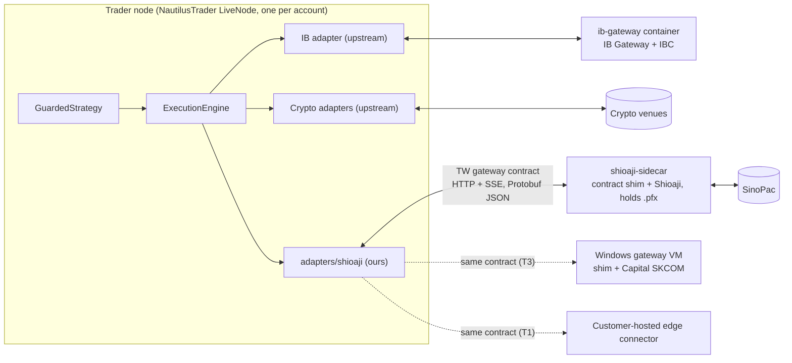

**English** | [繁體中文](ADR-0006-broker-connectivity-and-gateway-contract.zh-TW.md)

# ADR-0006: Broker and exchange connectivity: ports, capability flags and an out-of-process gateway contract

## Status

**Proposed** · 2026-10-05 · Scope: scenarios 1 and 2. Phase 0 spikes (the out-of-tree adapter API, the Shioaji sidecar, IBKR cancel semantics) update this ADR. This ADR also resolves an inconsistency about the Taiwan gateway contract (see *Context*).

## Context and problem statement

The platform must trade US/global markets, crypto venues and Taiwan (TWSE/TPEx, TAIFEX) from a Linux core. Most live-trading bugs live in the connectivity layer. Venues disagree on client-ID formats, amend semantics (in place, cancel/replace, or cancel plus new), rate limits and reconnect behaviour. How should connectivity be abstracted? And how do we handle Taiwan broker APIs, some of which run only on Windows?

What the research found ([04](../../research/04-broker-exchange-connectivity.md), [11](../../research/11-taiwan-market-localization.md)):

- **IBKR is the only verified single-account route** for a Taiwan resident to US/global stocks, options, futures and bonds. IBKR's TPEx access excludes Taiwan residents; we assume no IBKR access to TWSE either. TWS API 10.49+ (released 2026-08-03) is GPL. NautilusTrader v2's IB adapter uses the MIT Rust `ibapi` crate, which is pinned at `=3.3.0` while crates.io already has 5.0.0. ib_async 2.1.0 (BSD-2) is an independent Python client. IB Gateway needs daily restarts, and a human must approve the periodic 2FA re-authentication; IBC automates restarts, not the approval.
- **Crypto.** NautilusTrader ships adapters with reconciliation for Binance, Bybit, OKX, Coinbase, Kraken, Deribit, Hyperliquid and others. CCXT 4.5.85 (MIT) gives breadth. Since 2026-10-01 Coinbase's Deribit-powered derivatives gateway trades perpetuals only, so crypto options go to Deribit directly.
- **Taiwan brokers.**

  | Broker API | Platforms and languages | Notes |
  |---|---|---|
  | SinoPac Shioaji 1.7.7 | Linux, macOS, Windows; Rust core; local HTTP/SSE server | Mandatory simulation tests; IP-bound API keys; 5 sessions per person ID; a 14-day release cycle (1.7.6 was yanked); empty values instead of errors over its traffic cap |
  | Fubon Neo SDK 2.4.0 | Linux, macOS, Windows; Python 3.8–3.13, C#, Node.js | IP-bound API keys; its test environment has securities accounts only |
  | Yuanta SPARK | .NET 8, runs on Linux x64 | — |
  | Capital SKCOM | **Windows COM only** | Needed for overseas futures and sub-brokerage (複委託) |
  | KGI `kgiapp` | **Windows .NET Framework 4.5 only** | Last upload 2024-11-17 |

  Taiwan broker certificates (`.pfx`) are personal, and broker terms forbid authorizing third parties.
- **Bonds.** Retail API access is essentially IBKR. Taiwan has no retail bond-trading API.
- **Inconsistency in the source documents (since corrected).** The [main report](../../README.md) described "a Taiwan sidecar built to an edge-connector contract". Trigger T3 there put a Windows gateway "behind the same gateway contract (HTTP/gRPC or a NATS leaf node)". [Recommended architecture](../../architecture/recommended-architecture.md) §2 defined the sidecar as `shioaji server start`, which is SinoPac's own proprietary HTTP/SSE API. §7 said a Windows shim should expose "the same gateway contract as the Shioaji sidecar (HTTP/SSE)". Read literally, a Capital SKCOM shim would have had to imitate SinoPac's API, and the edge-connector contract was never defined.

## Decision drivers

- Reuse of maintained adapters and their reconciliation, rather than writing our own.
- Isolation of proprietary binaries, OS-locked SDKs and personal certificates from the engine process.
- One contract that a Windows gateway or a future customer-hosted edge connector can implement unchanged.
- Idempotent order handling: no duplicate orders after timeouts or crashes.
- The licence boundary: no GPL IBKR client linked into our code.
- Windows-only SDKs must not dictate the core's OS.

## Considered options

1. **Ports and adapters with capability flags.** Upstream NautilusTrader adapters for IBKR and crypto; our own NautilusTrader adapter for Taiwan, talking to an out-of-process broker sidecar through a **platform-defined gateway contract**; Windows-only brokers later, as Windows gateway VMs behind the same contract.
2. **Our own adapters for every venue** (Proposal B: one gateway process per venue account).
3. **No engine adapters:** CCXT for crypto execution, ib_async directly and Shioaji in-process, behind our own OMS.
4. **The Shioaji Python SDK in-process** inside the NautilusTrader node.
5. **A Windows host for the whole core**, so every Taiwan broker SDK can load.
6. **FIX** for all connectivity.

## Decision outcome

**Chosen option: 1.** It reuses upstream adapters and reconciliation, keeps every proprietary SDK and certificate in its own process, and defines one contract that serves the Shioaji sidecar now, a Windows gateway on T3, and a customer-hosted edge connector at T1.

### Rules

| Area | Rule |
|---|---|
| Ports | `MarketDataPort`, `ExecutionPort` (submit, modify, cancel, query, mass status), `AccountPort` (balances, positions, margin), `ReferenceDataPort` (instrument discovery, symbology) and `CalendarPort` |
| Capability flags | `adapters/capabilities.yaml`, per venue and product: `amend_mode` (in_place, cancel_replace, emulate), `native_oco`, `multi_leg`, `reduce_only`, `post_only`, `max_client_id_len`, `id_format`, `dead_man` (kind or none), `cancel_on_disconnect`. Strategy and risk code branch on flags, never on venue names. OCO is emulated only where `native_oco` is false, and the legging risk is logged |
| Client order IDs | A canonical ULID-based `client_order_id`. Only the canonical ID is written to the intent WAL before sending, because upstream adapters encode or assign the venue ID inside the adapter after that write (IBKR's integer `orderId` comes from `nextValidId` at send time; ≤32 alphanumerics for OKX, 128-bit hex for Hyperliquid). A post-send `venue_id_assigned` record then maps the canonical ID to the venue-encoded ID, the venue order ID and, for IBKR, `orderId` and `permId` ([ADR-0011](ADR-0011-intent-wal-and-hash-chained-ledger.md)). Where a venue has a free-text field, the canonical ID travels in it (IBKR `orderRef`). Where a venue has no client-ID field, our adapter persists `client_order_id → venue order number` on acknowledgement |
| Timeouts and recovery | In our Shioaji adapter, a submit that times out or loses its connection becomes `UNKNOWN` and is resolved **by query** (by client ID, or by matching account, instrument, side, quantity, price and a time window), **never by blind resubmission**. For upstream adapters, NautilusTrader's in-flight-order reconciliation resolves it, following the per-venue recovery table in §3.4 of the [recommended architecture](../../architecture/recommended-architecture.md): IBKR has no lookup by `orderRef`, so recovery scans `reqAllOpenOrders`, `reqExecutions` and `reqCompletedOrders` and matches `orderRef` or `permId`; crypto venues are queried by client ID. A Phase 0 spike verifies this for each upstream adapter we use |
| Fills | De-duplicated on `(venue, exec_id)`. Positions are derived from fills, never from status messages. Exercise, assignment and expiry are reconciled explicitly |
| Rate governance | Per-venue token buckets set below published limits, with headroom reserved for cancels and risk-reducing orders. Examples: Shioaji 250 order operations per 10 s, 50 data calls per 10 s, 25 account queries per 5 s; Fubon 50 orders per second; Binance spot 6,000 weight per minute |
| IBKR | The NautilusTrader IB adapter, through an `ib-gateway` container (IB Gateway + IBC, headless). The 2FA approval is an operator duty with a scheduler reminder. The kill switch uses ib_async. IBKR's official GPL client (10.49+) is never linked into our code ([ADR-0009](ADR-0009-open-source-licensing-strategy.md)) |
| Crypto | NautilusTrader native adapters on 1–2 venues that are legally available to the user. A perpetual or options venue is added only after a Phase 0 check against the FSC AML-registration list and the venue's own geo terms; if none is eligible, IBKR is the first live market. CCXT for data capture and the long tail. TWD venues (MAX, BitoPro) offer spot only, sit on a configured allow-list tied to the FSC register, and get adapters only when used. Counterparty limits are in [ADR-0013](ADR-0013-risk-gate-and-three-path-kill-switch.md) |
| Taiwan: contract | A **platform-defined TW gateway contract**: Protobuf messages in `proto/gateway/v1/`. The scenario-1 binding is HTTP for commands and queries plus SSE for streams, using the JSON mapping, on localhost or WireGuard. The scenario-2 binding is NATS subjects over a leaf node. It covers session health, instrument discovery, market-data subscriptions with sequence numbers, submit/cancel/amend, queries by client ID or venue order ID, open orders, fills since a watermark, positions, balances, declared capability flags and an explicit `EMPTY_RESPONSE` alarm event. gRPC is not used for this contract in scenario 1 |
| Taiwan: Shioaji (primary) | Our NautilusTrader data and execution adapter (`adapters/shioaji/`, on the documented out-of-tree adapter API) speaks only the contract. The `shioaji-sidecar` container runs a **thin shim that implements the contract on top of Shioaji 1.7.7**. The Phase 0 spike decides whether the shim calls the Shioaji Python SDK directly or fronts `shioaji server start` inside the same container. The sidecar holds the `.pfx`; the node never does ([ADR-0008](ADR-0008-key-and-secret-management.md)). Empty responses raise an alarm. Versions are pinned exactly |
| Taiwan: Fubon Neo (documented second broker and fallback) | Its own sidecar implementing the same contract. Its Python support (3.8–3.13) keeps it out of the 3.14 main image anyway. Futures logic is tested with the smallest real orders, because its test environment has securities accounts only |
| Windows-only brokers | **Not in the MVP.** On trigger T3 (Capital SKCOM for overseas futures or 複委託, or another DLL/COM-only broker), a Windows Server VM runs the SDK in a persistent desktop session behind a shim that implements the **same contract**, reached over WireGuard. It needs a watchdog, restarts before 08:30 and 15:00, a matching 32/64-bit build, pinned versions and health probes. Windows SDKs never run inside client apps |
| Bonds | Bond ETFs trade as equities. Direct bonds are booked by hand or placed as low-frequency IBKR orders. No bond RFQ in scenario 1 |
| FIX | Not in scenario 1. QuickFIX/J 3.0.x for prime brokers, institutional crypto and bond RFQ (scenario 2 or T8) |
| Testing | Contract tests replay recorded venue sessions with fault injection (disconnect mid-fill, duplicate acknowledgements, out-of-order events, empty responses, rate-limit errors) on every merge for the Shioaji adapter, and nightly against paper or testnet |

**Wording amendments (applied on 2026-10-05).** The TW gateway contract defined here is the "edge-connector contract" of the [main report](../../README.md) and the "gateway contract" of §3.4 and §7 in the [recommended architecture](../../architecture/recommended-architecture.md). §2 there now reads "contract shim over Shioaji (SDK or `shioaji server`)" instead of only "`shioaji server start`", §3.4 summarizes the contract, and T3 reads "HTTP + SSE in scenario 1, a NATS leaf node in scenario 2".

### Consequences

**Positive**

- Zero custom adapter code for IBKR and crypto, and their reconciliation comes from upstream.
- The proprietary Shioaji binary, its release churn and the personal certificate are isolated from the engine and from every other container except the kill switch.
- Adding Fubon Neo, Yuanta SPARK, a Windows gateway or a customer edge connector means implementing one contract, not changing the node.
- Capability flags and canonical client IDs keep strategy and risk code venue-neutral.

**Negative**

- We own the contract, the shim, the Shioaji adapter and their contract tests. In a Taiwan-first plan, the adapter and the Taiwan rules pack together add about 2 PM to the critical path.
- An extra local hop (HTTP/SSE) on the Taiwan order path. It is negligible at our latency tier, but it is one more failure point to monitor.
- Two upstream dependencies (NautilusTrader and the single-maintainer `ibapi` crate) gate IB protocol changes. ib_async is the independent fallback, and the MIT crate can be vendored.
- IB Gateway's human 2FA approval and Shioaji's 14-day cadence are standing operator duties.

### Confirmation

Phase 0 spikes record verdicts here:

- the v2 out-of-tree adapter API;
- the Shioaji shim approach;
- the session behaviour and cancel latency from a second Shioaji session;
- odd-lot behaviour with tiny real orders (the simulator rejects odd lots);
- IBKR cancel semantics (`reqGlobalCancel` versus the master client ID) and the 2FA cadence;
- NautilusTrader's in-flight-order reconciliation for each upstream adapter, and whether the IB adapter carries the canonical ID in `orderRef`;
- each crypto perpetual and options venue's eligibility for a Taiwan resident;
- whether the chosen Taiwan broker accepts API logins from cloud IPs.

In CI, `buf breaking` guards `proto/gateway/v1/`, and the contract-test suite runs on every merge.

### Revisit when

- **T2:** more than about five accounts, or broker session limits → one gateway process per venue account.
- **T3:** a Windows-only broker is needed.
- **T1:** an external offering → the customer-hosted edge connector, which is a legal hypothesis requiring counsel and broker confirmation ([ADR-0015](ADR-0015-self-use-regulatory-posture-and-legal-gate.md)).
- **T8:** bonds beyond ETFs and manual booking → IBKR `BOND` orders, then FIX RFQ.
- **T5:** latency-sensitive TAIFEX strategies → Fubon DMA/IDC routing.

## Links

- [Main report: broker connectivity row; triggers T1, T3, T5 and T8](../../README.md)
- [Recommended architecture §2, §3.4, §6 and §7](../../architecture/recommended-architecture.md)
- [Evaluation record: grafts 3, 9, 10, 23 and 27; concerns 2, 3, 7, 18, 22 and 23](../../architecture/evaluation.md)
- [Proposal C: edge connector](../../architecture/proposal-C-platform-scale.md)
- Research: [04 Broker and exchange connectivity](../../research/04-broker-exchange-connectivity.md) · [11 Taiwan localization](../../research/11-taiwan-market-localization.md) · [07 Messaging](../../research/07-system-architecture-messaging.md)
- Related ADRs: [ADR-0005](ADR-0005-messaging-and-deployment-topology.md) · [ADR-0008](ADR-0008-key-and-secret-management.md) · [ADR-0011](ADR-0011-intent-wal-and-hash-chained-ledger.md) · [ADR-0013](ADR-0013-risk-gate-and-three-path-kill-switch.md)
