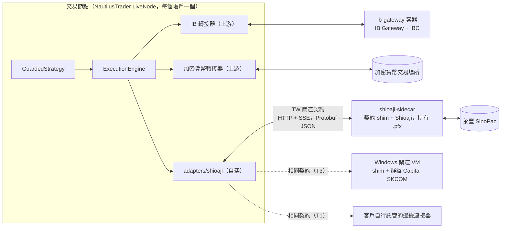

[English](ADR-0006-broker-connectivity-and-gateway-contract.md) | **繁體中文**

# ADR-0006：券商與交易所連線：埠（ports）、能力旗標（capability flags）與行程外閘道契約（out-of-process gateway contract）

## 狀態

**提議中（Proposed）** · 2026-10-05 · 範圍：情境 1 與情境 2。Phase 0 spike（技術驗證：out-of-tree 轉接器 API、Shioaji sidecar、IBKR 刪單語意）的結果會更新本 ADR。本 ADR 也解決了一項關於台灣閘道契約的不一致之處（見 *背景與問題陳述*）。

## 背景與問題陳述

平台必須從 Linux 核心交易美國／全球市場、加密貨幣交易場所與台灣市場（TWSE/TPEx、TAIFEX）。大多數實盤交易的 bug 都出在連線層。各交易場所（venue）在客戶端 ID 格式、改單語意（原地修改、cancel/replace，或刪單後再新下一筆）、速率限制與重新連線行為上各不相同。連線應該如何抽象化？又該如何處理台灣券商 API，其中有些只能在 Windows 上執行？

研究的發現（[04](../../research/04-broker-exchange-connectivity.zh-TW.md)、[11](../../research/11-taiwan-market-localization.zh-TW.md)）：

- **IBKR 是唯一經過驗證、能讓台灣居民以單一帳戶交易**美國／全球股票、選擇權、期貨與債券的管道。IBKR 的 TPEx 存取排除台灣居民；我們也假設 IBKR 無法存取 TWSE。TWS API 10.49+（2026-08-03 發布）採用 GPL 授權。NautilusTrader v2 的 IB 轉接器（adapter）使用 MIT 授權的 Rust `ibapi` crate，其版本鎖定在 `=3.3.0`，而 crates.io 上已有 5.0.0。ib_async 2.1.0（BSD-2）是一個獨立的 Python 用戶端。IB Gateway 需要每日重新啟動，且週期性的 2FA 重新驗證必須由人工核准；IBC 能自動化重新啟動，但無法自動化核准。
- **加密貨幣。** NautilusTrader 內建附對帳（reconciliation）功能的轉接器，支援 Binance、Bybit、OKX、Coinbase、Kraken、Deribit、Hyperliquid 等交易場所。CCXT 4.5.85（MIT）則提供廣度。自 2026-10-01 起，Coinbase 由 Deribit 驅動的衍生性商品閘道只交易永續合約，因此加密貨幣選擇權直接走 Deribit。
- **台灣券商。**

  | 券商 API | 平台與語言 | 備註 |
  |---|---|---|
  | 永豐 SinoPac Shioaji 1.7.7 | Linux、macOS、Windows；Rust 核心；本機 HTTP/SSE 伺服器 | 必須通過模擬測試；API 金鑰綁定 IP；每個身分證字號 5 個 session；14 天的發布週期（1.7.6 曾被撤回）；超過流量上限時回傳空值而非錯誤 |
  | 富邦 Fubon Neo SDK 2.4.0 | Linux、macOS、Windows；Python 3.8–3.13、C#、Node.js | API 金鑰綁定 IP；其測試環境只有證券帳戶 |
  | 元大 Yuanta SPARK | .NET 8，可在 Linux x64 上執行 | — |
  | 群益 Capital SKCOM | **僅限 Windows COM** | 海外期貨與複委託需要使用 |
  | 凱基 KGI `kgiapp` | **僅限 Windows .NET Framework 4.5** | 最後一次上傳為 2024-11-17 |

  台灣券商憑證（`.pfx`）屬於個人所有，且券商條款禁止授權第三方使用。
- **債券。** 零售 API 存取基本上只有 IBKR。台灣沒有零售債券交易 API。
- **來源文件中的不一致之處（已修正）。** [主報告](../../README.zh-TW.md) 描述的是「依邊緣連接器契約（edge-connector contract）建置的台灣 sidecar」。其中的觸發條件 T3 則把 Windows 閘道放在「同一個閘道契約之後（HTTP/gRPC 或 NATS leaf node）」。[建議架構](../../architecture/recommended-architecture.zh-TW.md) §2 將 sidecar 定義為 `shioaji server start`，這是永豐自有的專有 HTTP/SSE API。§7 則說 Windows shim 應提供「與 Shioaji sidecar 相同的閘道契約（HTTP/SSE）」。若照字面解讀，群益 Capital SKCOM 的 shim 就必須模仿永豐的 API，而邊緣連接器契約則從未被定義。

## 決策驅動因素

- 重用有人維護的轉接器及其對帳功能，而不是自行撰寫。
- 將專有二進位檔、綁定作業系統的 SDK 與個人憑證，與引擎行程隔離。
- 單一契約，讓 Windows 閘道或未來由客戶自行託管的邊緣連接器都能原封不動地實作。
- 冪等（idempotent）的委託處理：逾時或當機後不會產生重複委託。
- 授權邊界：不將任何 GPL 授權的 IBKR 用戶端連結進我們的程式碼。
- 僅限 Windows 的 SDK 不得左右核心所使用的作業系統。

## 考慮的選項

1. **埠與轉接器（ports and adapters）搭配能力旗標。** IBKR 與加密貨幣使用上游 NautilusTrader 轉接器；台灣市場使用我們自己的 NautilusTrader 轉接器，透過**平台定義的閘道契約**與行程外的券商 sidecar 通訊；僅限 Windows 的券商之後再以 Windows 閘道 VM 的形式放在同一個契約之後。
2. **為每個交易場所自行撰寫轉接器**（提案 B：每個交易場所帳戶一個閘道行程）。
3. **不使用引擎轉接器：** 加密貨幣執行用 CCXT、直接使用 ib_async、行程內使用 Shioaji，全部放在我們自己的 OMS 之後。
4. **在 NautilusTrader 節點內以行程內方式使用 Shioaji Python SDK。**
5. **以 Windows 主機承載整個核心**，讓每一家台灣券商的 SDK 都能載入。
6. **所有連線都使用 FIX。**

## 決策結果

**選擇選項：1。** 它重用上游轉接器與對帳功能，讓每一個專有 SDK 與憑證都待在各自的行程中，並定義單一契約，現在服務 Shioaji sidecar，在 T3 時服務 Windows 閘道，在 T1 時服務由客戶自行託管的邊緣連接器。

### 規則

| 領域 | 規則 |
|---|---|
| 埠（Ports） | `MarketDataPort`、`ExecutionPort`（送單、改單、刪單、查詢、批次狀態查詢）、`AccountPort`（餘額、部位、保證金）、`ReferenceDataPort`（商品探索、代碼體系）與 `CalendarPort` |
| 能力旗標 | `adapters/capabilities.yaml`，依交易場所與商品設定：`amend_mode`（in_place、cancel_replace、emulate）、`native_oco`、`multi_leg`、`reduce_only`、`post_only`、`max_client_id_len`、`id_format`、`dead_man`（種類或 none）、`cancel_on_disconnect`。策略與風控程式碼依旗標分支，絕不依交易場所名稱分支。只有在 `native_oco` 為 false 時才模擬 OCO，並記錄逐腳成交（legging）風險 |
| 客戶端委託 ID | 以 ULID 為基礎的標準（canonical）`client_order_id`。送出前只有標準 ID 會寫入 intent WAL，因為上游轉接器是在該次寫入之後，才在轉接器內部編碼或指派交易場所 ID（IBKR 的整數 `orderId` 在送出時取自 `nextValidId`；OKX 為 ≤32 個英數字元，Hyperliquid 為 128 位元十六進位）。接著由送出後的 `venue_id_assigned` 紀錄，將標準 ID 對應到交易場所編碼後的 ID、交易場所委託 ID，以及 IBKR 的 `orderId` 與 `permId`（[ADR-0011](ADR-0011-intent-wal-and-hash-chained-ledger.zh-TW.md)）。若交易場所有自由文字欄位，標準 ID 就放在該欄位中傳遞（IBKR 的 `orderRef`）。若交易場所沒有客戶端 ID 欄位，我們的轉接器會在收到確認時持久化 `client_order_id → 交易場所委託書號` 的對應 |
| 逾時與復原 | 在我們的 Shioaji 轉接器中，逾時或連線中斷的送單會變成 `UNKNOWN`，並**透過查詢**解決（依客戶端 ID，或比對帳戶、商品、買賣方向、數量、價格與時間窗），**絕不盲目重送**。對於上游轉接器，則由 NautilusTrader 的在途委託（in-flight order）對帳解決，並遵循[建議架構](../../architecture/recommended-architecture.zh-TW.md) §3.4 中各交易場所的復原表：IBKR 無法依 `orderRef` 查詢，因此復原時會掃描 `reqAllOpenOrders`、`reqExecutions` 與 `reqCompletedOrders`，並比對 `orderRef` 或 `permId`；加密貨幣交易場所則依客戶端 ID 查詢。Phase 0 spike 會針對我們使用的每一個上游轉接器驗證這一點 |
| 成交回報 | 依 `(venue, exec_id)` 去重。部位由成交回報推導，絕不由狀態訊息推導。履約、指派與到期都會明確對帳 |
| 速率治理 | 每個交易場所各自設定低於公告上限的 token bucket，並為刪單與降低風險的委託保留餘裕。範例：Shioaji 每 10 秒 250 次委託操作、每 10 秒 50 次資料呼叫、每 5 秒 25 次帳務查詢；富邦每秒 50 筆委託；Binance 現貨每分鐘 6,000 權重 |
| IBKR | 使用 NautilusTrader IB 轉接器，透過 `ib-gateway` 容器（IB Gateway + IBC，無頭模式）。2FA 核准是營運人員的職責，並由排程器提醒。緊急停止開關（kill switch）使用 ib_async。IBKR 官方的 GPL 用戶端（10.49+）絕不連結進我們的程式碼（[ADR-0009](ADR-0009-open-source-licensing-strategy.zh-TW.md)） |
| 加密貨幣 | 在 1–2 個使用者可合法使用的交易場所上使用 NautilusTrader 原生轉接器。永續合約或選擇權交易場所，只有在 Phase 0 對照金管會（FSC）洗錢防制登記名單與該交易場所自身的地區條款檢查後才會加入；若沒有任何一家符合資格，IBKR 就是第一個實盤市場。資料擷取與長尾交易場所使用 CCXT。新台幣交易場所（MAX、BitoPro）只提供現貨，列在與金管會登記名單掛鉤的設定允許清單上，且只有在實際使用時才會建置轉接器。交易對手限額見 [ADR-0013](ADR-0013-risk-gate-and-three-path-kill-switch.zh-TW.md) |
| 台灣：契約 | 一個**平台定義的 TW 閘道契約**：位於 `proto/gateway/v1/` 的 Protobuf 訊息。情境 1 的繫結（binding）是指令與查詢用 HTTP、串流用 SSE，採用 JSON 對應（JSON mapping），運行於 localhost 或 WireGuard 上。情境 2 的繫結是透過 leaf node 的 NATS subject。涵蓋範圍包括：session 健康狀態、商品探索、帶序號的行情訂閱、送單／刪單／改單、依客戶端 ID 或交易場所委託 ID 查詢、未成交委託、自某水位標記（watermark）以來的成交回報、部位、餘額、宣告的能力旗標，以及明確的 `EMPTY_RESPONSE` 警示事件。情境 1 中此契約不使用 gRPC |
| 台灣：Shioaji（主要） | 我們的 NautilusTrader 資料與執行轉接器（`adapters/shioaji/`，基於有文件記載的 out-of-tree 轉接器 API）只使用此契約溝通。`shioaji-sidecar` 容器執行一個**在 Shioaji 1.7.7 之上實作此契約的輕量 shim**。由 Phase 0 spike 決定 shim 是直接呼叫 Shioaji Python SDK，還是在同一個容器內作為 `shioaji server start` 的前端。sidecar 持有 `.pfx`；節點永遠不持有（[ADR-0008](ADR-0008-key-and-secret-management.zh-TW.md)）。空回應會觸發警示。版本精確鎖定 |
| 台灣：富邦 Fubon Neo（已記載的第二家券商與備援） | 有自己的 sidecar，實作同一個契約。它的 Python 支援範圍（3.8–3.13）本來就使它無法放進 3.14 的主映像檔。由於其測試環境只有證券帳戶，期貨邏輯以最小的真實委託進行測試 |
| 僅限 Windows 的券商 | **不在 MVP 範圍內。** 在觸發條件 T3（為海外期貨或複委託使用群益 Capital SKCOM，或其他僅提供 DLL/COM 的券商）發生時，由一台 Windows Server VM 在持續性桌面 session 中執行該 SDK，前面放一個實作**相同契約**的 shim，並透過 WireGuard 連線。它需要 watchdog、在 08:30 與 15:00 之前重新啟動、相符的 32/64 位元建置、鎖定版本與健康探測。Windows SDK 絕不在用戶端應用程式內執行 |
| 債券 | 債券 ETF 以股票方式交易。直接持有的債券以人工記帳，或以低頻率的 IBKR 委託下單。情境 1 不提供債券 RFQ |
| FIX | 不在情境 1 中。QuickFIX/J 3.0.x 用於主經紀商（prime broker）、機構級加密貨幣與債券 RFQ（情境 2 或 T8） |
| 測試 | 契約測試（contract tests）會重播錄製的交易場所 session 並注入故障（成交途中斷線、重複確認、事件亂序、空回應、速率限制錯誤）：Shioaji 轉接器在每次合併時執行，並且每晚對模擬帳戶（paper）或測試網（testnet）執行 |

**措辭修訂（已於 2026-10-05 套用）。** 本文定義的 TW 閘道契約，即[主報告](../../README.zh-TW.md)中的「邊緣連接器契約」，以及[建議架構](../../architecture/recommended-architecture.zh-TW.md) §3.4 與 §7 中的「閘道契約」。該文件 §2 現在寫的是「Shioaji 之上的契約 shim（SDK 或 `shioaji server`）」，而不只是「`shioaji server start`」；§3.4 摘要了此契約；T3 則寫為「情境 1 為 HTTP + SSE，情境 2 為 NATS leaf node」。

### 影響

**正面**

- IBKR 與加密貨幣不需要任何自訂轉接器程式碼，其對帳功能也來自上游。
- 專有的 Shioaji 二進位檔、其頻繁的版本更迭與個人憑證，都與引擎以及除緊急停止開關以外的所有其他容器隔離。
- 新增富邦 Fubon Neo、元大 Yuanta SPARK、Windows 閘道或客戶邊緣連接器，只需實作同一個契約，不必修改節點。
- 能力旗標與標準客戶端 ID 讓策略與風控程式碼保持與交易場所無關。

**負面**

- 契約、shim、Shioaji 轉接器及其契約測試都由我們負責。在以台灣為優先的計畫中，轉接器與台灣規則包合計約在關鍵路徑上增加 2 人月（PM）。
- 台灣委託路徑上多了一個本機跳點（HTTP/SSE）。以我們的延遲等級來說可以忽略，但它是需要監控的另一個故障點。
- 兩個上游相依項目（NautilusTrader 與僅有單一維護者的 `ibapi` crate）把關 IB 協定的變更。ib_async 是獨立的備援方案，而 MIT 授權的 crate 可以 vendor 進來。
- IB Gateway 的人工 2FA 核准與 Shioaji 的 14 天發布節奏，是長期的營運職責。

### 確認

Phase 0 spike 會在此記錄判定結果：

- v2 out-of-tree 轉接器 API；
- Shioaji shim 的做法；
- 來自第二個 Shioaji session 的 session 行為與刪單延遲；
- 以極小額真實委託測試的零股行為（模擬器會拒絕零股）；
- IBKR 刪單語意（`reqGlobalCancel` 對比 master client ID）與 2FA 頻率；
- NautilusTrader 對每個上游轉接器的在途委託對帳，以及 IB 轉接器是否在 `orderRef` 中攜帶標準 ID；
- 每個加密貨幣永續合約與選擇權交易場所對台灣居民的資格；
- 所選的台灣券商是否接受來自雲端 IP 的 API 登入。

在 CI 中，`buf breaking` 守護 `proto/gateway/v1/`，且契約測試套件在每次合併時執行。

### 重新檢視時機

- **T2：** 超過約五個帳戶，或遇到券商 session 上限 → 每個交易場所帳戶一個閘道行程。
- **T3：** 需要僅限 Windows 的券商。
- **T1：** 對外提供服務 → 由客戶自行託管的邊緣連接器；這是一項法律上的假設，需要法律顧問與券商確認（[ADR-0015](ADR-0015-self-use-regulatory-posture-and-legal-gate.zh-TW.md)）。
- **T8：** 債券需求超出 ETF 與人工記帳 → IBKR `BOND` 委託，之後再用 FIX RFQ。
- **T5：** 對延遲敏感的 TAIFEX 策略 → 富邦 DMA/IDC 路由。

## 連結

- [主報告：券商連線列；觸發條件 T1、T3、T5 與 T8](../../README.zh-TW.md)
- [建議架構 §2、§3.4、§6 與 §7](../../architecture/recommended-architecture.zh-TW.md)
- [評估紀錄：嫁接項 3、9、10、23 與 27；疑慮 2、3、7、18、22 與 23](../../architecture/evaluation.zh-TW.md)
- [提案 C：邊緣連接器](../../architecture/proposal-C-platform-scale.zh-TW.md)
- 研究：[04 券商與交易所連線](../../research/04-broker-exchange-connectivity.zh-TW.md) · [11 台灣在地化](../../research/11-taiwan-market-localization.zh-TW.md) · [07 訊息傳遞](../../research/07-system-architecture-messaging.zh-TW.md)
- 相關 ADR：[ADR-0005](ADR-0005-messaging-and-deployment-topology.zh-TW.md) · [ADR-0008](ADR-0008-key-and-secret-management.zh-TW.md) · [ADR-0011](ADR-0011-intent-wal-and-hash-chained-ledger.zh-TW.md) · [ADR-0013](ADR-0013-risk-gate-and-three-path-kill-switch.zh-TW.md)
