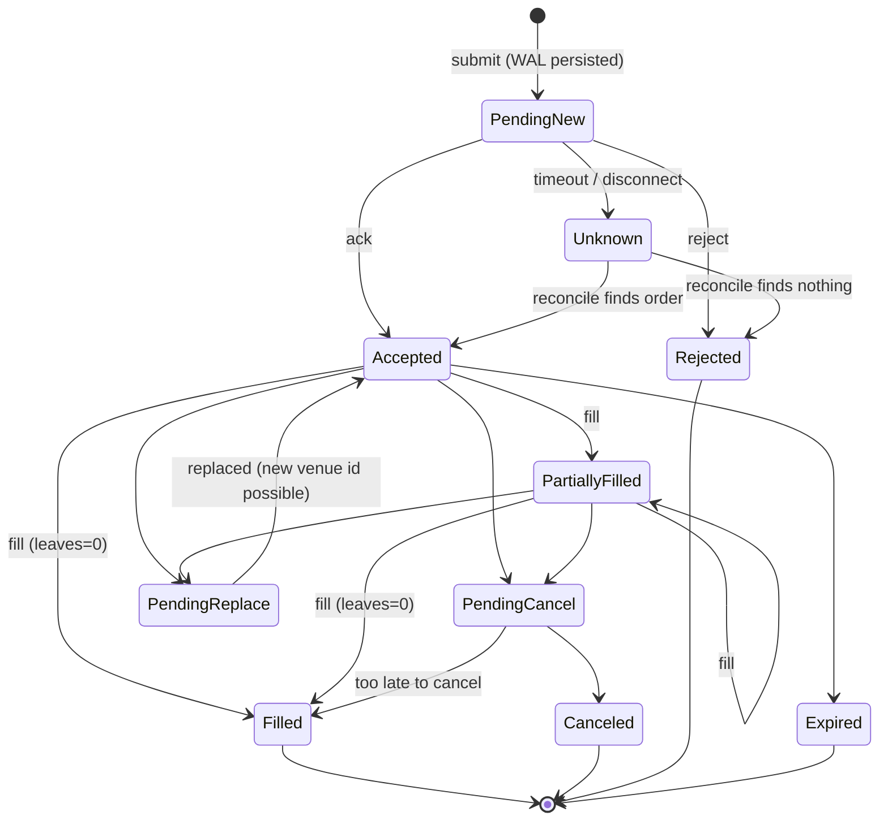

**English** | [繁體中文](04-broker-exchange-connectivity.zh-TW.md)

# 04 — Broker & Exchange Connectivity (Global Markets)

> Research date: 2026-10-05. Versions, limits and eligibility drift quickly. Items marked "unverified" could not be confirmed from public 2025–2026 sources and must be checked with the provider before you commit.

## TL;DR

- **Interactive Brokers (IBKR) is the only verified single-account API route for a Taiwan-based user to reach US/global stocks, options, futures and bonds**, plus crypto where the IB entity and country of residence allow it. Two 2025–26 changes matter. First, **TWS API 10.49+ (released 2026-08-03) is GPL-licensed**; current downloads are 10.50 (Stable, 2026-09-09) and 10.51 (Latest, 2026-09-30). Second, **IBKR's Taiwan listings are not available to Taiwan residents**. Taiwan stocks and TAIFEX therefore need a local broker API: Shioaji (永豐金) or Fubon Neo (富邦). See [11](11-taiwan-market-localization.md) for details.
- **For crypto, use CCXT for breadth and native adapters for depth.** CCXT v4.5.85 (2026-10-01, MIT) bundles its WebSocket layer ("CCXT Pro") for free. Write native adapters only for the 2–4 venues that carry real volume. Crypto options concentrate on Deribit, which Coinbase now owns. Since 2026-10-01, Coinbase Advanced Trade's "Global Derivatives" runs on a Deribit-powered gateway, but it trades perpetuals only for now: options and dated futures are "not yet available through the gateway", so trade crypto options on Deribit directly. On-chain venues such as Hyperliquid authenticate with wallet signatures and nonce rules, not API keys.
- **Bonds are structurally different.** They trade OTC, by RFQ, with CUSIP/ISIN identifiers and $1,000 face increments. Retail API access is essentially IBKR, or the Alpaca Broker API (via Moment) if you build a retail product. Institutional access is Tradeweb, MarketAxess or Bloomberg over FIX/RFQ.
- **Most live-trading bugs live in the connectivity layer.** Use ports-and-adapters with:
  - a canonical order model and a persisted order state machine;
  - your own client order IDs, encoded to each venue's constraints;
  - idempotent fill handling;
  - reconcile-on-reconnect.

  Venues implement "modify" in three incompatible ways: in-place amend, cancel/replace chain, and cancel + new.
- **Recommendation.**
  - **MVP:** IBKR (ib_async) + CCXT + optionally Shioaji, behind your own adapter interface (or use NautilusTrader's adapters if you adopt its engine). No FIX.
  - **Institutional:** one gateway process per venue account, native adapters for the top venues, and FIX (QuickFIX/J 3.0.x, or OnixS/Chronicle) for prime brokers, institutional crypto and bonds.

## Key questions

1. Which APIs can a Taiwan resident actually open and automate, per asset class?
2. What is the minimum set of accounts that covers stocks, options, crypto and bonds?
3. Should we build adapters ourselves or reuse CCXT, NautilusTrader, LEAN or Hummingbot?
4. When is FIX worth the cost?
5. Which canonical order model survives venue differences in IDs, amend semantics, partial fills and reconnects?
6. Which licensing and regulatory constraints apply if the platform is later offered to other users?

## Options compared

### 1. Broker APIs (stocks, options, futures, bonds)

| Broker / API | Stocks | Options | Futures | Bonds | Crypto | Interface & limits | Paper / sandbox | Taiwan-resident fit |
|---|---|---|---|---|---|---|---|---|
| **IBKR TWS API / IB Gateway** | Global (170+ markets) | Yes, incl. combos | Yes | US Treasuries, corporates and munis via SmartRouting. Bond market data over the API is limited to minTick, exchange and short name. | Spot via Paxos/zerohash; availability depends on IB entity and residence | TCP socket with official Java/C++/C#/Python clients. GPL since 10.49 (2026-08-03); current Stable is 10.50 (2026-09-09) and Latest is 10.51 (2026-09-30). Requires an IBKR Pro account. Pacing = market-data lines ÷ 2 requests/s. | Paper account | ✅ Onboards Taiwan residents, but TPEx access explicitly excludes residents of Taiwan and Mainland China. Expect the same for TWSE (verify). |
| **IBKR Web API** | same backend | Yes | Yes | Yes | Yes | REST + WebSocket. Individuals (funded IBKR Pro account) connect through the Client Portal Gateway (Java). OAuth 2.0 (beta) is listed for organizations; third-party vendors can currently only get OAuth 1.0a, after a compliance review. 10 req/s per session; violating IPs go into a 10-minute "penalty box", and repeat offenders may be blocked. Brokerage endpoints (/iserver) reset nightly around 01:00 regional time. | Paper login | ✅ same as above |
| **Alpaca** | US | Levels 1–3 (spreads) | – | Broker API only: T-bills and investment-grade corporates via Moment | Spot (select jurisdictions) | REST/WS, 200 req/min; FIX 4.2 offering | **Paper-only accounts open to anyone globally** | ⚠ Paper yes. Live eligibility for individuals: "contact support" (unverified). |
| **Charles Schwab Trader API** | US | Yes | – | – | – | REST + OAuth. Refresh token lasts 7 days, so a browser re-login is needed weekly. | None documented | ⚠ US-centric (unverified) |
| **tastytrade Open API** | US | Yes (strong multi-leg) | Yes, plus futures options | – | Yes | REST + streaming, OAuth2 | Cert sandbox: resets every 24 h, market orders fill at $1, no market data | ⚠ International program exists; Taiwan unverified |
| **TradeStation API v3** | US | Yes | Yes | – | – | REST + HTTP streaming | SIM | ⚠ unverified |
| **Tradier** | US | Yes | – | – | – | REST + HTTP/WS streaming | Sandbox (delayed data) | ⚠ US-focused |
| **Saxo OpenAPI** | Global | Yes (multi-leg) | Yes | Yes | ETP/CFD | REST + streaming. OAuth2 (code, PKCE or certificate). Separate FIX API. | SIM, plus a 24-h developer token | ⚠ Served through regional entities; Taiwan unverified |
| **Futu / moomoo OpenAPI** | HK, US, A-shares, SG, JP, MY | Yes | Yes | – | Region-dependent | Local OpenD gateway + SDKs (Python, Java, C#, C++, JS) | Paper | ❌ No Taiwan entity among the regional brokers |
| **Webull OpenAPI** | US | Yes | Yes | – | Yes | HTTP + MQTT + gRPC; OAuth 2.0 for third parties | Not documented | ⚠ US-focused |
| **Shioaji (Sinopac 永豐金)** / **Fubon Neo (富邦)** | TWSE/TPEx incl. odd lots | TAIFEX | TAIFEX | – | – | Shioaji 1.7.7: Python, HTTP and CLI. Fubon Neo: Python, C#, Node.js; C++ and Go for securities only. | Shioaji has a simulation mode. Fubon's test environment covers securities only. | ✅ Local brokers |

Not evaluated in depth: Tiger Brokers' TigerOpen API (Python SDK `tigeropen` 3.8.0, 2026-09-17; Taiwan-resident eligibility unverified) and Public's API (a LEAN-supported US brokerage). Other Taiwan broker APIs are covered in [11](11-taiwan-market-localization.md).

**Verified costs:**

- **IBKR Pro (Fixed):** US stocks USD 0.005/share (minimum USD 1.00, maximum 1% of trade value). Crypto 0.12–0.18% (minimum USD 1.75).
- **IBKR Pro US options:** one volume- and premium-tiered schedule (there is no separate "Fixed" option rate). Up to 10,000 contracts/month it is USD 0.65/contract for premiums ≥ USD 0.10, USD 0.50 for premiums from USD 0.05 to under 0.10, and USD 0.25 below USD 0.05. The minimum is USD 1.00 per order. IBKR Lite is a flat USD 0.65/contract.
- **IBKR Lite:** US residents only, and the TWS API requires an IBKR Pro account.
- **Alpaca:** US stocks are commission-free. Crypto tier 1 is 0.15% maker / 0.25% taker.

### 2. Crypto venues

| Venue | Products | Auth / signing | Rate-limit model | Test env | 2025–26 notes |
|---|---|---|---|---|---|
| **Binance** | Spot, margin, USDⓈ-M / COIN-M futures, options | HMAC, RSA or **Ed25519 (recommended)**; timestamp + `recvWindow` ≤ 60 s | Spot: **6,000 weight/min, 100 orders/10 s, 200,000 orders/day**. HTTP 429, then a 418 IP ban (2 min–3 days). | Spot and futures testnets | Geo-blocked in some countries. The old `binance-connector` Python library is deprecated; it is replaced by modular `binance-sdk-*` packages (e.g. `binance-sdk-spot` 13.0.0). |
| **Coinbase Advanced Trade** | Spot; US futures (CFM); **Global Derivatives** (perps only for now: 125+ contracts incl. equity and commodity perps; options and dated futures not yet on the gateway) | CDP key → JWT signed with **ES256 (ECDSA)**. Ed25519 keys are not supported by Coinbase App APIs. Global Derivatives exchanges the JWT via `public/auth` for a Deribit token. | Per endpoint | Limited | Deribit acquisition announced 2025-05-08 ($700M cash + $2.2B stock). On 2026-10-01 the INTX `/intx/*` endpoints were retired and international derivatives moved to the Deribit-powered gateway, which speaks JSON-RPC 2.0 at `drb.coinbase.com`. Open INTX orders were cancelled at migration. |
| **OKX** | Spot, margin, futures, perps, options | Key + secret + passphrase, HMAC-SHA256 | Per instrument; 1,000 order requests per 2 s per sub-account | Demo (`x-simulated-trading: 1`) | 30 WS connections per private channel per sub-account; candles: 100 per call by default, 300 maximum |
| **Bybit V5** | Spot, linear/inverse perps & futures, options in one unified account | HMAC / RSA | Per endpoint, per UID | Testnet + demo | One `/v5/order/create` endpoint, selected by `category` |
| **Kraken** | Spot, derivatives, tokenized equities (xStocks) | HMAC-SHA512 + nonce | Counter-based | Futures demo; CLI paper trading | Unified FIX covers spot + derivatives. Bought NinjaTrader (2025, $1.5B); agreed to buy Bitnomial (2026-04). |
| **Deribit** | BTC/ETH and USDC-settled options, futures, perps | JSON-RPC over WS/HTTP; FIX | Credit-based | `test.deribit.com` | Coinbase-owned; deepest crypto options book |
| **Hyperliquid (on-chain)** | Perps, spot, HIP-3 builder-deployed perps (live markets include equity perps, e.g. `xyz:AAPL`) | EIP-712 wallet signatures via API ("agent") wallets. Nonces must fall in (T−2 d, T+1 d) and exceed the smallest of the top-100 used. | 1,200 weight/min per IP; per address, 1 request per 1 USDC traded (+10,000 buffer); ≤10 WS connections and ≤1,000 subscriptions per IP | Testnet | **Never reuse agent-wallet addresses**: signed actions can be replayed after the wallet is pruned. |

### 3. Open-source projects with adapters (checked 2026-10-05)

This table covers adapter coverage only. The engine-level build-vs-buy decision is in [10](10-open-source-platforms-build-vs-buy.md).

| Project | Latest | License | Adapter coverage | Fit |
|---|---|---|---|---|
| **CCXT** | v4.5.85 (2026-10-01) | MIT | 100+ crypto exchanges and prediction markets. REST + WebSocket (Pro is free and bundled). JS/TS, Python, PHP, C#, Go, Java (Rust is also named in the README). | Crypto breadth and normalized symbols. Semantics are lowest-common-denominator: amend, OCO and margin modes vary. |
| **NautilusTrader** | 1.231.0 (2026-08-02, intended as the last 1.x); 2.0.0rc5 (2026-09-15) is the newest published build. RELEASES.md already lists 2.0.0rc6 (2026-10-04), but it is not yet on PyPI. | LGPL-3.0 | IB, Binance, Bybit, OKX, Coinbase, Kraken, Deribit, Hyperliquid, dYdX, Lighter, Derive, AX, Polymarket, Betfair; data from Databento and Tardis. BitMEX is dropped: the exchange closed on 2026-09-23, and rc6 removes the adapter. | Best engine-plus-adapter package for IB + crypto, with built-in reconciliation. The v2 cut-over is a risk (see [02](02-backtesting-engine.md)). |
| **LEAN** | Continuous (last commit 2026-10-02) | Apache-2.0 | IB, TradeStation, tastytrade, Schwab, Webull, Alpaca, Public, Tradier, Clear Street, Binance, Bybit, Kraken, Coinbase, Bitfinex, dYdX, Trading Technologies, Bloomberg EMSX/FIX, SS&C Eze | Broadest coverage of US brokers; C# |
| **Hummingbot** | v2.17.0 (2026-09-22) | Apache-2.0 | 50+ CEX/DEX connectors; AMMs via Gateway | Crypto bots centred on market making and arbitrage. V2 executors also cover directional, grid, DCA and TWAP. |
| **Freqtrade** | 2026.9 (2026-09-29) | GPL-3.0 | Crypto via CCXT; futures on Binance, Bitget, Bybit, Gate, Hyperliquid, Kraken Futures and OKX (BingX is spot-only) | Crypto-only bots |
| **ib_async** | 2.1.0 (2025-12-08) | BSD-2 | IBKR TWS / Gateway | Best Python IBKR client (successor to ib_insync) |

Venue SDKs worth pinning:

- alpaca-py 0.44.0
- tastytrade 13.2.3 (unofficial)
- schwab-py 1.5.x (unofficial)
- futu-api / moomoo-api 10.11.7108
- webull-openapi-python-sdk 3.0.2
- hyperliquid-python-sdk 0.24.0
- shioaji 1.7.7 (2026-09-29)

### 4. FIX engines and when FIX is needed

| Engine | Language | Latest | License | Use |
|---|---|---|---|---|
| **QuickFIX/J** | Java | 3.0.2 (2026-08-04); 2.3.3 maintenance (2026-07-21) | QuickFIX (BSD-style) | Default open-source choice. Supports FIX 4.0–5.0SP2, FIXT 1.1 and FIX Latest. |
| **QuickFIX/n** | .NET | 1.14.1 (2026-06) | QuickFIX | .NET shops |
| **QuickFIX (C++)** | C++, with Python bindings | 1.16.0 (2026-05-09) | QuickFIX | C++/Python; slow release cadence |
| **OnixS** | C++, .NET (8–10), Java | Commercial | Commercial | Ultra-low latency, SBE/exchange-native protocols, vendor support |
| **Chronicle FIX** | Java | Commercial | Commercial | Microsecond latency, FIX 4.0–5.0SP2, failover |

FIX is justified for:

- prime brokers and EMS/OMS hubs (Bloomberg EMSX, SS&C Eze);
- institutional crypto (Coinbase Prime, Kraken unified FIX 4.4, Deribit FIX). Coinbase moved INTX derivatives onto the Deribit-backed platform on 2026-10-01, so confirm the current Coinbase derivatives FIX endpoint before you build against it;
- IBKR FIX/CTCI for institutional flow;
- bond RFQ platforms;
- drop-copy feeds for compliance.

A retail MVP does not need FIX: every broker and venue above also offers REST/WebSocket.

### 5. Bond access tiers

| Tier | Venue | API | Constraints |
|---|---|---|---|
| Retail self-directed | IBKR | TWS / Web API | Needs Fixed Income permission and a US bond data subscription (Moody's for munis). API bond data is restricted. |
| Retail platform (B2B2C) | Alpaca Broker API + Moment | REST | T-bills and corporates. The FAQ mentions high yield, but the list of bonds currently offered is investment-grade, non-callable and non-144A only. Limit and market orders only; a market order is a marketable limit with a 2.5% collar. $1,000 increments. Available to partners only. |
| Institutional | Tradeweb (incl. a retail-advisor market for munis, corporates and CDs), MarketAxess, Bloomberg | FIX / RFQ / proprietary | Dealer relationships and institutional onboarding |
| Taiwan | Bank/broker desks; sub-brokerage (複委託) for foreign bonds | No retail bond-trading API found | Treat as manual |

### 6. How the four asset classes differ in connectivity

| Dimension | Stocks | Options | Crypto | Bonds |
|---|---|---|---|---|
| Intermediary | Regulated broker | Broker, gated by approval levels | Direct account per venue, or a self-custodied wallet (DEX) | Broker or dealer/RFQ platform |
| Market structure | Exchanges + ATS; regular, extended and overnight sessions | Listed; huge chains; expiries | 24/7 order book per venue; perps with funding | OTC, quote-driven |
| Identifiers | Ticker + MIC, IB conId, FIGI | OCC symbol / conId (underlying, expiry, strike, right) | Venue-native (`BTCUSDT` / `BTC-USD` / `BTC-PERP`) | CUSIP / ISIN |
| Order semantics | Standard types and TIF | Multi-leg combos (native support varies); exercise and assignment | Post-only, reduce-only, IOC; amend often supported | Limit/RFQ sized in face value; accrued interest |
| Main pain | Corporate actions, session calendars | Instrument discovery, combos, positions changing at expiry without any order | Rate limits, key security, API churn, geo-blocks, on-chain signing | Thin data, licensing, few APIs |
| Paper realism | Good | Fair | Testnet order books are unrealistic | Poor or none |

### 7. Order-lifecycle semantics that the abstraction must absorb

| Venue | Client ID field | Modify semantics | Duplicate protection / lookup |
|---|---|---|---|
| IBKR TWS | `orderId` integer that must increase per clientId (`nextValidId`); `orderRef` free text; `permId` is global | **In-place:** re-send `placeOrder` with the same `orderId` | Duplicate IDs are rejected. Recover through openOrder/execDetails callbacks; there is no lookup by `orderRef`. |
| FIX | `ClOrdID`(11), chained through `OrigClOrdID`(41) | **Cancel/replace (35=G) chain** with a new ClOrdID | ClOrdID is unique per session; OrderStatusRequest (35=H) |
| Alpaca | `client_order_id` ≤128 chars | **Replace creates a new order ID**; the old order becomes `replaced` | GET by client_order_id |
| Binance spot | `newClientOrderId` ≤36 chars | **No general amend.** Use cancelReplace, or amend-keep-priority (quantity down only). Futures support modify. | Query by `origClientOrderId` |
| OKX / Bybit | `clOrdId` ≤32 / `orderLinkId` ≤36 | **In-place amend** of price/size | Query by client ID |
| Hyperliquid | `cloid` (128-bit hex) | modify / batchModify | Nonce uniqueness doubles as replay protection |

## Recommendations

### (a) Solo or 1–3-person MVP

1. **Use one TradFi broker: IBKR.** Run IB Gateway headless with ib_async, starting on the paper account. Automate the daily restart and periodic 2FA re-login (for example with IBC), and host the IBKR client in a server-side gateway process.
2. **Crypto via CCXT** (REST + WebSocket), on 1–2 venues that are legally available to you. Develop against testnets or demo modes. Use trade-only API keys with an IP allow-list and **no withdrawal permission**.
3. **Taiwan stocks and TAIFEX via Shioaji** (simulation first) as the only third adapter. Skip it if Taiwan markets are not in scope.
4. **Choose between building and adopting the engine.** Either write a thin adapter interface yourself (about three adapters), or adopt NautilusTrader, which covers IB, Binance, OKX, Bybit, Coinbase, Deribit and Hyperliquid with built-in reconciliation. If you adopt it, pin the exact version during the v2 RC period. Pick LEAN instead if you need US-broker breadth or prefer C#.
5. **Bonds:** trade manually or as low-frequency orders through IBKR. No algorithmic bond trading in the MVP.
6. **No FIX** and no institutional venues.
7. **Variant for a US person:** add Alpaca (simplest REST API, free global paper accounts) or tastytrade (multi-leg options) as a second broker.

### (b) 5–20-person team or institutional grade

1. **Make connectivity its own tier.** Run one gateway process per venue account and publish normalized order, fill and position events over the bus ([07](07-system-architecture-messaging.md)). The OMS owns order state; gateways stay stateless apart from session state.
2. **Write native adapters** for the top venues: IBKR, Binance/OKX/Bybit, Coinbase/Deribit and Hyperliquid. Keep CCXT for the long tail and for reference data.
3. **FIX:** use QuickFIX/J 3.0.x by default. Buy OnixS or Chronicle FIX when you need latency SLAs or vendor support. Use FIX for prime brokers, institutional crypto, EMS links and drop copy.
4. **Bonds:** connect to Tradeweb, MarketAxess or Bloomberg over FIX/RFQ for institutional flow. Use the Alpaca Broker API (Moment) only if you are building a retail product.
5. **If you serve other users,** choose deliberately between third-party OAuth and a Broker-API model (Alpaca). Third-party OAuth options are IBKR, tastytrade OAuth2, Webull OAuth 2.0 (Connect API) and Alpaca OAuth2 (Connect API). For IBKR, third-party vendors can currently only get **OAuth 1.0a**, after a 2–3-week screening and a 3–6-week compliance review; OAuth 2.0 (beta) is offered to organizations. IBKR also expects vendors of automated-trading products to hold the relevant registrations in every region they serve. Get legal review on:
   - broker/advisory licensing in Taiwan (FSC) and in each target market;
   - VASP registration for crypto;
   - TWS API GPL (10.49+) obligations for distributed desktop/mobile clients;
   - market-data redistribution, which IBKR prohibits over the TWS API without written approval.
6. **Build a venue-certification harness:** record/replay of venue messages, fault injection (disconnects mid-fill, duplicate acks, out-of-order events), and a nightly run against paper/testnet.

## Impact on overall architecture

- **Ports.** Define `InstrumentPort` (discovery and symbology), `MarketDataPort`, `ExecutionPort` (submit, modify, cancel, query, mass-status) and `AccountPort` (balances, positions, margin). Each adapter declares capability flags: `amend_mode ∈ {in_place, cancel_replace, emulate}`, `native_oco`, `multi_leg`, `reduce_only`, `post_only`, `max_client_id_len` and `id_format`. The strategy and risk layers branch on these flags, never on venue names.
- **Canonical IDs.** Generate an internal ULID/UUIDv7, then encode it per venue: an integer sequence for IBKR, ≤32 alphanumerics for OKX, 128-bit hex for Hyperliquid. **Persist the mapping before sending** (write-ahead), so a crash between send and ack is recoverable.
- **Order state machine.** The OMS persists it and the venue is the source of truth:

- **Idempotency.** After a timeout, query by client ID before any retry; never blindly resubmit. De-duplicate fills on `(venue, exec/trade id)`. Derive positions from fills, not from status messages. Keep quantities and prices as fixed-point decimals (IBKR moved sizes to Decimal in 10.44+); see [01](01-core-language-runtime.md).
- **Reconnect and reconciliation.** Reconcile at startup, after every reconnect, and periodically. Each pass:
  1. Snapshots open orders, fills since a watermark, positions and balances.
  2. Diffs them against the OMS.
  3. Emits synthetic events to close the gaps.
  4. Flags "external" orders.
  5. **Halts the strategy on an unexplained position mismatch.**

  Option exercise/assignment and expiry must also be reconciled, because they change positions without any order.
- **Per-venue rate governors.** Use weight-aware token buckets so that cancels and risk-reducing orders always keep headroom.
- **Session and clock management.**
  - Schedule around IB Gateway daily restarts, the nightly IBKR Web API reset, Schwab's 7-day tokens and periodic crypto WebSocket drops.
  - Keep hosts NTP/chrony-synced, because `recvWindow` checks and Hyperliquid nonces depend on it.
- **Secrets.** Keep keys in a vault, scoped per venue and per account. Use no-withdrawal keys and rotate Hyperliquid agent wallets.
- **License boundary.** Keep IBKR's official client library (GPL from 10.49) inside a separate gateway process that you do not distribute, or use an independent protocol implementation or the Web API. Independent implementations include ib_async (BSD-2, which does not depend on IBKR's `ibapi`) and the Rust `ibapi` crate (MIT) used by NautilusTrader v2's IB adapter. NautilusTrader 1.231.0 instead pins `nautilus-ibapi` 10.45.1, a repackaged pre-GPL official client under IB's non-commercial/commercial API license. Have counsel confirm before shipping desktop or mobile builds.

## Risks & pitfalls

- **Eligibility drift.** Product access depends on the IB entity, the account type and country of residence: IBKR's Taiwan listings exclude Taiwan residents, and IBKR Lite is US-only. Crypto availability varies by jurisdiction, and geo-blocks can freeze accounts. Re-verify every venue for each user jurisdiction.
- **API churn.**
  - IBKR: tick sizes changed to Decimal (10.44+), protobuf messaging was introduced, and the license moved to GPL (10.49).
  - Binance deprecated its old Python connector.
  - Coinbase moved to CDP/JWT keys, and on 2026-10-01 retired the INTX derivatives endpoints in favour of the JSON-RPC Deribit gateway.
  - NautilusTrader's v2 renames enums and APIs.
  - Venues can disappear: BitMEX closed on 2026-09-23 after a month of reduce-only trading.

  Pin versions and run contract tests against paper/testnet in CI.
- **Paper ≠ live.** tastytrade's sandbox fills market orders at $1. Alpaca paper ignores market impact, queue position and regulatory fees. Crypto testnets have thin, unrealistic books.
- **Rate-limit bans.** Binance escalates 418 IP bans up to 3 days. The IBKR Web API puts violators in a 10-minute penalty box. Hyperliquid throttles addresses with low traded volume to 1 request per 10 s.
- **Amend races.**
  - Fills can arrive during a cancel/replace.
  - "Too late to cancel" responses arrive after fills.
  - An emulated cancel+new loses queue priority, and can double-fill if the cancel silently fails.
- **Multi-leg options.** Native combo support differs across IBKR, Alpaca, tastytrade and Saxo. Legging risk appears wherever a combo has to be emulated.
- **Counterparty and custody risk** on centralized crypto venues. Keep balances minimal, disable withdrawals, and segregate sub-accounts.
- **Unofficial SDKs** (schwab-py, tastytrade) depend on very few maintainers. Wrap them behind your own port so they can be replaced.
- **Regulatory exposure** grows sharply once you execute for others. Taiwan's FSC rules on investment advisory/discretionary services and VASP registration apply, as do the rules of each broker's own jurisdiction. Obtain legal advice before taking any multi-user design live (see [08](08-risk-security-ops-compliance.md)).

## References

- IBKR TWS API changelog (10.49 GPL, 10.44 Decimal, pacing): https://www.interactivebrokers.com/campus/ibkr-api-page/tws-api-changelog-2/
- IBKR TWS API downloads (10.50 Stable / 10.51 Latest): https://interactivebrokers.github.io/
- IBKR Web API documentation (OAuth 2.0 beta, third-party OAuth 1.0a, 10 req/s, resets): https://www.interactivebrokers.com/campus/ibkr-api-page/webapi-doc/
- IBKR TWS API contract details (bond fields): https://www.interactivebrokers.com/docs/tws-api/doc/contracts-financial-instruments/contract-details/introduction
- IBKR TPEx access, 2025-11-18 (Taiwan residents excluded): https://www.interactivebrokers.com/en/general/about/mediaRelations/11-20-25.php
- IBKR crypto expansion, 2026-07-14: https://www.interactivebrokers.com/en/general/about/mediaRelations/7-15-26.php
- IBKR stock commissions: https://www.interactivebrokers.com/en/pricing/commissions-stocks.php
- IBKR option commissions: https://www.interactivebrokers.com/en/pricing/commissions-options.php
- ib_async: https://pypi.org/project/ib_async/
- Alpaca paper trading: https://docs.alpaca.markets/us/docs/paper-trading.md
- Alpaca options levels: https://docs.alpaca.markets/docs/options-trading
- Alpaca fixed income: https://docs.alpaca.markets/us/docs/fixed-income.md
- Alpaca crypto fees: https://docs.alpaca.markets/us/docs/crypto-fees.md
- Alpaca rate limit: https://alpaca.markets/support/usage-limit-api-calls
- schwab-py authentication (token lifetimes): https://schwab-py.readthedocs.io/en/latest/auth.html
- tastytrade Open API: https://developer.tastytrade.com/
- tastytrade sandbox: https://developer.tastytrade.com/docs/sandbox
- TradeStation API: https://api.tradestation.com/docs/
- Tradier API: https://docs.tradier.com/
- Saxo OpenAPI: https://www.developer.saxo/openapi/learn
- Futu OpenAPI: https://openapi.futunn.com/futu-api-doc/en/intro/intro.html
- Webull OpenAPI: https://developer.webull.com/api-doc/
- Shioaji docs: https://sinotrade.github.io/
- Shioaji on PyPI: https://pypi.org/project/shioaji/
- Fubon Neo API: https://www.fbs.com.tw/TradeAPI/en/docs/welcome/
- TAIFEX foreign participation: https://www.taifex.com.tw/enl/eng12/qa
- CCXT repository: https://github.com/ccxt/ccxt
- CCXT releases: https://github.com/ccxt/ccxt/releases
- CCXT Pro manual: https://github.com/ccxt/ccxt/blob/master/wiki/ccxt.pro.manual.md
- Binance Spot API limits: https://developers.binance.com/docs/binance-spot-api-docs/rest-api/limits
- Binance live exchangeInfo: https://api.binance.com/api/v3/exchangeInfo
- Binance endpoint security (recvWindow, key types): https://developers.binance.com/docs/binance-spot-api-docs/rest-api/endpoint-security-type
- Coinbase Advanced Trade REST API: https://docs.cdp.coinbase.com/coinbase-app/advanced-trade-apis/rest-api
- Coinbase Global Derivatives overview (INTX → Deribit gateway, 2026-10-01): https://docs.cdp.coinbase.com/coinbase-app/advanced-trade-apis/guides/derivatives/overview
- Coinbase App API key authentication (ES256 only): https://docs.cdp.coinbase.com/coinbase-app/authentication-authorization/api-key-authentication
- Coinbase (Deribit deal): https://en.wikipedia.org/wiki/Coinbase
- BitMEX closure notice: https://www.bitmex.com/blog/bitmex-closure
- OKX API v5: https://www.okx.com/docs-v5/en/
- Bybit V5 API: https://bybit-exchange.github.io/docs/v5/intro
- Kraken API: https://docs.kraken.com/api/
- Kraken (NinjaTrader, Bitnomial): https://en.wikipedia.org/wiki/Kraken_(cryptocurrency_exchange)
- Deribit API: https://docs.deribit.com/
- Hyperliquid rate limits: https://hyperliquid.gitbook.io/hyperliquid-docs/for-developers/api/rate-limits-and-user-limits
- Hyperliquid nonces and API wallets: https://hyperliquid.gitbook.io/hyperliquid-docs/for-developers/api/nonces-and-api-wallets
- Hyperliquid HIP-3: https://hyperliquid.gitbook.io/hyperliquid-docs/hyperliquid-improvement-proposals-hips/hip-3-builder-deployed-perpetuals
- NautilusTrader releases: https://github.com/nautechsystems/nautilus_trader/releases
- NautilusTrader integrations: https://nautilustrader.io/docs/latest/integrations/
- NautilusTrader RELEASES.md (2.0.0rc6, BitMEX removal): https://github.com/nautechsystems/nautilus_trader/blob/develop/RELEASES.md
- ib_async repository: https://github.com/ib-api-reloaded/ib_async
- Rust ibapi crate: https://crates.io/crates/ibapi
- Tiger OpenAPI Python SDK: https://github.com/tigerfintech/openapi-python-sdk
- QuantConnect brokerages: https://www.quantconnect.com/docs/v2/cloud-platform/live-trading/brokerages
- LEAN repository: https://github.com/QuantConnect/Lean
- Hummingbot exchanges: https://hummingbot.org/exchanges/
- Hummingbot releases: https://github.com/hummingbot/hummingbot/releases
- Freqtrade exchanges: https://www.freqtrade.io/en/stable/exchanges/
- Freqtrade releases: https://github.com/freqtrade/freqtrade/releases
- Freqtrade README (supported futures exchanges): https://github.com/freqtrade/freqtrade
- Hummingbot README (strategies and executors): https://github.com/hummingbot/hummingbot
- QuickFIX/J releases: https://github.com/quickfix-j/quickfixj/releases
- QuickFIX/J site: https://www.quickfixj.org/
- QuickFIX/n: https://github.com/connamara/quickfixn
- QuickFIX (C++) releases: https://github.com/quickfix/quickfix/releases
- OnixS FIX engine: https://www.onixs.biz/fix-engine.html
- Chronicle FIX: https://chronicle.software/fix-engine/
- Tradeweb retail market: https://www.tradeweb.com/our-markets/tradeweb-retail-market/
- MarketAxess: https://www.marketaxess.com/

## Verification log (2026-10)

An adversarial fact-check ran on 2026-10-05 against official docs, GitHub/PyPI/NuGet/crates.io release metadata, live venue APIs and press releases. It checked 58 items: 40 confirmed, 11 corrected and 7 unverifiable.

### Confirmed

- **TWS API changelog.**
  - 10.49 was released on 2026-08-03, and 10.49+ is under the GNU GPL.
  - Last_Size and Delayed_Last_Size are returned as Decimal for API 10.44+ (rollout 2026-02-23).
  - Pacing is market-data lines ÷ 2 requests/s, and the TWS API requires IBKR Pro.
- **IBKR Web API.**
  - Global limit of 10 req/s per authenticated session, CP Gateway included. Violating IPs get a 10-minute penalty box.
  - OAuth 2.0 is listed as beta.
  - `/iserver` maintenance starts at 01:00 US/Eastern, CEST or HKT, depending on region.
- **IBKR TPEx access** (press release dated 2025-11-18) is not available to residents of Chinese Mainland and Taiwan.
- **IBKR crypto (2026-07-14).**
  - Nine tokens added via zerohash and three via Paxos.
  - USDC, PYUSD and RLUSD withdrawals.
  - Commissions of 0.12–0.18% with a USD 1.75 minimum. Availability varies by affiliate and residence.
  - "Over 170 markets".
- **IBKR TWS bond contract details** return only minTick, exchange and short name.
- **IBKR pricing.**
  - US stocks on Pro Fixed cost USD 0.005/share (minimum USD 1.00, maximum 1%).
  - IBKR Lite is for US residents only.
- **CCXT.** v4.5.85 (2026-10-01), MIT, 100+ exchanges and prediction markets. The Pro manual says "CCXT Pro is a free part of CCXT".
- **NautilusTrader.**
  - 1.231.0 (2026-08-02) is "intended to be the final 1.x".
  - 2.0.0rc5 (2026-09-15) is on PyPI.
  - LGPL-3.0; IB, Binance, Bybit, OKX, Coinbase, Kraken, Deribit, Hyperliquid and dYdX are all "stable".
- **Binance.**
  - Live `exchangeInfo` shows 6,000 weight/min, 100 orders/10 s, 200,000 orders/day and 300,000 raw requests per 5 min.
  - IP bans run from 2 minutes to 3 days, and Ed25519 keys are "highly recommended".
  - The maximum recvWindow is 60,000 ms.
  - `binance-connector` is marked deprecated.
- **Hyperliquid.**
  - 1,200 weight/min per IP.
  - Per address: 1 request per 1 USDC traded, plus a 10,000-request buffer. Throttled addresses get 1 request per 10 s.
  - 10 WS connections and 1,000 subscriptions per IP.
  - Nonce window is (T−2 d, T+1 d), checked against the top-100 nonces, with a replay warning after agent pruning.
  - HIP-3 equity perps such as `xyz:AAPL` are live on the mainnet `perpDexs` and `meta` endpoints.
- **Alpaca.**
  - The paper-only account is open to "anyone globally".
  - Fixed income goes through Moment in $1,000 increments ($1,000 minimum, $1,000,000 maximum), with a 2.5% collar on market orders, for Broker API partners.
  - Crypto tier 1 is 0.15% / 0.25%; options go up to Level 3 multi-leg; FIX 4.2 is available.
  - 200 req/min per account: this comes from the Alpaca support article, which is dated 2022. The 2026 Broker API page says partner limits are set per correspondent and not published.
- **QuickFIX.**
  - QuickFIX/J 3.0.2 (2026-08-04) and 2.3.3 (2026-07-21) support FIX 4.0–5.0SP2, FIXT 1.1 and FIX Latest.
  - QuickFIX/n 1.14.1 was published on NuGet on 2026-06-05.
  - QuickFIX C++ 1.16.0 was released on 2026-05-09.
- **Other brokers.**
  - Schwab: refresh token 7 days, access token 30 minutes.
  - tastytrade sandbox: resets every 24 h, market orders fill at $1, no market data.
  - Saxo: 24-hour developer token; code, PKCE and certificate auth; FIX API.
  - Futu/moomoo: markets and languages as listed; entities are HK, US, SG, AU, MY, CA and JP, with no Taiwan entity.
  - Webull: HTTP + MQTT + gRPC, OAuth 2.0 Connect API, US market.
  - Shioaji: Python, HTTP and CLI, simulation mode, 1.7.7 (2026-09-29).
  - Fubon Neo: languages as listed; its test environment covers securities only.
- **Crypto venues.**
  - OKX: 1,000 order requests per 2 s per sub-account; 30 WS connections per channel; demo header `x-simulated-trading: 1`.
  - Kraken: unified FIX 4.4 for spot + derivatives; kraken-cli paper trading; NinjaTrader bought for $1.5B (2025); Bitnomial deal agreed in April 2026.
  - The Coinbase–Deribit deal was announced on 2025-05-08 ($700M cash + $2.2B stock).
- **Open-source projects and SDK pins.**
  - LEAN: Apache-2.0, last commit 2026-10-02, brokerage list as stated.
  - Hummingbot: v2.17.0 (2026-09-22), Apache-2.0, "50+ exchanges".
  - Freqtrade: 2026.9 (2026-09-29), GPL-3.0.
  - ib_async: 2.1.0 (2025-12-08), BSD-2-Clause.
  - SDK pins: alpaca-py 0.44.0, tastytrade 13.2.3, schwab-py 1.5.1, futu-api/moomoo-api 10.11.7108, webull-openapi-python-sdk 3.0.2, hyperliquid-python-sdk 0.24.0.
- **Commercial FIX engines.** OnixS supports .NET 8/9/10+ (and .NET Framework 4.8). Chronicle FIX covers FIX 4.0–5.0SP2 with failover.

### Corrected (original → correction, source)

1. **IBKR TWS API version.** "Latest is 10.49" → GPL since 10.49, but current downloads are 10.50 Stable (2026-09-09) and 10.51 Latest (2026-09-30). Source: https://interactivebrokers.github.io/
2. **IBKR OAuth for third parties.** "Third-party OAuth (IBKR OAuth 2.0 beta)" → third-party vendors "may currently only seek approval for the use of OAuth1.0a", after compliance review; OAuth 2.0 (beta) is listed for organizations. Added the registration expectation and the TWS API market-data redistribution prohibition. Sources: https://www.interactivebrokers.com/campus/ibkr-api-page/webapi-doc/ and https://interactivebrokers.github.io/
3. **Coinbase Global Derivatives products.** "Options, futures and perpetuals" → since 2026-10-01 the Deribit-powered gateway trades perpetuals (125+, incl. equity and commodity perps); "options and dated futures are not yet available through the gateway". INTX `/intx/*` endpoints are retired. Source: https://docs.cdp.coinbase.com/coinbase-app/advanced-trade-apis/guides/derivatives/overview
4. **Coinbase key types.** "CDP key → JWT (ES256 or Ed25519)" → ES256/ECDSA only: "Do NOT select Ed25519 as it is not supported by Coinbase App APIs". Source: https://docs.cdp.coinbase.com/coinbase-app/authentication-authorization/api-key-authentication
5. **IBKR options pricing.** "IBKR Pro (Fixed): US options USD 0.65/contract up to 10k/month" → IBKR Pro US options use a single volume- and premium-tiered schedule. Up to 10k contracts, it is USD 0.65 for premium ≥ USD 0.10, USD 0.50 for 0.05–0.10 and USD 0.25 below 0.05, with a USD 1.00 minimum. Lite is a flat USD 0.65. Source: https://www.interactivebrokers.com/en/pricing/commissions-options.php
6. **NautilusTrader BitMEX adapter.** BitMEX was listed as a NautilusTrader adapter → BitMEX closed on 2026-09-23, and NautilusTrader 2.0.0rc6 (in RELEASES.md, 2026-10-04, not yet on PyPI) removes the adapter. Sources: https://www.bitmex.com/blog/bitmex-closure and https://github.com/nautechsystems/nautilus_trader/blob/develop/RELEASES.md
7. **Freqtrade futures exchanges.** The list included BingX → BingX is spot-only in Freqtrade; the futures exchanges are Binance, Bitget, Bybit, Gate, Hyperliquid, Kraken and OKX. Source: https://github.com/freqtrade/freqtrade
8. **Hummingbot scope.** "Market-making only" → market making and arbitrage are its centre, but V2 executors also cover position (directional), DCA, grid, TWAP, XEMM and LP. Source: https://github.com/hummingbot/hummingbot
9. **OKX candles.** "100 candles per call" → 100 by default, 300 maximum per call (`/api/v5/market/candles`). Source: https://www.okx.com/docs-v5/en/
10. **CCXT languages.** The list omitted Java → JS/TS, Python, PHP, C#, Go and Java, with Rust also named in the README tagline. Source: https://github.com/ccxt/ccxt
11. **Alpaca corporates and Coinbase FIX.**
    - "IG/HY corporates" for Alpaca → the currently offered list is investment-grade (non-callable, non-144A) only. Source: https://docs.alpaca.markets/us/docs/fixed-income.md
    - "Coinbase Prime/INTX" in the FIX list → INTX derivatives moved to the Deribit-backed platform on 2026-10-01; confirm the current derivatives FIX endpoint.

Additions:

- Missing-option note: Tiger OpenAPI, Public, and the other Taiwan broker APIs (pointer to [11](11-taiwan-market-localization.md)).
- License-boundary note: ib_async and the Rust `ibapi` crate are independent implementations; NautilusTrader 1.231.0 pins the pre-GPL `nautilus-ibapi` 10.45.1.

### Unverifiable

- Whether IBKR offers TWSE (main board) access at all, and whether Taiwan residents can use it. No IBKR TWSE product page was found; only TPEx is documented.
- Live Alpaca account eligibility for Taiwan-resident individuals.
- Taiwan-resident eligibility at tastytrade, Saxo, TradeStation, Schwab and Tiger Brokers.
- Which GPL version (v2 or v3) applies to TWS API 10.49+. The changelog says only "GNU General Public License (GPL)".
- Coinbase's institutional derivatives FIX endpoint after the 2026-10-01 INTX migration.
- Whether Kraken's Bitnomial acquisition has closed (it was expected by June 2026).
- Client-ID length limits for Bybit `orderLinkId` (≤36) and Alpaca `client_order_id` (≤128). These were not re-checked; OKX `clOrdId` ≤32 was confirmed.
