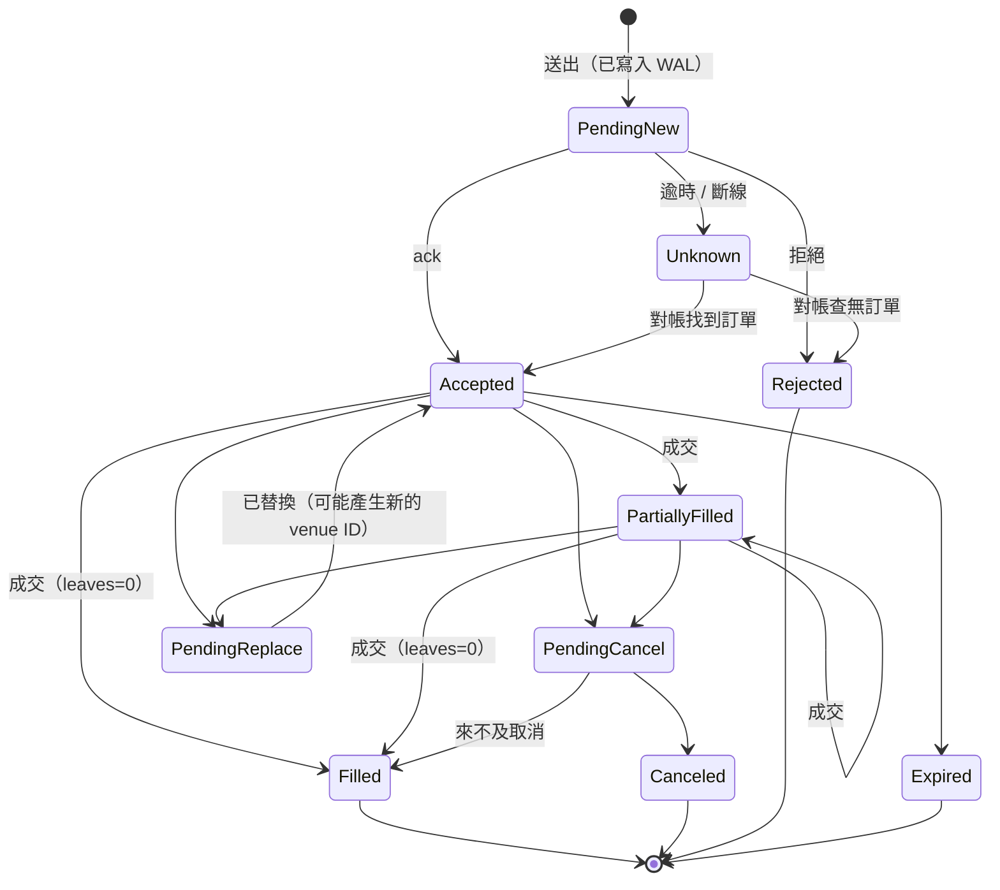

[English](04-broker-exchange-connectivity.md) | **繁體中文**

# 04 — 券商與交易所連線（全球市場）

> 研究日期：2026-10-05。版本、限制與開戶資格變動很快。標示為「未查證」（unverified）的項目無法從 2025–2026 年的公開資料確認，在決定採用前必須先向供應商確認。

## 摘要（TL;DR）

- **對台灣使用者而言，Interactive Brokers（IBKR）是唯一經查證、能以單一帳戶透過 API 交易美國/全球股票、選擇權、期貨與債券的途徑**；在 IB 法人實體與居住國允許的情況下，也能交易加密貨幣。2025–26 年有兩項重要變化。第一，**TWS API 10.49 以上版本（2026-08-03 發布）採用 GPL 授權**；目前可下載的版本為 10.50（Stable，2026-09-09）與 10.51（Latest，2026-09-30）。第二，**IBKR 的台灣市場商品不開放給台灣居民**。因此台股與 TAIFEX 需要透過本地券商 API：Shioaji（永豐金）或 Fubon Neo（富邦）。詳見 [11](11-taiwan-market-localization.zh-TW.md)。
- **加密貨幣方面，以 CCXT 取得廣度，以原生 adapter 取得深度。** CCXT v4.5.85（2026-10-01，MIT）免費內含其 WebSocket 層（「CCXT Pro」）。只針對真正有成交量的 2–4 個交易場所撰寫原生 adapter。加密貨幣選擇權集中在 Deribit，而 Deribit 現已歸 Coinbase 所有。自 2026-10-01 起，Coinbase Advanced Trade 的「Global Derivatives」改在由 Deribit 驅動的閘道（gateway）上運作，但目前只交易永續合約：選擇權與定期期貨「尚未透過該閘道提供」（"not yet available through the gateway"），因此加密貨幣選擇權請直接在 Deribit 交易。Hyperliquid 等鏈上交易場所以錢包簽章與 nonce 規則驗證身分，而非 API 金鑰。
- **債券在結構上截然不同。** 債券以 OTC、RFQ 方式交易，使用 CUSIP/ISIN 識別碼，面額以 $1,000 為單位遞增。散戶 API 存取基本上只有 IBKR；若要打造散戶產品，則可用 Alpaca Broker API（透過 Moment）。機構存取則是透過 FIX/RFQ 連接 Tradeweb、MarketAxess 或 Bloomberg。
- **大多數實盤交易的 bug 都出在連線層。** 採用 ports-and-adapters 架構，並具備：
  - 標準（canonical）訂單模型與持久化的訂單狀態機；
  - 自行產生的客戶端訂單 ID，並依各交易場所的限制進行編碼；
  - 冪等（idempotent）的成交處理；
  - 重新連線時對帳（reconcile-on-reconnect）。

  各交易場所實作「修改」（modify）的方式有三種，且彼此互不相容：原地改單（in-place amend）、取消/替換鏈（cancel/replace chain），以及取消 + 新單（cancel + new）。
- **建議。**
  - **MVP：** IBKR（ib_async）+ CCXT + 視需要加入 Shioaji，全部置於你自己的 adapter 介面之後（若採用 NautilusTrader 的引擎，也可直接使用其 adapter）。不使用 FIX。
  - **機構級：** 每個交易場所帳戶一個閘道行程（gateway process），主要交易場所使用原生 adapter，並以 FIX（QuickFIX/J 3.0.x，或 OnixS/Chronicle）連接主經紀商（prime broker）、機構級加密貨幣與債券。

## 關鍵問題

1. 依各資產類別而言，台灣居民實際上能開立並自動化哪些 API？
2. 涵蓋股票、選擇權、加密貨幣與債券的最少帳戶組合為何？
3. 我們應該自行打造 adapter，還是重用 CCXT、NautilusTrader、LEAN 或 Hummingbot？
4. 什麼情況下 FIX 值得其成本？
5. 哪一種標準訂單模型能承受各交易場所在 ID、改單語意、部分成交與重新連線上的差異？
6. 若平台日後提供給其他使用者，會適用哪些授權與法規限制？

## 方案比較

### 1. 券商 API（股票、選擇權、期貨、債券）

| 券商 / API | 股票 | 選擇權 | 期貨 | 債券 | 加密貨幣 | 介面與限制 | 模擬 / 沙盒 | 台灣居民適用性 |
|---|---|---|---|---|---|---|---|---|
| **IBKR TWS API / IB Gateway** | 全球（170 個以上市場） | 有，含組合單（combos） | 有 | 透過 SmartRouting 交易美國公債、公司債與市政債。透過 API 取得的債券市場資料僅限 minTick、交易所與簡稱。 | 透過 Paxos/zerohash 交易現貨；可用性取決於 IB 法人實體與居住地 | TCP socket，提供官方 Java/C++/C#/Python 用戶端。自 10.49（2026-08-03）起採 GPL；目前 Stable 為 10.50（2026-09-09），Latest 為 10.51（2026-09-30）。需要 IBKR Pro 帳戶。速率限制（pacing）= 市場資料線路數 ÷ 2 次請求/秒。 | 模擬帳戶 | ✅ 接受台灣居民開戶，但 TPEx（櫃買中心）存取明確排除台灣與中國大陸居民。預期 TWSE（證交所）亦同（待查證）。 |
| **IBKR Web API** | 相同後端 | 有 | 有 | 有 | 有 | REST + WebSocket。個人（已入金的 IBKR Pro 帳戶）透過 Client Portal Gateway（Java）連線。OAuth 2.0（beta）列為提供給機構組織使用；第三方廠商目前只能在通過合規審查後取得 OAuth 1.0a。每個 session 10 次請求/秒；違規 IP 會被放入 10 分鐘的「懲罰區」（penalty box），屢次違規者可能遭封鎖。券商交易端點（/iserver）每晚約在當地區域時間 01:00 重置。 | 模擬帳戶登入 | ✅ 同上 |
| **Alpaca** | 美國 | Level 1–3（價差單） | – | 僅 Broker API：透過 Moment 交易美國國庫券（T-bills）與投資等級公司債 | 現貨（特定司法管轄區） | REST/WS，200 次請求/分鐘；提供 FIX 4.2 | **全球任何人皆可開立僅限模擬交易的帳戶** | ⚠ 模擬交易可以。個人實盤資格：「聯繫客服」（未查證）。 |
| **Charles Schwab Trader API** | 美國 | 有 | – | – | – | REST + OAuth。Refresh token 有效期為 7 天，因此每週都需要透過瀏覽器重新登入。 | 無文件記載 | ⚠ 以美國為主（未查證） |
| **tastytrade Open API** | 美國 | 有（多腳位能力強） | 有，另含期貨選擇權 | – | 有 | REST + 串流，OAuth2 | Cert 沙盒：每 24 小時重置，市價單一律以 $1 成交，無市場資料 | ⚠ 有國際客戶方案；台灣未查證 |
| **TradeStation API v3** | 美國 | 有 | 有 | – | – | REST + HTTP 串流 | SIM | ⚠ 未查證 |
| **Tradier** | 美國 | 有 | – | – | – | REST + HTTP/WS 串流 | 沙盒（延遲資料） | ⚠ 以美國為主 |
| **Saxo OpenAPI** | 全球 | 有（多腳位） | 有 | 有 | ETP/CFD | REST + 串流。OAuth2（code、PKCE 或憑證）。另有獨立的 FIX API。 | SIM，另有 24 小時開發者 token | ⚠ 透過各區域法人實體提供服務；台灣未查證 |
| **Futu / moomoo OpenAPI** | 香港、美國、A 股、新加坡、日本、馬來西亞 | 有 | 有 | – | 依地區而定 | 本地 OpenD 閘道 + SDK（Python、Java、C#、C++、JS） | 模擬交易 | ❌ 各區域券商中沒有台灣法人實體 |
| **Webull OpenAPI** | 美國 | 有 | 有 | – | 有 | HTTP + MQTT + gRPC；第三方使用 OAuth 2.0 | 無文件記載 | ⚠ 以美國為主 |
| **Shioaji (Sinopac 永豐金)** / **Fubon Neo (富邦)** | TWSE/TPEx，含零股 | TAIFEX | TAIFEX | – | – | Shioaji 1.7.7：Python、HTTP 與 CLI。Fubon Neo：Python、C#、Node.js；C++ 與 Go 僅支援證券。 | Shioaji 有模擬模式。富邦的測試環境僅涵蓋證券。 | ✅ 本地券商 |

未深入評估：老虎證券（Tiger Brokers）的 TigerOpen API（Python SDK `tigeropen` 3.8.0，2026-09-17；台灣居民資格未查證），以及 Public 的 API（LEAN 支援的美國券商）。其他台灣券商 API 請見 [11](11-taiwan-market-localization.zh-TW.md)。

**已查證的費用：**

- **IBKR Pro（Fixed 固定費率）：** 美股每股 USD 0.005（最低 USD 1.00，最高為交易金額的 1%）。加密貨幣 0.12–0.18%（最低 USD 1.75）。
- **IBKR Pro 美國選擇權：** 採單一依交易量與權利金分級的費率表（沒有另外的「Fixed」選擇權費率）。每月 10,000 口以內，權利金 ≥ USD 0.10 者每口 USD 0.65，權利金介於 USD 0.05 至未滿 0.10 者為 USD 0.50，低於 USD 0.05 者為 USD 0.25。每筆訂單最低 USD 1.00。IBKR Lite 則一律每口 USD 0.65。
- **IBKR Lite：** 僅限美國居民，且 TWS API 需要 IBKR Pro 帳戶。
- **Alpaca：** 美股免手續費。加密貨幣第 1 級為 0.15% maker / 0.25% taker。

### 2. 加密貨幣交易場所

| 交易場所 | 產品 | 驗證 / 簽章 | 速率限制模型 | 測試環境 | 2025–26 年備註 |
|---|---|---|---|---|---|
| **Binance** | 現貨、槓桿（margin）、USDⓈ-M / COIN-M 期貨、選擇權 | HMAC、RSA 或 **Ed25519（建議）**；timestamp + `recvWindow` ≤ 60 秒 | 現貨：**6,000 weight/分鐘、100 筆訂單/10 秒、200,000 筆訂單/日**。先回 HTTP 429，接著是 418 IP 封鎖（2 分鐘至 3 天）。 | 現貨與期貨測試網 | 在部分國家遭地理封鎖。舊的 `binance-connector` Python 函式庫已棄用，由模組化的 `binance-sdk-*` 套件取代（例如 `binance-sdk-spot` 13.0.0）。 |
| **Coinbase Advanced Trade** | 現貨；美國期貨（CFM）；**Global Derivatives**（目前僅永續合約：125 檔以上，含股票與商品永續合約；選擇權與定期期貨尚未上線至該閘道） | CDP 金鑰 → 以 **ES256（ECDSA）** 簽署的 JWT。Coinbase App API 不支援 Ed25519 金鑰。Global Derivatives 透過 `public/auth` 以 JWT 換取 Deribit token。 | 依端點而定 | 有限 | 2025-05-08 宣布收購 Deribit（7 億美元現金 + 22 億美元股票）。2026-10-01 INTX `/intx/*` 端點退役，國際衍生性商品移至由 Deribit 驅動的閘道，該閘道在 `drb.coinbase.com` 使用 JSON-RPC 2.0。遷移時尚未成交的 INTX 訂單已被取消。 |
| **OKX** | 現貨、槓桿、期貨、永續合約、選擇權 | 金鑰 + secret + passphrase，HMAC-SHA256 | 依商品而定；每個子帳戶每 2 秒 1,000 次下單請求 | Demo（`x-simulated-trading: 1`） | 每個子帳戶每個私有頻道 30 條 WS 連線；K 線：每次呼叫預設 100 根，最多 300 根 |
| **Bybit V5** | 現貨、正向/反向永續合約與期貨、選擇權，集中於一個統一帳戶 | HMAC / RSA | 依端點、依 UID | 測試網 + demo | 單一 `/v5/order/create` 端點，以 `category` 區分 |
| **Kraken** | 現貨、衍生性商品、代幣化股票（xStocks） | HMAC-SHA512 + nonce | 計數器制 | 期貨 demo；CLI 模擬交易 | 統一 FIX 涵蓋現貨 + 衍生性商品。收購 NinjaTrader（2025 年，15 億美元）；同意收購 Bitnomial（2026-04）。 |
| **Deribit** | BTC/ETH 與 USDC 結算的選擇權、期貨、永續合約 | 透過 WS/HTTP 的 JSON-RPC；FIX | 點數制（credit-based） | `test.deribit.com` | 歸 Coinbase 所有；加密貨幣選擇權委託簿最深 |
| **Hyperliquid（鏈上）** | 永續合約、現貨、HIP-3 builder 部署的永續合約（已上線市場包含股票永續合約，例如 `xyz:AAPL`） | 透過 API（「agent」）錢包進行 EIP-712 錢包簽章。Nonce 必須落在（T−2 天, T+1 天）區間內，且必須大於已使用的前 100 大 nonce 中的最小值。 | 每個 IP 1,200 weight/分鐘；每個地址每成交 1 USDC 可發 1 次請求（+10,000 緩衝）；每個 IP ≤10 條 WS 連線、≤1,000 個訂閱 | 測試網 | **切勿重複使用 agent 錢包地址**：錢包被修剪（pruned）後，已簽署的操作可能遭到重放。 |

### 3. 具備 adapter 的開源專案（查核於 2026-10-05）

本表僅涵蓋 adapter 的支援範圍。引擎層級的自建或採購（build-vs-buy）決策見 [10](10-open-source-platforms-build-vs-buy.zh-TW.md)。

| 專案 | 最新版本 | 授權 | Adapter 涵蓋範圍 | 適用性 |
|---|---|---|---|---|
| **CCXT** | v4.5.85（2026-10-01） | MIT | 100 個以上加密貨幣交易所與預測市場。REST + WebSocket（Pro 免費且內建）。JS/TS、Python、PHP、C#、Go、Java（README 中也提到 Rust）。 | 加密貨幣的廣度與標準化的商品代號。語意採最小公分母：改單、OCO 與保證金模式各家不同。 |
| **NautilusTrader** | 1.231.0（2026-08-02，預定為最後一個 1.x 版本）；2.0.0rc5（2026-09-15）是最新已發布的版本。RELEASES.md 已列出 2.0.0rc6（2026-10-04），但尚未上架 PyPI。 | LGPL-3.0 | IB、Binance、Bybit、OKX、Coinbase、Kraken、Deribit、Hyperliquid、dYdX、Lighter、Derive、AX、Polymarket、Betfair；資料來自 Databento 與 Tardis。BitMEX 已移除：該交易所已於 2026-09-23 關閉，rc6 移除了其 adapter。 | 針對 IB + 加密貨幣的最佳「引擎 + adapter」套件，內建對帳功能。v2 的切換是一項風險（見 [02](02-backtesting-engine.zh-TW.md)）。 |
| **LEAN** | 持續更新（最後一次 commit 為 2026-10-02） | Apache-2.0 | IB、TradeStation、tastytrade、Schwab、Webull、Alpaca、Public、Tradier、Clear Street、Binance、Bybit、Kraken、Coinbase、Bitfinex、dYdX、Trading Technologies、Bloomberg EMSX/FIX、SS&C Eze | 美國券商涵蓋範圍最廣；C# |
| **Hummingbot** | v2.17.0（2026-09-22） | Apache-2.0 | 50 個以上 CEX/DEX 連接器；透過 Gateway 支援 AMM | 以造市與套利為核心的加密貨幣機器人。V2 executor 也涵蓋方向性、網格、DCA 與 TWAP。 |
| **Freqtrade** | 2026.9（2026-09-29） | GPL-3.0 | 透過 CCXT 支援加密貨幣；期貨支援 Binance、Bitget、Bybit、Gate、Hyperliquid、Kraken Futures 與 OKX（BingX 僅支援現貨） | 僅限加密貨幣的機器人 |
| **ib_async** | 2.1.0（2025-12-08） | BSD-2 | IBKR TWS / Gateway | 最佳的 Python IBKR 用戶端（ib_insync 的後繼者） |

值得鎖定版本的交易場所 SDK：

- alpaca-py 0.44.0
- tastytrade 13.2.3（非官方）
- schwab-py 1.5.x（非官方）
- futu-api / moomoo-api 10.11.7108
- webull-openapi-python-sdk 3.0.2
- hyperliquid-python-sdk 0.24.0
- shioaji 1.7.7（2026-09-29）

### 4. FIX 引擎與何時需要 FIX

| 引擎 | 語言 | 最新版本 | 授權 | 用途 |
|---|---|---|---|---|
| **QuickFIX/J** | Java | 3.0.2（2026-08-04）；2.3.3 維護版（2026-07-21） | QuickFIX（BSD 風格） | 預設的開源選擇。支援 FIX 4.0–5.0SP2、FIXT 1.1 與 FIX Latest。 |
| **QuickFIX/n** | .NET | 1.14.1（2026-06） | QuickFIX | .NET 團隊 |
| **QuickFIX (C++)** | C++，附 Python 綁定 | 1.16.0（2026-05-09） | QuickFIX | C++/Python；發布節奏緩慢 |
| **OnixS** | C++、.NET（8–10）、Java | 商業版 | 商業授權 | 超低延遲、SBE/交易所原生協定、廠商支援 |
| **Chronicle FIX** | Java | 商業版 | 商業授權 | 微秒級延遲、FIX 4.0–5.0SP2、容錯移轉（failover） |

在下列情況使用 FIX 是合理的：

- 主經紀商與 EMS/OMS 樞紐（Bloomberg EMSX、SS&C Eze）；
- 機構級加密貨幣（Coinbase Prime、Kraken 統一 FIX 4.4、Deribit FIX）。Coinbase 已於 2026-10-01 將 INTX 衍生性商品移至以 Deribit 為後盾的平台，因此在據以開發之前，請先確認 Coinbase 目前的衍生性商品 FIX 端點；
- 用於機構流量的 IBKR FIX/CTCI；
- 債券 RFQ 平台；
- 供合規使用的 drop-copy 資料流。

散戶 MVP 不需要 FIX：上述所有券商與交易場所也都提供 REST/WebSocket。

### 5. 債券存取層級

| 層級 | 交易場所 | API | 限制 |
|---|---|---|---|
| 散戶自主交易 | IBKR | TWS / Web API | 需要固定收益（Fixed Income）交易權限與美國債券資料訂閱（市政債需 Moody's）。API 的債券資料受限。 |
| 散戶平台（B2B2C） | Alpaca Broker API + Moment | REST | 國庫券與公司債。FAQ 提到高收益債，但目前提供的債券清單僅限投資等級、不可贖回（non-callable）且非 144A 的債券。僅支援限價單與市價單；市價單實為帶 2.5% 價格區間（collar）的可成交限價單。以 $1,000 為單位。僅提供給合作夥伴。 |
| 機構 | Tradeweb（含針對市政債、公司債與定存單（CD）的散戶顧問市場）、MarketAxess、Bloomberg | FIX / RFQ / 專有協定 | 需要交易商（dealer）關係與機構開戶程序 |
| 台灣 | 銀行/券商交易台；以複委託交易海外債券 | 未發現散戶債券交易 API | 視為人工處理 |

### 6. 四種資產類別在連線上的差異

| 面向 | 股票 | 選擇權 | 加密貨幣 | 債券 |
|---|---|---|---|---|
| 中介機構 | 受監管的券商 | 券商，並受交易權限等級管控 | 在各交易場所直接開戶，或使用自行託管的錢包（DEX） | 券商或交易商/RFQ 平台 |
| 市場結構 | 交易所 + ATS；一般、延長與夜間時段 | 集中市場掛牌；龐大的選擇權鏈；到期日 | 各交易場所 24/7 委託簿；含資金費率的永續合約 | OTC，報價驅動 |
| 識別碼 | Ticker + MIC、IB conId、FIGI | OCC 代號 / conId（標的、到期日、履約價、買權/賣權） | 交易場所原生代號（`BTCUSDT` / `BTC-USD` / `BTC-PERP`） | CUSIP / ISIN |
| 訂單語意 | 標準委託類型與 TIF | 多腳位組合單（原生支援程度不一）；履約與被指派 | Post-only、reduce-only、IOC；通常支援改單 | 以面額計量的限價/RFQ；應計利息 |
| 主要痛點 | 公司行動（corporate actions）、交易時段行事曆 | 商品探索、組合單、到期時部位在沒有任何訂單的情況下變動 | 速率限制、金鑰安全、API 頻繁變動、地理封鎖、鏈上簽章 | 資料稀少、授權、API 稀少 |
| 模擬交易擬真度 | 良好 | 尚可 | 測試網的委託簿不擬真 | 差或無 |

### 7. 抽象層必須吸收的訂單生命週期語意

| 交易場所 | 客戶端 ID 欄位 | 修改語意 | 重複防護 / 查詢 |
|---|---|---|---|
| IBKR TWS | `orderId` 整數，在每個 clientId 下必須遞增（`nextValidId`）；`orderRef` 為自由文字；`permId` 為全域唯一 | **原地修改：** 以相同的 `orderId` 重新送出 `placeOrder` | 重複的 ID 會被拒絕。透過 openOrder/execDetails 回呼復原；無法以 `orderRef` 查詢。 |
| FIX | `ClOrdID`(11)，透過 `OrigClOrdID`(41) 串連 | 以新的 ClOrdID 進行**取消/替換（35=G）鏈** | ClOrdID 在每個 session 內唯一；OrderStatusRequest（35=H） |
| Alpaca | `client_order_id` ≤128 字元 | **替換會產生新的訂單 ID**；舊訂單變為 `replaced` | 以 client_order_id 進行 GET |
| Binance 現貨 | `newClientOrderId` ≤36 字元 | **沒有一般性的改單。** 使用 cancelReplace，或 amend-keep-priority（僅能減少數量）。期貨支援 modify。 | 以 `origClientOrderId` 查詢 |
| OKX / Bybit | `clOrdId` ≤32 / `orderLinkId` ≤36 | 價格/數量的**原地改單** | 以客戶端 ID 查詢 |
| Hyperliquid | `cloid`（128 位元 hex） | modify / batchModify | Nonce 的唯一性同時兼作重放防護 |

## 建議

### (a) 個人或 1–3 人的 MVP

1. **只使用一家傳統金融（TradFi）券商：IBKR。** 以 ib_async 搭配無頭（headless）模式執行 IB Gateway，從模擬帳戶開始。將每日重啟與定期的 2FA 重新登入自動化（例如使用 IBC），並將 IBKR 用戶端放在伺服器端的閘道行程中。
2. **透過 CCXT 交易加密貨幣**（REST + WebSocket），使用 1–2 個你在法律上可以使用的交易場所。以測試網或 demo 模式進行開發。使用僅限交易的 API 金鑰，搭配 IP 白名單，且**不授予提領權限**。
3. **透過 Shioaji 交易台股與 TAIFEX**（先用模擬模式），作為唯一的第三個 adapter。若台灣市場不在範圍內，則略過此項。
4. **在自建與採用引擎之間做出選擇。** 可以自行撰寫一層精簡的 adapter 介面（約三個 adapter），或採用 NautilusTrader，它涵蓋 IB、Binance、OKX、Bybit、Coinbase、Deribit 與 Hyperliquid，並內建對帳功能。若採用，請在 v2 RC 期間鎖定確切版本。若需要美國券商的廣度或偏好 C#，則改選 LEAN。
5. **債券：** 透過 IBKR 以人工或低頻訂單交易。MVP 不做演算法債券交易。
6. **不使用 FIX**，也不接入機構級交易場所。
7. **美國人（US person）的變化版本：** 加入 Alpaca（最簡單的 REST API、全球免費的模擬帳戶）或 tastytrade（多腳位選擇權）作為第二家券商。

### (b) 5–20 人團隊或機構級

1. **讓連線成為獨立的一層。** 每個交易場所帳戶執行一個閘道行程，並透過訊息匯流排發布標準化的訂單、成交與部位事件（[07](07-system-architecture-messaging.zh-TW.md)）。訂單狀態由 OMS 擁有；閘道除了 session 狀態之外保持無狀態。
2. **為主要交易場所撰寫原生 adapter**：IBKR、Binance/OKX/Bybit、Coinbase/Deribit 與 Hyperliquid。保留 CCXT 處理長尾交易場所與參考資料。
3. **FIX：** 預設使用 QuickFIX/J 3.0.x。需要延遲 SLA 或廠商支援時，購買 OnixS 或 Chronicle FIX。FIX 用於主經紀商、機構級加密貨幣、EMS 連結與 drop copy。
4. **債券：** 機構流量透過 FIX/RFQ 連接 Tradeweb、MarketAxess 或 Bloomberg。只有在打造散戶產品時才使用 Alpaca Broker API（Moment）。
5. **若要服務其他使用者，** 請審慎地在第三方 OAuth 與 Broker-API 模式（Alpaca）之間做出選擇。第三方 OAuth 選項有 IBKR、tastytrade OAuth2、Webull OAuth 2.0（Connect API）與 Alpaca OAuth2（Connect API）。就 IBKR 而言，第三方廠商目前只能取得 **OAuth 1.0a**，且需經過 2–3 週的篩選與 3–6 週的合規審查；OAuth 2.0（beta）則提供給機構組織。IBKR 也要求自動化交易產品的廠商在其服務的每個地區持有相關登記。請就以下事項進行法律審查：
   - 台灣（金管會 FSC）及各目標市場的券商/投顧執照；
   - 加密貨幣的 VASP 登記；
   - 對於對外散布的桌面/行動用戶端，TWS API GPL（10.49+）所帶來的義務；
   - 市場資料轉散布：未經書面核准，IBKR 禁止透過 TWS API 轉散布市場資料。
6. **建立交易場所認證測試框架（venue-certification harness）：** 交易場所訊息的錄製/重播、故障注入（成交途中斷線、重複 ack、亂序事件），以及每晚針對模擬/測試網的執行。

## 對整體架構的影響

- **Port。** 定義 `InstrumentPort`（商品探索與代號體系）、`MarketDataPort`、`ExecutionPort`（送出、修改、取消、查詢、大量狀態查詢 mass-status）與 `AccountPort`（餘額、部位、保證金）。每個 adapter 宣告能力旗標：`amend_mode ∈ {in_place, cancel_replace, emulate}`、`native_oco`、`multi_leg`、`reduce_only`、`post_only`、`max_client_id_len` 與 `id_format`。策略層與風控層依據這些旗標進行分支，絕不依據交易場所名稱。
- **標準 ID。** 產生內部的 ULID/UUIDv7，再依各交易場所進行編碼：IBKR 用整數序列、OKX 用 ≤32 個英數字元、Hyperliquid 用 128 位元 hex。**在送出前先持久化對應關係**（預寫，write-ahead），如此在送出與 ack 之間發生當機時仍可復原。
- **訂單狀態機。** 由 OMS 負責持久化，並以交易場所為事實來源（source of truth）：

- **冪等性。** 逾時後，在任何重試之前先以客戶端 ID 查詢；絕不盲目重送。以 `(venue, exec/trade id)` 對成交去重。由成交推導部位，而非由狀態訊息推導。數量與價格以定點小數表示（IBKR 在 10.44+ 將數量改為 Decimal）；見 [01](01-core-language-runtime.zh-TW.md)。
- **重新連線與對帳。** 在啟動時、每次重新連線後以及定期進行對帳。每一輪：
  1. 擷取未成交訂單、自某個水位線（watermark）以來的成交、部位與餘額的快照。
  2. 與 OMS 比對差異。
  3. 發出合成事件以補齊差距。
  4. 標記「外部」訂單。
  5. **出現無法解釋的部位不一致時，停止策略。**

  選擇權履約/被指派與到期也必須對帳，因為它們會在沒有任何訂單的情況下改變部位。
- **各交易場所的速率調節器。** 使用能感知權重（weight-aware）的 token bucket，讓取消單與降低風險的訂單始終保有餘裕。
- **Session 與時鐘管理。**
  - 排程時需避開 IB Gateway 的每日重啟、IBKR Web API 的每晚重置、Schwab 的 7 天 token，以及加密貨幣 WebSocket 的週期性斷線。
  - 主機須以 NTP/chrony 保持時間同步，因為 `recvWindow` 檢查與 Hyperliquid nonce 都依賴於此。
- **機密。** 將金鑰存放在 vault 中，並依交易場所與帳戶劃分範圍。使用無提領權限的金鑰，並輪替 Hyperliquid agent 錢包。
- **授權邊界。** 將 IBKR 官方用戶端函式庫（自 10.49 起為 GPL）放在一個你不對外散布的獨立閘道行程中，或改用獨立的協定實作或 Web API。獨立實作包括 ib_async（BSD-2，不依賴 IBKR 的 `ibapi`）以及 NautilusTrader v2 的 IB adapter 所使用的 Rust `ibapi` crate（MIT）。NautilusTrader 1.231.0 則鎖定 `nautilus-ibapi` 10.45.1，這是在 IB 非商業/商業 API 授權下重新封裝、GPL 化之前的官方用戶端。在發布桌面或行動版本之前，請由法律顧問確認。

## 風險與陷阱

- **資格變動。** 產品存取取決於 IB 法人實體、帳戶類型與居住國：IBKR 的台灣市場商品排除台灣居民，IBKR Lite 僅限美國。加密貨幣的可用性因司法管轄區而異，地理封鎖可能導致帳戶凍結。請針對每個使用者的司法管轄區重新查證每個交易場所。
- **API 頻繁變動。**
  - IBKR：tick 資料的數量（size）改為 Decimal（10.44+）、引入 protobuf 訊息格式，授權改為 GPL（10.49）。
  - Binance 棄用了其舊的 Python connector。
  - Coinbase 改用 CDP/JWT 金鑰，並於 2026-10-01 退役 INTX 衍生性商品端點，改用 JSON-RPC Deribit 閘道。
  - NautilusTrader 的 v2 重新命名了 enum 與 API。
  - 交易場所可能消失：BitMEX 在經歷一個月的僅限減倉（reduce-only）交易後，於 2026-09-23 關閉。

  請鎖定版本，並在 CI 中針對模擬/測試網執行合約測試（contract test）。
- **模擬 ≠ 實盤。** tastytrade 的沙盒以 $1 成交市價單。Alpaca 的模擬交易忽略市場衝擊、排隊順位與監管規費。加密貨幣測試網的委託簿稀薄且不擬真。
- **速率限制封鎖。** Binance 的 418 IP 封鎖會逐步升級，最長達 3 天。IBKR Web API 會將違規者放入 10 分鐘的懲罰區。Hyperliquid 會將成交量低的地址節流至每 10 秒 1 次請求。
- **改單競態（race）。**
  - 成交可能在取消/替換進行期間到達。
  - 「來不及取消」（too late to cancel）的回應會在成交之後才到達。
  - 模擬的取消 + 新單會失去排隊優先權，且若取消無聲無息地失敗，可能造成重複成交。
- **多腳位選擇權。** IBKR、Alpaca、tastytrade 與 Saxo 的原生組合單支援各不相同。凡是必須模擬組合單之處，就會出現逐腳成交風險（legging risk）。
- 中心化加密貨幣交易場所的**交易對手與託管風險**。保持最低餘額、停用提領，並隔離子帳戶。
- **非官方 SDK**（schwab-py、tastytrade）依賴極少數的維護者。請將其包在你自己的 port 之後，以便日後替換。
- 一旦開始替他人執行交易，**法規曝險**就會急遽升高。台灣金管會（FSC）關於投資顧問/全權委託服務與 VASP 登記的規定適用，各券商所在司法管轄區的規則亦然。在任何多使用者設計正式上線之前，請先取得法律意見（見 [08](08-risk-security-ops-compliance.zh-TW.md)）。

## 參考資料

- IBKR TWS API 變更紀錄（10.49 GPL、10.44 Decimal、pacing）： https://www.interactivebrokers.com/campus/ibkr-api-page/tws-api-changelog-2/
- IBKR TWS API 下載（10.50 Stable / 10.51 Latest）： https://interactivebrokers.github.io/
- IBKR Web API 文件（OAuth 2.0 beta、第三方 OAuth 1.0a、10 次請求/秒、重置）： https://www.interactivebrokers.com/campus/ibkr-api-page/webapi-doc/
- IBKR TWS API 合約明細（債券欄位）： https://www.interactivebrokers.com/docs/tws-api/doc/contracts-financial-instruments/contract-details/introduction
- IBKR TPEx 存取，2025-11-18（排除台灣居民）： https://www.interactivebrokers.com/en/general/about/mediaRelations/11-20-25.php
- IBKR 加密貨幣擴展，2026-07-14： https://www.interactivebrokers.com/en/general/about/mediaRelations/7-15-26.php
- IBKR 股票手續費： https://www.interactivebrokers.com/en/pricing/commissions-stocks.php
- IBKR 選擇權手續費： https://www.interactivebrokers.com/en/pricing/commissions-options.php
- ib_async： https://pypi.org/project/ib_async/
- Alpaca 模擬交易： https://docs.alpaca.markets/us/docs/paper-trading.md
- Alpaca 選擇權交易等級： https://docs.alpaca.markets/docs/options-trading
- Alpaca 固定收益： https://docs.alpaca.markets/us/docs/fixed-income.md
- Alpaca 加密貨幣手續費： https://docs.alpaca.markets/us/docs/crypto-fees.md
- Alpaca 速率限制： https://alpaca.markets/support/usage-limit-api-calls
- schwab-py 驗證（token 有效期）： https://schwab-py.readthedocs.io/en/latest/auth.html
- tastytrade Open API： https://developer.tastytrade.com/
- tastytrade 沙盒： https://developer.tastytrade.com/docs/sandbox
- TradeStation API： https://api.tradestation.com/docs/
- Tradier API： https://docs.tradier.com/
- Saxo OpenAPI： https://www.developer.saxo/openapi/learn
- Futu OpenAPI： https://openapi.futunn.com/futu-api-doc/en/intro/intro.html
- Webull OpenAPI： https://developer.webull.com/api-doc/
- Shioaji 文件： https://sinotrade.github.io/
- Shioaji 的 PyPI 頁面： https://pypi.org/project/shioaji/
- Fubon Neo API： https://www.fbs.com.tw/TradeAPI/en/docs/welcome/
- TAIFEX 外資參與： https://www.taifex.com.tw/enl/eng12/qa
- CCXT 儲存庫： https://github.com/ccxt/ccxt
- CCXT 發布版本： https://github.com/ccxt/ccxt/releases
- CCXT Pro 手冊： https://github.com/ccxt/ccxt/blob/master/wiki/ccxt.pro.manual.md
- Binance 現貨 API 限制： https://developers.binance.com/docs/binance-spot-api-docs/rest-api/limits
- Binance 即時 exchangeInfo： https://api.binance.com/api/v3/exchangeInfo
- Binance 端點安全性（recvWindow、金鑰類型）： https://developers.binance.com/docs/binance-spot-api-docs/rest-api/endpoint-security-type
- Coinbase Advanced Trade REST API： https://docs.cdp.coinbase.com/coinbase-app/advanced-trade-apis/rest-api
- Coinbase Global Derivatives 概覽（INTX → Deribit 閘道，2026-10-01）： https://docs.cdp.coinbase.com/coinbase-app/advanced-trade-apis/guides/derivatives/overview
- Coinbase App API 金鑰驗證（僅限 ES256）： https://docs.cdp.coinbase.com/coinbase-app/authentication-authorization/api-key-authentication
- Coinbase（Deribit 收購案）： https://en.wikipedia.org/wiki/Coinbase
- BitMEX 關閉公告： https://www.bitmex.com/blog/bitmex-closure
- OKX API v5： https://www.okx.com/docs-v5/en/
- Bybit V5 API： https://bybit-exchange.github.io/docs/v5/intro
- Kraken API： https://docs.kraken.com/api/
- Kraken（NinjaTrader、Bitnomial）： https://en.wikipedia.org/wiki/Kraken_(cryptocurrency_exchange)
- Deribit API： https://docs.deribit.com/
- Hyperliquid 速率限制： https://hyperliquid.gitbook.io/hyperliquid-docs/for-developers/api/rate-limits-and-user-limits
- Hyperliquid nonce 與 API 錢包： https://hyperliquid.gitbook.io/hyperliquid-docs/for-developers/api/nonces-and-api-wallets
- Hyperliquid HIP-3： https://hyperliquid.gitbook.io/hyperliquid-docs/hyperliquid-improvement-proposals-hips/hip-3-builder-deployed-perpetuals
- NautilusTrader 發布版本： https://github.com/nautechsystems/nautilus_trader/releases
- NautilusTrader 整合： https://nautilustrader.io/docs/latest/integrations/
- NautilusTrader RELEASES.md（2.0.0rc6、移除 BitMEX）： https://github.com/nautechsystems/nautilus_trader/blob/develop/RELEASES.md
- ib_async 儲存庫： https://github.com/ib-api-reloaded/ib_async
- Rust ibapi crate： https://crates.io/crates/ibapi
- Tiger OpenAPI Python SDK： https://github.com/tigerfintech/openapi-python-sdk
- QuantConnect 券商： https://www.quantconnect.com/docs/v2/cloud-platform/live-trading/brokerages
- LEAN 儲存庫： https://github.com/QuantConnect/Lean
- Hummingbot 交易所： https://hummingbot.org/exchanges/
- Hummingbot 發布版本： https://github.com/hummingbot/hummingbot/releases
- Freqtrade 交易所： https://www.freqtrade.io/en/stable/exchanges/
- Freqtrade 發布版本： https://github.com/freqtrade/freqtrade/releases
- Freqtrade README（支援的期貨交易所）： https://github.com/freqtrade/freqtrade
- Hummingbot README（策略與 executor）： https://github.com/hummingbot/hummingbot
- QuickFIX/J 發布版本： https://github.com/quickfix-j/quickfixj/releases
- QuickFIX/J 網站： https://www.quickfixj.org/
- QuickFIX/n： https://github.com/connamara/quickfixn
- QuickFIX (C++) 發布版本： https://github.com/quickfix/quickfix/releases
- OnixS FIX 引擎： https://www.onixs.biz/fix-engine.html
- Chronicle FIX： https://chronicle.software/fix-engine/
- Tradeweb 散戶市場： https://www.tradeweb.com/our-markets/tradeweb-retail-market/
- MarketAxess： https://www.marketaxess.com/

## 查核紀錄（2026-10）

2026-10-05 針對官方文件、GitHub/PyPI/NuGet/crates.io 的發布中繼資料、交易場所的即時 API 與新聞稿，進行了一次對抗式事實查核。共查核 58 項：40 項確認、11 項更正、7 項無法查證。

### 已確認

- **TWS API 變更紀錄。**
  - 10.49 於 2026-08-03 發布，10.49+ 採用 GNU GPL。
  - 在 API 10.44+ 中，Last_Size 與 Delayed_Last_Size 以 Decimal 回傳（2026-02-23 推出）。
  - Pacing 為市場資料線路數 ÷ 2 次請求/秒，且 TWS API 需要 IBKR Pro。
- **IBKR Web API。**
  - 每個已驗證 session 的全域限制為 10 次請求/秒，包含 CP Gateway。違規 IP 會被放入 10 分鐘的懲罰區。
  - OAuth 2.0 標示為 beta。
  - `/iserver` 維護依地區於美東時間（US/Eastern）、CEST 或 HKT 01:00 開始。
- **IBKR TPEx 存取**（2025-11-18 新聞稿）不開放給中國大陸與台灣居民。
- **IBKR 加密貨幣（2026-07-14）。**
  - 透過 zerohash 新增九種代幣，透過 Paxos 新增三種。
  - 支援 USDC、PYUSD 與 RLUSD 提領。
  - 手續費 0.12–0.18%，最低 USD 1.75。可用性因關係企業與居住地而異。
  - 「超過 170 個市場」（"Over 170 markets"）。
- **IBKR TWS 債券合約明細**僅回傳 minTick、交易所與簡稱。
- **IBKR 定價。**
  - Pro Fixed 的美股費用為每股 USD 0.005（最低 USD 1.00，最高 1%）。
  - IBKR Lite 僅限美國居民。
- **CCXT。** v4.5.85（2026-10-01）、MIT、100 個以上交易所與預測市場。Pro 手冊寫道「CCXT Pro 是 CCXT 的免費部分」（"CCXT Pro is a free part of CCXT"）。
- **NautilusTrader。**
  - 1.231.0（2026-08-02）「預定為最後一個 1.x 版本」（"intended to be the final 1.x"）。
  - 2.0.0rc5（2026-09-15）已上架 PyPI。
  - LGPL-3.0；IB、Binance、Bybit、OKX、Coinbase、Kraken、Deribit、Hyperliquid 與 dYdX 均標示為「stable」。
- **Binance。**
  - 即時 `exchangeInfo` 顯示 6,000 weight/分鐘、100 筆訂單/10 秒、200,000 筆訂單/日，以及每 5 分鐘 300,000 次原始請求。
  - IP 封鎖時間從 2 分鐘到 3 天不等，Ed25519 金鑰為「強烈建議」（"highly recommended"）。
  - recvWindow 上限為 60,000 毫秒。
  - `binance-connector` 已標示為棄用。
- **Hyperliquid。**
  - 每個 IP 1,200 weight/分鐘。
  - 每個地址：每成交 1 USDC 可發 1 次請求，另加 10,000 次請求的緩衝。被節流的地址每 10 秒 1 次請求。
  - 每個 IP 10 條 WS 連線與 1,000 個訂閱。
  - Nonce 視窗為（T−2 天, T+1 天），並與前 100 大 nonce 比對；agent 修剪後有重放警告。
  - `xyz:AAPL` 等 HIP-3 股票永續合約已在主網的 `perpDexs` 與 `meta` 端點上線。
- **Alpaca。**
  - 僅限模擬交易的帳戶開放給「全球任何人」（"anyone globally"）。
  - 固定收益透過 Moment 提供給 Broker API 合作夥伴，以 $1,000 為單位（最低 $1,000，最高 $1,000,000），市價單有 2.5% 的價格區間。
  - 加密貨幣第 1 級為 0.15% / 0.25%；選擇權最高至 Level 3 多腳位；提供 FIX 4.2。
  - 每個帳戶 200 次請求/分鐘：此數據來自 Alpaca 的客服支援文章，日期為 2022 年。2026 年的 Broker API 頁面表示，合作夥伴的限制依各 correspondent 個別設定且不公開。
- **QuickFIX。**
  - QuickFIX/J 3.0.2（2026-08-04）與 2.3.3（2026-07-21）支援 FIX 4.0–5.0SP2、FIXT 1.1 與 FIX Latest。
  - QuickFIX/n 1.14.1 於 2026-06-05 發布至 NuGet。
  - QuickFIX C++ 1.16.0 於 2026-05-09 發布。
- **其他券商。**
  - Schwab：refresh token 7 天，access token 30 分鐘。
  - tastytrade 沙盒：每 24 小時重置，市價單以 $1 成交，無市場資料。
  - Saxo：24 小時開發者 token；code、PKCE 與憑證驗證；FIX API。
  - Futu/moomoo：市場與語言如上所列；法人實體為香港、美國、新加坡、澳洲、馬來西亞、加拿大與日本，沒有台灣法人實體。
  - Webull：HTTP + MQTT + gRPC、OAuth 2.0 Connect API、美國市場。
  - Shioaji：Python、HTTP 與 CLI，模擬模式，1.7.7（2026-09-29）。
  - Fubon Neo：語言如上所列；其測試環境僅涵蓋證券。
- **加密貨幣交易場所。**
  - OKX：每個子帳戶每 2 秒 1,000 次下單請求；每個頻道 30 條 WS 連線；demo 標頭為 `x-simulated-trading: 1`。
  - Kraken：統一 FIX 4.4 涵蓋現貨 + 衍生性商品；kraken-cli 模擬交易；以 15 億美元收購 NinjaTrader（2025）；2026 年 4 月同意 Bitnomial 收購案。
  - Coinbase–Deribit 收購案於 2025-05-08 宣布（7 億美元現金 + 22 億美元股票）。
- **開源專案與 SDK 版本鎖定。**
  - LEAN：Apache-2.0，最後一次 commit 為 2026-10-02，券商清單如前所述。
  - Hummingbot：v2.17.0（2026-09-22）、Apache-2.0、「50 個以上交易所」（"50+ exchanges"）。
  - Freqtrade：2026.9（2026-09-29）、GPL-3.0。
  - ib_async：2.1.0（2025-12-08）、BSD-2-Clause。
  - SDK 版本鎖定：alpaca-py 0.44.0、tastytrade 13.2.3、schwab-py 1.5.1、futu-api/moomoo-api 10.11.7108、webull-openapi-python-sdk 3.0.2、hyperliquid-python-sdk 0.24.0。
- **商業 FIX 引擎。** OnixS 支援 .NET 8/9/10+（及 .NET Framework 4.8）。Chronicle FIX 涵蓋 FIX 4.0–5.0SP2，並支援容錯移轉。

### 已更正（原文 → 更正，來源）

1. **IBKR TWS API 版本。** 「最新版為 10.49」→ 自 10.49 起採 GPL，但目前可下載的版本為 10.50 Stable（2026-09-09）與 10.51 Latest（2026-09-30）。來源： https://interactivebrokers.github.io/
2. **第三方使用的 IBKR OAuth。** 「第三方 OAuth（IBKR OAuth 2.0 beta）」→ 第三方廠商「目前僅能申請核准使用 OAuth1.0a」（"may currently only seek approval for the use of OAuth1.0a"），且須經合規審查；OAuth 2.0（beta）列為提供給機構組織。新增了登記要求的說明，以及 TWS API 禁止轉散布市場資料的規定。來源： https://www.interactivebrokers.com/campus/ibkr-api-page/webapi-doc/ 與 https://interactivebrokers.github.io/
3. **Coinbase Global Derivatives 產品。** 「選擇權、期貨與永續合約」→ 自 2026-10-01 起，由 Deribit 驅動的閘道交易永續合約（125 檔以上，含股票與商品永續合約）；「選擇權與定期期貨尚未透過該閘道提供」（"options and dated futures are not yet available through the gateway"）。INTX `/intx/*` 端點已退役。來源： https://docs.cdp.coinbase.com/coinbase-app/advanced-trade-apis/guides/derivatives/overview
4. **Coinbase 金鑰類型。** 「CDP 金鑰 → JWT（ES256 或 Ed25519）」→ 僅限 ES256/ECDSA：「請勿選擇 Ed25519，因為 Coinbase App API 不支援」（"Do NOT select Ed25519 as it is not supported by Coinbase App APIs"）。來源： https://docs.cdp.coinbase.com/coinbase-app/authentication-authorization/api-key-authentication
5. **IBKR 選擇權定價。** 「IBKR Pro（Fixed）：美國選擇權每月 10k 口以內每口 USD 0.65」→ IBKR Pro 美國選擇權採用單一依交易量與權利金分級的費率表。10k 口以內，權利金 ≥ USD 0.10 為 USD 0.65，0.05–0.10 為 USD 0.50，低於 0.05 為 USD 0.25，最低 USD 1.00。Lite 一律 USD 0.65。來源： https://www.interactivebrokers.com/en/pricing/commissions-options.php
6. **NautilusTrader BitMEX adapter。** BitMEX 曾被列為 NautilusTrader 的 adapter → BitMEX 已於 2026-09-23 關閉，NautilusTrader 2.0.0rc6（見 RELEASES.md，2026-10-04，尚未上架 PyPI）移除了該 adapter。來源： https://www.bitmex.com/blog/bitmex-closure 與 https://github.com/nautechsystems/nautilus_trader/blob/develop/RELEASES.md
7. **Freqtrade 期貨交易所。** 清單中包含 BingX → BingX 在 Freqtrade 中僅支援現貨；期貨交易所為 Binance、Bitget、Bybit、Gate、Hyperliquid、Kraken 與 OKX。來源： https://github.com/freqtrade/freqtrade
8. **Hummingbot 範圍。** 「僅限造市」→ 造市與套利是其核心，但 V2 executor 也涵蓋部位（方向性）、DCA、網格、TWAP、XEMM 與 LP。來源： https://github.com/hummingbot/hummingbot
9. **OKX K 線。** 「每次呼叫 100 根 K 線」→ 預設 100 根，每次呼叫最多 300 根（`/api/v5/market/candles`）。來源： https://www.okx.com/docs-v5/en/
10. **CCXT 語言。** 清單遺漏了 Java → JS/TS、Python、PHP、C#、Go 與 Java，README 標語中也提到 Rust。來源： https://github.com/ccxt/ccxt
11. **Alpaca 公司債與 Coinbase FIX。**
    - Alpaca 的「IG/HY 公司債」→ 目前提供的清單僅限投資等級（不可贖回、非 144A）。來源： https://docs.alpaca.markets/us/docs/fixed-income.md
    - FIX 清單中的「Coinbase Prime/INTX」→ INTX 衍生性商品已於 2026-10-01 移至以 Deribit 為後盾的平台；請確認目前的衍生性商品 FIX 端點。

新增項目：

- 遺漏選項說明：Tiger OpenAPI、Public，以及其他台灣券商 API（指向 [11](11-taiwan-market-localization.zh-TW.md)）。
- 授權邊界說明：ib_async 與 Rust `ibapi` crate 為獨立實作；NautilusTrader 1.231.0 鎖定 GPL 化之前的 `nautilus-ibapi` 10.45.1。

### 無法查證

- IBKR 是否提供 TWSE（上市主板）存取，以及台灣居民能否使用。未找到 IBKR 的 TWSE 產品頁面；僅有 TPEx 有文件記載。
- 台灣居民個人的 Alpaca 實盤帳戶資格。
- tastytrade、Saxo、TradeStation、Schwab 與老虎證券（Tiger Brokers）對台灣居民的開戶資格。
- TWS API 10.49+ 適用哪一個 GPL 版本（v2 或 v3）。變更紀錄僅寫「GNU General Public License (GPL)」。
- 2026-10-01 INTX 遷移後，Coinbase 的機構衍生性商品 FIX 端點。
- Kraken 對 Bitnomial 的收購是否已完成（原預計於 2026 年 6 月前完成）。
- Bybit `orderLinkId`（≤36）與 Alpaca `client_order_id`（≤128）的客戶端 ID 長度限制。這些未重新查核；OKX `clOrdId` ≤32 已確認。
