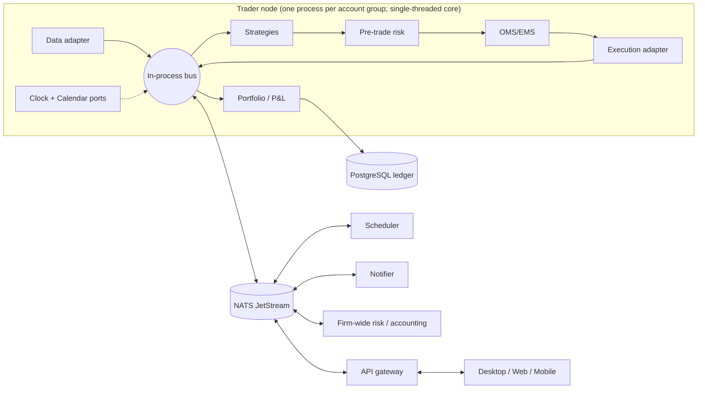

**English** | [繁體中文](07-system-architecture-messaging.zh-TW.md)

# 07 — System Architecture, Messaging & Component Design

> Research dimension 07. Research date: 2026-10-05. Scope: stocks, crypto, bonds and options across US/global markets, crypto venues, and Taiwan (TWSE/TPEx, TAIFEX). Versions, licenses and maintenance status are as of this date. Check them again before adopting anything.

## TL;DR

- **Build one deterministic, event-driven kernel and run it in backtest, paper and live modes by swapping adapters, not strategy code.** Use a hexagonal core, an in-process bus and single-threaded dispatch (LMAX / NautilusTrader style). The proven references are NautilusTrader (LGPL-3.0, Rust core; 1.231.0 stable, 2.0 in RC) and QuantConnect LEAN (Apache-2.0, C#).
- **Start as a modular monolith and split processes only at stable seams:** venue gateways, the API gateway/UI, research, and one "trader node" per broker account. Microservices on day one add distributed-systems failure modes with no benefit.
- **Messaging:** in-process bus inside a node; NATS JetStream between processes and hosts (Apache-2.0, single binary; 2.15.0 on 2026-09-17). Kafka 4.x only for an enterprise streaming backbone, Aeron only for microsecond co-located paths. Avoid ZeroMQ for new systems (no libzmq release since 2023-10).
- **Serialization per plane:** Protobuf for APIs, UI and control; SBE/FlatBuffers for hot-path market data only when profiling demands it; Arrow/Parquet for research and bulk history.
- **The order/position/cash ledger is an append-only event log in PostgreSQL with CQRS read models,** snapshots, and broker reconciliation at startup and on a schedule. The venue is the source of truth for what actually happened.

## Key questions

1. Which architectural style keeps backtest, paper and live behaviour identical while staying cheap enough for 1–3 people?
2. Where are process boundaries mandatory (crash isolation, OS constraints, security), and where are they only overhead?
3. Which transport and wire format fits each plane: hot path, control, UI and research?
4. How is trading state made durable, recovered after a crash, and reconciled with brokers?
5. How do we abstract time, sessions and calendars across 24/7 crypto, US equities/options, bonds, TWSE and TAIFEX night sessions?
6. How do the deployment topology and multi-strategy/multi-account isolation evolve from a desktop to a team or institution?

## Options compared

### 1. Architectural style

| Style | Strengths | Weaknesses | Fit |
|---|---|---|---|
| **Modular monolith + in-process bus + hexagonal ports/adapters** | One deployable unit; ports enforce module seams; sub-µs internal messaging; deterministic replay is easy | Shared fate inside one process; module discipline needs tooling (import linting) | Default for the MVP. It stays the *inside* of every trader node at any scale |
| **LMAX-style single-threaded core + input journal** | Lock-free and deterministic; state can be rebuilt by replaying input events. LMAX's business logic ran on one thread at about 6M orders/s | No blocking I/O is allowed in handlers; replication needs extra machinery | The internal design of a trader node (NautilusTrader works this way) |
| **Microservices per component** | Independent deploy and scale; team ownership; polyglot | Network hops on the order path, distributed consistency, hard replay, heavy operations | Only *around* the core (gateways, API, accounting, reporting) for 5–20 person teams |
| **Actor model** (Apache Pekko, MS Orleans, Rust actor crates) | Isolation and supervision per strategy/account; location transparency | Ordering across actors isn't deterministic, so backtest parity is harder. Akka moved to BSL; Pekko is the Apache-licensed fork of Akka 2.6 | Supervising many nodes or strategies, not the inner simulation loop |
| **CQRS + event sourcing** (ledger only) | Complete audit trail; positions and P&L can be rebuilt as of any time | Event schemas must be versioned forever; projections need maintenance | Orders, fills, positions and cash. *Not* market data, which is a time series |

### 2. Reference engines: how one engine runs backtest, paper and live

| | NautilusTrader | QuantConnect LEAN | Custom (copy the pattern) |
|---|---|---|---|
| Core idea | `NautilusKernel` is shared by `BacktestEngine` and `LiveNode`. DataEngine, ExecutionEngine, RiskEngine, Portfolio and Cache talk over a MessageBus (pub/sub, request/response, point-to-point) | Pluggable handlers chosen per `config.json` environment: `IDataFeed`, `ITransactionHandler`, `IResultHandler`, `IRealTimeHandler`, `ISetupHandler`, brokerage | Ports: MarketData, Execution, Clock, Calendar, Storage, with one adapter set per mode |
| Modes | Backtest (historical data + simulated venue); sandbox (live data + simulated execution = paper); live | Backtesting, paper, live brokerages | Same three |
| Clock | Test clock in backtest, live clock in live | `IRealTimeHandler` runs on simulated time in backtests | `SimClock` / `WallClock` behind a port |
| Threading | One thread consumes and dispatches all messages; Tokio threads handle network, logging and persistence | Engine loop over time slices from the data feed | Copy the single-threaded core |
| Recovery | Crash-only design; Cache can be backed by Redis or PostgreSQL (the Postgres backing doesn't persist actor/strategy state); startup reconciliation against venue reports | Brokerage state sync at start | Postgres event ledger + reconciliation |
| Language / license | Rust core, Python 3.12–3.14 strategies; LGPL-3.0+ | C# engine; C# and Python algorithms; Apache-2.0 | Any |
| Status (2026-10) | 1.231.0 stable (2026-08-02); 2.0.0rc5 (2026-09-15). The project advises against using RCs with real capital | Active, about 21.9k GitHub stars | — |
| Gaps for this project | No bond instrument model; no Taiwan broker adapter. Persistence doesn't gate dispatch on a durable commit | No bond model; Taiwan needs a custom brokerage | You build all of it |

**Takeaway:** whichever you choose (adopting NautilusTrader or building your own), take these ideas from both: a **kernel that doesn't know its mode**, **clock and data as injected ports**, **immutable messages**, and a **fill/latency model inside the simulated venue adapter** rather than inside strategies.

### 3. Core components and where they live



| Component | Responsibility | MVP placement | Team / institutional placement |
|---|---|---|---|
| Data gateway | Venue connectivity, normalisation, sequence-gap resync, raw recording for replay | Adapter in the node | One process per venue, fanning out on the bus |
| Strategy engine | Hosts strategies and turns events into order intents. Strategies get no direct I/O and no wall-clock access | In the node | In the node |
| OMS / EMS | Order state machine, deterministic client order IDs, child-order algos (TWAP, iceberg), routing | In the node | In the node, plus an optional EMS/smart-router service |
| Risk engine | Pre-trade checks (size, notional, price bands, rate limits, kill switch) and post-trade exposure | Synchronous in the node | In-node pre-trade checks plus a firm-wide limits service that aggregates asynchronously |
| Portfolio / accounting | Positions, multi-currency P&L (FX taken at event time), tax lots, cash, margin, fees and transaction taxes | In-node view + Postgres ledger | Book-of-record service fed by fills, reconciled against broker statements every day |
| Scheduler | Session open/close, EOD jobs, data pulls, futures rolls, option expiries | Node timers + cron | Dedicated scheduler that uses the CalendarPort |
| Research environment | Notebooks, vectorised studies, batch backtests | Same repo, reading Parquet/Arrow | Separate compute that reads from the data lake |
| API gateway | AuthN/AuthZ, REST/gRPC/WebSocket for UIs, command validation | Embedded HTTP/WS server | Separate service; UIs never connect to nodes directly |
| Notifications | Fill, risk, disconnect and recon alerts (email, Telegram, push, LINE) | In-process | Bus consumer. LINE Notify ended on 2025-03-31, so use the LINE Messaging API |

### 4. Messaging technology

Latency figures are indicative orders of magnitude for same-host or LAN setups. Benchmark them on your own hardware.

| Tech | Model | Latency class | Durability / delivery | Ops complexity | License & status (2026-10) | Best role |
|---|---|---|---|---|---|---|
| **In-process bus** | Direct typed dispatch | ~0.1–1 µs | None | None | — | Everything inside a trader node |
| **Aeron** (+Archive, Cluster) | UDP unicast/multicast, shared-memory IPC | Single-digit µs | Archive records and replays streams; Cluster runs Raft-replicated state machines | High (media driver, tuning; Java/C/C++/.NET) | Apache-2.0, owned by Adaptive; 1.53.3 (2026-09-25). Kernel bypass (DPDK) and encryption are paid "Aeron Premium" add-ons | Co-located low-latency paths; HA sequencer/OMS |
| **ZeroMQ** | Brokerless sockets | ~10s of µs | None; you build reliability yourself | Low infrastructure, high DIY | MPL-2.0; last libzmq release 4.3.5 (2023-10-09) | Legacy only |
| **NATS core + JetStream** | Subjects pub/sub, request/reply, KV, object store | Core: sub-ms; JetStream: ~ms | Core is at-most-once. JetStream adds at-least-once delivery, message-ID dedupe, memory/file storage and replication; atomic batch publish and scheduled messages since 2.12 | **Low**: one Go binary, leaf nodes, WebSocket, multi-tenant accounts | Apache-2.0, CNCF (trademarks moved to the Linux Foundation in 2025); 2.15.0 (2026-09-17), 2.14 maintained | **Default inter-process bus**: commands, events, UI streaming, config KV |
| **Apache Kafka 4.x** | Partitioned replicated log | Low-ms to tens of ms at p99 (acks=all) | Strong; long retention; transactions; share groups ("queues") production-ready since 4.2 | Medium–high (JVM; KRaft-only since 4.0 removes ZooKeeper) | Apache-2.0; 4.3.1 (2026-06-25) is the latest supported release (4.3.0 on 2026-05-22; 4.2.2 patch on 2026-09-29) | Enterprise backbone: audit stream, CDC, analytics fan-out |
| **Redpanda** | Kafka API, C++ single binary | Similar to Kafka or lower (vendor claims) | Same as Kafka | Medium | Community edition is under BSL: you **can't offer Redpanda itself as a commercial streaming or queuing service** (e.g. letting third parties create topics), and each change converts to Apache-2.0 after 4 years. Tiered storage, RBAC and DR (Shadowing) require an Enterprise licence; v26.2 line (docs list v26.2.3; the newest public GitHub tag is v26.2.2, 2026-08-19) | Kafka API without the JVM, for self-use |
| **Redis Streams / Valkey** | Append-only streams + consumer groups | Sub-ms | AOF/RDB persistence; asynchronous replication can lose acknowledged writes on failover | Low | Redis 8+ is tri-licensed (RSALv2 / SSPLv1 / AGPLv3); Valkey 9.1.2 (2026-09-01) is BSD (Linux Foundation), with 9.2.0-rc1 out since 2026-09-16 | Cache, lightweight fan-out; NautilusTrader's external bus option |
| **gRPC** (or Connect) | RPC + HTTP/2 streaming | ~0.1–1 ms | None (it's a transport) | Low | Apache-2.0 | Request/response APIs, UI backends, broker sidecars |

**Also considered (not in the default path):** **RabbitMQ** (MPL-2.0, Broadcom; 4.3.x line, needs Erlang 27+) offers quorum queues and streams and suits work queues and back-office jobs, but adds an Erlang cluster without beating NATS on footprint. **Apache Pulsar** (Apache-2.0; 4.2.4 latest stable on 2026-08-03, 4.0 LTS line still patched, 5.0 only at milestone builds) has built-in multi-tenancy, geo-replication and tiered storage, but needs brokers plus BookKeeper and a metadata store (ZooKeeper or Oxia). It is an alternative to Kafka for an institutional backbone, not for a 1–3 person MVP.

### 5. Serialization

| Format | Version (2026-10) | Performance | Schema evolution | Language/UI reach | Best role |
|---|---|---|---|---|---|
| **Protobuf** | v36.2 (2026-09-17) | Parse + allocate; compact varints | Excellent (field numbers; `buf breaking` checks) | All majors incl. TS, Dart, Swift, Kotlin | APIs, commands, ledger event payloads, UI |
| **FlatBuffers** | 25.12.19 (2025-12-19) | Zero-copy reads | Good (append-only fields) | Broad incl. TS, Dart, Swift | Large book/chain snapshots to UI and mobile |
| **SBE** (FIX standard) | 1.40.2 (2026-09-17) | Fixed layout, flyweights; the fastest of these | Limited (append within a block; versioned schemas) | Java, C++, C#, Go, Rust | Hot-path market data and orders, often with Aeron. CME iLink 3 / MDP 3.0 use it |
| **Cap'n Proto** | 1.5.0 (current download; 1.0 from 2023 was the LTS baseline) | Zero-copy + RPC with promise pipelining | Good | C++, Rust; others community-maintained | Niche. Skip unless you want its RPC |
| **Apache Arrow** | 25.0.1 (2026-08-10) | Columnar batches; IPC/Flight; zero-copy into pandas/Polars/DuckDB | Schema per batch | Python, Rust, C++, Java, JS, Go | Research, bulk history, backtest loading. Not for single messages |
| **JSON / MessagePack** | — | Slow / moderate | Schemaless | Universal | Debugging, webhooks, browser fallback |

NautilusTrader's external message-bus egress (Redis built in) supports JSON and MessagePack for all message types, and SBE or Cap'n Proto (behind Rust feature flags) for market data only; Redis cache payloads are JSON or MessagePack only. A mixed-format plane is therefore normal.

### 6. State, persistence, recovery and reconciliation

| Approach | Pros | Cons | Verdict |
|---|---|---|---|
| CRUD tables (orders/positions updated in place) | Simple | History is lost; update races; weak audit | Avoid for the ledger |
| **Event-sourced ledger in PostgreSQL** (append-only `ledger_events` + projections + transactional outbox → NATS) | ACID, one store, SQL audit, cheap. Thousands of events/s is plenty for this workload | Needs snapshotting and event upcasting | **Recommended** |
| Dedicated event store (e.g., KurrentDB, formerly EventStoreDB) | Purpose-built streams and subscriptions | Another system to operate and license (KurrentDB is source-available under the Kurrent License v1, which bars offering it as a hosted service) | Only with existing expertise |
| Kafka as system of record | Infinite retention, fan-out | No per-aggregate optimistic concurrency; awkward queries | Use for distribution, not as the source of truth |
| In-memory cache + Redis/Postgres backing (NautilusTrader Cache) | Fast | Persistence is asynchronous: capture doesn't gate dispatch on durable commit, so there is a small loss window | Fine if reconciliation closes that gap |

PostgreSQL 18.6 is the current stable release (2026-08-13), and 19 is in beta (Beta 4 on 2026-09-24). Partition events by month, keep a `seq` per aggregate (order, account) for optimistic concurrency, and use `NUMERIC` or scaled int64 types, never floats.

**Crash recovery and reconciliation sequence**

1. Load the latest snapshot and replay events after its sequence number to rebuild in-memory state.
2. Connect adapters in *reconciling* mode. Strategies stay stopped and new orders are blocked.
3. Pull open orders, executions since the last checkpoint (minus a safety margin), positions and cash/margin.
4. Match on client order IDs that encode `node-strategy-seq`. Write missing fills as events tagged `source=reconciliation`, and flag unknown external orders or positions.
5. If any difference exceeds tolerance, stay halted and alert a human. Otherwise start the strategies.
6. Re-run reconciliation intraday (for example every 1–5 min), and run end-of-day reconciliation against broker statements (對帳單).

### 7. Time, clocks and calendars

- **Clock port:** `now_ns()`, `set_timer(at|interval)`. `SimClock` advances to each event's timestamp and fires due timers in order, which keeps runs deterministic. `WallClock` is disciplined by chrony/NTP (PTP in co-location). Lint-ban `datetime.now()`/`time.time()` in core and strategy code.
- **Timestamps:** UTC int64 nanoseconds with both `ts_event` (venue) and `ts_init` (received), as in NautilusTrader. Convert to exchange-local time only for sessions and display.
- **`trading_date` is a first-class field, separate from the calendar date.** TAIFEX after-hours (盤後交易) trades span midnight and belong to the next trading day. Crypto needs an artificial daily cut (for example 00:00 UTC) for daily P&L.
- **Time zones:** Asia/Taipei has no DST, but US sessions shift by one hour relative to Taipei twice a year. Never hard-code offsets.

| Calendar source | Version | License | Coverage | Gaps |
|---|---|---|---|---|
| `exchange_calendars` | 4.13.2 (2026-03-10) | Apache-2.0 | Dozens of exchanges incl. **XTAI** (TWSE); sessions, breaks, early closes; Python ≥3.10 | No TAIFEX/night sessions, no bonds, no crypto venue calendars (only generic `24/7` and `24/5` calendars, which know nothing about venue maintenance windows) |
| `pandas_market_calendars` | 5.4.0 (2026-05-27) | MIT | Mirrors exchange_calendars and adds CME product calendars and **SIFMA US/UK/JP** bond calendars | No TAIFEX |
| Custom `CalendarPort` implementations | — | — | TAIFEX regular + after-hours, crypto 24/7, ad-hoc closures (typhoon days, 颱風假), override files | You maintain it |

### 8. Deployment topologies and isolation

| Topology | Pros | Cons | Use when |
|---|---|---|---|
| **A. Desktop all-in-one** (engine + DB + UI on one PC; Tauri/Electron or a localhost web UI) | No ops; offline research | Sleep and OS updates kill uptime; no 24/7 crypto; no mobile access | Research, backtest, paper |
| **B. Local engine + remote UI** (always-on mini-PC/server at home; UI over WireGuard/Tailscale via the API gateway) | Cheap; data stays local; can host Windows-only Taiwan broker SDKs and certificates | Home power/ISP risk | Solo live trading in Taiwan and US markets |
| **C. Cloud server** (VM in a region close to the venues) | Uptime; low latency to crypto venues | Secrets live in the cloud; some brokers need certificates, IP allow-lists or Windows; cost | Crypto, US markets, teams |
| **D. Hybrid** (cloud NATS hub + on-prem **leaf node** for the Taiwan gateway) | Each workload sits where it fits best; site isolation | More moving parts | The realistic end state for Taiwan + global multi-asset |

| Isolation level | Unit | Pros | Cons |
|---|---|---|---|
| L0 | All strategies in one node and one account | Simplest; one shared risk view | One bug takes everything down |
| **L1** | One node per broker account; strategies tagged inside it | Crash and reconciliation scope = one account | Cross-account risk needs an aggregator |
| L2 | One node per strategy × account (container) | Maximum isolation; independent deploys | Hits broker connection/session limits, so it needs shared gateways |
| L3 | Per tenant (only if you offer a service) | Data and regulatory separation | Full multi-tenancy: NATS accounts, per-tenant DB schemas, licensing review |

### 9. How the four asset classes differ in this dimension

| Concern | Stocks | Crypto | Bonds | Options |
|---|---|---|---|---|
| Sessions / calendar | Exchange sessions, auctions, halts; US T+1 settlement (since 2024-05-28), Taiwan T+2 | 24/7, UTC; venue maintenance windows | OTC; SIFMA calendars; Treasuries settle T+1 | Underlying's session; expiry calendars (weeklies) |
| Data volume on the bus | Moderate (L1/L2 for the universe) | High per venue (L2 deltas); gaps need snapshot + resync | Sparse quotes; RFQ-driven | **Highest**: thousands of contracts per underlying. Subscribe on demand; compute greeks/IV in a separate service |
| Instrument model | Symbol + exchange, lot size, tick table | Base/quote, up to 8+ decimals, perps with funding, multiple venues + wallets | Price as % of par, clean vs dirty, accrued interest, day count, coupon schedule | Underlying, strike, expiry, right, multiplier, deliverable (adjusted by corporate actions) |
| Ledger events | Fills, dividends, splits, fees, transaction tax | Fills, funding payments, transfers, deposits/withdrawals, fee rebates | Coupons, accrual, amortisation, maturity/redemption | Exercise, assignment, expiry, multi-leg fills |
| Risk / margin | Cash or Reg-T style; price limits | Venue margin, liquidation engines, counterparty risk | Duration/DV01; low turnover | Greeks limits; exchange portfolio margin; pin risk at expiry |
| Reconciliation | Broker positions + statements | Each venue's REST snapshots + on-chain balances | Custodian statements (daily is enough) | Broker positions after exercise/assignment processing |

**Taiwan specifics:** XTAI is in `exchange_calendars`, but TAIFEX isn't in either library, so build a custom calendar with the after-hours session. Odd-lot (零股) trading needs separate order and lot handling. Securities and futures transaction taxes (證券交易稅 / 期貨交易稅) are per-trade fee events, not capital-gains lots. Some Taiwan broker APIs ship as Windows-only components, which forces a Windows gateway process (topology B or D). Shioaji, by contrast, runs on Windows, Linux and macOS and offers a simulation mode.

## Recommendations (by scenario)

### (a) Solo / 1–3 person MVP

1. **Modular monolith trader node** with a hexagonal core: ports for MarketData, Execution, Clock, Calendar and Storage. Either adopt NautilusTrader (pin the 1.231.x stable line for real money and evaluate 2.0 RCs in paper/sandbox only) or mirror its kernel/MessageBus design.
2. **In-process bus only** at first. Add **NATS JetStream** (single binary) once the UI or a gateway runs out of process. Skip Kafka, Redpanda, Aeron and ZeroMQ.
3. **PostgreSQL 18 as the system of record**: an append-only ledger plus projections and an outbox. Keep market data in Parquet (see the data-storage research). Redis is optional.
4. **Protobuf** for the API and UI contracts and JSON for debugging. No SBE/FlatBuffers until a profiler shows a need.
5. **Calendars:** `exchange_calendars` (XTAI, US) + `pandas_market_calendars` (CME, SIFMA) + custom TAIFEX/crypto calendars, all behind one `CalendarPort`.
6. **Topology:** A for research, B (or C for crypto) for live trading. **Isolation L1:** one node per broker account.
7. Make **startup reconciliation and a kill switch** release blockers for the first live trade.

### (b) 5–20 person team / institutional grade

1. Keep the **same kernel** and split services at stable seams: per-venue market-data gateways, trader nodes per account/book, a firm-wide risk service, a book-of-record accounting service, the API gateway, scheduler and notifier.
2. **NATS JetStream** as the operational bus (subject namespaces, accounts for tenancy, leaf nodes for hybrid sites). Add **Kafka 4.x** only if there is an existing data platform (audit retention, CDC to the warehouse). Redpanda's BSL only bars offering Redpanda itself as a streaming or queuing service; running it internally behind a trading service is generally allowed. Still choose Kafka if tenants would get direct topic access, or if you need tiered storage, RBAC or DR without buying a Redpanda Enterprise licence.
3. **Aeron (+Archive/Cluster) with SBE** only for co-located, µs-sensitive paths or a replicated OMS/sequencer. It requires dedicated low-latency expertise.
4. **Schema governance:** a Protobuf monorepo with `buf breaking` in CI, versioned ledger events with upcasters, and a bitemporal ledger (event time vs. recorded time) for audit.
5. **Reconciliation as a service:** intraday plus EOD against statements and custodian files, with break tracking and a manual approval workflow.
6. **Ops:** OpenTelemetry tracing keyed by client order ID, latency histograms per hop, chrony/PTP, secrets in a vault, mTLS, and per-service NATS credentials. Run trader nodes on pinned VMs or bare metal and stateless services on Kubernetes.
7. **Isolation L1–L2**, with shared gateways to respect broker session limits. Move to L3 only for an external service offering, after a licence review (LGPL NautilusTrader for anything you distribute, AGPL/RSAL Redis or BSD Valkey instead, BSL Redpanda).

### Example monorepo layout

```text
trading-platform/
├─ proto/                     # Protobuf contracts: API, commands, ledger events
├─ schemas/sbe/               # optional hot-path schemas
├─ core/                      # pure domain, no I/O
│  ├─ model/                  # instruments (equity/crypto/bond/option), money, ids
│  ├─ bus/  clock/  calendar/ # in-process bus; SimClock/WallClock; CalendarPort
│  ├─ engine/                 # kernel: data, OMS/EMS, risk, portfolio
│  ├─ ledger/                 # event-sourced orders/positions/cash, projections
│  └─ ports/                  # MarketDataPort, ExecutionPort, StoragePort, ...
├─ adapters/
│  ├─ venues/{ibkr,binance,shioaji,...}/  # each implements data+exec+reconcile
│  ├─ sim/                    # simulated venue, fill/latency/fee models
│  ├─ storage/{postgres,parquet}/
│  └─ transport/{nats,grpc}/
├─ apps/
│  ├─ trader-node/  backtest-runner/  gateway-<venue>/
│  ├─ api-gateway/  scheduler/  notifier/
├─ strategies/                # user strategies, versioned with config
├─ research/                  # notebooks; imports core/model and fee models
├─ ui/{web,desktop,mobile}/   # clients of api-gateway only
├─ deploy/{compose,k8s,systemd}/
└─ tests/{golden-replay,contract,recon}/  # backtest==replay determinism tests
```

## Impact on overall architecture

- **Broker/data integration:** every venue adapter must implement *data + execution + reconciliation* (open orders, fills since T, positions, balances) and support client order IDs. A broker that can't provide these is a risk finding.
- **Data layer:** market data (Parquet/Arrow, time series) is kept separate from the trading ledger (PostgreSQL). The backtest runner reads the same normalised format that live gateways record.
- **UI:** desktop, web and mobile are thin clients of the API gateway (gRPC/Connect + WebSocket/NATS-WS), which keeps the UI stack independent of the engine language.
- **Risk:** pre-trade checks are synchronous and in-process; firm-wide aggregation is asynchronous on the bus.
- **Testing:** golden-replay tests (same input log produces an identical event log) become the main guard for backtest/live parity.
- **Candidate ADRs:** (1) modular-monolith trader node with a hexagonal core; (2) NATS JetStream as the inter-process bus; (3) Protobuf as the contract format; (4) event-sourced PostgreSQL ledger + outbox; (5) Clock/Calendar ports with UTC-ns timestamps and `trading_date`; (6) one node per broker account; (7) adopt vs. mirror NautilusTrader.

## Risks & pitfalls

- **Look-ahead and time leakage** from wall-clock calls or unsorted multi-source data. Enforce the Clock port and merge sources by `ts_init`.
- **Backtest/live divergence remains** even with a shared kernel (partial fills, queue position, latency, rejects, outages); NautilusTrader's own docs say so.
- **Duplicates from at-least-once delivery** and **asynchronous persistence windows**: make handlers idempotent (event and client order IDs) and let reconciliation close the gap.
- **Floating-point money** and per-instrument precision mistakes (crypto decimals, bond % of par).
- **Calendar errors:** DST shifts, TAIFEX night-session date attribution, typhoon closures. Keep override files in version control.
- **Release-candidate software with real capital** (NautilusTrader 2.0 RCs).
- **Licence traps** if the system becomes a service or a distributed product: Redpanda BSL and KurrentDB KLv1 (no offering the product itself as a service), Redis AGPL/RSAL/SSPL (AGPL's network clause; RSAL bars managed-service offerings; Valkey avoids both), and actor frameworks that moved to BSL (Akka). NautilusTrader's LGPL has no network clause; its obligations apply when you *distribute* it, for example inside a desktop build.
- **Stagnant dependencies** (libzmq's last release was in 2023) and **premature microservices** (network hops on the order path, lost replay determinism).
- **OS-locked (Windows-only) broker SDKs** dictating topology. Isolate them behind a gateway process from day one.

## References

- NautilusTrader architecture: https://nautilustrader.io/docs/nightly/concepts/architecture
- NautilusTrader MessageBus: https://nautilustrader.io/docs/latest/concepts/message_bus
- NautilusTrader live trading and reconciliation: https://nautilustrader.io/docs/latest/concepts/live
- NautilusTrader backtesting: https://nautilustrader.io/docs/latest/concepts/backtesting
- NautilusTrader on PyPI (versions, license): https://pypi.org/project/nautilus-trader/
- NautilusTrader GitHub: https://github.com/nautechsystems/nautilus_trader
- NautilusTrader 2.0.0rc4 notes: https://newreleases.io/project/github/nautechsystems/nautilus_trader/release/v2.0.0rc4
- LEAN engine docs: https://www.quantconnect.com/docs/v2/lean-engine/getting-started
- LEAN GitHub: https://github.com/QuantConnect/Lean
- LMAX architecture (Fowler): https://martinfowler.com/articles/lmax.html
- NATS release notes: https://docs.nats.io/release-notes/whats_new
- NATS server releases: https://github.com/nats-io/nats-server/releases
- NATS 2.12 release blog: https://nats.io/blog/nats-server-2.12-release/
- JetStream concepts: https://docs.nats.io/nats-concepts/jetstream
- CNCF–Synadia NATS agreement: https://www.cncf.io/announcements/2025/05/01/cncf-and-synadia-align-on-securing-the-future-of-the-nats-io-project/
- Apache Kafka 4.2.0 announcement: https://kafka.apache.org/blog/2026/02/17/apache-kafka-4.2.0-release-announcement/
- Apache Kafka downloads: https://kafka.apache.org/community/downloads/
- Kafka 4.x and ZooKeeper removal: https://www.instaclustr.com/blog/kafka-4-0-unveiled-key-changes-and-how-they-impact-developers/
- Redpanda licensing: https://docs.redpanda.com/current/get-started/licensing/overview/
- Aeron GitHub / releases: https://github.com/aeron-io/aeron/releases
- libzmq releases: https://github.com/zeromq/libzmq/releases
- Redis licenses: https://redis.io/legal/licenses/
- Valkey: https://valkey.io/
- Protobuf releases: https://github.com/protocolbuffers/protobuf/releases
- FlatBuffers releases: https://github.com/google/flatbuffers/releases
- SBE releases: https://github.com/real-logic/simple-binary-encoding/releases
- FIX SBE standard: https://github.com/FIXTradingCommunity/fix-simple-binary-encoding
- CME iLink SBE: https://cmegroupclientsite.atlassian.net/wiki/spaces/EPICSANDBOX/pages/714113056
- Cap'n Proto news: https://capnproto.org/news/
- Apache Arrow releases: https://arrow.apache.org/release/
- PostgreSQL: https://www.postgresql.org/
- KurrentDB (formerly EventStoreDB): https://github.com/kurrent-io/KurrentDB
- Apache Pekko: https://pekko.apache.org/
- exchange_calendars: https://pypi.org/project/exchange-calendars/
- pandas_market_calendars: https://pypi.org/project/pandas-market-calendars/
- pandas_market_calendars calendar list: https://pandas-market-calendars.readthedocs.io/en/latest/calendars.html
- SEC T+1 adoption: https://www.sec.gov/newsroom/press-releases/2023-29
- Shioaji (SinoPac API): https://sinotrade.github.io/
- LINE Notify closing announcement: https://notify-bot.line.me/closing-announce
- TAIFEX (trading hours, after-hours session): https://www.taifex.com.tw/
- NautilusTrader cache (Redis/Postgres backing): https://nautilustrader.io/docs/latest/concepts/cache
- NautilusTrader instruments: https://nautilustrader.io/docs/latest/concepts/instruments
- Redpanda GitHub tags: https://github.com/redpanda-data/redpanda/tags
- Redpanda BSL text: https://github.com/redpanda-data/redpanda/blob/dev/licenses/bsl.md
- Aeron README (Adaptive, Aeron Premium): https://github.com/aeron-io/aeron
- Valkey releases: https://github.com/valkey-io/valkey/releases
- Cap'n Proto install (current version): https://capnproto.org/install.html
- KurrentDB licence (KLv1): https://github.com/kurrent-io/KurrentDB/blob/master/LICENSE.md
- exchange_calendars calendar registry: https://github.com/gerrymanoim/exchange_calendars/blob/master/exchange_calendars/calendar_utils.py
- pandas_market_calendars registry: https://github.com/rsheftel/pandas_market_calendars/blob/master/pandas_market_calendars/calendar_registry.py
- LEAN `SecurityType` enum: https://github.com/QuantConnect/Lean/blob/master/Common/Global.cs
- TWSE trading and settlement: https://www.twse.com.tw/en/page/products/trading/introduce.html
- Apache Pulsar releases: https://github.com/apache/pulsar/releases
- RabbitMQ releases: https://github.com/rabbitmq/rabbitmq-server/releases

## Verification log (2026-10)

Adversarial fact-check run on 2026-10-05 against primary sources (PyPI, GitHub releases/tags/LICENSE files, official docs and announcements).

**Confirmed**

- NautilusTrader 1.231.0 stable (2026-08-02), 2.0.0rc5 (2026-09-15), LGPL-3.0-or-later, Python `>=3.12,<3.15` (PyPI).
- NautilusKernel shared by backtest, sandbox and live; single-threaded core dispatch; Tokio/background threads for network, logging and persistence; crash-only (abort on panic) (architecture docs).
- Event-store capture "does not gate dispatch on durable commit"; startup reconciliation runs before trader components start (live docs).
- The NautilusTrader README advises against running 2.0.0rcN with real capital. There is no bond instrument type and no Taiwan broker adapter (instruments docs, README).
- NATS 2.15.0 (2026-09-17), 2.14 maintained (2026-04-30), 2.13 never released, 2.12 (2025-09-22) EOL (NATS docs, GitHub releases). Atomic batch publish and delayed message scheduling arrived in 2.12 (NATS 2.12 blog).
- NATS stays a CNCF project under Apache-2.0; Synadia agreed to assign its two NATS trademark registrations to the Linux Foundation (CNCF, 2025-05-01).
- Kafka 4.2.0 (2026-02-17) declared Queues / share groups production-ready; 4.0 is KRaft-only; 4.3.0 released 2026-05-22 (Kafka blog, downloads page).
- Redpanda Community Edition BSL terms (no Streaming or Queuing Service for third parties; Apache-2.0 after four years); tiered storage, RBAC and Shadowing/DR are Enterprise features (Redpanda docs, BSL text).
- libzmq 4.3.5 (2023-10-09) is still the latest release, MPL-2.0 (GitHub releases).
- Aeron: Apache-2.0, owned and operated by Adaptive, 1.53.3 released 2026-09-25 (GitHub README, releases).
- Redis 8+ tri-licensed RSALv2/SSPLv1/AGPLv3 (redis.io); Valkey 9.1.2 BSD, Linux Foundation (valkey.io lists 2026-09-01; the GitHub release is stamped 2026-08-31 UTC).
- exchange_calendars 4.13.2 (2026-03-10, Apache-2.0, Python >=3.10) includes XTAI, no TAIFEX; pandas_market_calendars 5.4.0 (2026-05-27, MIT) has SIFMAUS/UK/JP and CME/CME Globex product calendars, no TAIFEX.
- Protobuf v36.2 (2026-09-17), SBE 1.40.2 (2026-09-17), Arrow 25.0.1 (2026-08-10), PostgreSQL 18.6 (2026-08-13) and 19 Beta 4 (2026-09-24); FlatBuffers 25.12.19 (date-based version, 2025-12-19).
- NautilusTrader Cache can be backed by Redis or PostgreSQL (cache docs).
- LEAN: Apache-2.0, about 21.9k stars, no Bond/fixed-income `SecurityType`.
- LMAX business logic: 6M orders/s on one thread (Fowler).
- Pekko is a fork of Akka 2.6.x from before Akka moved to BSL; KurrentDB is the renamed EventStoreDB.
- Shioaji runs on Windows, Linux and macOS and has a simulation mode; LINE Notify ended 2025-03-31 (Messaging API is the successor).
- US T+1 compliance date 2024-05-28 (SEC 2023-29); TWSE settles T+2 (TWSE).
- CME iLink order entry uses SBE (CME client systems wiki).

**Corrected**

- Kafka "4.3.x (4.3.0 on 2026-05-22)" -> 4.3.1 (2026-06-25) is the latest supported release; 4.2.2 patch on 2026-09-29 (https://kafka.apache.org/community/downloads/).
- Cap'n Proto "1.x (1.0 LTS, 2023)" -> current download is 1.5.0; 1.0 (2023) was the LTS baseline (https://capnproto.org/install.html).
- "NautilusTrader's Redis external streaming supports JSON, MessagePack, SBE and Cap'n Proto" -> SBE and Cap'n Proto apply to market-data encoding only; Redis cache payloads are JSON/MessagePack only (https://nautilustrader.io/docs/latest/concepts/message_bus).
- exchange_calendars "no crypto" -> no crypto venue calendars, but generic `24/7` and `24/5` calendars exist (calendar_utils.py).
- NautilusTrader cache "Redis or PostgreSQL" -> added caveat: the Postgres backing doesn't persist actor/strategy state (https://nautilustrader.io/docs/latest/concepts/cache).
- Recommendation (b)2 "choose Kafka over Redpanda if you offer the platform as a service" -> the BSL bars offering Redpanda itself as a streaming/queuing service, not internal use behind a trading service; Kafka is still preferable if tenants get topic access or you need Enterprise-only features (Redpanda BSL text).
- Risks "NautilusTrader LGPL" listed as a SaaS trap -> LGPL has no network clause; it matters when distributing (e.g. desktop builds). Added KurrentDB KLv1 and Valkey as the BSD escape from Redis licensing.
- Missing options: added a note on RabbitMQ (MPL-2.0, 4.3.x) and Apache Pulsar (Apache-2.0, 4.2.4 / 4.0 LTS, 5.0 milestones) (GitHub releases).

**Unverifiable**

- Redpanda "v26.2.3": the Redpanda docs metadata names v26.2.3 as the latest tag, but no v26.2.3 tag or release is public on GitHub (newest is v26.2.2, 2026-08-19). The table now says "v26.2 line".
- CME MDP 3.0 market data using SBE was not re-checked on a primary page in this pass (only iLink was).
- Latency figures in the messaging table are indicative orders of magnitude and were not independently benchmarked.
