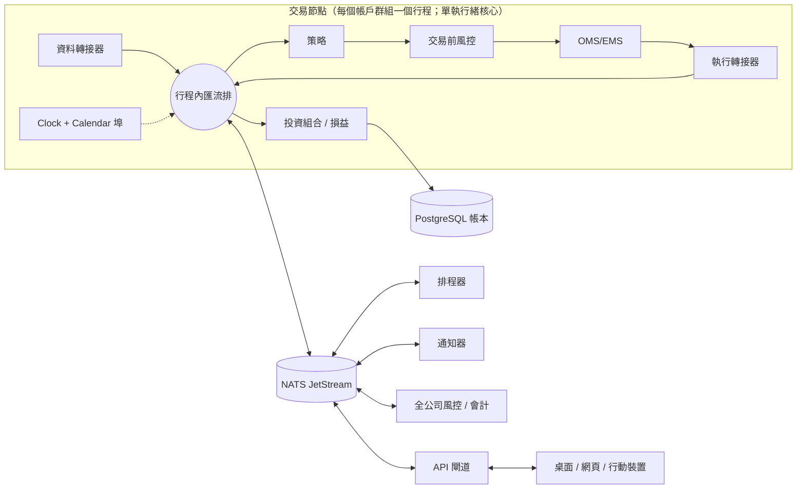

[English](07-system-architecture-messaging.md) | **繁體中文**

# 07 — 系統架構、訊息傳遞與元件設計

> 研究維度 07。研究日期：2026-10-05。範圍：美國／全球市場、加密貨幣交易場所，以及台灣（TWSE/TPEx、TAIFEX）的股票、加密貨幣、債券與選擇權。版本、授權與維護狀態皆以此日期為準。採用任何項目前請再次確認。

## TL;DR

- **建立一個確定性、事件驅動（event-driven）的核心（kernel），透過替換轉接器（adapter）而非策略程式碼，讓它在回測、模擬交易（paper）與實盤模式下執行。** 採用六角形架構（hexagonal）核心、行程內匯流排（in-process bus）與單執行緒分派（LMAX／NautilusTrader 風格）。經過驗證的參考實作是 NautilusTrader（LGPL-3.0，Rust 核心；1.231.0 穩定版，2.0 處於 RC 階段）與 QuantConnect LEAN（Apache-2.0，C#）。
- **從模組化單體（modular monolith）起步，只在穩定的接縫處拆分行程：** 交易場所閘道（venue gateway）、API 閘道／UI、研究環境，以及每個券商帳戶一個「交易節點（trader node）」。第一天就採用微服務，只會增加分散式系統的故障模式，毫無益處。
- **訊息傳遞：** 節點內使用行程內匯流排；行程之間與主機之間使用 NATS JetStream（Apache-2.0，單一執行檔；2.15.0 於 2026-09-17 發布）。Kafka 4.x 僅用於企業級串流骨幹，Aeron 僅用於微秒級的主機共置（co-located）路徑。新系統應避免 ZeroMQ（libzmq 自 2023-10 以來未再發布新版）。
- **依平面選擇序列化格式：** API、UI 與控制平面使用 Protobuf；只有在效能分析（profiling）顯示需要時，才在熱路徑市場資料上使用 SBE/FlatBuffers；研究與大量歷史資料使用 Arrow/Parquet。
- **委託／部位／現金帳本是 PostgreSQL 中的 append-only 事件日誌，搭配 CQRS 讀取模型、** 快照，以及在啟動時與定期執行的券商對帳。實際發生了什麼，以交易場所為事實來源（source of truth）。

## 關鍵問題

1. 哪一種架構風格能讓回測、模擬交易與實盤的行為保持一致，同時對 1–3 人來說成本夠低？
2. 哪些地方必須設立行程邊界（當機隔離、作業系統限制、安全性），哪些地方只是額外負擔？
3. 每個平面——熱路徑、控制、UI 與研究——各適合哪種傳輸方式與傳輸格式（wire format）？
4. 交易狀態如何持久化、當機後如何復原，以及如何與券商對帳？
5. 如何在 24/7 加密貨幣、美股／美國選擇權、債券、TWSE 與 TAIFEX 夜盤之間，抽象化時間、交易時段與交易日曆？
6. 部署拓撲與多策略／多帳戶隔離，如何從單機桌面演進到團隊或機構規模？

## 方案比較

### 1. 架構風格

| 風格 | 優點 | 缺點 | 適用情境 |
|---|---|---|---|
| **模組化單體 + 行程內匯流排 + 六角形埠／轉接器（ports/adapters）** | 單一部署單元；埠強制劃分模組接縫；內部訊息傳遞低於 1 µs；容易做到確定性重播 | 單一行程內命運與共；模組紀律需要工具輔助（import lint 檢查） | MVP 的預設選擇。在任何規模下，它都是每個交易節點的*內部*結構 |
| **LMAX 風格單執行緒核心 + 輸入日誌（input journal）** | 無鎖且具確定性；可透過重播輸入事件重建狀態。LMAX 的業務邏輯在單一執行緒上達到約每秒 600 萬筆委託 | 處理器（handler）中不允許阻塞式 I/O；複寫需要額外機制 | 交易節點的內部設計（NautilusTrader 即採此方式） |
| **每個元件一個微服務** | 可獨立部署與擴展；團隊擁有權；多語言 | 委託路徑上有網路跳轉、分散式一致性、重播困難、維運負擔沉重 | 僅適用於 5–20 人團隊、位於核心*周邊*的部分（閘道、API、會計、報表） |
| **Actor 模型**（Apache Pekko、MS Orleans、Rust actor crates） | 每個策略／帳戶各自隔離與監督；位置透明性 | 跨 actor 的順序不具確定性，因此較難維持與回測一致。Akka 已改為 BSL；Pekko 是 Akka 2.6 採 Apache 授權的分支 | 用於監督多個節點或策略，而非內層模擬迴圈 |
| **CQRS + 事件溯源（event sourcing）**（僅用於帳本） | 完整稽核軌跡；可重建任意時間點的部位與損益 | 事件 schema 必須永久版本化；投影（projection）需要維護 | 委託、成交、部位與現金。*不*適用於市場資料（那是時間序列） |

### 2. 參考引擎：一套引擎如何執行回測、模擬交易與實盤

| | NautilusTrader | QuantConnect LEAN | 自建（複製此模式） |
|---|---|---|---|
| 核心概念 | `NautilusKernel` 由 `BacktestEngine` 與 `LiveNode` 共用。DataEngine、ExecutionEngine、RiskEngine、Portfolio 與 Cache 透過 MessageBus（發布／訂閱、請求／回應、點對點）溝通 | 依 `config.json` 環境選用可插拔的處理器：`IDataFeed`、`ITransactionHandler`、`IResultHandler`、`IRealTimeHandler`、`ISetupHandler`、券商介接（brokerage） | 埠：MarketData、Execution、Clock、Calendar、Storage，每種模式各有一組轉接器 |
| 模式 | 回測（歷史資料 + 模擬交易場所）；沙盒（即時資料 + 模擬執行 = 模擬交易）；實盤 | 回測、模擬交易、實盤券商 | 同樣三種 |
| 時鐘 | 回測使用測試時鐘，實盤使用即時時鐘 | `IRealTimeHandler` 在回測中以模擬時間運作 | 位於埠後方的 `SimClock`／`WallClock` |
| 執行緒模型 | 單一執行緒負責消費並分派所有訊息；Tokio 執行緒處理網路、日誌與持久化 | 引擎迴圈依資料源提供的時間切片推進 | 複製單執行緒核心 |
| 復原 | Crash-only 設計；Cache 可由 Redis 或 PostgreSQL 作為後端（Postgres 後端不會持久化 actor／策略狀態）；啟動時依據交易場所回報進行對帳 | 啟動時同步券商狀態 | Postgres 事件帳本 + 對帳 |
| 語言／授權 | Rust 核心，Python 3.12–3.14 策略；LGPL-3.0+ | C# 引擎；C# 與 Python 演算法；Apache-2.0 | 任意 |
| 狀態（2026-10） | 1.231.0 穩定版（2026-08-02）；2.0.0rc5（2026-09-15）。專案方建議不要將 RC 版用於真實資金 | 活躍，GitHub 約 21.9k 顆星 | — |
| 對本專案的缺口 | 沒有債券商品模型；沒有台灣券商轉接器。持久化不會等待持久提交（durable commit）完成才分派 | 沒有債券模型；台灣需要自訂券商介接 | 全部都要自己建 |

**重點：** 無論選擇哪一種（採用 NautilusTrader 或自建），都應從兩者吸取這些概念：**不知道自己處於哪種模式的核心**、**以注入埠形式提供的時鐘與資料**、**不可變訊息**，以及將**成交／延遲模型放在模擬交易場所轉接器內**，而非放在策略中。

### 3. 核心元件及其所在位置



| 元件 | 職責 | MVP 配置 | 團隊／機構配置 |
|---|---|---|---|
| 資料閘道 | 交易場所連線、正規化、序號缺口重新同步、為重播保存原始紀錄 | 節點內的轉接器 | 每個交易場所一個行程，透過匯流排扇出（fan out） |
| 策略引擎 | 承載策略並將事件轉換為下單意圖。策略不得直接進行 I/O，也不得存取牆上時鐘（wall clock） | 節點內 | 節點內 |
| OMS / EMS | 委託狀態機、確定性客戶端委託編號（client order ID）、子單演算法（TWAP、冰山單）、路由 | 節點內 | 節點內，另可選配 EMS／智慧路由服務 |
| 風控引擎 | 交易前檢查（數量、名目金額、價格區間、速率限制、緊急停止開關）與交易後曝險 | 在節點內同步執行 | 節點內交易前檢查，加上一個非同步彙總的全公司限額服務 |
| 投資組合／會計 | 部位、多幣別損益（以事件發生時的匯率計算）、稅務批次（tax lot）、現金、保證金、手續費與交易稅 | 節點內檢視 + Postgres 帳本 | 由成交資料驅動的正式帳簿（book-of-record）服務，每日與券商對帳單對帳 |
| 排程器 | 開盤／收盤、日終作業、資料擷取、期貨轉倉、選擇權到期 | 節點計時器 + cron | 使用 CalendarPort 的專用排程器 |
| 研究環境 | Notebook、向量化研究、批次回測 | 同一個 repo，讀取 Parquet/Arrow | 獨立運算資源，從資料湖讀取 |
| API 閘道 | 身分驗證／授權（AuthN/AuthZ）、供 UI 使用的 REST/gRPC/WebSocket、指令驗證 | 內嵌 HTTP/WS 伺服器 | 獨立服務；UI 絕不直接連線到節點 |
| 通知 | 成交、風控、斷線與對帳警示（email、Telegram、推播、LINE） | 行程內 | 匯流排消費者。LINE Notify 已於 2025-03-31 終止服務，請改用 LINE Messaging API |

### 4. 訊息傳遞技術

延遲數據為同主機或區域網路環境下的參考數量級。請在自己的硬體上進行基準測試。

| 技術 | 模型 | 延遲等級 | 持久性／投遞保證 | 維運複雜度 | 授權與狀態（2026-10） | 最佳角色 |
|---|---|---|---|---|---|---|
| **行程內匯流排** | 直接的型別化分派 | ~0.1–1 µs | 無 | 無 | — | 交易節點內的一切 |
| **Aeron**（+Archive、Cluster） | UDP 單播／多播、共享記憶體 IPC | 個位數 µs | Archive 可記錄與重播串流；Cluster 執行以 Raft 複寫的狀態機 | 高（media driver、調校；Java/C/C++/.NET） | Apache-2.0，由 Adaptive 擁有；1.53.3（2026-09-25）。核心旁路（kernel bypass，DPDK）與加密為付費的「Aeron Premium」附加功能 | 主機共置的低延遲路徑；高可用（HA）定序器／OMS |
| **ZeroMQ** | 無 broker 的 socket | 約數十 µs | 無；可靠性需自行實作 | 基礎設施負擔低，但大量需自行實作 | MPL-2.0；libzmq 最後一版為 4.3.5（2023-10-09） | 僅限既有舊系統 |
| **NATS core + JetStream** | 以 subject 為單位的發布／訂閱、請求／回覆、KV、物件儲存 | Core：低於 1 ms；JetStream：約 ms 級 | Core 為至多一次（at-most-once）。JetStream 增加至少一次（at-least-once）投遞、訊息 ID 去重、記憶體／檔案儲存與複寫；自 2.12 起支援原子批次發布與排程訊息 | **低**：單一 Go 執行檔、leaf node、WebSocket、多租戶帳戶 | Apache-2.0，CNCF（商標於 2025 年移轉至 Linux Foundation）；2.15.0（2026-09-17），2.14 持續維護 | **預設的行程間匯流排**：指令、事件、UI 串流、設定 KV |
| **Apache Kafka 4.x** | 分割（partitioned）複寫日誌 | p99 為低毫秒至數十毫秒（acks=all） | 強；長期保留；交易（transactions）；共享群組（share groups，即「佇列」）自 4.2 起可用於正式環境 | 中至高（JVM；自 4.0 起僅支援 KRaft，移除 ZooKeeper） | Apache-2.0；4.3.1（2026-06-25）為最新支援版本（4.3.0 於 2026-05-22；4.2.2 修補版於 2026-09-29） | 企業骨幹：稽核串流、CDC、分析扇出 |
| **Redpanda** | Kafka API，C++ 單一執行檔 | 與 Kafka 相近或更低（廠商宣稱） | 與 Kafka 相同 | 中 | 社群版採 BSL：你**不得將 Redpanda 本身作為商業串流或佇列服務提供**（例如讓第三方建立 topic），且每次變更在 4 年後轉為 Apache-2.0。分層儲存、RBAC 與災難復原（Shadowing）需要 Enterprise 授權；v26.2 系列（文件列出 v26.2.3；GitHub 上最新的公開 tag 為 v26.2.2，2026-08-19） | 不需 JVM 的 Kafka API，供自用 |
| **Redis Streams / Valkey** | Append-only 串流 + 消費者群組 | 低於 1 ms | AOF/RDB 持久化；非同步複寫在容錯移轉（failover）時可能遺失已確認的寫入 | 低 | Redis 8+ 採三重授權（RSALv2／SSPLv1／AGPLv3）；Valkey 9.1.2（2026-09-01）採 BSD（Linux Foundation），9.2.0-rc1 自 2026-09-16 起推出 | 快取、輕量扇出；NautilusTrader 的外部匯流排選項 |
| **gRPC**（或 Connect） | RPC + HTTP/2 串流 | ~0.1–1 ms | 無（它是傳輸層） | 低 | Apache-2.0 | 請求／回應 API、UI 後端、券商 sidecar |

**其他考量（不在預設路徑中）：** **RabbitMQ**（MPL-2.0，Broadcom；4.3.x 系列，需要 Erlang 27+）提供仲裁佇列（quorum queues）與串流，適合工作佇列與後台作業，但會多出一個 Erlang 叢集，而資源占用並不比 NATS 精簡。**Apache Pulsar**（Apache-2.0；最新穩定版 4.2.4 於 2026-08-03 發布，4.0 LTS 系列仍持續修補，5.0 僅有 milestone 建置）內建多租戶、異地複寫與分層儲存，但需要 broker 加上 BookKeeper 以及中繼資料儲存（ZooKeeper 或 Oxia）。它是機構級骨幹中 Kafka 的替代方案，而非 1–3 人 MVP 的選項。

### 5. 序列化

| 格式 | 版本（2026-10） | 效能 | Schema 演進 | 語言／UI 涵蓋範圍 | 最佳角色 |
|---|---|---|---|---|---|
| **Protobuf** | v36.2（2026-09-17） | 需解析 + 配置記憶體；精簡的 varint | 優秀（欄位編號；`buf breaking` 檢查） | 所有主流語言，含 TS、Dart、Swift、Kotlin | API、指令、帳本事件酬載、UI |
| **FlatBuffers** | 25.12.19（2025-12-19） | 零複製讀取 | 良好（僅能附加欄位） | 廣泛，含 TS、Dart、Swift | 傳送至 UI 與行動裝置的大型委託簿／選擇權鏈快照 |
| **SBE**（FIX 標準） | 1.40.2（2026-09-17） | 固定佈局、flyweight；在這些格式中最快 | 有限（只能在區塊內附加；版本化 schema） | Java、C++、C#、Go、Rust | 熱路徑市場資料與委託，常與 Aeron 搭配。CME iLink 3／MDP 3.0 採用它 |
| **Cap'n Proto** | 1.5.0（目前下載版本；2023 年的 1.0 為 LTS 基準） | 零複製 + 支援 promise pipelining 的 RPC | 良好 | C++、Rust；其他語言由社群維護 | 小眾。除非需要它的 RPC，否則略過 |
| **Apache Arrow** | 25.0.1（2026-08-10） | 欄式批次；IPC/Flight；可零複製載入 pandas/Polars/DuckDB | 每批次一個 schema | Python、Rust、C++、Java、JS、Go | 研究、大量歷史資料、回測載入。不適用於單筆訊息 |
| **JSON / MessagePack** | — | 慢／中等 | 無 schema | 通用 | 除錯、webhook、瀏覽器備援 |

NautilusTrader 的外部訊息匯流排輸出（內建 Redis）對所有訊息類型支援 JSON 與 MessagePack，而 SBE 或 Cap'n Proto（需啟用 Rust feature flag）僅適用於市場資料；Redis 快取酬載僅支援 JSON 或 MessagePack。因此，混合格式的平面是常態。

### 6. 狀態、持久化、復原與對帳

| 做法 | 優點 | 缺點 | 結論 |
|---|---|---|---|
| CRUD 資料表（就地更新委託／部位） | 簡單 | 歷史遺失；更新競態；稽核能力薄弱 | 帳本應避免使用 |
| **PostgreSQL 中的事件溯源帳本**（append-only `ledger_events` + 投影 + 交易式 outbox（transactional outbox）→ NATS） | ACID、單一儲存、可用 SQL 稽核、成本低。每秒數千筆事件對此工作負載已綽綽有餘 | 需要快照與事件上轉（upcasting） | **建議採用** |
| 專用事件儲存（例如 KurrentDB，前身為 EventStoreDB） | 專為串流與訂閱打造 | 又多一套需要維運與授權的系統（KurrentDB 採 Kurrent License v1 原始碼可見（source-available）授權，禁止將其作為託管服務提供） | 僅在已有相關經驗時採用 |
| 以 Kafka 作為記錄系統（system of record） | 無限保留、扇出 | 沒有以聚合（aggregate）為單位的樂觀並行控制；查詢不便 | 用於分發，而非作為事實來源 |
| 記憶體內快取 + Redis/Postgres 後端（NautilusTrader Cache） | 快速 | 持久化為非同步：擷取不會等待持久提交完成才分派，因此存在一個小的資料遺失窗口 | 若對帳能補上此缺口則可接受 |

PostgreSQL 18.6 為目前的穩定版（2026-08-13），19 處於 beta 階段（Beta 4 於 2026-09-24）。事件依月份分割（partition），每個聚合（委託、帳戶）維護一個 `seq` 以進行樂觀並行控制，並使用 `NUMERIC` 或經縮放的 int64 型別，絕不使用浮點數。

**當機復原與對帳流程**

1. 載入最新快照，並重播其序號之後的事件，以重建記憶體內狀態。
2. 以*對帳*模式連接轉接器。策略維持停止，並封鎖新委託。
3. 拉取未成交委託、自上次檢查點以來（再往前扣除一段安全邊際）的成交紀錄、部位以及現金／保證金。
4. 以編碼了 `node-strategy-seq` 的客戶端委託編號進行比對。將缺漏的成交寫成標記為 `source=reconciliation` 的事件，並標示未知的外部委託或部位。
5. 若任何差異超出容許範圍，維持暫停並通知人員處理。否則啟動策略。
6. 盤中重新執行對帳（例如每 1–5 分鐘），並在日終依據券商對帳單進行對帳。

### 7. 時間、時鐘與交易日曆

- **時鐘埠（Clock port）：** `now_ns()`、`set_timer(at|interval)`。`SimClock` 會推進到每個事件的時間戳記並依序觸發到期的計時器，藉此確保執行結果具確定性。`WallClock` 由 chrony/NTP 校時（主機共置環境下使用 PTP）。在核心與策略程式碼中以 lint 禁用 `datetime.now()`／`time.time()`。
- **時間戳記：** 採用 UTC int64 奈秒，同時記錄 `ts_event`（交易場所時間）與 `ts_init`（接收時間），與 NautilusTrader 相同。僅在處理交易時段與顯示時才轉換為交易所當地時間。
- **`trading_date` 是一級欄位，與日曆日期分開。** TAIFEX 盤後交易時段（after-hours）跨越午夜，並歸屬於下一個交易日。加密貨幣需要一個人為的每日切點（例如 00:00 UTC）來計算每日損益。
- **時區：** Asia/Taipei 沒有日光節約時間，但美國交易時段相對於台北時間每年會位移兩次、每次一小時。絕不要把時差寫死。

| 交易日曆來源 | 版本 | 授權 | 涵蓋範圍 | 缺口 |
|---|---|---|---|---|
| `exchange_calendars` | 4.13.2（2026-03-10） | Apache-2.0 | 數十個交易所，含 **XTAI**（TWSE）；交易時段、午休、提前收盤；Python ≥3.10 | 沒有 TAIFEX／夜盤、沒有債券、沒有加密貨幣交易場所日曆（只有通用的 `24/7` 與 `24/5` 日曆，完全不知道交易場所的維護時段） |
| `pandas_market_calendars` | 5.4.0（2026-05-27） | MIT | 鏡像 exchange_calendars，並增加 CME 商品日曆與 **SIFMA US/UK/JP** 債券日曆 | 沒有 TAIFEX |
| 自訂 `CalendarPort` 實作 | — | — | TAIFEX 一般與盤後交易時段、加密貨幣 24/7、臨時休市（颱風假）、覆寫檔案 | 需自行維護 |

### 8. 部署拓撲與隔離

| 拓撲 | 優點 | 缺點 | 適用時機 |
|---|---|---|---|
| **A. 桌面一體式**（引擎 + 資料庫 + UI 在同一台 PC；Tauri/Electron 或 localhost 網頁 UI） | 無需維運；可離線研究 | 睡眠與作業系統更新會中斷運行；無法 24/7 交易加密貨幣；無法從行動裝置存取 | 研究、回測、模擬交易 |
| **B. 本地引擎 + 遠端 UI**（家中常駐的迷你 PC／伺服器；UI 透過 API 閘道經 WireGuard/Tailscale 存取） | 便宜；資料留在本地；可承載僅支援 Windows 的台灣券商 SDK 與憑證 | 家用電力／ISP 風險 | 個人在台灣與美國市場進行實盤交易 |
| **C. 雲端伺服器**（位於靠近交易場所之區域的 VM） | 可用性高；到加密貨幣交易場所的延遲低 | 機密資訊存放於雲端；部分券商需要憑證、IP 允許清單或 Windows；成本 | 加密貨幣、美國市場、團隊 |
| **D. 混合式**（雲端 NATS hub + 地端 **leaf node** 承載台灣閘道） | 每個工作負載都放在最適合的位置；站點隔離 | 更多可變動的元件 | 台灣 + 全球多資產的務實最終形態 |

| 隔離層級 | 單位 | 優點 | 缺點 |
|---|---|---|---|
| L0 | 所有策略在同一節點、同一帳戶 | 最簡單；單一共享的風險視圖 | 一個 bug 就會讓一切停擺 |
| **L1** | 每個券商帳戶一個節點；策略在節點內加上標記 | 當機與對帳範圍 = 單一帳戶 | 跨帳戶風險需要彙總器 |
| L2 | 每個策略 × 帳戶一個節點（容器） | 最大程度隔離；可獨立部署 | 會碰到券商連線／session 上限，因此需要共享閘道 |
| L3 | 每個租戶一個（僅在提供服務時） | 資料與法規上的隔離 | 完整多租戶：NATS 帳戶、每個租戶獨立的資料庫 schema、授權審查 |

### 9. 四種資產類別在此維度上的差異

| 關注點 | 股票 | 加密貨幣 | 債券 | 選擇權 |
|---|---|---|---|---|
| 交易時段／日曆 | 交易所交易時段、集合競價、暫停交易；美國 T+1 交割（自 2024-05-28 起），台灣 T+2 | 24/7、UTC；交易場所維護時段 | 店頭市場（OTC）；SIFMA 日曆；美國公債 T+1 交割 | 依標的物的交易時段；到期日曆（週選擇權） |
| 匯流排上的資料量 | 中等（標的池的 L1/L2） | 每個交易場所都很高（L2 增量）；出現缺口時需要快照 + 重新同步 | 報價稀疏；以 RFQ 為主 | **最高**：每個標的物有數千檔合約。依需求訂閱；在獨立服務中計算 Greeks／IV |
| 商品模型 | 代號 + 交易所、交易單位、升降單位表 | 基礎幣／報價幣、最多 8 位以上小數、含資金費率的永續合約、多個交易場所 + 錢包 | 以面額百分比報價、淨價 vs. 全價（clean vs dirty）、應計利息、計息天數慣例（day count）、票息時程 | 標的物、履約價、到期日、買賣權別、契約乘數、交割標的（依公司行動調整） |
| 帳本事件 | 成交、股利、股票分割、手續費、交易稅 | 成交、資金費率支付、轉帳、入金／出金、手續費回饋 | 票息、應計、攤銷、到期／贖回 | 履約、被指派、到期、多腳成交 |
| 風險／保證金 | 現金或 Reg-T 形式；漲跌幅限制 | 交易場所保證金、強制平倉引擎、交易對手風險 | 存續期間／DV01；週轉率低 | Greeks 限額；交易所投資組合保證金；到期時的 pin risk |
| 對帳 | 券商部位 + 對帳單 | 各交易場所的 REST 快照 + 鏈上餘額 | 保管機構對帳單（每日一次即可） | 履約／指派處理後的券商部位 |

**台灣特有事項：** XTAI 已收錄於 `exchange_calendars`，但兩個函式庫都沒有 TAIFEX，因此需建立含盤後交易時段的自訂日曆。零股（odd-lot）交易需要獨立的委託與交易單位處理。證券交易稅／期貨交易稅是逐筆交易的費用事件，而非資本利得批次。部分台灣券商 API 以僅支援 Windows 的元件形式提供，迫使你必須有一個 Windows 閘道行程（拓撲 B 或 D）。相較之下，Shioaji 可在 Windows、Linux 與 macOS 上執行，並提供模擬模式。

## 建議（依情境）

### (a) 個人／1–3 人 MVP

1. **模組化單體交易節點**，搭配六角形核心：提供 MarketData、Execution、Clock、Calendar 與 Storage 埠。可以採用 NautilusTrader（真實資金請鎖定 1.231.x 穩定系列，2.0 RC 僅在模擬交易／沙盒中評估），或仿照其 kernel／MessageBus 設計。
2. 起初**只用行程內匯流排**。當 UI 或閘道移到行程外執行時，再加入 **NATS JetStream**（單一執行檔）。略過 Kafka、Redpanda、Aeron 與 ZeroMQ。
3. **以 PostgreSQL 18 作為記錄系統**：append-only 帳本加上投影與 outbox。市場資料保存在 Parquet（參見資料儲存研究）。Redis 為選用。
4. API 與 UI 合約使用 **Protobuf**，除錯使用 JSON。在效能分析工具顯示有需要之前，不使用 SBE/FlatBuffers。
5. **交易日曆：** `exchange_calendars`（XTAI、美國）+ `pandas_market_calendars`（CME、SIFMA）+ 自訂 TAIFEX／加密貨幣日曆，全部置於單一 `CalendarPort` 之後。
6. **拓撲：** 研究用 A，實盤交易用 B（加密貨幣則用 C）。**隔離 L1：** 每個券商帳戶一個節點。
7. 將**啟動對帳與緊急停止開關（kill switch）**列為首筆實盤交易的發布阻斷項目（release blocker）。

### (b) 5–20 人團隊／機構級

1. 保留**相同的核心**，並在穩定接縫處拆分服務：每個交易場所的市場資料閘道、每個帳戶／帳簿的交易節點、全公司風控服務、正式帳簿會計服務、API 閘道、排程器與通知器。
2. 以 **NATS JetStream** 作為營運匯流排（subject 命名空間、以帳戶實現租戶隔離、以 leaf node 連接混合站點）。只有在已有資料平台時（稽核保留、CDC 至資料倉儲）才加入 **Kafka 4.x**。Redpanda 的 BSL 僅禁止將 Redpanda 本身作為串流或佇列服務提供；在交易服務之後於內部執行它通常是允許的。但若租戶會直接存取 topic，或你需要分層儲存、RBAC 或災難復原而又不想購買 Redpanda Enterprise 授權，仍應選擇 Kafka。
3. **Aeron（+Archive/Cluster）搭配 SBE** 僅用於主機共置、對 µs 敏感的路徑，或複寫式 OMS／定序器。這需要專門的低延遲專業能力。
4. **Schema 治理：** Protobuf monorepo 並在 CI 中執行 `buf breaking`、搭配 upcaster 的版本化帳本事件，以及用於稽核的雙時態帳本（事件時間 vs. 記錄時間）。
5. **對帳即服務：** 盤中加上日終，依據對帳單與保管機構檔案進行對帳，並具備差異（break）追蹤與人工核准流程。
6. **維運：** 以客戶端委託編號為鍵的 OpenTelemetry 追蹤、每個跳轉的延遲直方圖、chrony/PTP、存放於 vault 的機密、mTLS，以及每個服務各自的 NATS 憑證。交易節點執行於固定配置（pinned）的 VM 或實體機上，無狀態服務則執行於 Kubernetes。
7. **隔離 L1–L2**，並以共享閘道遵守券商 session 上限。只有在對外提供服務時才轉向 L3，且須先完成授權審查（NautilusTrader 的 LGPL 適用於你散布的任何內容；Redis 的 AGPL/RSAL，或改用 BSD 授權的 Valkey；Redpanda 的 BSL）。

### 範例 monorepo 結構

```text
trading-platform/
├─ proto/                     # Protobuf 合約：API、指令、帳本事件
├─ schemas/sbe/               # 選用的熱路徑 schema
├─ core/                      # 純領域邏輯，無 I/O
│  ├─ model/                  # 商品（股票／加密貨幣／債券／選擇權）、金額、ID
│  ├─ bus/  clock/  calendar/ # 行程內匯流排；SimClock/WallClock；CalendarPort
│  ├─ engine/                 # kernel：資料、OMS/EMS、風控、投資組合
│  ├─ ledger/                 # 事件溯源的委託／部位／現金、投影
│  └─ ports/                  # MarketDataPort, ExecutionPort, StoragePort, ...
├─ adapters/
│  ├─ venues/{ibkr,binance,shioaji,...}/  # 各自實作資料 + 執行 + 對帳
│  ├─ sim/                    # 模擬交易場所，成交／延遲／手續費模型
│  ├─ storage/{postgres,parquet}/
│  └─ transport/{nats,grpc}/
├─ apps/
│  ├─ trader-node/  backtest-runner/  gateway-<venue>/
│  ├─ api-gateway/  scheduler/  notifier/
├─ strategies/                # 使用者策略，與設定一起版本化
├─ research/                  # notebook；匯入 core/model 與手續費模型
├─ ui/{web,desktop,mobile}/   # 僅作為 api-gateway 的用戶端
├─ deploy/{compose,k8s,systemd}/
└─ tests/{golden-replay,contract,recon}/  # backtest==replay 確定性測試
```

## 對整體架構的影響

- **券商／資料整合：** 每個交易場所轉接器都必須實作*資料 + 執行 + 對帳*（未成交委託、自 T 以來的成交、部位、餘額），並支援客戶端委託編號。無法提供這些功能的券商應列為風險發現。
- **資料層：** 市場資料（Parquet/Arrow，時間序列）與交易帳本（PostgreSQL）分開保存。回測執行器讀取的正規化格式，與實盤閘道所記錄的格式相同。
- **UI：** 桌面、網頁與行動裝置都是 API 閘道（gRPC/Connect + WebSocket/NATS-WS）的精簡用戶端，讓 UI 技術堆疊與引擎語言彼此獨立。
- **風控：** 交易前檢查為同步且在行程內執行；全公司彙總則在匯流排上非同步進行。
- **測試：** golden-replay 測試（相同的輸入日誌產生完全相同的事件日誌）成為維持回測／實盤一致性的主要防線。
- **候選 ADR：** (1) 採六角形核心的模組化單體交易節點；(2) 以 NATS JetStream 作為行程間匯流排；(3) 以 Protobuf 作為合約格式；(4) 事件溯源的 PostgreSQL 帳本 + outbox；(5) 採 UTC 奈秒時間戳記與 `trading_date` 的 Clock/Calendar 埠；(6) 每個券商帳戶一個節點；(7) 採用 vs. 仿照 NautilusTrader。

## 風險與陷阱

- 牆上時鐘呼叫或未排序的多來源資料所造成的**前視偏差（look-ahead）與時間洩漏**。強制使用 Clock 埠，並依 `ts_init` 合併資料來源。
- 即使共用核心，**回測／實盤的落差依然存在**（部分成交、排隊位置、延遲、拒單、中斷）；NautilusTrader 自己的文件也這麼說。
- **至少一次投遞造成的重複**與**非同步持久化窗口**：讓處理器具冪等性（透過事件 ID 與客戶端委託編號），並由對帳補上缺口。
- **以浮點數表示金額**，以及各商品的精度錯誤（加密貨幣小數位數、債券面額百分比）。
- **交易日曆錯誤：** 日光節約時間位移、TAIFEX 夜盤的日期歸屬、颱風休市。將覆寫檔案納入版本控制。
- **以 release candidate 版軟體操作真實資金**（NautilusTrader 2.0 RC）。
- 系統若成為服務或散布的產品，會有**授權陷阱**：Redpanda BSL 與 KurrentDB KLv1（不得將產品本身作為服務提供）、Redis AGPL/RSAL/SSPL（AGPL 的網路條款；RSAL 禁止以託管服務形式提供；Valkey 可同時避開兩者），以及已改為 BSL 的 actor 框架（Akka）。NautilusTrader 的 LGPL 沒有網路條款；其義務在你*散布*它時才適用，例如包含在桌面版建置中。
- **停滯的相依套件**（libzmq 最後一次發布是在 2023 年）與**過早的微服務化**（委託路徑上的網路跳轉、失去重播確定性）。
- **受作業系統綁定（僅支援 Windows）的券商 SDK** 左右部署拓撲。從第一天起就把它們隔離在閘道行程之後。

## 參考資料

- NautilusTrader 架構: https://nautilustrader.io/docs/nightly/concepts/architecture
- NautilusTrader MessageBus: https://nautilustrader.io/docs/latest/concepts/message_bus
- NautilusTrader 實盤交易與對帳: https://nautilustrader.io/docs/latest/concepts/live
- NautilusTrader 回測: https://nautilustrader.io/docs/latest/concepts/backtesting
- NautilusTrader 於 PyPI（版本、授權）: https://pypi.org/project/nautilus-trader/
- NautilusTrader GitHub: https://github.com/nautechsystems/nautilus_trader
- NautilusTrader 2.0.0rc4 版本說明: https://newreleases.io/project/github/nautechsystems/nautilus_trader/release/v2.0.0rc4
- LEAN 引擎文件: https://www.quantconnect.com/docs/v2/lean-engine/getting-started
- LEAN GitHub: https://github.com/QuantConnect/Lean
- LMAX 架構（Fowler）: https://martinfowler.com/articles/lmax.html
- NATS 版本說明: https://docs.nats.io/release-notes/whats_new
- NATS server 版本發布: https://github.com/nats-io/nats-server/releases
- NATS 2.12 發布部落格: https://nats.io/blog/nats-server-2.12-release/
- JetStream 概念: https://docs.nats.io/nats-concepts/jetstream
- CNCF 與 Synadia 的 NATS 協議: https://www.cncf.io/announcements/2025/05/01/cncf-and-synadia-align-on-securing-the-future-of-the-nats-io-project/
- Apache Kafka 4.2.0 發布公告: https://kafka.apache.org/blog/2026/02/17/apache-kafka-4.2.0-release-announcement/
- Apache Kafka 下載: https://kafka.apache.org/community/downloads/
- Kafka 4.x 與移除 ZooKeeper: https://www.instaclustr.com/blog/kafka-4-0-unveiled-key-changes-and-how-they-impact-developers/
- Redpanda 授權: https://docs.redpanda.com/current/get-started/licensing/overview/
- Aeron GitHub／版本發布: https://github.com/aeron-io/aeron/releases
- libzmq 版本發布: https://github.com/zeromq/libzmq/releases
- Redis 授權: https://redis.io/legal/licenses/
- Valkey: https://valkey.io/
- Protobuf 版本發布: https://github.com/protocolbuffers/protobuf/releases
- FlatBuffers 版本發布: https://github.com/google/flatbuffers/releases
- SBE 版本發布: https://github.com/real-logic/simple-binary-encoding/releases
- FIX SBE 標準: https://github.com/FIXTradingCommunity/fix-simple-binary-encoding
- CME iLink SBE: https://cmegroupclientsite.atlassian.net/wiki/spaces/EPICSANDBOX/pages/714113056
- Cap'n Proto 最新消息: https://capnproto.org/news/
- Apache Arrow 版本發布: https://arrow.apache.org/release/
- PostgreSQL: https://www.postgresql.org/
- KurrentDB（前身為 EventStoreDB）: https://github.com/kurrent-io/KurrentDB
- Apache Pekko: https://pekko.apache.org/
- exchange_calendars: https://pypi.org/project/exchange-calendars/
- pandas_market_calendars: https://pypi.org/project/pandas-market-calendars/
- pandas_market_calendars 日曆清單: https://pandas-market-calendars.readthedocs.io/en/latest/calendars.html
- SEC 採行 T+1: https://www.sec.gov/newsroom/press-releases/2023-29
- Shioaji（永豐金證券 API）: https://sinotrade.github.io/
- LINE Notify 終止服務公告: https://notify-bot.line.me/closing-announce
- TAIFEX（交易時間、盤後交易時段）: https://www.taifex.com.tw/
- NautilusTrader cache（Redis/Postgres 後端）: https://nautilustrader.io/docs/latest/concepts/cache
- NautilusTrader 商品: https://nautilustrader.io/docs/latest/concepts/instruments
- Redpanda GitHub tags: https://github.com/redpanda-data/redpanda/tags
- Redpanda BSL 條文: https://github.com/redpanda-data/redpanda/blob/dev/licenses/bsl.md
- Aeron README（Adaptive、Aeron Premium）: https://github.com/aeron-io/aeron
- Valkey 版本發布: https://github.com/valkey-io/valkey/releases
- Cap'n Proto 安裝（目前版本）: https://capnproto.org/install.html
- KurrentDB 授權（KLv1）: https://github.com/kurrent-io/KurrentDB/blob/master/LICENSE.md
- exchange_calendars 日曆註冊表: https://github.com/gerrymanoim/exchange_calendars/blob/master/exchange_calendars/calendar_utils.py
- pandas_market_calendars 註冊表: https://github.com/rsheftel/pandas_market_calendars/blob/master/pandas_market_calendars/calendar_registry.py
- LEAN `SecurityType` 列舉: https://github.com/QuantConnect/Lean/blob/master/Common/Global.cs
- TWSE 交易與交割: https://www.twse.com.tw/en/page/products/trading/introduce.html
- Apache Pulsar 版本發布: https://github.com/apache/pulsar/releases
- RabbitMQ 版本發布: https://github.com/rabbitmq/rabbitmq-server/releases

## 驗證紀錄（2026-10）

於 2026-10-05 依據一手資料來源（PyPI、GitHub releases／tags／LICENSE 檔案、官方文件與公告）進行對抗式事實查核。

**已確認**

- NautilusTrader 1.231.0 穩定版（2026-08-02）、2.0.0rc5（2026-09-15）、LGPL-3.0-or-later、Python `>=3.12,<3.15`（PyPI）。
- NautilusKernel 由回測、沙盒與實盤共用；單執行緒核心分派；Tokio／背景執行緒負責網路、日誌與持久化；crash-only（panic 時中止）（架構文件）。
- 事件儲存擷取「does not gate dispatch on durable commit」（不會等待持久提交完成才分派）；啟動對帳會在交易元件啟動前執行（實盤文件）。
- NautilusTrader README 建議不要以真實資金執行 2.0.0rcN。沒有債券商品類型，也沒有台灣券商轉接器（商品文件、README）。
- NATS 2.15.0（2026-09-17）、2.14 持續維護（2026-04-30）、2.13 從未發布、2.12（2025-09-22）已 EOL（NATS 文件、GitHub releases）。原子批次發布與延遲訊息排程於 2.12 推出（NATS 2.12 部落格）。
- NATS 仍是採 Apache-2.0 授權的 CNCF 專案；Synadia 同意將其兩項 NATS 商標註冊轉讓給 Linux Foundation（CNCF，2025-05-01）。
- Kafka 4.2.0（2026-02-17）宣布 Queues／共享群組可用於正式環境；4.0 僅支援 KRaft；4.3.0 於 2026-05-22 發布（Kafka 部落格、下載頁面）。
- Redpanda 社群版 BSL 條款（不得為第三方提供 Streaming 或 Queuing Service；四年後轉為 Apache-2.0）；分層儲存、RBAC 與 Shadowing／災難復原為 Enterprise 功能（Redpanda 文件、BSL 條文）。
- libzmq 4.3.5（2023-10-09）仍是最新版本，MPL-2.0（GitHub releases）。
- Aeron：Apache-2.0，由 Adaptive 擁有並營運，1.53.3 於 2026-09-25 發布（GitHub README、releases）。
- Redis 8+ 採 RSALv2/SSPLv1/AGPLv3 三重授權（redis.io）；Valkey 9.1.2 採 BSD，隸屬 Linux Foundation（valkey.io 列為 2026-09-01；GitHub release 的時間戳記為 2026-08-31 UTC）。
- exchange_calendars 4.13.2（2026-03-10，Apache-2.0，Python >=3.10）包含 XTAI，沒有 TAIFEX；pandas_market_calendars 5.4.0（2026-05-27，MIT）有 SIFMAUS/UK/JP 以及 CME/CME Globex 商品日曆，沒有 TAIFEX。
- Protobuf v36.2（2026-09-17）、SBE 1.40.2（2026-09-17）、Arrow 25.0.1（2026-08-10）、PostgreSQL 18.6（2026-08-13）與 19 Beta 4（2026-09-24）；FlatBuffers 25.12.19（以日期為版本號，2025-12-19）。
- NautilusTrader Cache 可由 Redis 或 PostgreSQL 作為後端（cache 文件）。
- LEAN：Apache-2.0，約 21.9k 顆星，沒有 Bond／固定收益的 `SecurityType`。
- LMAX 業務邏輯：單一執行緒每秒 600 萬筆委託（Fowler）。
- Pekko 是 Akka 改為 BSL 之前的 Akka 2.6.x 分支；KurrentDB 是 EventStoreDB 更名後的名稱。
- Shioaji 可在 Windows、Linux 與 macOS 上執行並具備模擬模式；LINE Notify 於 2025-03-31 終止（後繼者為 Messaging API）。
- 美國 T+1 合規日期為 2024-05-28（SEC 2023-29）；TWSE 採 T+2 交割（TWSE）。
- CME iLink 委託下單採用 SBE（CME client systems wiki）。

**已更正**

- Kafka「4.3.x（4.3.0 於 2026-05-22）」-> 4.3.1（2026-06-25）為最新支援版本；4.2.2 修補版於 2026-09-29 (https://kafka.apache.org/community/downloads/)。
- Cap'n Proto「1.x（1.0 LTS，2023）」-> 目前下載版本為 1.5.0；1.0（2023）為 LTS 基準 (https://capnproto.org/install.html)。
- 「NautilusTrader 的 Redis 外部串流支援 JSON、MessagePack、SBE 與 Cap'n Proto」-> SBE 與 Cap'n Proto 僅適用於市場資料編碼；Redis 快取酬載僅支援 JSON/MessagePack (https://nautilustrader.io/docs/latest/concepts/message_bus)。
- exchange_calendars「沒有加密貨幣」-> 沒有加密貨幣交易場所日曆，但有通用的 `24/7` 與 `24/5` 日曆（calendar_utils.py）。
- NautilusTrader cache「Redis 或 PostgreSQL」-> 新增附註：Postgres 後端不會持久化 actor／策略狀態 (https://nautilustrader.io/docs/latest/concepts/cache)。
- 建議 (b)2「若將平台作為服務提供，應選擇 Kafka 而非 Redpanda」-> BSL 禁止的是將 Redpanda 本身作為串流／佇列服務提供，而非在交易服務之後的內部使用；若租戶可存取 topic 或你需要僅限 Enterprise 的功能，Kafka 仍較為合適（Redpanda BSL 條文）。
- 風險一節將「NautilusTrader LGPL」列為 SaaS 陷阱 -> LGPL 沒有網路條款；在散布時（例如桌面版建置）才有影響。另新增 KurrentDB KLv1，以及 Valkey 作為避開 Redis 授權問題的 BSD 選項。
- 缺漏的選項：新增 RabbitMQ（MPL-2.0，4.3.x）與 Apache Pulsar（Apache-2.0，4.2.4／4.0 LTS，5.0 milestone）的說明（GitHub releases）。

**無法驗證**

- Redpanda「v26.2.3」：Redpanda 文件的中繼資料將 v26.2.3 列為最新 tag，但 GitHub 上沒有公開的 v26.2.3 tag 或 release（最新為 v26.2.2，2026-08-19）。表格現改為「v26.2 系列」。
- 使用 SBE 的 CME MDP 3.0 市場資料，本次未在一手頁面上重新確認（僅確認了 iLink）。
- 訊息傳遞表中的延遲數據為參考數量級，未經獨立基準測試。
