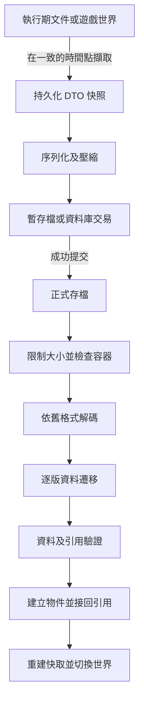

[English overview](README.md) | **完整繁體中文研究**

# 大型軟體與遊戲的存讀檔設計及版本相容性

研究日期：2026 年 10 月 14 日。

大型軟體與遊戲能延續多年存檔，關鍵在於把「需要長期保存的資料」當成穩定契約，並為每次資料意義改變留下轉換規則。程式內部的類別可以重構，磁碟上的欄位編號、物件識別與歷史意義則必須有人管理。

功能變更時，通常由新程式讀取舊資料，先轉換成目前的資料模型，驗證後才建立可操作的文件或遊戲世界。舊程式要完整理解未來的新功能，則必須事先設計可保留的未知資料、功能限制或降版匯出；無法把雙向相容視為自然成立。

本研究涵蓋桌面編輯器的專案文件、單機與大型世界遊戲存檔，以及序列化與交易工具。以公開官方文件和開源實作為依據；下文的參考架構是設計建議，並不代表所有商業軟體都採用相同內部機制。

## 閱讀入口

| 文件 | 可回答的問題 |
| --- | --- |
| [參考架構與流程](research/01-reference-design.zh-TW.md) | 格式怎麼排、物件關係怎麼保存、怎麼安全寫入與遷移 |
| [功能變更與驗證](research/02-change-scenarios-and-verification.zh-TW.md) | 加欄位、改單位、改任務、刪物件及降版時怎麼處理 |
| [來源與證據範圍](research/03-sources.zh-TW.md) | 哪些結論來自產品文件、原始碼或本研究的設計推論 |

## 存檔到底保存什麼

先決定恢復的粒度。同樣叫「存檔」，可能只記錄解鎖關卡，也可能必須恢復完整世界中每一台列車的狀態。這個契約決定需要保存多少資料，以及更新後應保留哪些行為。

| 資料類型 | 例子 | 建議處理 |
| --- | --- | --- |
| 作者或玩家的權威資料 | 文件物件、背包、任務進度、世界修改 | 保存，定義版本及語意 |
| 靜態內容引用 | 模型、物品定義、關卡、字型 | 保存穩定 ID 與內容版本，另管資產 |
| 可推導結果 | 空間索引、GPU 資源、縮圖、尋路快取 | 通常重建，必要時保存可失效快取 |
| 執行期狀態 | 記憶體指標、執行緒、檔案控制代碼 | 讀檔後重新建立 |
| 設定與帳號進度 | 按鍵、畫質、成就、跨局解鎖 | 分開管理；機器設定不宜直接跨裝置同步 |

「重建」也有條件：如果世界由程序生成，光保存隨機種子未必足夠。生成器改版後，相同種子可能得到不同地形；需要固定生成器版本、保存已生成區塊，或承諾內容變更政策。若要求逐 tick 重播，還要處理隨機數生成器狀態、演算法版本與數值決定性。

## 一般架構

以下是建議流程。DTO 是專門承載存檔欄位的資料物件，讓執行期物件與保存契約可以各自演進。

最容易忽略的是「一致的時間點」。把存檔工作丟到背景執行緒，卻讓它直接遍歷仍在改變的世界，可能存下交易前的金錢與交易後的物品。先取得不可變快照、短暫鎖定資料、採用 copy-on-write，或使用資料庫的適當交易隔離，再讓背景工作壓縮與寫入。

## 公開實作的設計

### Blender 的結構描述與版本轉換

Blender 的 DNA 系統描述保存的 C 結構，`.blend` 內嵌 SDNA，讓讀取端比較檔案結構與當前結構。這有助於處理結構布局的差異；欄位含義改變仍需要 versioning 轉換。官方相容性指南描述了版本判斷及增量轉換，也承認較新檔案由舊版開啟可能損失資料。[DNA 文件](https://developer.blender.org/docs/features/core/dna/)、[相容性指南](https://developer.blender.org/docs/handbook/guidelines/compatibility_handling_for_blend_files/)

可借鏡的是「結構描述加上語意遷移」的雙層處理。自我描述格式能告訴讀取端欄位的布局，卻不能自行判斷某個數字原本代表公分還是公尺。Blender 也有列出的格式相容性中斷，不能從 DNA 設計推導出任意版本均可無損互開。[官方相容性變更](https://developer.blender.org/docs/release_notes/compatibility/)

### OpenTTD 的區塊與載入後轉換

OpenTTD 的 `ChunkHandler` 定義區塊 ID、保存、載入與 `FixPointers` 階段；引用保存為物件索引，讀取後再連回真正物件。`afterload.cpp` 則依存檔版本做轉換，包括補歷史設定與把更新間隔從天轉成秒。[存讀檔介面](https://github.com/OpenTTD/OpenTTD/blob/master/src/saveload/saveload.h)、[載入後處理](https://github.com/OpenTTD/OpenTTD/blob/master/src/saveload/afterload.cpp)

這個案例說明相容性包含遊戲規則：新增功能時，舊存檔可能需要原有設定，而不是目前「開新遊戲」的預設值。AI 腳本的保存另有版本傳入 `Load()`，顯示外掛自己的狀態也需要獨立契約。[腳本存讀檔文件](https://wiki.openttd.org/en/Development/Script/Save%20and%20Load)

### Unreal Engine 的 SaveGame 資料物件

Unreal 的官方流程讓開發者建立自己的 `USaveGame`，把世界中需要延續的資料移入，再保存到 slot；讀取後把資料套回遊戲物件。文件也允許用不同 SaveGame 類別和檔案分開全域解鎖及單次遊玩狀態，並建議較大或遊玩中的保存使用非同步 API。[官方存讀檔指南](https://dev.epicgames.com/documentation/en-us/unreal-engine/saving-and-loading-your-game-in-unreal-engine)

這個 API 處理保存的入口與作業流程。任務重寫、物品刪除、資產改名及世界規則變更的轉換，仍要由遊戲定義；使用引擎的存檔 API 並不構成跨所有版本的相容性保證。

## 選擇保存格式

| 方案 | 適合情境 | 演進重點 | 代價與限制 |
| --- | --- | --- | --- |
| JSON 或其他文字格式 | 初期原型、中小型狀態、便於除錯與工具交換 | 明確 schema、缺值政策、未知欄位保留 | 文字大小及解析成本；數字精度取決於讀取端 |
| Protobuf | 有明確 schema、跨語言、許多獨立紀錄 | 欄位 tag 穩定；刪除後 reserved；保留 unknown fields | 線上格式相容不等於業務語意相容 |
| FlatBuffers | 需要直接存取二進位資料、讀取延遲敏感 | table 欄位與預設值遵循演進規則 | struct 與 table 限制不同；不能任意改布局 |
| 區塊式容器 | 大型場景、世界區塊、多模組與外掛 | 區塊 ID、長度、各自版本及必要功能宣告 | 自訂格式、驗證器與工具需持續維護 |
| SQLite | 多筆局部更新、索引查詢、文件資料庫 | schema 遷移及交易；應用管理自己的版本 | 執行期物件圖仍須映射；備份須正確處理 WAL |
| 容器加資產包 | 編輯器專案、含大型二進位資產 | manifest、資產 ID、相對引用與內容雜湊 | 多檔一致性、抽取安全與可攜性 |

Protobuf 的新增欄位可維持二進位解析相容，未知欄位會保留，但轉成 JSON 或逐欄位重建物件會丟失它們。FlatBuffers 也有新增欄位、deprecated 欄位與預設值等規則，不能將兩者的演進限制混為一談。[Protobuf 指南](https://protobuf.dev/programming-guides/proto3/)、[FlatBuffers 演進](https://flatbuffers.dev/evolution/)

SQLite 提供資料庫交易，但不會自行把應用的「舊技能樹」轉成新技能樹。其 `user_version` 由應用使用，和 SQLite 自身的檔案格式版本是兩件事。[檔案格式](https://sqlite.org/fileformat.html)、[原子提交](https://sqlite.org/atomiccommit.html)

選擇前應測量典型文件大小、最大世界大小、快照耗時、壓縮耗時、提交延遲、記憶體峰值與讀檔時間。上述表格沒有宣稱任何方案在所有工作負載都較快。

## 相容性應分開承諾

| 承諾 | 例子 | 建議政策 |
| --- | --- | --- |
| 向後相容 | 新版讀舊版存檔 | 訂出支援範圍，以遷移及歷史樣本驗證 |
| 向前相容 | 舊版讀新版存檔 | 只對可理解功能承諾，必要時拒絕或唯讀 |
| 讀取後重存的保留性 | 舊版開啟新版資料後再保存 | 保留未知區塊或禁止重存，避免無聲抹除 |
| 語意與行為相容 | 讀完後任務、單位、規則仍正確 | 轉換內容並驗證結果；必要時保留舊規則版本 |
| 跨平台相容 | Windows 存檔在其他平台載入 | 固定型別與編碼，處理路徑、精度及資產差異 |
| 降版匯出 | 新版另存為舊格式 | 定義轉換器、損失清單與使用者提示 |

建議把應用版本、容器版本、各模組 schema 版本與內容版本分開。介面換色通常不必升存檔版本；更改座標單位就需要資料遷移，即使只是小版本更新。

## 可靠寫入及雲端同步

正式存檔不應在整份新資料尚未完成時被覆寫。單檔方案可先在同一檔案系統寫暫存檔，檢查結果並刷新寫入，再透過平台支援的替換流程提交；資料庫則使用合適的交易與耐久性設定。原子替換處理「看見哪一份檔案」，寫入刷新處理「斷電後資料是否留下」，兩者需要分別驗證。[Windows 檔案替換](https://learn.microsoft.com/en-us/windows/win32/api/winbase/nf-winbase-replacefilew)、[緩衝刷新](https://learn.microsoft.com/en-us/windows/win32/fileio/flushing-system-buffered-i-o-data-to-disk)、[SQLite 原子提交](https://sqlite.org/atomiccommit.html)

Steam Cloud 提供檔案同步及跨機器存取；本機和雲端不同時可能出現衝突。產品仍需決定如何辨識分支、保存兩份進度，以及拒絕不相容版本。只有修改時間通常不足以判斷哪份進度應覆蓋另一份。[Steamworks 文件](https://partner.steamgames.com/doc/features/cloud?language=english)、[Steam 衝突說明](https://help.steampowered.com/en/faqs/view/68D2-35AB-09A9-7678)

## 建議起步方式

一般編輯器或中型遊戲可從「版本化 DTO、穩定 ID、逐版 migration、安全提交、歷史存檔測試」開始。先承諾新版讀取舊檔，再評估舊版可否唯讀開啟新版檔案，以及是否值得維護降版匯出。

大型世界再加入分區、各模組 schema、不可變快照與世代 manifest。這些機制應由世界規模及測量結果驅動；為了避免未來相容性問題，不必一開始就自製完整序列化框架。
